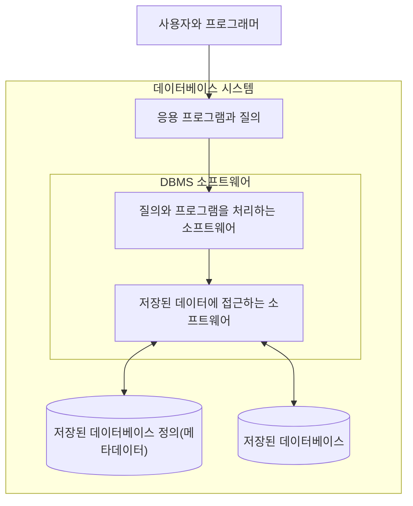



요약

도서관에는 책장에 꽂힌 책들이 있고, 책을 들이고 찾아 주는 사서가 있다. 서로 이어진 기록을 한데 모아 둔 것이 데이터베이스이고, 그 기록을 대신 만들고 찾고 고쳐 주는 프로그램이 DBMS다. 사람과 프로그램이 기록 파일을 직접 열지 않고 DBMS에 부탁하므로 여럿이 같은 기록을 함께 쓸 수 있다. 다만 아무 자료나 쌓아 둔 것은 데이터베이스가 아니고, 자료끼리 뜻이 이어지고 앞뒤가 맞아야 한다.

## 예시로 보기

학적과는 학생 명단을, 교무과는 성적을 각자 파일로 들고 있다고 하자. "A를 받은 학생의 전공"을 알려면 사람이 두 파일을 나란히 놓고 맞춰 봐야 한다. 같은 학생의 이름이 양쪽에 따로 적혀 있어서 한쪽만 고치면 서로 어긋난다[^s1]. 그래서 대학에 관한 기록을 한곳에 모으고, 그 기록을 다루는 일을 프로그램 하나에 맡긴다.

대학 데이터베이스(UNIVERSITY)를 예로 들자. 이 데이터베이스는 다섯 종류의 기록으로 되어 있다. 한 대상에 대한 값을 한 줄로 묶은 것을 레코드라 부른다. 아래 표의 한 행이 레코드 하나다. 칸은 표의 세로줄(열)이다.

| 표 | 무엇을 적나 | 칸 | 행 수 |
|---|---|---|---|
| STUDENT | 학생 | Name, Student_number, Class, Major | 2 |
| COURSE | 과목 | Course_name, Course_number, Credit_hours, Department | 4 |
| SECTION | 과목이 어느 학기에 열린 분반 | Section_identifier, Course_number, Semester, Year, Instructor | 6 |
| GRADE_REPORT | 학생이 분반에서 받은 성적 | Student_number, Section_identifier, Grade | 6 |
| PREREQUISITE | 먼저 들어야 하는 과목 | Course_number, Prerequisite_number | 3 |

표 다섯 개에 21행이 들어 있다. 이 가운데 세 표를 그대로 옮기면 이렇다.

**STUDENT**

| Name | Student_number | Class | Major |
|---|---|---|---|
| Smith | 17 | 1 | CS |
| Brown | 8 | 2 | CS |

**GRADE_REPORT**

| Student_number | Section_identifier | Grade |
|---|---|---|
| 17 | 112 | B |
| 17 | 119 | C |
| 8 | 85 | A |
| 8 | 92 | A |
| 8 | 102 | B |
| 8 | 135 | A |

**SECTION**

| Section_identifier | Course_number | Semester | Year | Instructor |
|---|---|---|---|---|
| 85 | MATH2410 | Fall | 07 | King |
| 92 | CS1310 | Fall | 07 | Anderson |
| 102 | CS3320 | Spring | 08 | Knuth |
| 112 | MATH2410 | Fall | 08 | Chang |
| 119 | CS1310 | Fall | 08 | Anderson |
| 135 | CS3380 | Fall | 08 | Stone |

"Brown이 A를 받은 과목은 무엇인가?"에 답하려면 표 셋을 거친다[^s1].

1. STUDENT에서 Brown을 찾는다. 학번이 8이다.
2. GRADE_REPORT에서 학번이 8이고 성적이 A인 줄을 고른다. 분반 85, 92, 135다.
3. SECTION에서 그 분반의 과목 번호를 읽는다. MATH2410, CS1310, CS3380이다.

성적표에는 학생 이름도 과목 번호도 없다. 학번과 분반 번호가 다른 표를 가리키고 있어서 답이 나온다. 표끼리 이렇게 이어져 있다는 것이 "서로 관련된 데이터"라는 말의 뜻이다.

도서관 비유는 여기까지만 맞다. 책은 한 사람이 빌려 가면 다른 사람이 못 보지만, 데이터베이스의 기록은 여러 사람이 같은 순간에 본다.

검증: 표 5개, 칸 18개, 21행, Brown이 A를 받은 과목 세 개, 네 가지 일(정의·구축·조작·공유), 카드 C3 — [01_database-and-dbms_verify.py](/Hongs_Blog/studies/database-design/code/01_database-and-dbms_verify/)

## 세 낱말

| 말 | 뜻 | 대학 예에서 |
|---|---|---|
| 데이터베이스 (DB) | 서로 관련된 데이터를 논리적으로 앞뒤가 맞게 모아 둔 것. DBMS가 관리한다 | 표 다섯 개와 거기 든 21행 |
| DBMS | 사용자가 데이터베이스를 만들고 유지하게 해 주는 컴퓨터 시스템. 한 가지 업무에만 쓰는 프로그램이 아니라 어떤 데이터베이스에나 쓰는 범용 소프트웨어다 | 다섯 표를 맡아 요청을 처리하는 프로그램 |
| 데이터베이스 시스템 | 데이터베이스 + DBMS 소프트웨어 | 둘을 합친 전체 |

DBMS는 데이터베이스 관리 시스템(database management system)을 줄인 말이다.

질의(query)는 "이런 데이터를 찾아 달라"고 DBMS에 보내는 요청이다. 사용자와 응용 프로그램은 맨 아래 두 통을 직접 건드리지 않는다. 요청은 반드시 가운데 DBMS 소프트웨어를 지난다. 왼쪽 통에는 "어떤 표가 있고 칸이 무엇인가" 같은 설명이, 오른쪽 통에는 실제 값이 들어 있다.

### DBMS가 돕는 네 가지 일

DBMS는 데이터베이스를 정의하고, 구축하고, 조작하고, 공유하는 일을 돕는 소프트웨어다. 대학 예로 풀면 이렇다[^s3].

| 일 | 무엇을 하나 | 대학 예 |
|---|---|---|
| 정의 (defining) | 어떤 데이터를 어떤 자료형과 구조로 둘지, 어떤 규칙을 지켜야 하는지 정한다 | STUDENT에는 Name, Student_number, Class, Major 칸이 있다고 정한다 |
| 구축 (constructing) | 정해 둔 틀에 실제 데이터를 채워 저장한다 | 위의 21행을 넣는다 |
| 조작 (manipulating) | 원하는 데이터를 찾고, 바뀐 사실에 맞게 고친다 | Brown의 A 과목을 찾는다. Smith의 학년을 2로 고친다 |
| 공유 (sharing) | 여러 사용자와 프로그램이 같은 데이터베이스를 함께 쓰게 한다 | 교무과와 학과 사무실이 같은 표를 본다 |

정의가 먼저다. 대학 예에서도 데이터를 넣기 전에 칸의 자료형과 표 사이의 관계부터 정해야 한다.

## 활용

- SQLite, PostgreSQL, MySQL, Oracle 같은 제품이 DBMS다. 이 문서의 검증 코드는 SQLite로 네 가지 일을 차례로 해 본다[^s3].
- 흔한 실수: DBMS 제품을 가리켜 "데이터베이스"라고 부르는 것. 일상 대화에서는 통하지만 시험에서는 가른다. 모아 둔 데이터가 데이터베이스이고, 그것을 관리하는 소프트웨어가 DBMS다.

## 연결

- 선수: [데이터와 메타데이터](/Hongs_Blog/studies/data-and-information/data-metadata/). 그림의 "저장된 데이터베이스 정의"가 메타데이터다.
- 파일을 프로그램마다 따로 두던 방식과 갈리는 점: [데이터베이스 방식의 네 가지 특징](/Hongs_Blog/studies/database-design/database-approach-characteristics/)
- 누가 쓰는가: [데이터베이스 사용자](/Hongs_Blog/studies/database-design/database-users/)
- DBMS가 대신 해 주는 일과 그 값: [DBMS의 기능과 쓰지 않을 때](/Hongs_Blog/studies/database-design/dbms-features/)
- 표의 틀과 그 안의 내용을 가르는 말: [스키마와 인스턴스](/Hongs_Blog/studies/database-design/schema-and-instance/)

## 확인 문제

**C1** 데이터베이스, DBMS, 데이터베이스 시스템을 각각 한 문장으로 말하라. DBMS가 돕는 네 가지 일은 무엇인가?

**답:** 데이터베이스는 서로 관련된 데이터를 논리적으로 앞뒤가 맞게 모아 둔 것이다. DBMS는 사용자가 데이터베이스를 만들고 유지하게 해 주는 범용 소프트웨어다. 데이터베이스 시스템은 데이터베이스와 DBMS 소프트웨어를 합친 것이다. 네 가지 일은 정의, 구축, 조작, 공유다. 
**흔한 오답:** 데이터베이스 시스템을 DBMS와 같은 말로 쓰는 것. 데이터가 빠지면 DBMS일 뿐이다.

**C2** 다음 넷을 데이터베이스, DBMS, 데이터베이스 시스템, 응용 프로그램으로 가르라. (a) 디스크에 저장된 학생·과목·성적 표들 (b) 그 표들을 맡아 요청을 처리하는 SQLite 같은 소프트웨어 (c) (a)와 (b)를 합친 것 (d) 학생이 쓰는 수강신청 화면

**답:** (a) 데이터베이스 (b) DBMS (c) 데이터베이스 시스템 (d) 응용 프로그램. 
**이유:** (a)는 모아 둔 데이터 자체다. (b)는 데이터가 아니라 데이터를 관리하는 소프트웨어다. (d)는 DBMS에 요청을 보내는 쪽이다. 위 그림에서 (d)는 데이터베이스 시스템 상자 안에 있지만 DBMS 소프트웨어 상자의 바깥이다.

**C3** 위의 세 표만 보고 Smith가 들은 과목 번호와 성적을 구하라. 표를 몇 개 거쳤는가?

**답:** MATH2410에서 B, CS1310에서 C. 표 셋을 거친다. 
**이유:** STUDENT에서 Smith의 학번 17을 찾는다. GRADE_REPORT에서 학번 17인 줄은 분반 112(B)와 119(C)다. SECTION에서 112는 MATH2410, 119는 CS1310이다. 성적표에 과목 번호가 없어서 SECTION까지 가야 한다.

[^s1]: 풀이의 값은 검증 코드로 확인했다.
[^s3]: 풀이는 같은 교재 1.1절을 따랐고, 대학 예와 제품 이름은 보탠 것이다. 네 가지 일은 검증 코드에서 SQLite로 차례로 해 보았다.

