

요약

집을 지을 때는 먼저 식구들에게 어떤 방이 필요한지 묻고, 종이에 평면도를 그리고, 그 뒤에야 자재와 시공 방법을 정한다. 데이터베이스도 쓸 사람에게 무엇을 저장할지 묻고, 그 내용을 그림으로 정리하고, 그림을 표로 옮기고, 마지막에 디스크에 어떻게 둘지 정한다. 이 순서를 지키면 앞의 두 단계는 어떤 제품을 쓰든 그대로 다시 쓸 수 있다. 반대로 묻는 단계를 대충 넘기면 표를 다 만든 뒤에 뜯어고치게 된다.

## 예시로 보기

"직원 관리 데이터베이스를 만들어 달라"는 말만 듣고 곧바로 표를 만들면 금방 막힌다. 직원 한 명이 프로젝트를 여러 개 맡을 수 있는지, 부서장이 언제부터 그 부서를 맡았는지도 적어야 하는지 모르기 때문이다. 이런 것은 쓸 사람에게 물어야 나온다.

회사 데이터베이스(COMPANY) 예에서 설계자가 묻고 정리한 내용은 이렇다. 데이터베이스에 담으려는 현실의 한 부분을 작은 세계(miniworld)라고 부른다.

- 회사는 부서로 나뉜다. 부서마다 겹치지 않는 이름과 번호가 있고, 위치가 여러 곳일 수 있고, 부서장이 있고, 부서장이 그 부서를 맡기 시작한 날이 있다.
- 부서는 프로젝트 여러 개를 관리한다. 프로젝트마다 겹치지 않는 이름과 번호, 위치 한 곳이 있다.
- 직원마다 이름, 사회보장번호(SSN), 주소, 급여, 성별, 생일, 맡은 프로젝트들을 적는다.
- 보험 때문에 직원의 부양가족도 적는다. 부양가족마다 이름, 성별, 생일, 직원과의 관계가 있다.

이 글이 첫 단계의 결과물이다. 둘째 단계는 이 글을 그림으로 바꾸고, 셋째 단계는 그 그림을 표 여섯 개로 바꾼다.

```mermaid
flowchart TD
    M(["작은 세계"]) --> R["1. 요구 수집과 분석"]
    R -->|"데이터 요구사항"| C["2. 개념 설계"]
    R -->|"기능 요구사항"| F["기능 분석"]
    C -->|"개념 스키마: ER 다이어그램"| L["3. 논리 설계 = 데이터 모델 사상"]
    F -->|"트랜잭션 설명"| A["응용 프로그램 설계"]
    L -->|"고른 DBMS의 모델로 쓴 스키마: 릴레이션들"| P["4. 물리 설계"]
    P --> I(["내부 스키마"])
    A --> T["트랜잭션 구현"]
    I --> T
    T --> G(["응용 프로그램"])
    subgraph indep["어떤 DBMS를 쓰든 같다"]
        R
        C
        F
    end
    subgraph spec["고른 DBMS에 따라 달라진다"]
        L
        P
        A
        T
    end
```

번호가 붙은 네 칸은 저장할 자료를 정하는 길이다. 번호가 없는 칸(기능 분석, 응용 프로그램 설계, 트랜잭션 구현)은 그 자료로 할 일을 정하는 길이다.

## 네 단계

| 단계 | 하는 일 | 결과물 | 관련 문서 |
|---|---|---|---|
| 1. 요구 수집과 분석 | 설계자가 쓸 사람들을 만나 무엇이 필요한지 듣고, 저장할 자료를 모아 정리한다 | 사용자의 자세한 요구사항(글) | 이 문서 |
| 2. 개념 설계 | 요구사항을 "저장할 대상, 대상에 적을 항목, 대상 사이의 관계"로 정리한다 | 개념 스키마(ER 다이어그램) | [ER 설계 절차](/Hongs_Blog/studies/database-design/er-design-steps/) |
| 3. 논리 설계 | 그림을 쓰려는 DBMS의 데이터 모델로 옮긴다. 이 문서 모음에서는 표(릴레이션)로 옮긴다 | 릴레이션 스키마 | [ER-관계형 사상 절차](/Hongs_Blog/studies/database-design/er-to-relational-mapping/) |
| 4. 물리 설계 | 디스크에 어떤 구조로 저장하고 어떤 길로 찾을지 정한다 | 내부 스키마 | [B-트리](/Hongs_Blog/studies/database-design/b-tree/) |

3단계 논리 설계는 영어로 LOGICAL DESIGN (DATA MODEL MAPPING)이라 적기도 해서, 데이터 모델 사상이라고도 부른다.

요구를 모을 때는 자료만 묻지 않는다. 그 자료에 어떤 일을 할지도 함께 정리한다. 이것이 기능 분석(functional analysis)이다. 사용자가 데이터베이스에 걸 연산을 적어 두는 일이고, "직원의 급여를 고친다", "부서별 직원 수를 뽑는다" 같은 것이 여기에 든다.

요구사항을 모으고 분석한 다음에야 개념 스키마를 만든다. 개념 설계는 다시 세 걸음으로 나뉜다. 개체 타입과 속성을 적고, 관계 타입과 그 비율을 정하고, 그림을 그린다.

검증: 단계의 순서, 결과물의 이름, "제품과 무관 / 제품에 매임"의 경계는 교재(Elmasri & Navathe)의 설계 과정 그림과 한 칸씩 손으로 맞췄다. 다이어그램은 문법 검사를 통과했다.

## 활용

- 개념 설계를 따로 두는 까닭: ER 다이어그램에는 표도 디스크도 나오지 않는다. 그래서 기술을 모르는 사용자와 함께 보면서 요구가 빠짐없이 들어갔는지, 서로 어긋나는 요구는 없는지 확인할 수 있다[^s2].
- 흔한 실수: 요구사항에서 곧바로 표를 만드는 것. "직원이 프로젝트를 여러 개 맡는다"를 직원 표의 열 하나에 넣으려다 막힌다. 그림에서 관계로 그려 두면 표로 옮기는 규칙이 따로 있다: [다대다·n항 관계 타입의 사상](/Hongs_Blog/studies/database-design/mapping-many-to-many-relationship/).

## 연결

- 단계마다 쓰는 데이터 모델이 다르다. 2단계는 사람이 이해하기 쉬운 모델(ER), 3단계는 DBMS가 받아들이는 모델(관계형), 4단계는 저장 구조를 적는 모델이다: [데이터 모델의 종류](/Hongs_Blog/studies/database-design/data-model-categories/)
- 4단계의 결과물인 내부 스키마가 놓이는 자리: [3단계 스키마 구조](/Hongs_Blog/studies/database-design/three-schema-architecture/). 설계 과정 그림에는 "conceptual schema"라는 말이 두 번 나온다. 2단계의 것은 ER 다이어그램이고, 3단계의 "Logical (Conceptual) Schema"는 고른 DBMS의 모델로 쓴 스키마다. 3단계 스키마 구조의 개념 단계에 놓이는 것은 뒤쪽이다.
- 2단계에서 쓰는 낱말들: [개체 타입과 개체 집합](/Hongs_Blog/studies/database-design/entity-type-and-set/), [관계 타입과 관계 집합](/Hongs_Blog/studies/database-design/relationship-type-and-set/)

## 확인 문제

**C1** 데이터베이스 설계의 네 단계를 순서대로 쓰고, 단계마다 무엇이 나오는지 쓰라.

**답:** ① 요구 수집과 분석 → 사용자의 자세한 요구사항 ② 개념 설계 → 개념 스키마(ER 다이어그램) ③ 논리 설계(데이터 모델 사상) → 고른 DBMS의 모델로 쓴 스키마(이 문서 모음에서는 릴레이션 스키마) ④ 물리 설계 → 내부 스키마. 
**이유:** 앞 단계의 결과물이 다음 단계의 입력이다. 요구사항이 없으면 그림을 못 그리고, 그림이 없으면 표로 옮길 것이 없다.

**C2** 위 다이어그램은 개념 설계와 논리 설계 사이에서 "어떤 DBMS를 쓰든 같다"(DBMS-independent)와 "고른 DBMS에 따라 달라진다"(DBMS-specific)를 가른다. 왜 하필 그 자리인가?

**답:** ER 다이어그램은 대상, 항목, 관계만 적고 어떤 DBMS의 데이터 모델도 쓰지 않는다. 논리 설계부터는 고른 DBMS가 받아들이는 모델(관계형이면 표)로 써야 한다. 그래서 그 사이가 경계다. 
**이유:** 제품을 바꾸면 3단계부터만 다시 하면 된다. 1~2단계의 요구사항과 그림은 그대로 쓴다. 흔한 오답은 "물리 설계만 제품에 매인다"인데, 표로 옮기는 3단계도 이미 관계형 DBMS를 쓰기로 정한 뒤의 일이다.

**C3** 다음은 각각 어느 단계의 일인가? (a) "부서장은 부서마다 한 명인가요?"라고 묻는다. (b) EMPLOYEE와 DEPARTMENT 사이에 MANAGES 마름모를 그린다. (c) DEPARTMENT 표에 Mgr_ssn 열을 넣는다. (d) 직원을 번호로 빨리 찾게 색인을 만든다.

**답:** (a) 1단계 요구 수집과 분석 (b) 2단계 개념 설계 (c) 3단계 논리 설계 (d) 4단계 물리 설계. 
**이유:** (b)와 (c)가 헷갈린다. 마름모는 그림의 기호이고, 열은 표의 것이다. "부서장"이라는 같은 사실이 2단계에서는 관계로, 3단계에서는 열로 적힌다.

[^s2]: Elmasri & Navathe, *Fundamentals of Database Systems* 7판, 3장(설계 과정 개요)의 설명이다.

