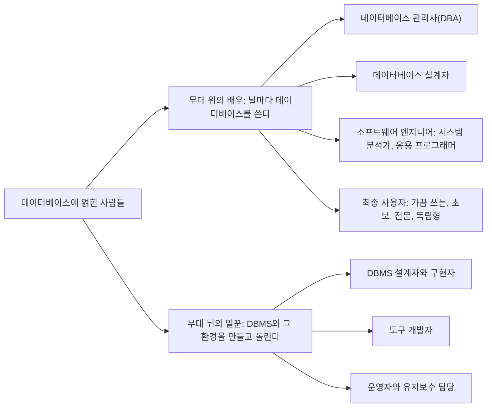



요약

혼자 쓰는 가계부라면 만드는 사람과 쓰는 사람이 같다. 대학이나 은행의 큰 데이터베이스에는 여러 부류의 사람이 붙는다. 연극에 빗대면, 무대에 올라 날마다 그 데이터베이스를 쓰는 사람들(관리하는 사람, 구조를 짜는 사람, 프로그램을 만드는 사람, 그 프로그램으로 일하는 사람)과 무대 뒤에서 관리 프로그램 자체와 도구를 만들고 기계를 돌리는 사람들로 갈린다. 무대 뒤 사람들은 데이터베이스에 무엇이 적혀 있는지에는 보통 관심이 없다.

## 예시로 보기

"데이터베이스 사용자"라고 하면 화면 앞에 앉은 사람만 떠오른다. 그런데 볼 권한은 누가 주고, 표는 누가 짰고, 화면은 누가 만들었는가? 역할을 가르지 않으면 누구에게 무엇을 맡길지 정할 수 없다.

대학의 수강신청 데이터베이스 하나에 얽힌 사람은 이렇다[^s1].

| 사람 | 하는 일 | 부류 |
|---|---|---|
| 전산원의 관리 담당 | 누가 어느 표를 볼 수 있는지 허락하고, 서버가 버티는지 살핀다 | 데이터베이스 관리자 |
| 학사 시스템을 처음 짠 사람 | 학과와 교무과의 요구를 듣고 학생·과목·분반·성적을 어떤 표로 둘지 정했다 | 데이터베이스 설계자 |
| 요구를 정리한 사람 | 교무과 직원에게 필요한 기능을 묻고 "수강신청 한 건은 이렇게 처리한다"를 문서로 적었다 | 시스템 분석가 |
| 프로그램을 짠 사람 | 그 문서대로 수강신청 프로그램을 만들고 시험하고 고친다 | 응용 프로그래머 |
| 수강신청하는 학생 | 화면에서 과목을 골라 담는다. 정해진 화면 밖의 일은 못 한다 | 초보 사용자 |
| 교무처장 | 학기마다 다른 통계를 한 번씩 물어본다 | 가끔 쓰는 사용자 |
| 학습 자료를 분석하는 연구자 | DBMS의 기능을 직접 써서 자기 분석 프로그램을 돌린다 | 전문 사용자 |
| DBMS 제품을 만든 회사의 개발자 | 어느 대학의 데이터인지 모른다. 여럿이 동시에 써도 엉키지 않게 하는 기능, 사고 뒤에 되돌리는 기능을 만든다 | 무대 뒤의 일꾼 |

위의 일곱은 이 데이터베이스를 날마다 쓰는 일이 직업이다. 마지막 한 명은 이 데이터베이스가 아니라 DBMS라는 소프트웨어를 만든다. 슬라이드는 앞쪽을 무대 위의 배우, 뒤쪽을 무대 뒤의 일꾼이라 부른다[^1].

## 두 무리

### 무대 위의 배우

큰 조직의 큰 데이터베이스에는 설계하고, 쓰고, 유지하는 데 많은 사람이 관여한다. 그 가운데 큰 데이터베이스를 날마다 쓰는 것이 일인 사람들을 배우(actors on the scene)라 한다[^1].

| 부류 | 하는 일 |
|---|---|
| 데이터베이스 관리자 (DBA) | 데이터베이스에 접근할 권한을 주고, 데이터베이스 시스템의 자원을 조정하고 지켜본다[^2] |
| 데이터베이스 설계자 | 데이터베이스에 저장할 데이터를 가려내고 그것을 담을 구조를 설계한다. 앞으로 쓸 사람 모두와 이야기해 요구를 알아내고, 그 요구에 맞는 설계를 만든다[^2] |
| 시스템 분석가 | 최종 사용자의 요구를 알아내고, 그 요구에 맞는 표준 트랜잭션을 어떻게 만들지 문서로 정한다[^2] |
| 응용 프로그래머 | 그 문서를 프로그램으로 구현한다. 트랜잭션을 시험하고, 고치고, 문서로 남기고, 유지한다[^2] |
| 최종 사용자 | 데이터베이스에 접근해야 하는 일을 하는 사람들. 아래 네 갈래다[^3] |

시스템 분석가와 응용 프로그래머를 묶어 소프트웨어 엔지니어(개발자)라 부른다. 이들은 DBMS가 할 수 있는 일을 두루 알아야 한다[^2]. 트랜잭션은 수강신청 한 건처럼 데이터베이스를 읽고 고치는 한 묶음의 일이다.

최종 사용자의 네 갈래[^3].

| 갈래 | 쓰는 방식 | 슬라이드의 예 |
|---|---|---|
| 가끔 쓰는 사용자 (casual) | 가끔 들어오지만 올 때마다 다른 정보를 찾는다 | — |
| 초보 사용자 (naive) | 미리 꼼꼼히 짜고 시험해 둔 표준 질의(찾기)와 갱신(고치기)만 쓴다 | 은행 창구 직원, 항공 예약 직원, SNS 사용자 |
| 전문 사용자 (sophisticated) | DBMS의 기능을 직접 써서 자기의 복잡한 요구에 맞는 응용을 만든다 | 엔지니어, 과학자, 경영 분석가 |
| 독립형 사용자 (standalone) | 메뉴나 그림 화면으로 쉽게 쓰는 기성 프로그램으로 개인 데이터베이스를 관리한다 | 개인 금융 자료를 저장하는 재무 프로그램 사용자 |

"초보"는 실력이 모자란다는 뜻이 아니다. 미리 짜 둔 화면만 쓴다는 뜻이다. 가끔 쓰는 사용자와 헷갈리기 쉬운데, 둘은 찾는 것이 정해져 있는가로 갈린다. 초보 사용자는 날마다 같은 종류의 일을 정해진 화면으로 한다. 가끔 쓰는 사용자는 드물게 오지만 올 때마다 새 질문을 던지므로 정해진 화면으로는 안 되고, 질의 언어로 직접 묻는다[^s2]. 초보 사용자가 쓰는 미리 짜 둔 표준 작업은 뒤의 슬라이드에서 canned transaction이라는 이름으로 다시 나온다[^4].

### 무대 뒤의 일꾼

배우 말고도 DBMS 소프트웨어와 시스템 환경을 설계하고, 개발하고, 돌리는 사람들이 있다. 이들은 보통 데이터베이스의 내용 자체에는 관심이 없다[^5].

| 부류 | 하는 일 |
|---|---|
| DBMS 설계자와 구현자 | DBMS를 이루는 모듈과 인터페이스를 설계하고 구현해 소프트웨어 패키지로 만든다. 모듈의 예: 질의 언어 처리, 인터페이스 처리, 데이터를 읽어 와 메모리에 잠시 담아 두기(버퍼링), 동시성 제어, 복구[^6] |
| 도구 개발자 | 데이터베이스를 편하게 다루게 해 주는 도구를 설계하고 구현한다. 예: 데이터베이스 모델링과 설계, 데이터베이스 시스템 설계, 성능 지켜보기, 시뮬레이션을 돕는 패키지[^6] |
| 운영자와 유지보수 담당 | 데이터베이스 시스템이 올라가는 하드웨어와 소프트웨어 환경을 돌리고 유지한다[^6] |

## 연결

- 선수: [데이터베이스와 DBMS](/Hongs_Blog/studies/database-design/database-and-dbms/). DBMS가 어떤 데이터베이스에나 쓰는 범용 소프트웨어라서, 그것을 만드는 사람은 특정 데이터베이스의 내용을 몰라도 된다.
- 사용자마다 쓰는 말과 화면이 다르다: [DBMS 언어와 인터페이스](/Hongs_Blog/studies/database-design/dbms-languages-interfaces/)
- 사용자마다 DBMS 안으로 들어오는 길, 구현자가 만드는 모듈: [DBMS 구성 모듈](/Hongs_Blog/studies/database-design/dbms-component-modules/)
- 데이터베이스 관리자가 주는 권한: [DBMS의 기능과 쓰지 않을 때](/Hongs_Blog/studies/database-design/dbms-features/)
- 설계자가 밟는 단계: [데이터베이스 설계 과정](/Hongs_Blog/studies/database-design/database-design-process/)

## 확인 문제

**C1** 무대 위의 배우 네 부류와 무대 뒤의 일꾼 세 부류를 쓰라. 최종 사용자는 다시 어떻게 갈리는가?

**답:** 배우는 데이터베이스 관리자(DBA), 데이터베이스 설계자, 소프트웨어 엔지니어(시스템 분석가와 응용 프로그래머), 최종 사용자다. 일꾼은 DBMS 설계자와 구현자, 도구 개발자, 운영자와 유지보수 담당이다. 최종 사용자는 가끔 쓰는 사용자, 초보 사용자, 전문 사용자, 독립형 사용자로 갈린다.

**C2** 다음 다섯 사람은 각각 어느 부류인가? (a) 은행 창구에서 입금 화면만 쓰는 직원 (b) 분기마다 다른 질문을 직접 던지는 임원 (c) 누가 급여 표를 볼 수 있는지 정하는 사람 (d) DBMS의 동시성 제어 모듈을 구현하는 개발자 (e) 사용자들의 요구를 듣고 어떤 데이터를 어떤 구조로 저장할지 정하는 사람

**답:** (a) 초보 사용자 (b) 가끔 쓰는 사용자 (c) 데이터베이스 관리자 (d) 무대 뒤의 일꾼 가운데 DBMS 설계자와 구현자 (e) 데이터베이스 설계자. 
**이유:** (a)와 (b)는 둘 다 최종 사용자지만, (a)는 미리 짜 둔 표준 작업만 쓰고 (b)는 올 때마다 찾는 것이 다르다. (d)만 특정 데이터베이스가 아니라 DBMS 소프트웨어를 만든다. 
**흔한 오답:** (e)를 데이터베이스 관리자로 답하는 것. 구조를 정하는 사람은 설계자이고, 관리자는 만들어진 데이터베이스의 권한과 자원을 맡는다.

**C3** 무대 뒤의 일꾼은 왜 데이터베이스의 내용에 관심이 없는가? 배우와 일꾼을 가르는 기준은 무엇인가?

**답:** 기준은 "어느 한 데이터베이스를 날마다 쓰는 것이 일인가"다. 일꾼이 만들고 돌리는 것은 DBMS 소프트웨어와 그 환경이다. DBMS는 어떤 데이터베이스에나 쓰는 범용 소프트웨어라서, 그 안에 학생 성적이 들었든 항공 예약이 들었든 만드는 일은 같다.

[^1]: 데이터베이스 설계 2회 강의 자료 「2-1_DB-users」, p.13 (Actors on the Scene: "people whose jobs involve the day-to-day use of a large database", Database Users 그림). 요약은 p.27. p.13의 왼쪽 그림에는 본문에 설명이 없는 Specialized Users가 하나 더 그려져 있다.
[^2]: 데이터베이스 설계 2회 강의 자료 「2-1_DB-users」, p.14 (DB Administrators, DB Designer, Software Engineers: System analysts, Application programmer)
[^3]: 데이터베이스 설계 2회 강의 자료 「2-1_DB-users」, p.15 (End Users: Casual, Naïve, Sophisticated, Standalone). 슬라이드에는 은행 창구 직원이 "back tellers"로 적혀 있다(bank의 오타).
[^4]: 데이터베이스 설계 2회 강의 자료 「2-2_DB-system-architecture」, p.32~33 (canned transaction)
[^5]: 데이터베이스 설계 2회 강의 자료 「2-1_DB-users」, p.16 (Workers behind the Scene: "typically not interested in the DB content itself"). p.27의 요약에는 "'Workers' on the scene"으로 적혀 있다(behind가 맞다).
[^6]: 데이터베이스 설계 2회 강의 자료 「2-1_DB-users」, p.17 (DBMS system designer and implementer, Tool developer, Operators and Maintenance Personnel)
[^s1]: 보충 수강신청 데이터베이스의 여덟 사람은 슬라이드에 없다. 슬라이드의 부류 설명(p.14~17)을 한 장면에 모아 보이려고 만들었다. 카드 C2의 다섯 사람도 같은 방식으로 만들었다.
[^s2]: 보충 "초보"의 뜻풀이, 가끔 쓰는 사용자가 질의 언어로 직접 묻는다는 설명은 슬라이드에 없다. Elmasri & Navathe, *Fundamentals of Database Systems* 7판 1.4.3절을 따랐다. 교재는 초보 사용자를 매개변수 사용자(parametric user)라고도 부르고, 가끔 쓰는 사용자로 중간·고위 관리자를 든다.

