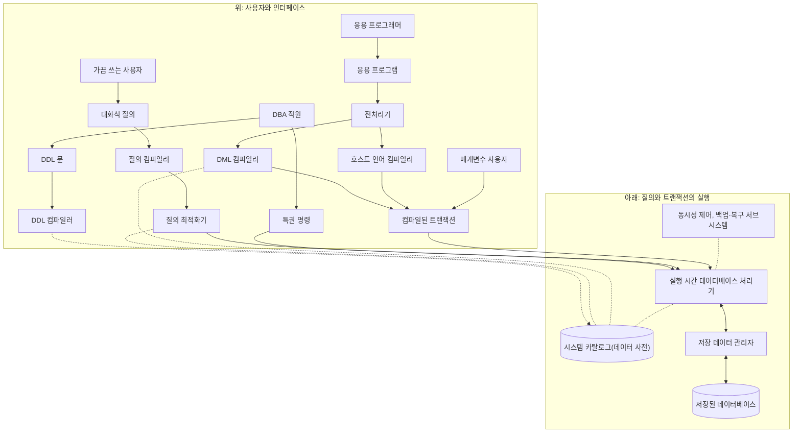


<div class="callout callout-summary" markdown="1">
<div class="callout-title callout-title--default" markdown="span">요약</div>

데이터베이스를 관리하는 프로그램(DBMS)은 한 덩어리가 아니라 일을 나눠 맡은 부품들의 모음이다. 구청 민원실에 빗대면, 사람마다 다른 창구로 서류를 내고, 서류는 번역과 정리를 거쳐 한 명의 처리 담당에게 모이고, 처리 담당은 창고지기를 거쳐서만 서류철을 꺼낸다. 누가 어느 창구로 들어오든 디스크를 만지는 길이 하나라서, 여럿이 동시에 쓰는 일과 사고 뒤에 되돌리는 일을 한곳에서 챙길 수 있다. 대신 간단한 요청도 여러 부품을 거쳐야 한다.

</div>


## 예시로 보기

"2008년 가을에 열린 분반을 달라"는 한 문장이 디스크의 바이트를 읽는 일로 바뀌기까지 할 일이 여럿이다. 문법이 맞는지 보고, 그런 표와 칸이 있는지 확인하고, 어느 길로 찾을지 고르고, 실제로 읽어야 한다. 이 일을 부품 하나가 다 하면 고치기 어렵고, 사람이 던진 요청과 프로그램 속에 든 요청을 따로따로 처리하게 된다. 그래서 일을 나눠 맡긴다.

아래 한 문장이 지나가는 길을 SQLite라는 DBMS에서 따라가면 이렇다[^s1].

```sql
SELECT Section_identifier FROM SECTION WHERE Semester = 'Fall' AND Year = '08';
```

| 차례 | 하는 일 | 맡는 모듈 | 직접 본 것 |
|---|---|---|---|
| 1 | 문법을 본다 | 질의 컴파일러 | SELECT를 SELEC으로 잘못 쓰면 여기서 걸린다 |
| 2 | 표와 칸이 있는지 본다 | 질의 컴파일러가 시스템 카탈로그를 읽는다 | 없는 표 SECTIONS, 없는 칸 Teacher를 쓰면 실행하기 전에 걸린다 |
| 3 | 내부 형태로 바꾼다 | 질의 컴파일러 | "표를 연다, 행을 내놓는다, 끝낸다" 같은 명령의 줄이 나온다 |
| 4 | 찾는 길을 고른다 | 질의 최적화기가 카탈로그를 읽는다 | 색인이 없으면 표를 훑고, 색인이 생기면 색인으로 찾는다 |
| 5 | 실행한다 | 실행 시간 데이터베이스 처리기 | 112, 119, 135 |
| 6 | 디스크에서 읽는다 | 저장 데이터 관리자 | 데이터베이스 파일은 크기가 같은 블록으로 나뉘어 있고, 표마다 시작하는 블록 번호가 카탈로그에 있다 |

4번에서 색인이 있든 없든 답은 같다. 문장을 적은 사람은 색인이 생겼는지 몰라도 된다.

<div class="callout callout-check" markdown="1">
<div class="callout-title" markdown="span">검증: 정의 문장이 카탈로그에 들어감, 문법이 틀린 질의와 없는 표·칸을 쓰는 질의가 실행 전에 걸림, 맞는 질의가 명령의 줄로 바뀜, 표를 적은 순서를 바꿔도 실행 계획이 같고 색인을 달면 계획이 바뀌며 답은 같음, 값만 바꿔 넣는 트랜잭션, 도중에 그만둔 트랜잭션의 되돌림, 파일 크기 = 블록 크기 × 블록 수 — [10_dbms-component-modules_verify.py](/Hongs_Blog/studies/database-design/code/10_dbms-component-modules_verify/)</div>

</div>


## 정확히 말하면

DBMS는 여러 소프트웨어 구성 모듈로 이루어진다. 구성을 그림으로 그리면 위아래 두 부분이다. 위쪽은 데이터베이스 환경의 여러 사용자와 그들의 인터페이스이고, 아래쪽은 데이터 저장과 트랜잭션 처리를 맡는 DBMS 안쪽 모듈이다.



점선은 카탈로그를 읽고 쓰는 길과 서브시스템이 붙는 자리다. 실선을 따라가면 특권 명령, 질의, 컴파일된 트랜잭션의 세 길이 모두 실행 시간 데이터베이스 처리기 하나로 모인다.

| 모듈 | 하는 일 |
|---|---|
| 저장 데이터 관리자 | 저장 장치에 있는 모든 데이터로 가는 접근을 다스린다. 데이터베이스의 사용자 데이터와 시스템 카탈로그의 메타데이터가 모두 여기를 거친다 |
| DDL 컴파일러 | DBA 직원이 DDL로 적은 스키마 정의를 처리하고, 스키마에 관한 메타데이터를 시스템 카탈로그에 저장한다. 예: 파일의 이름과 크기, 데이터 항목의 이름과 자료형, 파일의 저장 세부, 스키마 사이의 사상 정보 |
| 질의 컴파일러와 질의 최적화기 | 가끔 쓰는 사용자가 대화식으로 던진 질의를 받는다. ① 고수준 질의를 구문 분석한다 ② 내부 형태로 컴파일한다 ③ 순서를 다시 짜고 겹치는 일을 없애 질의를 최적화한다 ④ 필요한 연산을 하도록 실행 시간 데이터베이스 처리기를 부른다 |
| 전처리기와 DML 컴파일러 | 응용 프로그래머가 호스트 언어(C, C++, Java 등)로 짠 응용 프로그램에서 DML 명령(SQL)을 뽑아낸다. 뽑은 명령을 데이터베이스에 접근하는 목적 코드로 컴파일하고, 프로그램의 나머지 부분과 이어 붙인다. 이렇게 만들어진 것이 미리 짜 둔 트랜잭션(canned transaction)이고, 그 실행 코드 안에 실행 시간 데이터베이스 처리기를 부르는 자리가 들어 있다 |
| 실행 시간 데이터베이스 처리기 | 들어오는 것 세 가지를 처리한다. 특권 명령, 실행할 수 있게 된 질의 계획, 미리 짜 둔 트랜잭션. 시스템 카탈로그와 저장 데이터 관리자를 써서 일한다 |
| 동시성 제어, 백업·복구 서브시스템 | 트랜잭션 관리를 위해 실행 시간 데이터베이스 처리기의 동작 안에 끼워져 있다 |

호스트 언어는 SQL 문장을 품고 있는 바깥 프로그래밍 언어라는 뜻이다. 그림의 매개변수 사용자는 미리 짜 둔 트랜잭션에 값만 넣어 돌리는 사람으로, [데이터베이스 사용자](/Hongs_Blog/studies/database-design/database-users/)의 초보 사용자와 같은 부류다. 성적표 프로그램에 학번 17을 넣으면 두 줄이, 8을 넣으면 네 줄이 나오는 식이다[^s1].

### 한곳으로 모으면 얻는 것

- **카탈로그가 하나다.** DDL 컴파일러가 적어 둔 정의를 질의 컴파일러, 질의 최적화기, DML 컴파일러, 실행 시간 처리기가 모두 읽는다. 표에 칸을 더하거나 색인을 달면 다음 요청부터 모두가 새 정의를 본다. [데이터 독립성](/Hongs_Blog/studies/database-design/data-independence/)이 여기서 나온다.
- **디스크로 가는 문이 하나다.** 어느 사용자의 요청이든 저장 데이터 관리자를 지나야 데이터에 닿는다. 그래서 동시에 들어온 요청이 엉키지 않게 하는 일과, 도중에 그만둔 트랜잭션을 되돌리는 일을 실행 시간 처리기 한곳에서 챙길 수 있다. 성적 여섯 개를 고치다가 그만두면 여섯 개가 모두 원래 값으로 돌아온다[^s1].

## 연결

- 선수: [DBMS 언어와 인터페이스](/Hongs_Blog/studies/database-design/dbms-languages-interfaces/)(위쪽 상자들에 들어오는 문장), [데이터베이스 사용자](/Hongs_Blog/studies/database-design/database-users/)(위쪽 맨 윗줄의 사람들), [데이터베이스 방식의 네 가지 특징](/Hongs_Blog/studies/database-design/database-approach-characteristics/)(카탈로그)
- 질의 컴파일러가 하는 구문 분석, 내부 형태로 바꾸기, 최적화는 프로그래밍 언어의 컴파일러가 밟는 단계와 같은 꼴이다: [컴파일러의 구조](/Hongs_Blog/studies/compilers/compiler-structure/)
- 저장 데이터 관리자가 디스크에서 레코드를 찾을 때 쓰는 구조: [B-트리](/Hongs_Blog/studies/database-design/b-tree/)
- 동시성 제어가 막으려는 문제: [경쟁 조건과 임계 구역](/Hongs_Blog/studies/operating-systems/race-condition-critical-section/)

## 확인 문제

<details class="callout callout-question" markdown="1">
<summary class="callout-title" markdown="span">**C1** DBMS 구성 모듈 여섯 묶음과 각각 하는 일을 한 줄씩 쓰라.</summary>

**답:** ① 저장 데이터 관리자: 저장 장치의 모든 데이터(사용자 데이터와 카탈로그의 메타데이터)로 가는 접근을 다스린다. ② DDL 컴파일러: 스키마 정의를 처리해 메타데이터를 시스템 카탈로그에 저장한다. ③ 질의 컴파일러와 최적화기: 대화식 질의를 구문 분석하고, 내부 형태로 바꾸고, 최적화하고, 실행 시간 처리기를 부른다. ④ 전처리기와 DML 컴파일러: 응용 프로그램에서 DML 명령을 뽑아 목적 코드로 만들고 나머지와 이어 붙여 미리 짜 둔 트랜잭션을 만든다. ⑤ 실행 시간 데이터베이스 처리기: 특권 명령, 실행할 질의 계획, 미리 짜 둔 트랜잭션을 처리한다. ⑥ 동시성 제어, 백업·복구 서브시스템: 트랜잭션 관리를 위해 실행 시간 처리기에 끼워져 있다.

</details>


<details class="callout callout-question" markdown="1">
<summary class="callout-title" markdown="span">**C2** 그림을 보지 않고 다음 두 길을 모듈 이름으로 차례대로 적어라. (a) 가끔 쓰는 사용자가 던진 질의가 저장된 데이터베이스에 닿기까지 (b) 응용 프로그램 속에 든 SQL 문장이 저장된 데이터베이스에 닿기까지</summary>

**답:** (a) 대화식 질의 → 질의 컴파일러 → 질의 최적화기 → 실행 시간 데이터베이스 처리기 → 저장 데이터 관리자 → 저장된 데이터베이스. (b) 응용 프로그램 → 전처리기 → DML 컴파일러(나머지 코드는 호스트 언어 컴파일러) → 컴파일된 트랜잭션 → 실행 시간 데이터베이스 처리기 → 저장 데이터 관리자 → 저장된 데이터베이스.<br>
**이유:** 두 길은 앞쪽만 다르고 실행 시간 데이터베이스 처리기부터는 같다. (b)의 컴파일은 프로그램을 만들 때 한 번 하고, 그 뒤에는 매개변수 사용자가 값만 넣어 돌린다.

</details>


<details class="callout callout-question" markdown="1">
<summary class="callout-title" markdown="span">**C3** DDL 컴파일러가 시스템 카탈로그에 적어 둔 것을 질의 컴파일러와 질의 최적화기는 왜 읽어야 하는가?</summary>

**답:** 질의에 나온 표와 칸이 실제로 있는지, 자료형이 무엇인지 알아야 질의를 내부 형태로 바꿀 수 있다. 어떤 색인이 있는지 알아야 가장 나은 길을 고를 수 있다. 이 정보는 모두 DDL 컴파일러가 스키마 정의를 처리하며 카탈로그에 넣어 둔 것이다.<br>
**이유:** 카탈로그에 없는 표나 칸을 쓴 질의는 실행하기 전에 걸러지고, 색인을 달면 같은 질의의 실행 계획이 바뀐다[^s1].

</details>


[^s1]: 모듈과 SQLite 부품의 짝은 SQLite 문서의 구조 설명을 따랐다. 토크나이저·파서·코드 생성기가 질의 컴파일러와 최적화기의 일을, 바이트코드 엔진이 실행 시간 처리기의 일을, B-트리와 페이저가 저장 데이터 관리자의 일을 하고, sqlite_schema 표가 카탈로그다. SQLite는 응용 프로그램 안에 넣어 쓰는 작은 DBMS라서 그림의 전처리기 같은 부품은 따로 없다.

