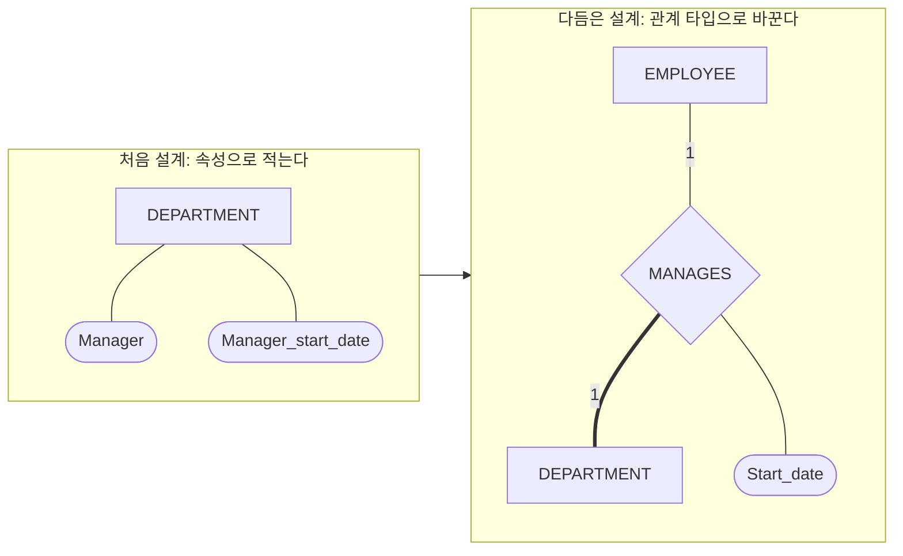



요약

요구사항을 적은 글을 그림으로 바꾸는 순서다. 먼저 글에서 저장할 대상과 대상마다 적을 항목을 빠짐없이 뽑되, 다른 대상을 가리키는 항목(직원의 "소속 부서")도 일단 항목으로 적어 둔다. 그다음 그런 항목을 골라내 대상 사이의 이어짐으로 바꾸고, 이어짐마다 몇 대 몇인지와 빠져도 되는지를 정한 뒤 그린다. 정답 그림은 하나가 아니어서, 요구사항이 말하지 않은 것을 어떻게 가정하느냐에 따라 그림이 달라진다.

## 예시로 보기

요구사항 글을 보면서 네모와 마름모를 곧바로 그리려 하면, 무엇이 네모이고 무엇이 마름모인지부터 막힌다. "부서장"은 부서의 항목인가, 직원과 부서 사이의 이어짐인가. 처음부터 가르려 하지 않고, 일단 다 항목으로 적어 놓고 나중에 가르면 쉽다.

COMPANY의 요구사항에서 "부서마다 부서장이 있고, 부서장이 부서를 맡기 시작한 날을 적는다"는 대목은 이렇게 두 번에 걸쳐 그림이 된다.

처음 설계의 Manager는 값이 직원이다. 다른 개체를 가리키는 속성이므로 다듬을 때 관계 타입 MANAGES로 바꾸고, 부서 네모에서는 지운다.

## 세 단계

ER 다이어그램은 세 단계로 설계한다.

1. **개체 타입과 속성을 적는다.** 요구사항에서 개체 타입을 찾고, 개체 타입마다 속성을 늘어놓는다. 키 속성, 복합 속성, 다치 속성을 표시한다. 다른 개체를 가리키는 것도 이 단계에서는 속성으로 적는다.
2. **관계 타입과 비율을 정한다.** 관계를 나타내는 속성을 관계 타입으로 바꾼다. 관계 타입마다 참여하는 개체 타입, 카디널리티 비율, 참여 제약, 관계에 붙는 속성을 정한다.
3. **ER 다이어그램을 그린다.**

**쓸 수 있는 때.** 요구사항이 "대상마다 무엇을 적는다"는 꼴의 글로 주어졌을 때다. [ER 다이어그램 설계 연습](/Hongs_Blog/studies/database-design/er-diagram-design-practice/)의 세 문제가 모두 이 꼴이다.

**관계 타입으로 바꿀 속성을 알아보는 신호.**

| 처음 설계에 적힌 모양 | 바꾼 뒤 | COMPANY와 연습의 예 |
|---|---|---|
| 값이 다른 개체 타입의 개체인 속성 | 두 개체 타입을 잇는 관계 타입 | PROJECT의 Controlling_department → CONTROLS |
| 값이 같은 개체 타입의 개체인 속성 | 재귀 관계 | EMPLOYEE의 Supervisor → SUPERVISION |
| 두 개체 타입에 서로 뒤집어 적힌 속성 한 쌍 | 관계 타입 하나 | MOVIE의 Production과 PRODUCTION의 {Produces} → PRODUCES |
| 성분이 "다른 개체 + 값"인 다치 속성 | M:N 관계 타입과 그 속성 | EMPLOYEE의 {Works_on(Project, Hours)} → WORKS_ON과 Hours |
| 키가 없는 개체 타입에 있는, 주인을 가리키는 속성 | 식별 관계. 그 개체 타입은 약한 개체 타입 | DEPENDENT의 Employee → DEPENDENTS_OF |

값이 개체가 아닌 속성은 여럿이어도 관계 타입이 되지 않는다. DEPARTMENT의 {Locations}는 위치를 개체 타입으로 두지 않았으므로 다치 속성으로 남는다.

## COMPANY로 따라가기

**1단계. 처음 설계.** 요구사항에서 뽑은 개체 타입 넷과 속성이다. 밑줄 대신 "(키)"로 적었다.

| 개체 타입 | 속성 |
|---|---|
| DEPARTMENT | Name (키), Number (키), {Locations}, Manager, Manager_start_date |
| PROJECT | Name (키), Number (키), Location, Controlling_department |
| EMPLOYEE | Name(Fname, Minit, Lname), Ssn (키), Sex, Address, Salary, Birth_date, Department, Supervisor, {Works_on(Project, Hours)} |
| DEPENDENT | Employee, Dependent_name, Sex, Birth_date, Relationship |

Name과 Number가 키인 까닭은 요구사항이 둘 다 겹치지 않는다고 했기 때문이다. Works_on은 직원이 프로젝트를 여럿 맡고 프로젝트마다 주당 시간을 적어야 해서 성분이 둘인 다치 속성이 되었다.

**2단계. 관계를 나타내는 속성을 관계 타입으로.** 다른 개체를 가리키는 속성은 여섯 개다(Manager, Controlling_department, Department, Supervisor, Works_on, Employee). 여기에 Manager_start_date를 더한 일곱 개가 관계 타입 여섯 개로 바뀐다.

| 관계 타입 | 없어지는 속성 | 잇는 개체 타입 | 비율 | 참여 | 관계에 붙는 속성 |
|---|---|---|---|---|---|
| MANAGES | DEPARTMENT의 Manager, Manager_start_date | EMPLOYEE, DEPARTMENT | 1:1 | EMPLOYEE 부분, DEPARTMENT 전체 | Start_date |
| WORKS_FOR | EMPLOYEE의 Department | EMPLOYEE, DEPARTMENT | 부서 1 : 직원 N | 양쪽 전체 | 없음 |
| CONTROLS | PROJECT의 Controlling_department | DEPARTMENT, PROJECT | 부서 1 : 프로젝트 N | PROJECT 전체, DEPARTMENT 부분 | 없음 |
| SUPERVISION | EMPLOYEE의 Supervisor | EMPLOYEE(상사), EMPLOYEE(부하) | 상사 1 : 부하 N | 양쪽 부분 | 없음 |
| WORKS_ON | EMPLOYEE의 Works_on(Project, Hours) | EMPLOYEE, PROJECT | M:N | 양쪽 전체 | Hours |
| DEPENDENTS_OF | DEPENDENT의 Employee | EMPLOYEE, DEPENDENT | 직원 1 : 부양가족 N | EMPLOYEE 부분, DEPENDENT 전체 | 없음 |

비율과 참여는 COMPANY의 요구사항에서 관계 타입마다 정한 값이다. DEPENDENT는 Employee를 떼고 나면 키가 없다. 그래서 약한 개체 타입이 되고 DEPENDENTS_OF가 식별 관계가 된다.

**3단계. 그리기.** 일곱 속성을 지우고 남은 속성과 관계 타입 여섯을 그리면 COMPANY의 완성 그림이 된다: [ER 다이어그램 표기법](/Hongs_Blog/studies/database-design/er-diagram-notation/)의 그림. 남는 개체 속성은 EMPLOYEE 여섯(Ssn, Name, Bdate, Address, Salary, Sex), DEPARTMENT 셋(Name, Number, {Locations})에 유도 속성 Number_of_employees, PROJECT 셋(Name, Number, Location), DEPENDENT 넷(Name, Sex, Birth_date, Relationship)이다.

검증: 가리키는 속성 6개 + Manager_start_date = 7개가 관계 타입 6개로 바뀌는 것, 7개를 지우면 완성 그림의 개체 속성이 남는 것, 설계 연습 세 문제의 같은 장부(PART_ORDER 3 → 3, MOVIE 7 → 4, CONF_REVIEW 4 → 3), 카드 C2·C5 — [31_er-design-steps_verify.py](/Hongs_Blog/studies/database-design/code/31_er-design-steps_verify/). 비율과 참여는 (min, max)로 그린 COMPANY 그림과 손으로 맞췄다.

### 스스로 설명해 보기

1. Manager_start_date가 DEPARTMENT에 남지 않고 MANAGES의 속성이 되는 근거

그 날짜는 "이 직원이 이 부서를 맡기 시작한 날"이다. 관리자와 부서의 짝에 붙은 값이다. Manager를 관계 타입으로 옮기면 날짜도 함께 가야 누구의 시작 날짜인지 뜻이 통한다. MANAGES가 1:1이라 부서나 직원 쪽으로 옮겨 적을 수도 있지만, 그림에서는 관계에 붙여 둔다.

2. {Works_on(Project, Hours)}가 M:N 관계 타입과 속성 Hours가 되는 근거

Works_on의 성분 Project는 값이 프로젝트 개체다. 그래서 EMPLOYEE와 PROJECT를 잇는 관계 타입이 된다. 다치 속성이었으니 직원 한 명에 프로젝트가 여럿이고, 프로젝트 쪽에서도 직원이 여럿이라 M:N이다. Hours는 직원과 프로젝트의 짝마다 하나씩 정해지므로 관계 타입의 속성이다. M:N이라 어느 개체로도 옮길 수 없다.

3. {Locations}가 관계 타입이 되지 않는 근거

Locations의 값은 위치 이름이고, 이 설계에서 위치는 개체 타입이 아니다. 가리킬 개체가 없으니 이을 것도 없다. 값이 여럿일 뿐이므로 다치 속성으로 남는다.

4. DEPENDENT가 약한 개체 타입이 되는 근거

Employee를 관계 타입으로 떼어 내면 Dependent_name, Sex, Birth_date, Relationship이 남는다. 이 가운데 회사 전체에서 겹치지 않는다고 할 수 있는 것이 없다. 주인 직원을 함께 대야 가려지므로 약한 개체 타입이고, Dependent_name이 부분 키다.

이 절차의 핵심 아이디어는?

다른 개체를 가리키는 속성은 속성이 아니라 관계라는 것이다. 처음에는 가리지 않고 다 적고, 다듬을 때 "값이 개체인가"만 물어서 골라낸다.

이 생각을 쓸 수 있는 다른 상황은?

표로 옮길 때 거꾸로 쓴다. 관계 타입은 표에서 다시 "상대 표의 행을 가리키는 열"이 된다. 그림에서 지웠던 Department가 EMPLOYEE 표의 Dno 열로 돌아온다.

## 대표 문제

풀이는 [ER 다이어그램 설계 연습](/Hongs_Blog/studies/database-design/er-diagram-design-practice/)에 있다.

- **PART_ORDER.** 직원이 고객의 부품 주문을 받는다. 처음 설계에서 {Takes_order}, {Places_order}, {Contains_part(Part, Specified_qty)} 셋이 관계를 나타내고, 각각 TAKES(1:N), PLACES(1:N), CONTAINS(M:N, 속성 Specified_qty)가 된다.
- **MOVIE.** 영화, 배우, 감독, 제작사. 처음 설계의 일곱 속성이 관계 타입 넷이 된다. 서로 뒤집어 적힌 속성 세 쌍을 하나씩으로 합치는 것이 요점이다.

## 활용

- 가정을 적어 둔다. 요구사항이 "한 편 이상"인지 "없어도 되는지"를 말하지 않으면 참여 제약을 정할 수 없다. 그럴 때는 가정을 적고 그린다. 가정이 다르면 그림도 다르다.
- 흔한 실수: 관계 타입으로 바꾼 속성을 개체 네모에 그대로 남겨 두는 것. 같은 사실이 그림에 두 번 적힌다.
- 흔한 실수: 서로 뒤집어 적힌 속성 한 쌍을 관계 타입 둘로 그리는 것. MOVIE의 Production과 PRODUCTION의 {Produces}는 같은 사실이다.
- 그림이 다 되면 표로 옮긴다: [ER-관계형 사상 절차](/Hongs_Blog/studies/database-design/er-to-relational-mapping/)

## 연결

- 이 절차가 전체 설계에서 놓인 자리(개념 설계): [데이터베이스 설계 과정](/Hongs_Blog/studies/database-design/database-design-process/)
- 2단계에서 정하는 것들: [카디널리티 비율](/Hongs_Blog/studies/database-design/cardinality-ratio/), [참여 제약](/Hongs_Blog/studies/database-design/participation-constraint/), [관계 타입의 속성](/Hongs_Blog/studies/database-design/relationship-attributes/), [(min, max) 표기](/Hongs_Blog/studies/database-design/min-max-notation/)
- 관계 타입이 표에서 열로 돌아오는 곳: [일대다 관계 타입의 사상](/Hongs_Blog/studies/database-design/mapping-one-to-many-relationship/), [참조 무결성 제약과 외래 키](/Hongs_Blog/studies/database-design/referential-integrity-foreign-key/)

## 자주 하는 오해

"EMPLOYEE 네모에 '부서 번호' 속성도 그려야 한다. EMPLOYEE 표에 Dno 열이 있으니까"

틀렸다. ER 다이어그램에서 직원이 어느 부서 사람인지는 마름모 WORKS_FOR가 적는다. 네모에 부서 번호 타원까지 그리면 같은 사실을 두 번 적는 것이다. 그럴듯해 보이는 까닭은 완성된 표를 먼저 떠올리기 때문이다. 표에는 실제로 Dno 열이 있다. 하지만 그 열은 그림을 표로 옮기는 단계에서 WORKS_FOR로부터 생긴다. 그림에는 아직 없다. 확인하는 법: 다듬은 COMPANY 그림의 EMPLOYEE에는 Ssn, Name, Bdate, Address, Salary, Sex 여섯 개만 붙어 있고 부서를 가리키는 타원이 없다. 처음 설계에 있던 Department는 다듬으면서 지운 것이다.

## 확인 문제

**C1** ER 다이어그램을 설계하는 세 단계를 쓰라. 처음 설계에서 관계는 어떤 모양으로 적히는가?

**답:** ① 요구사항에서 개체 타입과 속성을 적는다. ② 관계를 나타내는 속성을 관계 타입으로 바꾸고 비율과 참여를 정한다. ③ ER 다이어그램을 그린다. 처음 설계에서 관계는 "값이 다른 개체인 속성"으로 적힌다. 
**이유:** 1단계에서는 관계를 따로 찾지 않는다. 대상마다 적을 것을 빠짐없이 모으는 데만 마음을 쓴다.

**C2** 요구사항: "도서관 회원은 책을 여러 권 빌릴 수 있다. 책 한 권은 한 번에 한 회원만 빌린다. 빌린 날짜를 적는다." 처음 설계에서 MEMBER에 어떤 속성을 적는가? 다듬으면 어떤 관계 타입이 되는가? 빌린 날짜는 어디로 옮길 수 있는가?

**답:** 처음 설계: MEMBER에 {Borrows(Book, Borrow_date)}. 다듬으면 MEMBER와 BOOK을 잇는 BORROWS가 되고, 비율은 회원 1 : 책 N이다. Borrow_date는 BORROWS의 속성이다. 1:N이므로 N쪽인 BOOK으로 옮길 수 있다. MEMBER로는 옮길 수 없다. 
**이유:** 성분이 "다른 개체 + 값"인 다치 속성은 관계 타입과 그 속성이 된다. 책 한 권은 인스턴스 하나에만 끼므로 "이 책이 빌려 간 날"은 하나로 정해진다. 회원은 여러 권을 빌리므로 회원 쪽으로는 값이 여럿이다[^s3].

**C3** 처음부터 마름모를 그리지 않고, 관계를 일단 속성으로 적어 두었다가 나중에 바꾸는 까닭은 무엇인가?

**답:** 요구사항은 "부서마다 이름, 번호, 부서장을 적는다"처럼 대상별로 쓰여 있다. 그대로 대상별 항목으로 옮기면 빠뜨리는 것이 적다. 다 적고 나서야 어느 항목이 다른 대상을 가리키는지, 어느 두 항목이 같은 사실을 양쪽에서 적은 것인지가 한눈에 보인다. 
**이유:** 찾는 일과 가르는 일을 나누면 각각이 쉬워진다. 처음부터 가르려 하면 "부서장은 항목인가 이어짐인가"에서 멈추고, 그러는 동안 다른 항목을 놓친다[^s3].

**C4** MOVIE의 처음 설계에는 MOVIE의 Production과 PRODUCTION의 {Produces}가 둘 다 있다. 다듬을 때 이 둘을 관계 타입 PRODUCES 하나로 합치는 근거는 무엇인가?

**답:** 둘은 같은 사실을 양쪽에서 적은 것이다. "영화 m의 Production이 제작사 c다"와 "제작사 c의 Produces에 영화 m이 들어 있다"는 같은 말이다. 관계 인스턴스 (c, m) 하나가 두 속성 값을 모두 대신한다. 
**이유:** 관계 타입은 방향 없이 양쪽을 한 번에 잇는다. 둘을 따로 관계 타입으로 만들면 같은 사실이 두 번 저장되고, 한쪽만 고쳤을 때 서로 어긋난다.

**C5** 다음 속성은 다듬은 뒤에도 속성으로 남는가, 관계 타입이 되는가? (a) DEPARTMENT의 {Locations} (b) PROJECT의 Controlling_department (c) EMPLOYEE의 Address (d) EMPLOYEE의 Supervisor (e) MOVIE의 {Genre}

**답:** (a) 남는다(다치 속성). (b) 관계 타입 CONTROLS. (c) 남는다. (d) 관계 타입 SUPERVISION(재귀 관계). (e) 남는다(다치 속성). 
**이유:** 가르는 물음은 "값이 개체 타입의 개체인가"다. 값이 여럿인지는 상관없다. Locations와 Genre는 값이 여럿이지만 가리키는 개체가 없어 속성이다. 흔한 오답은 "다치 속성은 다 관계 타입이 된다"다.

[^s3]: C2와 C5의 답은 검증 코드로 확인했다.

