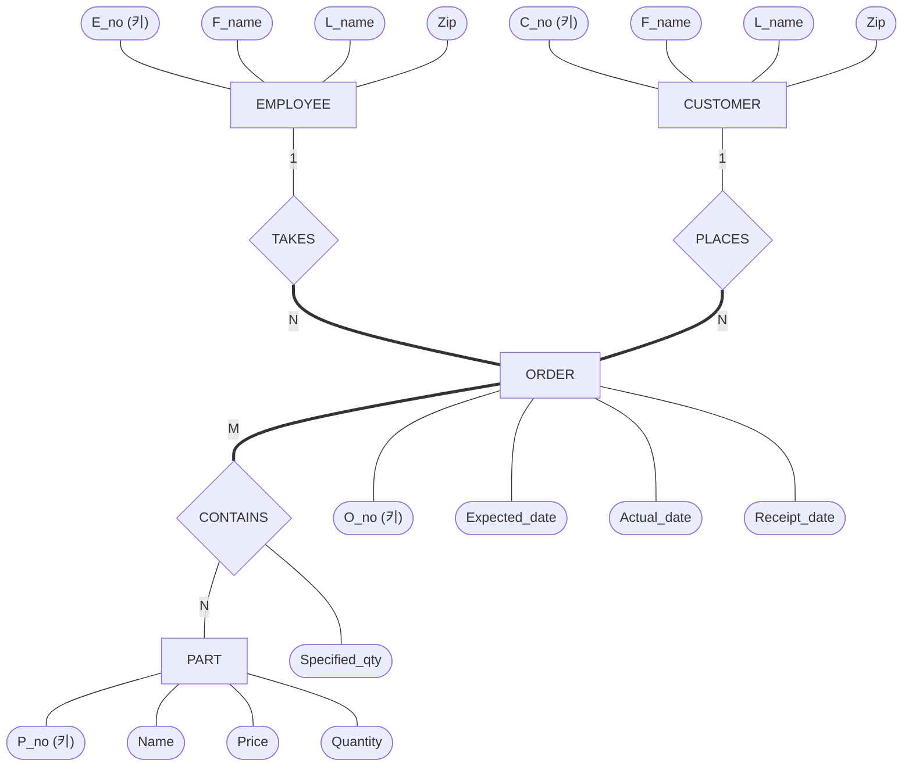
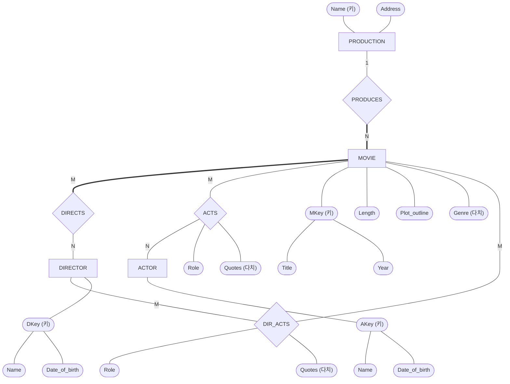
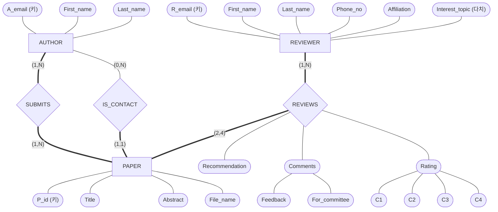


사용 개념: [ER 설계 절차](/Hongs_Blog/studies/database-design/er-design-steps/)의 세 단계, [관계 타입의 속성](/Hongs_Blog/studies/database-design/relationship-attributes/), [(min, max) 표기](/Hongs_Blog/studies/database-design/min-max-notation/).

"요구사항 글을 주고 ER 다이어그램을 그리라"는 문제는 늘 같은 하위목표를 밟는다. ① 개체 타입과 속성 적기(다른 개체를 가리키는 것도 속성으로) ② 그런 속성을 관계 타입으로 바꾸고 비율·참여·관계의 속성 정하기 ③ 그리기. 6주차 슬라이드의 세 문제를 차례로 푼다. 문제 1은 풀이를 다 보이고, 문제 2는 뒤쪽 하위목표를 비워 두고, 문제 3은 혼자 푼다.

## 문제 1 · 완전한 풀이: PART_ORDER

직원이 고객에게서 부품 주문을 받는 데이터베이스다[^1].

- EMPLOYEE: 직원은 겹치지 않는 직원 번호로 가려낸다. 이름(성, 이름)과 우편번호가 있다.
- CUSTOMER: 고객은 겹치지 않는 고객 번호로 가려낸다. 이름(성, 이름)과 우편번호가 있다.
- PART: 부품은 겹치지 않는 부품 번호로 가려낸다. 부품 이름, 값, 재고 수량이 있다.
- ORDER: 고객이 낸 주문은 직원 한 명이 받고, 겹치지 않는 주문 번호가 붙는다. 주문 하나에는 부품이 한 가지 이상, 부품마다 정한 수량만큼 들어 있다. 주문에는 접수 날짜, 예정 출하 날짜, 실제 출하 날짜가 있다.

1. *개체 타입과 속성 적기.* 다른 개체를 가리키는 것도 속성으로 적는다[^2].
   - EMPLOYEE: Employee_no (키), First_name, Last_name, Zip_code, {Takes_order}
   - CUSTOMER: Customer_no (키), First_name, Last_name, Zip_code, {Places_order}
   - PART: Part_no (키), Name, Price, Quantity
   - ORDER: Order_no (키), Expected_date, Actual_date, Receipt_date, {Contains_part(Part, Specified_qty)}
2. *관계를 나타내는 속성 고르기.* 값이 다른 개체인 것은 {Takes_order}, {Places_order}, {Contains_part(Part, Specified_qty)} 셋이다.
3. *관계 타입마다 비율과 참여 정하기*[^3].

| 관계 타입 | 잇는 개체 타입 | 요구사항의 문장 | 비율 | 참여 |
|---|---|---|---|---|
| TAKES | EMPLOYEE, ORDER | 직원 한 명이 주문을 여럿 받고, 주문은 직원 한 명이 받아야 한다 | 직원 1 : 주문 N | ORDER 전체 |
| PLACES | CUSTOMER, ORDER | 고객은 주문을 몇 개든 내고, 주문은 고객 한 명이 내야 한다 | 고객 1 : 주문 N | ORDER 전체 |
| CONTAINS | ORDER, PART | 주문에는 부품이 한 가지 이상 들어 있고, 부품은 여러 주문에 들어간다 | M:N | ORDER 전체 |

{: start="4"}
4. *관계의 속성 정하기.* Specified_qty는 (주문, 부품) 짝마다 하나다. M:N 관계 타입 CONTAINS의 속성이 되고 어느 개체로도 옮길 수 없다.
5. *그리기.*

굵은 선은 슬라이드 그림의 겹선(전체 참여)이다. PART의 Quantity는 재고 수량이고 CONTAINS의 Specified_qty는 주문한 수량이다. 둘은 다른 값이다.

원본 오류 의심

원문: 3단계 완성 그림에서 ORDER의 속성이 O_no, Quantity, Expected_date, Receipt_date다 (6주차 6-1 p.18, 풀이 p.18) / 문제점: Actual_date가 빠지고 그 자리에 Quantity가 있다. ORDER에는 수량 속성이 없다. 주문한 수량은 CONTAINS의 Specified_qty이고 재고 수량은 PART의 Quantity다. / 수정안: ORDER의 Quantity를 Actual_date로 바꾼다. / 근거: 같은 덱의 1단계 목록(p.12)과 1~2단계 그림(p.13, p.15~17)에서 ORDER의 속성은 O_no, Expected_date, Actual_date, Receipt_date다. 요구사항(p.11)에도 "The actual ship date is also recorded"가 있다.

검증: 관계를 나타내는 속성 셋이 관계 타입 셋으로 바뀌고, 지우고 나면 ORDER에 날짜 셋이 남는 것 — [31_er-design-steps_verify.py](/Hongs_Blog/studies/database-design/code/31_er-design-steps_verify/). 비율과 겹선은 풀이 슬라이드 p.15~18과 손으로 맞췄다.

## 문제 2 · 뒤쪽 하위목표가 빈칸: MOVIE

영화 산업의 자료를 적는 데이터베이스다[^4].

- MOVIE: 영화는 (제목, 개봉 연도)로 가려낸다. 상영 시간(분)과 줄거리가 있다. 장르가 하나 이상 있다(horror, action, drama, …). 영화마다 제작사가 하나, 감독이 한 명 이상, 출연 배우가 한 명 이상 있다. 영화에는 명대사가 0개 이상 있고, 명대사마다 그 영화에 나온 어느 배우가 한 말이다.
- ACTOR: 배우는 (이름, 생일)로 가려내고, 영화에 한 편 이상 나온다. 배우는 영화마다 맡은 역이 있다.
- DIRECTOR: 감독은 (이름, 생일)로 가려내고, 영화를 한 편 이상 연출한다. 감독이 영화에 배우로 나올 수도 있다(자기가 연출한 영화 포함).
- PRODUCTION: 제작사는 이름으로 가려내고 주소가 있다. 제작사는 영화를 한 편 이상 만든다.

1. *개체 타입과 속성 적기*[^5].
   - MOVIE: Mkey(Title, Year) (키), Length, Plot_outline, {Genre}, Production, {Directors}, {Actors}
   - ACTOR: Akey(Name, Date_of_birth) (키), {Acts_on(Movie, Role, {Quotes})}
   - DIRECTOR: Dkey(Name, Date_of_birth) (키), {Directs}, {Acts_on(Movie, Role, {Quotes})}
   - PRODUCTION: Name (키), Address, {Produces}
2. *관계를 나타내는 속성 고르기:* ______
3. *관계 타입마다 비율과 참여 정하기:* ______
4. *관계의 속성 정하기:* ______
5. *그리기:* ______

답

{: start="2"}
2. 값이 다른 개체인 속성은 일곱 개다. MOVIE의 Production, {Directors}, {Actors}, ACTOR의 {Acts_on}, DIRECTOR의 {Directs}와 {Acts_on}, PRODUCTION의 {Produces}. 이 가운데 세 쌍은 같은 사실을 양쪽에서 적은 것이다. Production과 {Produces}, {Directors}와 {Directs}, {Actors}와 ACTOR의 {Acts_on}. 쌍마다 관계 타입 하나가 되고, DIRECTOR의 {Acts_on}이 하나를 더해 모두 넷이다. {Genre}는 값이 개체가 아니라 다치 속성으로 남는다.
3. 풀이 슬라이드가 정한 값이다.

| 관계 타입 | 잇는 개체 타입 | 비율 | 참여 |
|---|---|---|---|
| PRODUCES | PRODUCTION, MOVIE | 제작사 1 : 영화 N | MOVIE 전체 |
| ACTS | ACTOR, MOVIE | M:N | 슬라이드는 묻기만 하고 답을 적지 않았다 |
| DIRECTS | DIRECTOR, MOVIE | M:N | MOVIE 전체 |
| DIR_ACTS | DIRECTOR, MOVIE | M:N | 양쪽 부분 |

{: start="4"}
4. Role과 {Quotes}는 (배우, 영화) 짝마다 정해진다. ACTS의 속성이다. Quotes는 값이 0개 이상이라 다치 속성이다. DIR_ACTS는 ACTS와 똑같이 Role과 {Quotes}를 갖는다.
5. 풀이 슬라이드의 완성 그림이다. 굵은 선은 겹선이다.

풀이는 슬라이드의 것이다[^6]. 하위목표 2의 "서로 뒤집은 쌍" 설명은 슬라이드의 속성 목록과 관계 타입 목록을 견주어 붙였다[^s1].

원본 오류 의심

원문: 완성 그림(6주차 6-1 풀이 p.26)에서 겹선은 MOVIE와 PRODUCES 사이, MOVIE와 DIRECTS 사이 둘뿐이다. ACTS는 양쪽 다 홑선이고, p.24는 MOVIE와 ACTS 사이에 "Total or partial participation?"이라고 묻기만 한다. / 문제점: 요구사항(p.19)은 "one or more actors appearing in it", 배우는 "appear in one or more movies", 감독은 "direct one or more movies", 제작사는 "produces one or more movies"라고 적었다. "한 편 이상", "한 명 이상"은 전체 참여다. 그림대로면 배우 없는 영화, 출연작 없는 배우, 연출작 없는 감독, 만든 영화 없는 제작사가 들어와도 막지 못한다. / 수정안: 요구사항을 그대로 따르면 ACTS의 양쪽, DIRECTS의 DIRECTOR 쪽, PRODUCES의 PRODUCTION 쪽도 겹선이다. DIR_ACTS만 양쪽 홑선이다("감독이 배우로 나올 수도 있다"). / 근거: 요구사항의 네 문장과, 네 가지 자료가 그림의 규칙은 통과하고 요구사항대로 그은 판에서는 걸리는 것을 문제 코드로 확인했다. 같은 그림에서 DIR_ACTS의 양쪽 글자가 둘 다 M인데, M:N이라는 뜻은 같다.

검증: 풀이 그림의 비율(PRODUCES 1:N, 나머지 M:N), 풀이 그림이 지켜 주는 문장 둘과 못 지키는 문장 넷 — [31_er-diagram-design-practice_p2.py](/Hongs_Blog/studies/database-design/code/31_er-diagram-design-practice_p2/). 일곱 속성이 관계 타입 넷이 되는 장부는 [31_er-design-steps_verify.py](/Hongs_Blog/studies/database-design/code/31_er-design-steps_verify/).

## 문제 3 · 혼자 풀기: CONF_REVIEW

학술대회에 연구자가 논문을 내고, 심사자가 심사한 내용을 적어 두었다가 논문을 뽑는 데 쓰는 데이터베이스다. 주로 심사자가 쓴다. 심사자는 맡은 논문마다 평가 항목에 답하고, 받아들일지 떨어뜨릴지 추천한다[^7].

- AUTHOR: 저자는 이메일로 가려낸다. 이름(성, 이름)이 있다.
- REVIEWER: 심사자는 이메일로 가려낸다. 이름(성, 이름), 전화번호, 소속, 관심 주제들이 있다.
- PAPER: 논문에는 시스템이 겹치지 않는 번호를 붙인다. 제목, 초록, 파일 이름이 있다.
  - 논문에는 저자가 여럿일 수 있고, 그 가운데 한 명을 연락 저자로 정한다.
  - 논문은 심사자 2명에서 4명에게 맡긴다.
  - 심사자는 맡은 논문마다 네 항목을 1~10점으로 매긴다: 기술적 가치, 읽기 쉬움, 독창성, 학술대회와의 관련성.
  - 심사자는 맡은 논문마다 전체 추천을 적는다.
  - 심사마다 글로 쓴 의견이 두 가지 있다. 하나는 심사 위원회만 보는 것이고, 하나는 저자에게 돌려주는 것이다.

ER 다이어그램을 그려라. 관계 타입에는 (min, max)를 적어라. 다 그렸으면 이 물음에도 답하라. "연락 저자인지"를 저자와 논문을 잇는 관계 타입의 속성으로만 두면 "논문마다 연락 저자가 한 명"이 지켜지는가?

답

*1단계. 개체 타입과 속성*
- AUTHOR: A_email (키), First_name, Last_name, {Submits_paper(Paper, Is_contact)}
- REVIEWER: R_email (키), First_name, Last_name, Phone_no, Affiliation, {Interest_topic}, {Reviews_paper(Paper, Recommendation, Comments(Feedback, For_committee), Rating(Technical_merit, Readability, Originality, Relevance))}
- PAPER: P_id (키), Title, Abstract, File_name, {Author}, {Reviewer}

*2단계. 관계 타입*

| 관계 타입 | 개체 타입 | (min, max) | 요구사항에서 읽은 것 |
|---|---|---|---|
| SUBMITS | AUTHOR | (1,N) | 저자는 논문을 한 편은 냈고, 여러 편 낼 수 있다 |
| | PAPER | (1,N) | 논문에는 저자가 한 명은 있고, 여럿일 수 있다 |
| IS_CONTACT | AUTHOR | (0,N) | 저자는 연락 저자가 아니어도 되고, 여러 논문의 연락 저자일 수 있다 |
| | PAPER | (1,1) | 논문마다 연락 저자는 정확히 한 명이다 |
| REVIEWS | REVIEWER | (1,N) | 심사자는 한 편은 심사하고, 여러 편 심사할 수 있다 |
| | PAPER | (2,4) | 논문은 심사자 2~4명이 심사한다 |

- {Submits_paper}와 PAPER의 {Author}는 같은 사실을 양쪽에서 적은 것이라 SUBMITS 하나가 된다. {Reviews_paper}와 {Reviewer}도 REVIEWS 하나가 된다.
- REVIEWS의 속성은 셋이다. Recommendation, 복합 속성 Comments(Feedback, For_committee), 복합 속성 Rating(네 항목). 모두 (심사자, 논문) 짝마다 정해진다.
- 물음의 답: 지켜지지 않는다. Is_contact를 SUBMITS의 속성으로 두면 그 값은 인스턴스마다 붙는 표시일 뿐이다. 한 논문의 저자 둘에 모두 표시가 붙어도, 아무에게도 안 붙어도 그림의 어떤 규칙도 어긋나지 않는다. 그래서 관계 타입 IS_CONTACT를 따로 만들고 PAPER 쪽에 (1,1)을 적는다. 그러면 연락 저자가 둘이거나 없는 논문은 (1,1)에 걸린다.

*3단계. 그림.* 굵은 선은 겹선이다.

C1~C4는 Rating의 네 항목(기술적 가치, 읽기 쉬움, 독창성, 관련성)이다. 풀이는 슬라이드의 것이다[^8].

그림이 적지 못하는 것이 하나 남는다. "연락 저자는 그 논문의 저자 가운데 한 명"이라는 조건이다. 그 논문을 내지 않은 사람이 IS_CONTACT로 이어져도 숫자쌍은 모두 지켜진다[^s2].

검증: 요구사항을 지키는 자료가 완성 그림의 (min, max)를 모두 지키는 것, Is_contact를 속성으로만 두면 연락 저자가 둘이거나 없어도 통과하고 IS_CONTACT를 두면 걸리는 것, 심사자가 1명·5명인 논문과 논문이 없는 심사자가 걸리는 것, 저자가 아닌 연락 저자는 통과하는 것 — [31_er-diagram-design-practice_p3.py](/Hongs_Blog/studies/database-design/code/31_er-diagram-design-practice_p3/)

원본 오류 의심

원문: 완성 그림 쪽의 제목 "Exercise 2: ER Schema Diagram (Cont'd)" (6주차 6-1 풀이 p.35) / 문제점: 그 쪽의 그림은 AUTHOR, REVIEWER, PAPER를 그린 CONF_REVIEW, 곧 연습 3의 3단계다. 연습 2는 MOVIE다. / 수정안: "Exercise 3". / 근거: 바로 앞 p.27~34의 제목이 모두 Exercise 3이고, 같은 개체 타입과 관계 타입을 다룬다.

SUBMITS의 PAPER 쪽 숫자쌍은 p.32에는 (1,M), p.35에는 (1,N)으로 적혀 있다. M과 N은 둘 다 "위 한계 없음"이라 뜻은 같다[^8].

**변형 문제.** 세 그림을 표로 옮기는 연습은 [ER-관계형 사상 예제 사다리](/Hongs_Blog/studies/database-design/er-mapping-ladder/)에 있다.

[^1]: 데이터베이스 설계 6회 강의 자료 「6-1_ER-diagram-solution」, p.11 (Exercise 1: Design ER diagram for PART_ORDER Database)
[^2]: 데이터베이스 설계 6회 강의 자료 「6-1_ER-diagram-solution」, p.12~13 (Step 1: Describing the Entity Types)
[^3]: 데이터베이스 설계 6회 강의 자료 「6-1_ER-diagram-solution」, p.14~18 (Step 2: TAKES, PLACES, CONTAINS. Step 3: Drawing the ER Diagram). 6-1_ER-diagram.pdf의 p.11~18도 같은 내용이다.
[^4]: 데이터베이스 설계 6회 강의 자료 「6-1_ER-diagram-solution」, p.19 (Exercise 2: Design ER Diagram for MOVIE Database)
[^5]: 데이터베이스 설계 6회 강의 자료 「6-1_ER-diagram-solution」, p.20~21 (Step 1: MOVIE, ACTOR, DIRECTOR, PRODUCTION의 속성)
[^6]: 데이터베이스 설계 6회 강의 자료 「6-1_ER-diagram-solution」, p.22~26 (Step 2: PRODUCES, ACTS, DIRECTS, DIR_ACTS. Step 3: 완성 그림)
[^7]: 데이터베이스 설계 6회 강의 자료 「6-1_ER-diagram-solution」, p.27~28 (Exercise 3: Design ER Diagram for CONF_REVIEW Database). 6-1_ER-diagram.pdf p.25~27에서는 숙제로 냈다.
[^8]: 데이터베이스 설계 6회 강의 자료 「6-1_ER-diagram-solution」, p.29~35 (Step 1: AUTHOR, REVIEWER, PAPER. Step 2: SUBMITS, IS_CONTACT, REVIEWS. Step 3: 완성 그림)
[^s1]: 보충 하위목표의 이름, 문제 2에서 비워 둔 자리, "서로 뒤집은 쌍"이라는 설명, DIR_ACTS의 참여(양쪽 부분)는 원본에 없다. DIR_ACTS의 참여는 요구사항의 "It is possible for a director to act in a movie"와 완성 그림의 홑선에서 읽었다.
[^s2]: 보충 문제 3 끝의 물음은 풀이 슬라이드 p.32의 "Does this design satisfy the following requirement?"를 옮긴 것이고, 답의 풀이와 "연락 저자가 그 논문의 저자여야 한다는 조건은 그림에 안 적힌다"는 관찰은 원본에 없다. 문제 코드로 확인했다.

