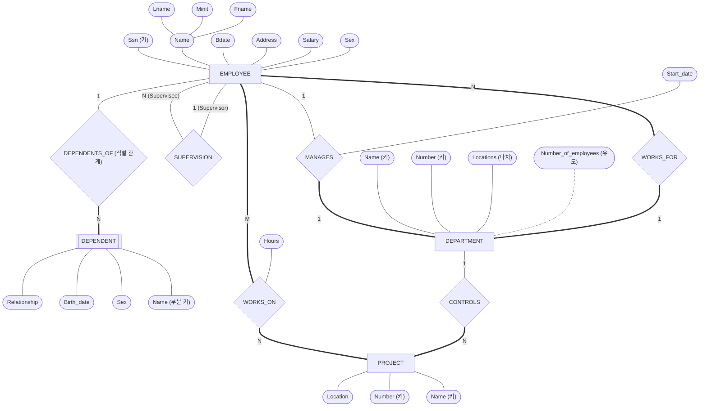



요약

지하철 노선도처럼, 약속된 기호 몇 개로 데이터베이스의 틀을 한 장에 그린 그림이다. 네모는 저장할 대상, 마름모는 대상 사이의 이어짐, 타원은 대상에 적을 항목이고, 겹으로 그린 것과 밑줄에는 저마다 특별한 뜻이 있다. 그림에는 틀만 그리고 실제 자료는 그리지 않는다. 책과 도구마다 약속이 조금씩 달라 같은 숫자가 반대쪽에 붙기도 하므로, 어떤 약속으로 그린 그림인지부터 확인해야 한다.

## 예시로 보기

요구사항을 글로만 적어 두면 "부서와 프로젝트가 몇 대 몇인지"를 찾으려고 문단을 다시 읽어야 한다. 그림 한 장이면 선 하나를 보면 된다.

COMPANY 데이터베이스 전체를 그린 그림이다.

네모 넷이 개체 타입, 마름모 여섯이 관계 타입, 둥근 칸이 속성이다. 굵은 선은 ER 다이어그램의 겹선을 대신한다[^s1].

## 기호와 뜻

ER 다이어그램의 기호를 표로 모으면 이렇다. 오른쪽 칸은 이 문서 모음의 그림이 같은 것을 어떻게 적는지다[^s1].

| ER 다이어그램의 기호 | 뜻 | 이 문서 모음의 그림 |
|---|---|---|
| 네모 | 개체 타입 | 네모 |
| 겹네모 | 약한 개체 타입 | 겹네모 |
| 마름모 | 관계 타입 | 마름모 |
| 겹마름모 | 식별 관계 | 마름모에 "(식별 관계)" |
| 타원 | 속성 | 둥근 칸 |
| 이름에 밑줄 친 타원 | 키 속성 | 이름 뒤에 "(키)" |
| 겹타원 | 다치 속성 | 이름 뒤에 "(다치)" |
| 타원에 작은 타원들을 붙임 | 복합 속성 | 둥근 칸에 성분 칸을 붙임 |
| 점선 타원 | 유도 속성 | 이름 뒤에 "(유도)", 점선 |
| 네모와 마름모 사이의 겹선 | 그 개체 타입의 전체 참여 | 굵은 선 |
| 마름모 양쪽 선의 1, N | 카디널리티 비율 | 선 위의 글자 |

기호표에는 없지만 COMPANY 그림에 쓰인 것이 둘 더 있다. 약한 개체 타입의 부분 키는 이름에 점선 밑줄을 긋는다. 재귀 관계에서는 선에 역할 이름(Supervisor, Supervisee)을 적는다.

**읽는 법.** 그림의 한 조각을 문장으로 옮기면 이렇다.

- `EMPLOYEE ═N═ WORKS_FOR ═1═ DEPARTMENT`: 부서 하나에 직원 여럿, 직원 한 명에 부서 하나. 양쪽 다 겹선이라 부서 없는 직원도, 직원 없는 부서도 안 된다.
- `EMPLOYEE ─1─ MANAGES ═1═ DEPARTMENT`와 Start_date: 부서마다 관리자가 꼭 한 명 있다. 직원은 부서를 많아야 하나 관리하고, 관리하지 않아도 된다. 관리를 시작한 날은 관계에 적는다.
- DEPARTMENT의 Name과 Number에 따로 밑줄: 둘 다 혼자서 부서를 가려낸다.

**숫자를 적는 두 가지 방식.** COMPANY 그림은 두 방식으로 그릴 수 있다. 한 방식은 위처럼 1, N, M과 겹선으로 적는다. 다른 방식은 선마다 (min, max) 숫자쌍과 역할 이름을 적는다. 두 방식은 숫자가 놓이는 쪽이 서로 반대다: [(min, max) 표기](/Hongs_Blog/studies/database-design/min-max-notation/)

검증: 그림의 개체 타입 넷, 관계 타입 여섯, 숫자와 겹선은 교재(Elmasri & Navathe)의 COMPANY ER 그림과 한 칸씩 손으로 맞췄다. 여섯 관계의 숫자·겹선이 (min, max)로 그린 COMPANY 그림에서 뽑은 값과 같은 것은 [30_min-max-notation_verify.py](/Hongs_Blog/studies/database-design/code/30_min-max-notation_verify/)로 확인했다. 다이어그램은 문법 검사를 통과했다.

## 활용

- ER 다이어그램은 틀(스키마)을 그린다. 개체나 관계 인스턴스는 그리지 않는다. 틀은 드물게 바뀌고, 개체 집합의 내용은 자주 바뀌기 때문이다.
- 흔한 실수 세 가지. ① 겹선을 긋는 쪽을 뒤집는다(전체 참여하는 개체 타입 쪽 선이 겹선이다). ② 키가 아닌 속성에 밑줄을 긋는다(밑줄은 키 속성에만 긋는다). ③ 다른 개체를 가리키는 속성(직원의 "소속 부서")을 타원으로 남겨 둔 채 마름모도 그린다(마름모가 그 일을 하므로 타원은 지운다).
- 이 표기는 교재(Elmasri & Navathe)의 것이다. 다른 책이나 도구의 그림은 기호가 다를 수 있다.

## 연결

- 기호 하나하나의 뜻: [개체 타입과 개체 집합](/Hongs_Blog/studies/database-design/entity-type-and-set/), [속성의 종류](/Hongs_Blog/studies/database-design/er-attribute-types/), [키 속성](/Hongs_Blog/studies/database-design/key-attribute/), [관계 타입과 관계 집합](/Hongs_Blog/studies/database-design/relationship-type-and-set/), [카디널리티 비율](/Hongs_Blog/studies/database-design/cardinality-ratio/), [참여 제약](/Hongs_Blog/studies/database-design/participation-constraint/), [약한 개체 타입](/Hongs_Blog/studies/database-design/weak-entity-type/)
- 그림을 그려 가는 순서: [ER 설계 절차](/Hongs_Blog/studies/database-design/er-design-steps/)
- 틀과 내용을 가르는 생각: [스키마와 인스턴스](/Hongs_Blog/studies/database-design/schema-and-instance/)
- 이 그림을 표 여섯 개로 옮기는 법: [ER-관계형 사상 절차](/Hongs_Blog/studies/database-design/er-to-relational-mapping/)

## 확인 문제

**C1** COMPANY 그림에서 `DEPARTMENT ─1─ CONTROLS ═N═ PROJECT` 조각을 문장으로 옮겨라(═는 겹선). 비율과 양쪽의 참여를 모두 말하라.

**답:** 부서 하나는 프로젝트를 여러 개 관리할 수 있고, 프로젝트 하나는 한 부서만 관리한다(1:N). 프로젝트는 반드시 관리 부서가 있다(PROJECT 전체 참여). 프로젝트를 하나도 관리하지 않는 부서가 있어도 된다(DEPARTMENT 부분 참여). 
**이유:** PROJECT 옆의 N은 "부서 하나에 프로젝트 여럿"이고, 겹선은 PROJECT 쪽에 있으므로 PROJECT가 전체 참여다. 겹선을 "부서가 반드시 프로젝트를 가진다"로 읽으면 뒤집어 읽은 것이다.

**C2** 겹네모, 겹마름모, 겹타원, 겹선은 모두 "겹"이다. 각각 무엇을 나타내는가? COMPANY 그림에서 하나씩 찾으라.

**답:** 겹네모는 약한 개체 타입(DEPENDENT), 겹마름모는 식별 관계(DEPENDENTS_OF), 겹타원은 다치 속성(DEPARTMENT의 Locations), 겹선은 전체 참여(예: EMPLOYEE와 WORKS_FOR 사이)다. 
**이유:** 넷은 서로 다른 것을 나타낸다. "겹은 다 전체 참여"나 "겹은 다 약한 것"으로 묶으면 틀린다. 겹타원은 값이 여럿이라는 뜻이고 약한 개체와 상관없다.

**C3** COMPANY 그림만 보고 답하라. (a) 키 속성이 둘인 개체 타입 (b) 속성이 붙은 관계 타입과 그 속성 (c) 유도 속성 (d) 복합 속성과 그 성분

**답:** (a) DEPARTMENT(Name, Number)와 PROJECT(Name, Number). (b) MANAGES의 Start_date, WORKS_ON의 Hours. (c) DEPARTMENT의 Number_of_employees. (d) EMPLOYEE의 Name(Fname, Minit, Lname). 
**이유:** 밑줄(키), 마름모에 붙은 타원(관계 타입의 속성), 점선 타원(유도), 타원에 붙은 작은 타원들(복합)을 찾으면 된다. DEPENDENT의 Name은 점선 밑줄이라 키가 아니라 부분 키다.

[^s1]: Mermaid는 밑줄, 겹타원, 겹마름모, 겹선을 그리지 못해 표의 오른쪽 칸처럼 바꿔 적었다.

