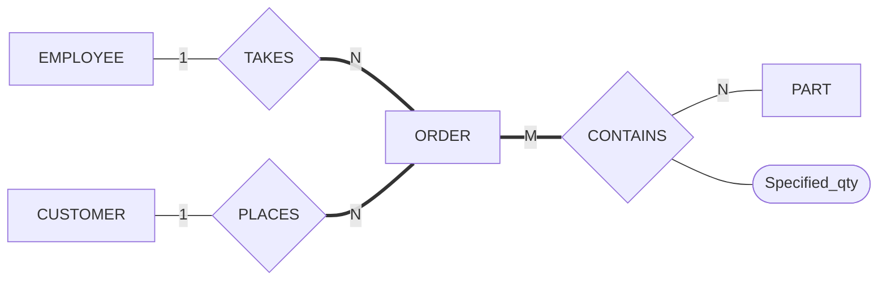
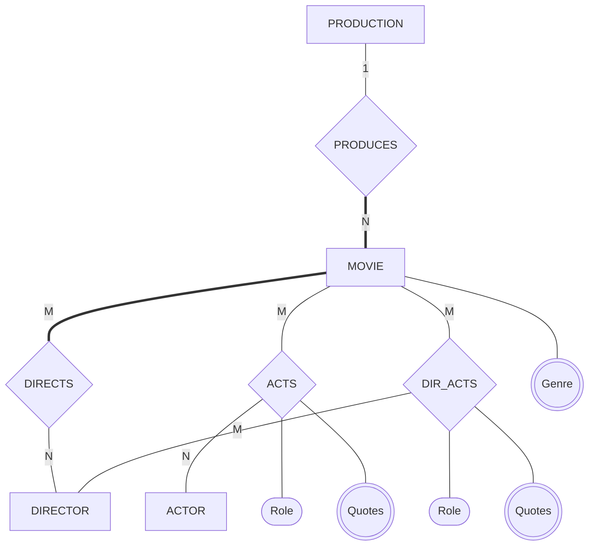
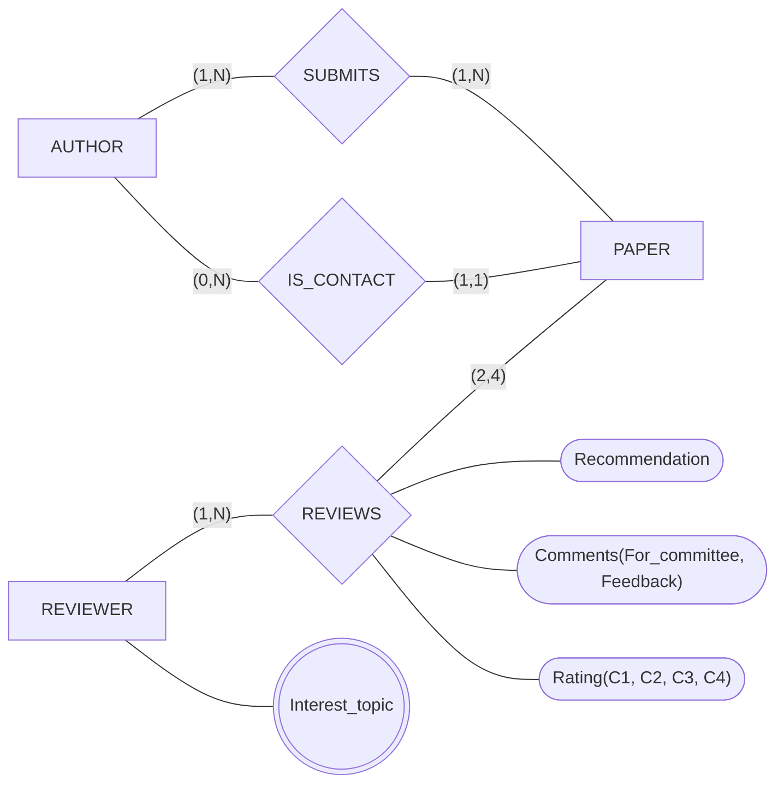


사용 개념: [ER-관계형 사상 절차](/Hongs_Blog/studies/database-design/er-to-relational-mapping/)와 단계별 문서 다섯 개.

"이 ER 그림을 릴레이션으로 옮겨라"는 문제는 늘 같은 하위목표를 순서대로 밟는다. ① 일반 개체 타입 ② 약한 개체 타입 ③ 다치 속성 ④ 1:1 관계 타입 ⑤ 1:N 관계 타입 ⑥ M:N·n항 관계 타입 ⑦ 세어서 확인. 그림에 없는 요소의 단계는 건너뛴다. ⑦에서는 릴레이션 수와 외래 키 수를 그림에서 미리 센 값과 맞춰 본다.

문제 2~4의 ER 그림은 6주차 ER 설계 연습의 답이다. 그 그림을 릴레이션으로 옮긴 답은 슬라이드에 없다[^s1]. 아래 그림에서 굵은 선은 전체 참여, 가는 선은 부분 참여, 겹동그라미는 값이 여럿인 속성이다.

## 문제 1 · 완전한 풀이

COMPANY의 ER 그림을 릴레이션으로 옮겨라. 그림은 [ER-관계형 사상 절차](/Hongs_Blog/studies/database-design/er-to-relational-mapping/)에 있다. 개체 타입 넷(EMPLOYEE, DEPARTMENT, PROJECT, 약한 개체 DEPENDENT), 관계 타입 여섯(WORKS_FOR 1:N, MANAGES 1:1, CONTROLS 1:N, SUPERVISION 1:N, WORKS_ON M:N, 식별 관계 DEPENDENTS_OF), 다치 속성 하나(Locations)다[^1].

1. *① 일반 개체 타입:* EMPLOYEE(Fname, Minit, Lname, **Ssn**, Bdate, Address, Sex, Salary), DEPARTMENT(Dname, **Dnumber**), PROJECT(Pname, **Pnumber**, Plocation). 복합 속성 Name은 성분 셋만 들어간다.
2. *② 약한 개체 타입:* DEPENDENT(**Essn**, **Dependent_name**, Sex, Bdate, Relationship). 주인 EMPLOYEE의 Ssn을 Essn으로 넣는다. 식별 관계 DEPENDENTS_OF는 이것으로 옮겨졌다.
3. *③ 다치 속성:* DEPT_LOCATIONS(**Dnumber**, **Dlocation**). Dnumber는 DEPARTMENT를 가리킨다.
4. *④ 1:1 관계 타입:* MANAGES. 전체 참여인 DEPARTMENT에 Mgr_ssn과 관계의 속성 Mgr_start_date를 넣는다.
5. *⑤ 1:N 관계 타입:* WORKS_FOR는 N쪽 EMPLOYEE에 Dno, SUPERVISION은 부하 쪽 EMPLOYEE에 Super_ssn, CONTROLS는 N쪽 PROJECT에 Dnum.
6. *⑥ M:N·n항 관계 타입:* WORKS_ON(**Essn**, **Pno**, Hours). n항 관계 타입은 없다.
7. *⑦ 세어서 확인:* 릴레이션 = 일반 개체 3 + 약한 개체 1 + 다치 속성 1 + M:N 1 = 6개. 외래 키 = 약한 개체 1 + 다치 속성 1 + 1:1 1 + 1:N 3 + M:N 2 = 8개. 옮긴 결과도 릴레이션 6개, 외래 키 8개(Essn, Dnumber, Mgr_ssn, Dno, Super_ssn, Dnum, WORKS_ON의 Essn과 Pno)다.

검증 — [44_er-to-relational-mapping_verify.py](/Hongs_Blog/studies/database-design/code/44_er-to-relational-mapping_verify/)

## 문제 2 · 마지막 하위목표만 빈칸

부품 주문 데이터베이스 PART_ORDER다. 직원이 고객의 주문을 받고, 주문 하나에 부품이 여러 가지 들어간다[^2].

| 개체 타입 | 속성 |
|---|---|
| EMPLOYEE | E_no(키), F_name, L_name, Zip |
| CUSTOMER | C_no(키), F_name, L_name, Zip |
| PART | P_no(키), Name, Price, Quantity |
| ORDER | O_no(키), Receipt_date, Expected_date, Actual_date |

1. *① 일반 개체 타입:* EMPLOYEE(**E_no**, F_name, L_name, Zip), CUSTOMER(**C_no**, F_name, L_name, Zip), PART(**P_no**, Name, Price, Quantity), ORDER(**O_no**, Receipt_date, Expected_date, Actual_date).
2. *②~④:* 약한 개체 타입, 다치 속성, 1:1 관계 타입이 없다.
3. *⑤ 1:N 관계 타입:* TAKES와 PLACES 모두 ORDER가 N쪽이다. ORDER에 E_no(→ EMPLOYEE)와 C_no(→ CUSTOMER)를 넣는다. ORDER가 두 관계에 전체 참여라 두 외래 키는 NULL일 수 없다.
4. *⑥ M:N·n항 관계 타입:* ______
5. *⑦ 세어서 확인:* ______

답

{: start="4"}
4. CONTAINS(**O_no**, **P_no**, Specified_qty). 외래 키는 O_no → ORDER.O_no, P_no → PART.P_no. 기본 키는 둘의 묶음이다. 주문한 수량 Specified_qty는 "어느 주문의 어느 부품"에 달린 값이라 이 릴레이션에 들어간다. PART의 Quantity(재고 수량)와 다른 값이다.
5. 릴레이션 = 일반 개체 4 + M:N 1 = 5개. 외래 키 = 1:N 2 + M:N 2 = 4개. 옮긴 결과와 같다.

| 릴레이션 | 속성 (굵은 것이 기본 키, 기울인 것이 외래 키) |
|---|---|
| EMPLOYEE | **E_no**, F_name, L_name, Zip |
| CUSTOMER | **C_no**, F_name, L_name, Zip |
| PART | **P_no**, Name, Price, Quantity |
| ORDER | **O_no**, Receipt_date, Expected_date, Actual_date, *E_no*, *C_no* |
| CONTAINS | ***O_no***, ***P_no***, Specified_qty |

ORDER는 SQL에서 줄을 세울 때 쓰는 낱말(`ORDER BY`)이라 표 이름으로 그냥 쓰면 구문 오류가 난다. 따옴표로 감싸거나 이름을 바꾼다[^s2].

검증 — [44_er-mapping-ladder_p4.py](/Hongs_Blog/studies/database-design/code/44_er-mapping-ladder_p4/)

## 문제 3 · 하위목표 절반이 빈칸

영화 데이터베이스 MOVIE다. 영화는 (제목, 개봉 해)로, 배우와 감독은 (이름, 생일)로 가려낸다. 감독이 영화에 출연하기도 한다[^3].

| 개체 타입 | 속성 |
|---|---|
| PRODUCTION | Name(키), Address |
| MOVIE | MKey(Title, Year)(복합 속성이자 키), Length, Plot_outline, Genre(값이 여럿) |
| DIRECTOR | DKey(Name, Date_of_birth)(복합 속성이자 키) |
| ACTOR | AKey(Name, Date_of_birth)(복합 속성이자 키) |

1. *① 일반 개체 타입:* PRODUCTION(**Name**, Address), MOVIE(**Title**, **Year**, Length, Plot_outline), DIRECTOR(**Name**, **Date_of_birth**), ACTOR(**Name**, **Date_of_birth**). 키가 복합 속성이면 성분들의 묶음이 기본 키다.
2. *③ 다치 속성:* ______
3. *⑤ 1:N 관계 타입:* PRODUCES. N쪽 MOVIE에 Production_name(→ PRODUCTION.Name)을 넣는다. MOVIE가 전체 참여라 NULL일 수 없다.
4. *⑥ M:N·n항 관계 타입:* ______
5. *⑦ 세어서 확인:* ______

답

{: start="2"}
2. MOVIE_GENRE(**Title**, **Year**, **Genre**). 외래 키는 (Title, Year) → MOVIE. 주인의 기본 키가 두 속성이라 외래 키도 두 속성이 함께 간다.
4. M:N 관계 타입이 셋이다.
   - DIRECTS(**Title**, **Year**, **Dname**, **Ddob**). 외래 키는 (Title, Year) → MOVIE, (Dname, Ddob) → DIRECTOR.
   - ACTS(**Title**, **Year**, **Aname**, **Adob**, Role). 외래 키는 (Title, Year) → MOVIE, (Aname, Adob) → ACTOR.
   - DIR_ACTS(**Title**, **Year**, **Dname**, **Ddob**, Role). 외래 키는 DIRECTS와 같다.
   - ACTS와 DIR_ACTS에는 값이 여럿인 Quotes가 달려 있다. 관계 타입의 다치 속성도 릴레이션을 따로 만든다. 그 관계 릴레이션의 기본 키를 외래 키로 가져온다: ACTS_QUOTES(**Title**, **Year**, **Aname**, **Adob**, **Quote**)는 앞의 넷이 ACTS를 가리키고, DIR_ACTS_QUOTES(**Title**, **Year**, **Dname**, **Ddob**, **Quote**)는 앞의 넷이 DIR_ACTS를 가리킨다.
5. 릴레이션 = 일반 개체 4 + 다치 속성 3(Genre, Quotes 둘) + M:N 3 = 10개. 외래 키 = 다치 속성 3 + 1:N 1 + M:N 2 × 3 = 10개. 속성 여럿을 묶은 외래 키는 하나로 센다.

속성 이름 Production_name, Dname, Ddob, Aname, Adob, Quote는 여기서 붙인 것이다. 다른 이름이어도 된다. 영화 쪽의 전체 참여(영화마다 감독이 한 명 이상)는 M:N이라 릴레이션에 남지 않는다.

검증 — [44_er-mapping-ladder_p4.py](/Hongs_Blog/studies/database-design/code/44_er-mapping-ladder_p4/)

## 문제 4 · 독립 문제

학술 대회 심사 데이터베이스 CONF_REVIEW다. 저자가 논문을 내고 심사자가 평가한다. 그림은 (min, max) 표기다. 릴레이션으로 옮기고, 그림의 규칙 가운데 릴레이션의 키와 외래 키로 적히지 않는 것을 하나 찾아라[^4].

| 개체 타입 | 속성 |
|---|---|
| AUTHOR | A_email(키), First_name, Last_name |
| PAPER | P_id(키), Title, Abstract, File_name |
| REVIEWER | R_email(키), First_name, Last_name, Phone_no, Affiliation, Interest_topic(값이 여럿) |

답

관계의 종류부터 읽는다. IS_CONTACT는 PAPER의 max가 1이라 1:N이고 PAPER가 외래 키를 받는다. SUBMITS와 REVIEWS는 양쪽 max가 1이 아니라 M:N이다.

| 릴레이션 | 속성 (굵은 것이 기본 키, 기울인 것이 외래 키) |
|---|---|
| AUTHOR | **A_email**, First_name, Last_name |
| PAPER | **P_id**, Title, Abstract, File_name, *Contact_email* |
| REVIEWER | **R_email**, First_name, Last_name, Phone_no, Affiliation |
| REVIEWER_TOPIC | ***R_email***, **Interest_topic** |
| SUBMITS | ***A_email***, ***P_id*** |
| REVIEWS | ***R_email***, ***P_id***, Recommendation, For_committee, Feedback, C1, C2, C3, C4 |

외래 키: PAPER.Contact_email → AUTHOR.A_email(PAPER의 min이 1이라 NULL일 수 없다), REVIEWER_TOPIC.R_email → REVIEWER, SUBMITS의 둘 → AUTHOR와 PAPER, REVIEWS의 둘 → REVIEWER와 PAPER. 관계의 복합 속성 Comments와 Rating은 성분 여섯 개로 들어간다.

세어서 확인: 릴레이션 = 일반 개체 3 + 다치 속성 1 + M:N 2 = 6개. 외래 키 = 다치 속성 1 + 1:N 1 + M:N 2 × 2 = 6개.

적히지 않는 규칙: 논문마다 심사자가 둘에서 넷이어야 한다는 (2,4). 심사자가 한 명뿐인 논문도 REVIEWS에 들어간다. 저자마다 논문이 하나 이상이라는 (1,N)의 1, 교신 저자가 그 논문의 저자 가운데 한 명이어야 한다는 규칙도 이 키와 외래 키로는 적히지 않는다.

속성 이름 Contact_email과 릴레이션 이름 REVIEWER_TOPIC은 여기서 붙인 것이다.

검증 — [44_er-mapping-ladder_p4.py](/Hongs_Blog/studies/database-design/code/44_er-mapping-ladder_p4/)

[^1]: 데이터베이스 설계 7회 강의 자료 「7_relational-model」, p.11 (COMPANY ER 그림과 결과), p.13~27 (단계마다의 그림)
[^2]: 데이터베이스 설계 6회 강의 자료 「6-1_ER-diagram-solution」, p.11 (요구 사항), p.18 (완성한 ER 그림). 그림의 ORDER에는 Actual_date 자리에 Quantity가 적혀 있다. 요구 사항과 p.12의 속성 목록을 따라 Actual_date로 적었다([ER 다이어그램 설계 연습](/Hongs_Blog/studies/database-design/er-diagram-design-practice/))
[^3]: 같은 자료, p.19 (요구 사항), p.26 (완성한 ER 그림)
[^4]: 같은 자료, p.27~28 (요구 사항), p.35 (완성한 ER 그림)
[^s1]: 보충 문제 2~4의 릴레이션 답, 속성과 릴레이션에 붙인 이름, 문제 4의 "적히지 않는 규칙"은 원본에 없다. 6주차 슬라이드는 ER 그림까지만 그린다. 7 p.13~28의 규칙을 그대로 코드로 옮긴 사상기의 결과와 맞췄고, 그 결과를 SQLite에서 표로 만들어 외래 키가 걸리는 것을 확인했다. Mermaid 그림 3개는 풀이 슬라이드의 Chen 표기 그림을 옮긴 것이다.
[^s2]: 보충 ORDER를 표 이름으로 쓸 때의 구문 오류는 SQLite에서 실행해 확인했다(`CREATE TABLE ORDER (…)`는 오류, `CREATE TABLE "ORDER" (…)`는 통과).

