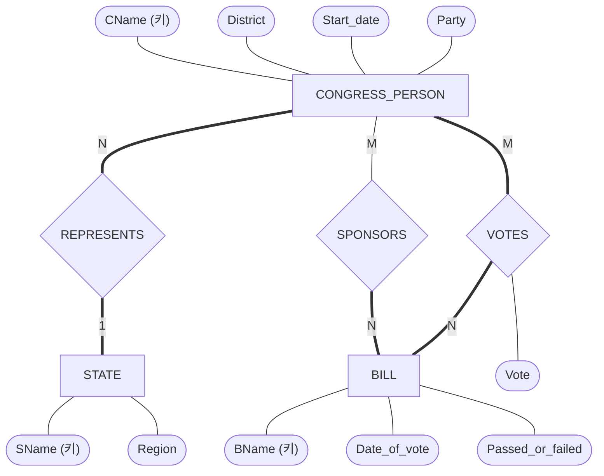
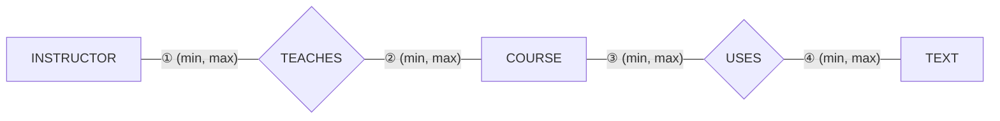
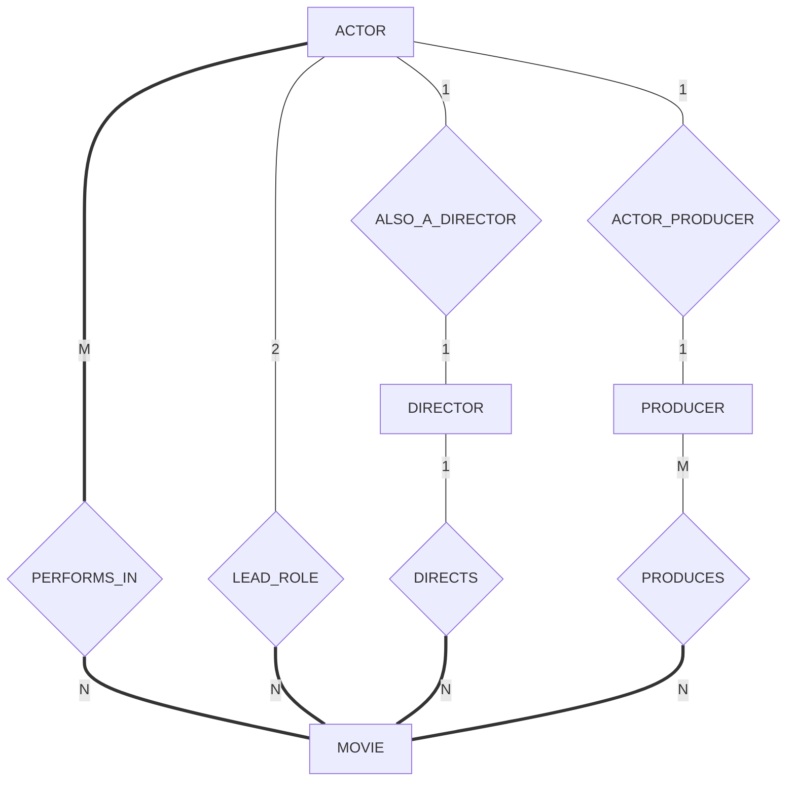


5주차 슬라이드의 연습 1~4다. 답은 접혀 있다. 먼저 종이에 써 본 뒤 펼친다.

## p1 · 상식으로 비율 정하기

두 개체 타입 사이의 이항 관계에, 개체 타입을 상식으로 본 뜻에 맞는 카디널리티 비율을 적으라[^1].

| 번호 | 개체 타입 1 | 개체 타입 2 |
|---|---|---|
| 1 | STUDENT | SOCIAL_SECURITY_CARD |
| 2 | STUDENT | TEACHER |
| 3 | COUNTRY | CURRENT_PRESIDENT |
| 4 | COURSE | TEXTBOOK |
| 5 | ITEM (주문에 들어 있는 물건) | ORDER |
| 6 | STUDENT | CLASS |
| 7 | CLASS | INSTRUCTOR |

사용 개념: [카디널리티 비율](/Hongs_Blog/studies/database-design/cardinality-ratio/)

풀이 전략: 짝마다 두 번 묻는다. "왼쪽 하나에 오른쪽이 몇 개까지 붙는가", "오른쪽 하나에 왼쪽이 몇 개까지 붙는가". 둘 다 하나면 1:1, 한쪽만 여럿이면 1:N, 둘 다 여럿이면 M:N이다. 비율은 왼쪽 : 오른쪽 순서로 쓴다.

답

| 번호 | 답 | 두 물음의 답 |
|---|---|---|
| 1 | 1:1 | 학생 한 명에 카드 한 장, 카드 한 장은 한 사람 것 |
| 2 | M:N | 학생은 선생님 여럿에게 배우고, 선생님은 학생 여럿을 가르친다 |
| 3 | 1:1 | 나라에 현직 대통령 한 명, 대통령은 한 나라만 맡는다 |
| 4 | M:N | 과목 하나가 교재 여럿을 쓰고, 교재 하나가 여러 과목에서 쓰인다 |
| 5 | N:1 | 주문 하나에 물건 여럿, 물건 하나는 한 주문에만 들어간다 |
| 6 | M:N | 학생은 수업 여럿을 듣고, 수업에는 학생이 여럿이다 |
| 7 | M:N | 수업 하나를 강사 여럿이 맡을 수 있고, 강사는 수업 여럿을 맡는다 |

5번의 N:1은 왼쪽(ITEM)이 N쪽, 오른쪽(ORDER)이 1쪽이라는 뜻이다[^2].

이 문제의 답은 가정에 따라 달라진다. 5번은 ITEM을 실물 하나하나로 볼 때 N:1이다. "상품 종류"로 보면 같은 상품이 여러 주문에 들어가므로 M:N이 된다. 7번은 수업 하나를 강사 한 명만 맡는 학교라면 N:1이다. 1번은 카드를 다시 발급받아 여러 장 갖는 경우까지 넣으면 1:N이다. 답안에는 어떤 가정으로 정했는지를 함께 쓴다[^s1].

## p2 · 미 하원 표결 ER 다이어그램

미국 하원의 표결 정보를 적는 데이터베이스의 ER 다이어그램을 그려라[^3]. 힌트: 개체 타입 셋, 관계 타입 셋.

1. 주(STATE): 이름(예: Texas, New York, California)과 지역(Northeast, Midwest, Southeast, Southwest, West).
2. 하원의원(CONGRESS_PERSON): 이름, 선거구(District), 당선된 날(Start_date), 소속 정당(Republican, Democrat, Independent).
3. 법안(BILL): 이름, 표결 날짜(Date_of_vote), 가결 여부(Passed_or_failed), 발의자(Sponsor). 발의자는 그 법안을 낸 하원의원(들)이다.
4. 의원마다 법안마다 어떻게 표결했는지(yes, no, absent).

사용 개념: [ER 설계 절차](/Hongs_Blog/studies/database-design/er-design-steps/), [관계 타입의 속성](/Hongs_Blog/studies/database-design/relationship-attributes/)

풀이 전략: 세 단계로 한다. ① 개체 타입과 속성을 적는다. ② 값이 다른 개체인 속성을 관계 타입으로 바꾼다. ③ 그린다. 4번처럼 "A마다 B마다 값 하나"인 문장은 M:N 관계 타입과 그 속성이라는 신호다.

답

*1단계. 개체 타입과 속성.*
- STATE: SName (키), Region
- CONGRESS_PERSON: CName (키), District, Start_date, Party
- BILL: BName (키), Date_of_vote, Passed_or_failed, {Sponsor}

*2단계. 관계 타입.*

| 관계 타입 | 잇는 개체 타입 | 비율 | 참여 | 속성 |
|---|---|---|---|---|
| REPRESENTS | CONGRESS_PERSON, STATE | 의원 N : 주 1 | 양쪽 전체 | 없음 |
| SPONSORS | CONGRESS_PERSON, BILL | M:N | BILL 전체, CONGRESS_PERSON 부분 | 없음 |
| VOTES | CONGRESS_PERSON, BILL | M:N | 양쪽 전체 | Vote |

- {Sponsor}는 값이 하원의원이다. 그래서 속성에서 지우고 SPONSORS로 바꾼다. 법안에는 발의자가 반드시 있고, 법안을 하나도 내지 않은 의원은 있어도 된다.
- 4번의 표결 결과는 (의원, 법안) 짝마다 하나다. M:N 관계 타입 VOTES의 속성 Vote가 된다. 어느 개체로도 옮길 수 없다.
- REPRESENTS는 요구사항 글에 따로 적혀 있지 않다. 의원은 어느 주의 선거구를 대표한다는 사실과 "관계 타입 셋"이라는 힌트에서 나온다[^s2].

*3단계. 그림*[^4].

굵은 선은 슬라이드 그림의 겹선(전체 참여)이다.

검증: 개체 타입 셋의 속성, 관계 타입 셋의 숫자와 겹선을 풀이 슬라이드(p.2)의 그림과 한 칸씩 손으로 맞췄다. 다이어그램은 문법 검사를 통과했다.

**변형 문제.** "법안의 발의자는 꼭 한 명"이라고 요구사항이 바뀌면 SPONSORS는 어떻게 달라지는가[^s3]?

답

의원 1 : 법안 N이 된다. CONGRESS_PERSON 옆에 1, BILL 옆에 N을 적고, BILL 쪽 겹선은 그대로 둔다. (min, max)로는 BILL 옆이 (1,1), CONGRESS_PERSON 옆이 (0,N)이다.

## p3 · (min, max) 제약 붙이기

아래 그림의 네 자리에 (min, max)를 적으라[^5].

- 과목은 교재를 쓸 수도 있고 안 쓸 수도 있다.
- 과목은 교재를 5권 넘게 쓸 수 없다.
- 과목은 적어도 한 명, 많아야 4명의 교수가 가르친다.
- 교재는 어느 과목에선가 쓰이는 책이다.
- 교수는 2과목에서 4과목을 가르친다.

사용 개념: [(min, max) 표기](/Hongs_Blog/studies/database-design/min-max-notation/)

풀이 전략: 문장마다 주어를 찾는다. 숫자쌍은 주어인 개체 타입 옆에 간다. COURSE는 두 관계에 끼므로 문장이 TEACHES 이야기인지 USES 이야기인지도 가린다. "안 쓸 수도 있다"는 아래 한계 0, "적어도 한"은 아래 한계 1이다. 위 한계를 말하지 않으면 N이다.

답

| 자리 | 답 | 근거 문장 |
|---|---|---|
| ① INSTRUCTOR | (2, 4) | 교수는 2과목에서 4과목을 가르친다 |
| ② COURSE (TEACHES 쪽) | (1, 4) | 과목은 적어도 한 명, 많아야 4명의 교수가 가르친다 |
| ③ COURSE (USES 쪽) | (0, 5) | 안 쓸 수도 있다(0), 5권 넘게는 못 쓴다(5) |
| ④ TEXT | (1, N) | 어느 과목에선가 쓰인다(적어도 1). 위 한계는 말이 없다 |

흔한 오답은 ①과 ②를 바꿔 적는 것이다. "교수는 2~4과목"의 주어는 교수이므로 (2,4)는 INSTRUCTOR 옆이다[^6].

검증: 다섯 문장을 모두 지키는 자료는 통과하고, 문장을 하나씩 어긴 자료 다섯 가지는 모두 걸리는 것 — [31_er-model-practice_p3.py](/Hongs_Blog/studies/database-design/code/31_er-model-practice_p3/)

**변형 문제.** 답을 1, N과 겹선으로 옮기면 두 관계의 비율과 참여는 어떻게 되는가[^s3]?

답

TEACHES와 USES 둘 다 M:N이다. 위 한계가 4, 4, 5, N으로 모두 1보다 크기 때문이다. 전체 참여(겹선)는 INSTRUCTOR, COURSE(TEACHES 쪽), TEXT이고, USES의 COURSE 쪽만 부분 참여(홑선)다. 2, 4, 5라는 숫자는 옮기면서 사라진다.

## p4 · ER 다이어그램 읽고 문장 가리기

아래 ER 다이어그램을 보고 문장 (a)~(f)가 True인지, False인지, Maybe인지 답하라[^7]. 굵은 선은 겹선(전체 참여)이다.

- (a) 이 데이터베이스에는 영화에 한 편도 나오지 않은 배우가 없다.
- (b) 영화에 열 편 넘게 나온 배우가 있다.
- (c) 여러 영화에서 주연을 맡은 배우가 있다.
- (d) 영화 한 편의 주연 배우는 많아야 두 명이다.
- (e) 제작자는 다른 영화의 배우가 될 수 없다.
- (f) 감독은 한 명인데 제작자는 여럿인 영화가 있다.

원본 오류 의심

원문: "(d) A movie can have only a maximum of lead actors" (5주차 p.37, 풀이 p.4) / 문제점: maximum 뒤에 수가 빠져 문장이 뜻을 이루지 못한다. / 수정안: "a maximum of two lead actors". / 근거: 그림에서 LEAD_ROLE의 ACTOR 쪽에 2가 적혀 있고, 풀이의 답이 True다. 수가 2일 때만 True가 된다.

사용 개념: [ER 다이어그램 표기법](/Hongs_Blog/studies/database-design/er-diagram-notation/), [카디널리티 비율](/Hongs_Blog/studies/database-design/cardinality-ratio/), [참여 제약](/Hongs_Blog/studies/database-design/participation-constraint/)

풀이 전략: 그림은 규칙만 적고 자료는 적지 않는다. 그래서 문장을 셋으로 가른다. 그림의 규칙을 지키는 자료라면 언제나 참인 문장은 True다. 규칙이 허용하는 일을 "할 수 없다"고 한 문장은 False다. 규칙이 허용하지만 꼭 그렇게 되라고 하지는 않는 일을 "~가 있다"고 한 문장은 Maybe다. 자료를 봐야 안다.

답

| 문장 | 답 | 그림에서 본 것 |
|---|---|---|
| (a) | True | ACTOR와 PERFORMS_IN 사이가 겹선이다. 배우는 모두 영화에 한 편 이상 나온다 |
| (b) | Maybe | PERFORMS_IN이 M:N이라 배우가 영화 몇 편에 나오든 된다. 그런 배우가 실제로 있는지는 그림이 말하지 않는다 |
| (c) | Maybe | LEAD_ROLE의 MOVIE 쪽이 N이라 배우 한 명이 여러 영화의 주연일 수 있다. 실제로 있는지는 모른다 |
| (d) | True | LEAD_ROLE의 ACTOR 쪽이 2다. 영화 한 편에 붙는 주연 배우는 2명까지다 |
| (e) | False | ACTOR_PRODUCER가 배우와 제작자를 잇는다. 제작자이면서 배우인 사람을 그림이 허용한다. 그 사람이 다른 영화에 나오는 것을 막는 규칙도 없다 |
| (f) | Maybe | DIRECTS가 감독 1 : 영화 N이고 MOVIE 쪽이 겹선이라 영화의 감독은 꼭 한 명이다. PRODUCES는 M:N이라 제작자가 여럿일 수 있다. 그런 영화가 실제로 있는지는 모른다 |

답은 풀이 슬라이드의 것이고[^8], 오른쪽 칸의 까닭은 그림에서 읽어 붙였다[^s4]. (b), (c), (f)를 True라고 답하기 쉽다. "할 수 있다"와 "실제로 있다"는 다르다.

검증: 그림을 (min, max)로 옮겨, True인 문장을 어기는 자료는 규칙에도 어긋나는 것, Maybe인 문장은 참인 자료와 거짓인 자료가 모두 규칙을 지키는 것, (e)와 반대인 자료가 규칙을 지키는 것 — [31_er-model-practice_p4.py](/Hongs_Blog/studies/database-design/code/31_er-model-practice_p4/)

**변형 문제.** 같은 그림에서 (g) "감독이 없는 영화가 있을 수 있다", (h) "배우이면서 감독인 사람이 있다"를 가려라[^s3].

답

(g) False. MOVIE와 DIRECTS 사이가 겹선이라 영화에는 감독이 반드시 있다. (h) Maybe. ALSO_A_DIRECTOR가 그런 사람을 허용하지만, 양쪽 다 홑선이라 꼭 있어야 하는 것은 아니다.

[^1]: 데이터베이스 설계 5회 강의 자료 「5_ERmodel」, p.17 (Exercise 1: Cardinality Ratio)
[^2]: 데이터베이스 설계 5회 강의 자료 「5_ERmodel-solution」, p.1 (답: 1:1, M:N, 1:1, M:N, N:1, M:N, M:N)
[^3]: 데이터베이스 설계 5회 강의 자료 「5_ERmodel」, p.35 (Exercise 2: ER Schema Diagram, "Hint: 3 Entity Types and 3 Relationship Types")
[^4]: 데이터베이스 설계 5회 강의 자료 「5_ERmodel-solution」, p.2 (Three Entity Types: CONGRESS_PERSON, STATE, BILL. Three Relationship Types: SPONSORS, VOTES, REPRESENTS. 그림의 마름모에는 SPOSNSORS로 적혀 있다)
[^5]: 데이터베이스 설계 5회 강의 자료 「5_ERmodel」, p.36 (Exercise 3: Constraints on ER Diagram)
[^6]: 데이터베이스 설계 5회 강의 자료 「5_ERmodel-solution」, p.3 (답: (2, 4), (1, 4), (0, 5), (1, N))
[^7]: 데이터베이스 설계 5회 강의 자료 「5_ERmodel」, p.37 (Exercise 4: Understanding ER Schema)
[^8]: 데이터베이스 설계 5회 강의 자료 「5_ERmodel-solution」, p.4 (답: True, Maybe, Maybe, True, False, Maybe)
[^s1]: 보충 풀이 슬라이드에는 답만 있다. "두 물음의 답" 칸과, 가정이 바뀌면 답이 달라지는 세 경우는 원본에 없다. 문제가 "common-sense meaning"으로 정하라고 한 데서 썼다.
[^s2]: 보충 풀이 슬라이드에는 완성 그림만 있다. 1~2단계의 풀이, {Sponsor}를 처음 설계의 속성으로 적은 것, REPRESENTS가 어디서 나오는지의 설명은 원본에 없다. 표의 비율과 참여는 풀이 그림의 숫자와 겹선을 읽은 것이다.
[^s3]: 보충 변형 문제 셋은 원본에 없다. p3과 p4의 변형은 문제 코드로 확인했다.
[^s4]: 보충 풀이 슬라이드에는 True, Maybe, False만 있다. 까닭과 풀이 전략은 문제의 그림에서 읽어 썼고 문제 코드로 확인했다. 그림은 슬라이드 p.37의 그림을 옮겨 그린 것이다.

