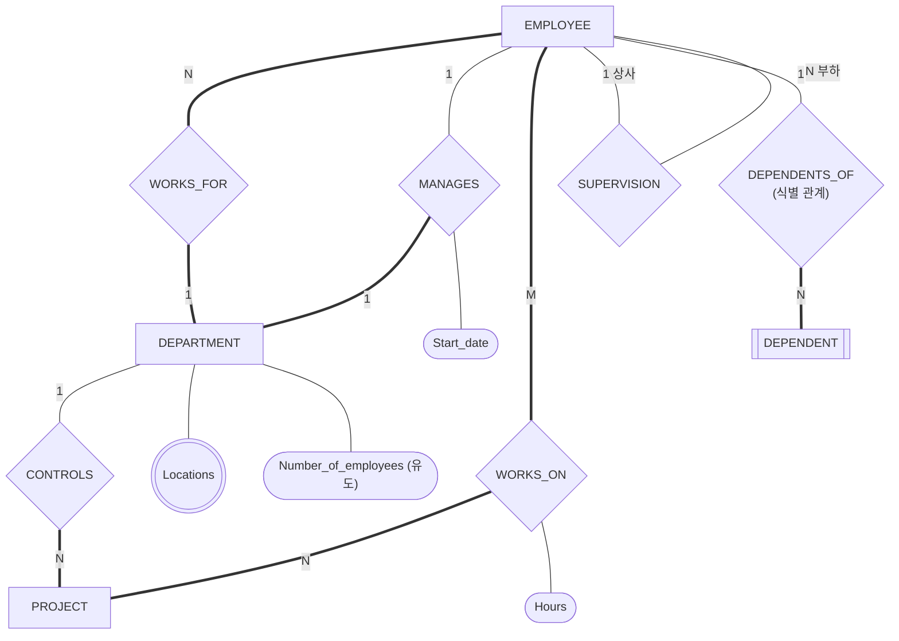



요약

개체와 그 사이의 연결을 그린 설계도(ER 그림)는 사람이 읽는 것이고, 데이터베이스가 받는 것은 표다. 그림의 네모, 마름모, 동그라미를 정해진 순서로 하나씩 옮기면 표 묶음이 나온다. 네모는 표가 되고, 일대일·일대다 연결은 칸 하나가 되고, 다대다 연결과 값이 여럿인 속성은 새 표가 된다. 다만 그림에 적어 둔 규칙 가운데 일부는 표로 옮기면 사라진다.

## 예시로 보기

개념 설계가 끝나면 ER 그림 한 장이 남는다. 이 그림은 DBMS에 넣을 수 없다. 관계형 DBMS는 릴레이션만 받는다. 그림을 보고 릴레이션을 "적당히" 만들면 사람마다 다른 스키마가 나오고 빠뜨리는 것이 생긴다. 그래서 그림의 요소마다 옮기는 법을 정해 두고 순서대로 따라간다[^1].

COMPANY의 ER 그림이다[^1].

네모는 개체 타입, 겹네모는 약한 개체 타입, 마름모는 관계 타입이다. 굵은 선은 전체 참여(원래 그림의 겹줄)이고 가는 선은 부분 참여다. 개체 타입의 속성은 아래 표에 따로 적었다[^s1].

| 개체 타입 | 속성 |
|---|---|
| EMPLOYEE | Ssn(키), Name(Fname, Minit, Lname), Bdate, Address, Salary, Sex |
| DEPARTMENT | Name(키), Number(키), Locations(값이 여럿), Number_of_employees(계산해서 얻는 값) |
| PROJECT | Name(키), Number(키), Location |
| DEPENDENT | Name(부분 키), Sex, Birth_date, Relationship |

이 그림을 옮기면 [관계형 데이터베이스 스키마와 상태](/Hongs_Blog/studies/database-design/relational-database-schema/)의 릴레이션 여섯 개가 나온다. 개체 타입이 넷, 관계 타입이 여섯인데 릴레이션은 여섯 개다. 어떻게 그렇게 되는지가 이 문서의 내용이다.

검증: 강의의 단계를 코드로 옮긴 사상기에 COMPANY ER을 넣어 릴레이션 6개·외래 키 8개가 슬라이드와 같음, 단계마다의 중간 결과가 7 p.13~27과 같음, 만든 표에 6-2 p.21의 45줄이 들어가고 외래 키 검사를 통과함, 전체 참여 쪽 외래 키의 NOT NULL이 9 p.17~18과 같음, (min, max)로 읽어도 같은 결과, 개수 식 — [44_er-to-relational-mapping_verify.py](/Hongs_Blog/studies/database-design/code/44_er-to-relational-mapping_verify/)

## 절차

옮기는 순서는 개체 타입 → 다치 속성 → 관계 타입이다[^2].

| 단계 | ER 그림의 요소 | 옮기는 법 | 자세한 문서 |
|---|---|---|---|
| 1 | 일반 개체 타입 | 릴레이션 하나. 단순 속성 전부(복합 속성은 성분만), 키 속성 하나가 기본 키 | [개체 타입의 사상](/Hongs_Blog/studies/database-design/mapping-entity-types/) |
| 2 | 약한 개체 타입 | 릴레이션 하나. 주인의 기본 키를 외래 키로, 기본 키는 그것과 부분 키의 묶음 | 같은 문서 |
| 3 | 다치 속성 | 릴레이션 하나. 주인의 기본 키(외래 키)와 값, 둘의 묶음이 기본 키 | [다치 속성의 사상](/Hongs_Blog/studies/database-design/mapping-multivalued-attributes/) |
| 4 | 1:1 이항 관계 타입 | 전체 참여 쪽 릴레이션에 외래 키 (또는 합치기, 관계 릴레이션) | [일대일 관계 타입의 사상](/Hongs_Blog/studies/database-design/mapping-one-to-one-relationship/) |
| 5 | 1:N 이항 관계 타입 | N쪽 릴레이션에 외래 키 (또는 관계 릴레이션) | [일대다 관계 타입의 사상](/Hongs_Blog/studies/database-design/mapping-one-to-many-relationship/) |
| 6 | M:N 이항 관계 타입 | 관계 릴레이션 하나. 외래 키 둘, 그 묶음이 기본 키 | [다대다·n항 관계 타입의 사상](/Hongs_Blog/studies/database-design/mapping-many-to-many-relationship/) |
| 7 | n항 관계 타입 | 관계 릴레이션 하나. 외래 키 $$n$$개, 그 묶음이 기본 키 | 같은 문서 |

관계 타입에 달린 속성은 그 관계가 간 곳으로 따라간다. 4·5단계에서는 외래 키를 넣은 릴레이션으로, 6·7단계에서는 관계 릴레이션으로 간다.

COMPANY를 단계마다 따라가면 이렇게 된다[^3].

| 단계 | 옮긴 것 | 이 단계에서 생기거나 바뀐 릴레이션 |
|---|---|---|
| 1 | EMPLOYEE, DEPARTMENT, PROJECT | EMPLOYEE(Fname, Minit, Lname, **Ssn**, Bdate, Address, Sex, Salary), DEPARTMENT(Dname, **Dnumber**), PROJECT(Pname, **Pnumber**, Plocation) |
| 2 | DEPENDENT와 식별 관계 DEPENDENTS_OF | DEPENDENT(**Essn**, **Dependent_name**, Sex, Bdate, Relationship) |
| 3 | Locations | DEPT_LOCATIONS(**Dnumber**, **Dlocation**) |
| 4 | MANAGES | DEPARTMENT에 Mgr_ssn, Mgr_start_date가 붙는다 |
| 5 | WORKS_FOR, SUPERVISION, CONTROLS | EMPLOYEE에 Dno, Super_ssn이 붙는다. PROJECT에 Dnum이 붙는다 |
| 6 | WORKS_ON | WORKS_ON(**Essn**, **Pno**, Hours) |
| 7 | (n항 관계 타입이 없다) | — |

굵은 것이 기본 키다. 5단계 뒤의 EMPLOYEE는 끝이 Dno, Super_ssn 순서이고, 6-2 슬라이드의 스키마 그림은 Super_ssn, Dno 순서다. 속성의 순서는 릴레이션의 뜻에 들지 않으므로 같은 릴레이션이다([릴레이션의 특성](/Hongs_Blog/studies/database-design/relation-characteristics/)). 완성 그림에서 PROJECT의 Plocation에 그어진 밑줄은 [관계형 데이터베이스 스키마와 상태](/Hongs_Blog/studies/database-design/relational-database-schema/)의 원본 오류 의심에 적었다.

### 몇 개가 나오는지 세기

일대일과 일대다를 모두 외래 키 방법으로 옮기면 릴레이션 수와 외래 키 수를 그림에서 바로 셀 수 있다[^s2].

- 릴레이션 수 = 일반 개체 타입 수 + 약한 개체 타입 수 + 다치 속성 수 + M:N 관계 타입 수 + n항 관계 타입 수
- 외래 키 수 = 약한 개체 타입 수 + 다치 속성 수 + 1:1 관계 타입 수 + 1:N 관계 타입 수 + 2 × M:N 관계 타입 수 + (n항 관계 타입마다 $$n$$)

식별 관계는 약한 개체 타입과 함께 옮겨지므로 1:N 관계 타입 수에서 뺀다.

COMPANY는 릴레이션이 $$3 + 1 + 1 + 1 = 6$$개, 외래 키가 $$1 + 1 + 1 + 3 + 2 = 8$$개다. 관계 타입 여섯 가운데 식별 관계 하나는 약한 개체와 함께, 넷은 외래 키 하나씩으로 옮겨지고, 릴레이션이 된 것은 WORKS_ON 하나다.

### ER 모델과 관계형 모델의 짝

슬라이드의 요약표다[^4].

| ER 모델 | 관계형 모델 |
|---|---|
| 개체 타입 | 개체 릴레이션 |
| 1:1 또는 1:N 관계 타입 | 외래 키 (또는 관계 릴레이션) |
| M:N 관계 타입 | 관계 릴레이션과 외래 키 두 개 |
| n항 관계 타입 | 관계 릴레이션과 외래 키 $$n$$개 |
| 단순 속성 | 속성 |
| 복합 속성 | 단순 성분 속성들 |
| 다치 속성 | 릴레이션과 외래 키 |
| 값 집합 | 도메인 |
| 키 속성 | 기본 키 (또는 보조 키) |

### 옮기면 남는 것과 사라지는 것

표의 왼쪽에 없는 것이 있다. 그림에 적은 규칙이 릴레이션의 키와 외래 키로 다 옮겨지지는 않는다[^s3].

| ER 그림의 규칙 | 릴레이션에서 |
|---|---|
| 외래 키를 넣은 쪽의 전체 참여 (직원은 꼭 부서에 속한다) | 외래 키에 NULL을 못 넣게 해서 남긴다. Dno, Mgr_ssn, Dnum이 그렇다 |
| 외래 키를 넣은 쪽의 "많아야 하나" | 칸이 하나라서 저절로 남는다 |
| 1:1에서 반대쪽의 "많아야 하나" (한 직원은 한 부서만 관리) | 사라진다. 값이 안 겹친다는 조건을 따로 걸어야 한다 |
| 아래쪽 한계가 2 이상 (부서에는 직원이 넷 이상) | 사라진다 |
| 다대다의 전체 참여 (직원은 프로젝트 하나 이상에서 일한다) | 사라진다 |
| 계산해서 얻는 속성 (Number_of_employees) | 칸으로 만들지 않는다 |

9주차 슬라이드의 `CREATE TABLE`에서 NOT NULL이 붙은 외래 키는 Dno, Mgr_ssn, Dnum이고 Super_ssn에는 붙지 않았다. 앞의 셋은 전체 참여 쪽에 넣은 외래 키이고 Super_ssn은 부분 참여 쪽에 넣은 외래 키다[^s3].

### 스스로 설명해 보기

1. 왜 개체 타입을 관계 타입보다 먼저 옮기는가?

관계를 옮기는 일은 "상대 릴레이션의 기본 키를 외래 키로 넣는 것"이다. 양쪽 릴레이션과 그 기본 키가 먼저 있어야 넣을 수 있다.

2. 왜 약한 개체 타입은 일반 개체 타입 다음인가?

약한 개체의 기본 키는 주인의 기본 키를 빌려 온다. 주인의 릴레이션이 먼저 있어야 한다.

3. 1:1과 1:N은 칸 하나로 되는데 M:N은 왜 릴레이션이 하나 더 필요한가?

1:1과 1:N에는 "상대를 많아야 하나만 가지는 쪽"이 있다. 그쪽 줄에 상대의 키 하나를 적으면 된다. M:N에는 그런 쪽이 없어서 어느 쪽 줄에 적어도 값이 여럿이다. 그래서 짝 하나를 한 줄로 적는 릴레이션을 만든다.

4. 4단계에서 MANAGES의 외래 키가 EMPLOYEE가 아니라 DEPARTMENT로 간 것은 그림의 무엇을 보고 정한 것인가?

참여 제약이다. DEPARTMENT와 MANAGES 사이는 겹줄(전체 참여), EMPLOYEE와 MANAGES 사이는 홑줄(부분 참여)이다. 전체 참여 쪽에 넣어야 NULL이 안 생긴다.

이 절차의 핵심 생각은?

"한 칸에 값 하나"를 지키면서 연결을 값으로 적는다. 연결의 한쪽이 상대를 많아야 하나만 가지면 그쪽에 칸 하나를 더하고, 아니면 연결마다 줄 하나를 쓰는 릴레이션을 만든다.

같은 수를 쓰는 다른 곳은?

약한 개체와 다치 속성도 "남의 기본 키를 빌려 와 자기 값과 묶는다"는 같은 수로 옮긴다. 세 경우 모두 기본 키가 외래 키를 품는다.

## 예제

**UNIVERSITY의 관계 타입 하나씩.** (min, max) 표기로 그린 그림에서는 먼저 관계의 종류를 읽어야 한다[^5].

1. *DEAN: COLLEGE (1, 1), INSTRUCTOR (0, 1).* 양쪽의 max가 1이라 1:1이다. min이 1인 COLLEGE가 전체 참여다. COLLEGE에 DeanId를 넣는다.
2. *ADMINS: COLLEGE (0, N), DEPT (1, 1).* max가 1인 쪽은 DEPT다. 학과는 단과대학 하나에만 딸린다. DEPT 쪽 릴레이션에 외래 키를 넣는다.
3. *TAKES: STUDENT (0, N), SECTION (5, N).* 양쪽의 max가 N이라 M:N이다. TAKES(SId, SecId, Grade)를 새로 만든다.

전체 풀이는 [UNIVERSITY 사상 연습](/Hongs_Blog/studies/database-design/university-mapping-practice/)에 있다.

**가정을 하나 바꾸면.** WORKS_FOR를 외래 키가 아니라 관계 릴레이션으로 옮기면 EMPLOYEE에서 Dno가 빠지고 WORKS_FOR(Essn, Dno)가 생겨 릴레이션이 일곱 개가 된다. 4·5단계는 방법을 고를 수 있어서, 같은 그림에서 서로 다른 올바른 스키마가 나올 수 있다[^s2].

## 활용

- **쓰는 때.** ER 그림이 다 그려진 뒤, `CREATE TABLE`을 쓰기 전이다. 설계 과정에서 이 일의 자리는 [데이터베이스 설계 과정](/Hongs_Blog/studies/database-design/database-design-process/)에 있다.
- **알아보는 신호.** "다음 ER 다이어그램을 관계형 스키마로 사상하라", "릴레이션 몇 개가 나오는가" 같은 물음.
- **결과를 SQL로.** 릴레이션마다 `CREATE TABLE` 하나를 쓴다. COMPANY처럼 릴레이션들이 서로를 가리키면 표를 만드는 순서를 따져야 한다: [CREATE SCHEMA와 CREATE TABLE](/Hongs_Blog/studies/database-design/sql-create-table/)
- **흔한 실수.** 마름모마다 릴레이션을 하나씩 만드는 것. 1:N의 외래 키를 1쪽에 넣는 것. 약한 개체의 기본 키에서 주인의 키를 빼먹는 것. (min, max) 표기의 N을 보고 그쪽을 N쪽으로 읽는 것.
- 연습: [ER-관계형 사상 예제 사다리](/Hongs_Blog/studies/database-design/er-mapping-ladder/), [UNIVERSITY 사상 연습](/Hongs_Blog/studies/database-design/university-mapping-practice/)

## 연결

- 앞 단계: [ER 설계 절차](/Hongs_Blog/studies/database-design/er-design-steps/)(그림을 그리는 일). 이 문서는 그 그림을 릴레이션으로 옮기는 일이다.
- 그림을 읽는 법: [ER 다이어그램 표기법](/Hongs_Blog/studies/database-design/er-diagram-notation/), [(min, max) 표기](/Hongs_Blog/studies/database-design/min-max-notation/)
- 결과물: [관계형 데이터베이스 스키마와 상태](/Hongs_Blog/studies/database-design/relational-database-schema/)
- 단계별 문서: 위 절차 표의 링크

## 자주 하는 오해

"관계 타입마다 릴레이션이 하나씩 생긴다"

틀렸다. 개체 타입이 릴레이션 하나씩 되니 관계 타입도 그럴 것처럼 보인다. 이름도 비슷하다. 실제로는 1:1과 1:N 관계 타입은 한쪽 릴레이션의 외래 키 칸 하나가 될 뿐이고, 식별 관계는 약한 개체와 함께 옮겨진다. 릴레이션이 되는 것은 M:N과 n항 관계 타입, 그리고 일부러 교차 참조 방법을 고른 경우뿐이다. COMPANY에서 확인된다. 관계 타입은 여섯 개인데 릴레이션이 된 것은 WORKS_ON 하나다. 나머지 다섯은 Essn(DEPENDENT), Mgr_ssn, Dno, Super_ssn, Dnum이라는 외래 키가 됐다.

## 확인 문제

**C1** ER 그림을 릴레이션으로 옮기는 단계를 순서대로 쓰고, 단계마다 새 릴레이션이 생기는지 기존 릴레이션에 칸이 붙는지 말하라.

**답:** ① 일반 개체 타입(새 릴레이션) ② 약한 개체 타입(새 릴레이션) ③ 다치 속성(새 릴레이션) ④ 1:1 관계 타입(칸이 붙는다) ⑤ 1:N 관계 타입(칸이 붙는다) ⑥ M:N 관계 타입(새 릴레이션) ⑦ n항 관계 타입(새 릴레이션). 
**이유:** ④와 ⑤도 교차 참조 방법을 고르면 새 릴레이션이 생긴다. 기본은 외래 키 방법이다.

**C2** COMPANY를 옮기다가 5단계(1:N 관계 타입)를 막 마쳤다. 이때 EMPLOYEE와 DEPARTMENT의 속성을 쓰라. WORKS_ON 릴레이션은 이때 있는가?

**답:** EMPLOYEE(Fname, Minit, Lname, Ssn, Bdate, Address, Sex, Salary, Dno, Super_ssn). DEPARTMENT(Dname, Dnumber, Mgr_ssn, Mgr_start_date). WORKS_ON은 아직 없다. 6단계에서 생긴다. 
**이유:** Mgr_ssn과 Mgr_start_date는 4단계에서, Dno와 Super_ssn은 5단계에서 붙었다.

**C3** 어떤 ER 그림에 일반 개체 타입 5개, 약한 개체 타입 1개, 다치 속성 2개, 1:1 관계 타입 1개, 1:N 관계 타입 4개(식별 관계는 빼고 센 것), M:N 관계 타입 2개가 있다. 1:1과 1:N을 외래 키 방법으로 옮기면 릴레이션과 외래 키는 각각 몇 개인가?

**답:** 릴레이션 $$5 + 1 + 2 + 2 = 10$$개. 외래 키 $$1 + 2 + 1 + 4 + 2 \times 2 = 12$$개. 
**이유:** 1:1과 1:N은 릴레이션을 늘리지 않고 외래 키만 하나씩 늘린다. M:N은 릴레이션 하나와 외래 키 둘을 늘린다.

**C4** 왜 개체 타입을 모두 옮긴 뒤에 관계 타입을 옮기는가? 순서를 뒤집어 WORKS_FOR부터 옮기려 하면 무엇이 막히는가?

**답:** WORKS_FOR를 옮기는 일은 DEPARTMENT의 기본 키를 EMPLOYEE에 외래 키로 넣는 것이다. 두 릴레이션이 아직 없고 DEPARTMENT의 기본 키도 정해지지 않았으면 넣을 것도 넣을 곳도 없다.

**C5** 다음 ER 요소는 옮긴 뒤에 무엇이 되는가? 새 릴레이션, 기존 릴레이션의 칸, 사라짐 가운데 골라라. (가) 복합 속성 Name (나) 다치 속성 Locations (다) 유도 속성 Number_of_employees (라) 1:N 관계 타입 CONTROLS (마) M:N 관계 타입 WORKS_ON (바) "부서에는 직원이 넷 이상"

**답:** (가) 칸. 성분 셋이 칸이 되고 Name이라는 칸은 없다. (나) 새 릴레이션 DEPT_LOCATIONS. (다) 사라짐. (라) 칸. PROJECT의 Dnum. (마) 새 릴레이션. (바) 사라짐.

**C6** 9주차 슬라이드의 `CREATE TABLE`에서 Dno, Mgr_ssn, Dnum에는 NOT NULL이 있고 Super_ssn에는 없다. ER 그림의 무엇에서 이 차이가 나오는가?

**답:** 외래 키를 넣은 쪽의 참여 제약이다. EMPLOYEE는 WORKS_FOR에, DEPARTMENT는 MANAGES에, PROJECT는 CONTROLS에 전체 참여한다. 그래서 그 외래 키는 비어 있을 수 없다. 부하 쪽 EMPLOYEE는 SUPERVISION에 부분 참여라서 Super_ssn은 NULL일 수 있다(Borg).

[^1]: 데이터베이스 설계 7회 강의 자료 「7_relational-model」, p.11, p.29 (COMPANY ER 그림과 옮긴 결과). 복습: 데이터베이스 설계 9회 강의 자료 「9_introduction-to-basic-SQL」, p.14
[^2]: 데이터베이스 설계 7회 강의 자료 「7_relational-model」, p.12 (Steps for ER-to-Relational Mapping). 복습: 데이터베이스 설계 9회 강의 자료 「9_introduction-to-basic-SQL」, p.6
[^3]: 데이터베이스 설계 7회 강의 자료 「7_relational-model」, p.13(일반 개체), p.14(약한 개체), p.15(다치 속성), p.17(MANAGES), p.22~24(1:N 셋), p.27(WORKS_ON)의 그림을 한 표로 모았다
[^4]: 같은 자료, p.30 (Correspondence between ER and Relational Models). 복습: 데이터베이스 설계 9회 강의 자료 「9_introduction-to-basic-SQL」, p.15
[^5]: 데이터베이스 설계 7회 강의 자료 「7_relational-model」, p.31 (UNIVERSITY ER). 답은 데이터베이스 설계 7회 강의 자료 「7-relational-model-solutions」, p.4~6
[^s1]: 보충 Mermaid 그림 1개는 원본에 없다. 7 p.11의 Chen 표기 그림을 옮긴 것이다. 겹줄을 굵은 선으로 바꿨고 개체 타입의 속성은 표로 뺐다. 1·N과 전체·부분 참여는 5 p.34의 (min, max) 그림과도 맞춰 보았다.
[^s2]: 보충 개수 식, WORKS_FOR를 관계 릴레이션으로 바꾼 예, 카드 C3은 원본에 없다. 식은 단계마다 생기는 것을 센 것이고 COMPANY(6, 8), UNIVERSITY(7, 10), SUPPLY 예(4, 3)에서 검증 코드로 확인했다.
[^s3]: 보충 "남는 것과 사라지는 것" 표, 스스로 설명해 보기, 오해, 카드 C4~C6은 원본에 없다. NOT NULL이 붙은 외래 키는 9 p.17~18의 `CREATE TABLE`에서 읽었고, 전체 참여와의 짝은 검증 코드로 맞춰 보았다. 사라지는 규칙은 SQLite에서 실제로 어기는 튜플을 넣어 확인했다([41_mapping-one-to-one-relationship_verify.py](/Hongs_Blog/studies/database-design/code/41_mapping-one-to-one-relationship_verify/), [44_university-mapping-practice_p1.py](/Hongs_Blog/studies/database-design/code/44_university-mapping-practice_p1/)).

