
## 먼저 알아야 할 것
- [집합](/Hongs_Blog/studies/discrete-math/sets/), [관계와 그 성질](/Hongs_Blog/studies/discrete-math/relations/), [함수의 성질과 집합의 크기](/Hongs_Blog/studies/discrete-math/function-properties/) (공학수학 이산수학): 릴레이션, 키, 일대다 관계를 적는 말
- [명제와 논리 연산](/Hongs_Blog/studies/discrete-math/propositional-logic/), [술어와 한정기호](/Hongs_Blog/studies/discrete-math/predicate-logic/), [동치관계와 분할](/Hongs_Blog/studies/discrete-math/equivalence-relations/) (공학수학 이산수학): WHERE 조건, EXISTS와 ALL, GROUP BY를 읽는 말
- [점근 표기](/Hongs_Blog/studies/discrete-math/asymptotic-notation/), [트리](/Hongs_Blog/studies/discrete-math/trees/), [로그](/Hongs_Blog/studies/college-math/logarithm/), [등비급수](/Hongs_Blog/studies/college-math/geometric-series/) (공학수학): B-트리의 높이를 증명할 때 쓴다
- [이분 탐색](/Hongs_Blog/studies/algorithms/binary-search/), [트리 순회와 이진 탐색 트리](/Hongs_Blog/studies/algorithms/tree-traversal-bst/) (알고리즘), [이진 탐색 트리의 탐색과 삽입](/Hongs_Blog/studies/data-structures/bst-search-insert/), [이진 탐색 트리의 삭제](/Hongs_Blog/studies/data-structures/bst-delete/) (1-2학기 자료구조): B-트리는 이진 탐색 트리의 갈래 수를 늘린 것이다

> 질의와 결과 표는 SQLite(파이썬 `sqlite3`)로 실행해 확인했고, SQLite가 받지 않는 문장은 PostgreSQL 16으로 확인했다. 예제는 교재의 COMPANY 데이터베이스(표 6개, 45줄)를 쓴다.

## 데이터베이스와 사용자, 데이터베이스 시스템의 개념과 구조

읽기 전에

1. 학생 레코드 끝에 생일 칸 하나를 덧붙였을 뿐인데 어떤 프로그램은 둘째 학생부터 엉뚱한 값을 읽는다. 그 프로그램은 무엇을 코드에 적어 두었을까? → [데이터베이스 방식의 네 가지 특징](/Hongs_Blog/studies/database-design/database-approach-characteristics/)
2. 색인을 새로 달거나 표에 칸을 더해도 이미 돌고 있는 프로그램을 안 고치려면, 프로그램과 디스크 사이에 무엇이 끼어 있어야 할까? → [데이터 독립성](/Hongs_Blog/studies/database-design/data-independence/)
3. 학생 이름을 성적표에도 한 번 더 적어 두면 무엇이 편해지고 무엇이 위험해질까? → [DBMS의 기능과 쓰지 않을 때](/Hongs_Blog/studies/database-design/dbms-features/)

| 번호 | 개념 | 한 줄 | 개념 코드 | 연습 |
|---|---|---|---|---|
| 01 | [데이터베이스와 DBMS](/Hongs_Blog/studies/database-design/database-and-dbms/) | 서로 이어진 데이터의 모음과 그것을 관리하는 범용 소프트웨어, 둘을 합친 데이터베이스 시스템 | [verify](/Hongs_Blog/studies/database-design/code/01_database-and-dbms_verify/) | — |
| 02 | [데이터베이스 방식의 네 가지 특징](/Hongs_Blog/studies/database-design/database-approach-characteristics/) | 구조의 설명(카탈로그)을 함께 품어서 프로그램이 저장 모양에 매이지 않고, 여러 뷰와 동시 사용을 받친다 | [verify](/Hongs_Blog/studies/database-design/code/02_database-approach-characteristics_verify/) | — |
| 03 | [데이터베이스 사용자](/Hongs_Blog/studies/database-design/database-users/) | 날마다 쓰는 무대 위 네 부류와 DBMS를 만들고 돌리는 무대 뒤 세 부류 | — | — |
| 04 | [DBMS의 기능과 쓰지 않을 때](/Hongs_Blog/studies/database-design/dbms-features/) | 중복 통제·접근 제한·여러 인터페이스·무결성 제약·백업과 복구, 그리고 파일이 더 나은 세 경우 | [verify](/Hongs_Blog/studies/database-design/code/04_dbms-features_verify/) | — |
| 05 | [데이터 모델의 종류](/Hongs_Blog/studies/database-design/data-model-categories/) | 누구에게 보여 주느냐로 갈리는 개념적·표현적·물리적 데이터 모델 | [verify](/Hongs_Blog/studies/database-design/code/05_data-model-categories_verify/) | — |
| 06 | [스키마와 인스턴스](/Hongs_Blog/studies/database-design/schema-and-instance/) | 거의 안 바뀌는 틀(스키마)과 넣고 고칠 때마다 바뀌는 내용(상태) | [verify](/Hongs_Blog/studies/database-design/code/06_schema-and-instance_verify/) | — |
| 07 | [3단계 스키마 구조](/Hongs_Blog/studies/database-design/three-schema-architecture/) | 외부·개념·내부 세 단계의 설명과 그 사이에서 요청을 옮겨 주는 사상 | [verify](/Hongs_Blog/studies/database-design/code/07_three-schema-architecture_verify/) | — |
| 08 | [데이터 독립성](/Hongs_Blog/studies/database-design/data-independence/) | 아래 단계의 스키마를 바꿔도 바로 위 단계와 프로그램은 그대로 | [verify](/Hongs_Blog/studies/database-design/code/08_data-independence_verify/) | — |
| 09 | [DBMS 언어와 인터페이스](/Hongs_Blog/studies/database-design/dbms-languages-interfaces/) | 틀을 정하는 말(DDL·SDL·VDL)과 자료를 다루는 말(DML), 말 대신 쓰는 다섯 가지 창구 | [verify](/Hongs_Blog/studies/database-design/code/09_dbms-languages-interfaces_verify/) | — |
| 10 | [DBMS 구성 모듈](/Hongs_Blog/studies/database-design/dbms-component-modules/) | 어느 길로 들어온 요청이든 실행 시간 처리기 하나로 모여 저장 데이터 관리자를 거쳐 디스크에 닿는다 | [verify](/Hongs_Blog/studies/database-design/code/10_dbms-component-modules_verify/) | — |

카탈로그가 메타데이터를 따로 둔다는 이야기는 [데이터와 메타데이터](/Hongs_Blog/studies/data-and-information/data-metadata/) 문서의 `과목별 관점`에 합쳤다.
떠올려 보기: 노트를 닫고 외부·개념·내부 세 단계를 그린 뒤, 두 데이터 독립성이 어느 경계에 놓이는지와 경계마다 무엇이 바뀌고 무엇이 그대로인지 써 본다.

## B-트리의 뜻과 높이, 검색과 삽입

읽기 전에

1. 찾아보기를 이진 탐색 트리로 만들면 디스크에서는 왜 느린가? 노드 하나에 키를 1,000개 담으면 디스크를 두 번 읽고 몇 개까지 찾을 수 있을까? → [B-트리](/Hongs_Blog/studies/database-design/b-tree/)
2. 키가 100만 개일 때 B-트리의 높이는 얼마까지 커질 수 있을까? 무엇이 그 한계를 정할까? → [B-트리의 높이](/Hongs_Blog/studies/database-design/b-tree-height/)
3. 가득 찬 잎에 키를 넣어야 하면 어떻게 할까? 트리는 아래로 자랄까 위로 자랄까? → [B-트리 삽입](/Hongs_Blog/studies/database-design/b-tree-insert/)

| 번호 | 개념 | 한 줄 | 개념 코드 | 연습 |
|---|---|---|---|---|
| 11 | [B-트리](/Hongs_Blog/studies/database-design/b-tree/) | 노드 하나에 키를 여러 개 담아 디스크를 덜 읽는 균형 탐색 트리. 키 수는 $$t - 1$$~$$2t - 1$$개, 잎의 깊이는 모두 같다 | [verify](/Hongs_Blog/studies/database-design/code/11_b-tree_verify/) | — |
| 12 | [B-트리의 높이](/Hongs_Blog/studies/database-design/b-tree-height/) | 키 $$n$$개면 높이 $$h \le \log_t \frac{n+1}{2}$$, 높이 $$h$$에 많아야 $$(2t)^{h+1} - 1$$개 | [verify](/Hongs_Blog/studies/database-design/code/12_b-tree-height_verify/) | — |
| 13 | [B-트리 검색](/Hongs_Blog/studies/database-design/b-tree-search/) | 노드의 키와 견주어 여러 갈래 가운데 하나로 내려간다. $$O(t \log_t n)$$, 노드 안에서 이분 탐색을 쓰면 $$O(\lg n)$$ | [impl](/Hongs_Blog/studies/database-design/code/13_b-tree-search_impl/) | — |
| 14 | [B-트리 노드 쪼개기](/Hongs_Blog/studies/database-design/b-tree-split-child/) | 가득 찬 노드의 가운데 키를 부모로 올리고 키 $$t - 1$$개짜리 둘로 가른다 | — | — |
| 15 | [B-트리 삽입](/Hongs_Blog/studies/database-design/b-tree-insert/) | 내려가는 길의 가득 찬 노드를 미리 쪼개고 잎에 넣는다. 뿌리를 쪼갤 때만 높아진다 | [impl](/Hongs_Blog/studies/database-design/code/15_b-tree-insert_impl/) | [B-트리 삽입 예제 사다리](/Hongs_Blog/studies/database-design/b-tree-insert-ladder/) |
| 16 | [B-트리와 이진 탐색 트리 비교](/Hongs_Blog/studies/database-design/b-tree-vs-bst/) | 노드 하나의 키 수가 갈래 수, 자라는 쪽, 디스크 읽기 횟수를 가른다 | — | — |

노드 안에서 이분 탐색을 하면 걸리는 시간은 [이분 탐색](/Hongs_Blog/studies/algorithms/binary-search/), 색인과 디스크 접근 비용은 [파일 조직](/Hongs_Blog/studies/operating-systems/file-organization/)과 [디스크 스케줄링](/Hongs_Blog/studies/operating-systems/disk-scheduling/) 문서의 `과목별 관점`에 합쳤다.
떠올려 보기: 노트를 닫고 B-트리가 지켜야 하는 성질 세 가지를 쓰고, 빈 트리($$t = 2$$)에 F, S, Q, K를 넣은 모양을 그려 본다.

## B-트리 삭제, ER 모델 1: 개체·속성·관계

읽기 전에

1. 잎에서 키를 하나 지웠더니 그 잎의 키가 아래 한계보다 적어졌다. 고칠 방법 두 가지는 무엇일까? → [B-트리 삭제](/Hongs_Blog/studies/database-design/b-tree-delete/)
2. "John Smith"와 "EMPLOYEE"는 ER 모델에서 같은 종류의 것일까? → [개체 타입과 개체 집합](/Hongs_Blog/studies/database-design/entity-type-and-set/)
3. "직원이 직원을 감독한다"를 그리면 선의 양쪽이 다 직원이다. 누가 상사인지 어떻게 적을까? → [역할 이름과 재귀 관계](/Hongs_Blog/studies/database-design/recursive-relationship/)

| 번호 | 개념 | 한 줄 | 개념 코드 | 연습 |
|---|---|---|---|---|
| 17 | [B-트리 삭제](/Hongs_Blog/studies/database-design/b-tree-delete/) | 잎에서 지우고, 모자라면 형제에게 빌리거나 부모의 키를 내려 합친다(CLRS와 다른 방식) | [impl](/Hongs_Blog/studies/database-design/code/17_b-tree-delete_impl/) | [B-트리 삭제 예제 사다리](/Hongs_Blog/studies/database-design/b-tree-delete-ladder/) · [B-트리 연습](/Hongs_Blog/studies/database-design/b-tree-practice/) · [문제 코드](/Hongs_Blog/studies/database-design/code/17_b-tree-practice_p5/) · [문제 코드](/Hongs_Blog/studies/database-design/code/17_b-tree-practice_p6/) |
| 18 | [데이터베이스 설계 과정](/Hongs_Blog/studies/database-design/database-design-process/) | 요구를 묻고 → 그림(ER)으로 정리하고 → 표로 옮기고 → 저장 구조를 정하는 네 단계 | — | — |
| 19 | [개체 타입과 개체 집합](/Hongs_Blog/studies/database-design/entity-type-and-set/) | 개체 타입은 이름과 속성 목록이라는 틀, 개체 집합은 지금 들어 있는 개체들 | [verify](/Hongs_Blog/studies/database-design/code/19_entity-type-and-set_verify/) | — |
| 20 | [속성의 종류](/Hongs_Blog/studies/database-design/er-attribute-types/) | 쪼갤 수 있는가(복합/단순), 값이 여럿인가(다치/단일값), 저장하는가(저장/유도)로 속성을 가름 | [verify](/Hongs_Blog/studies/database-design/code/20_er-attribute-types_verify/) | — |
| 21 | [키 속성](/Hongs_Blog/studies/database-design/key-attribute/) | 값이 개체마다 달라 개체 하나를 가려내는 속성. 묶음일 수도, 둘 이상일 수도 있다 | [verify](/Hongs_Blog/studies/database-design/code/21_key-attribute_verify/) | — |
| 22 | [관계 타입과 관계 집합](/Hongs_Blog/studies/database-design/relationship-type-and-set/) | 개체 타입들을 잇는 틀과 그 인스턴스들의 집합 $$R \subseteq E_1 \times \cdots \times E_n$$, 차수 | [verify](/Hongs_Blog/studies/database-design/code/22_relationship-type-and-set_verify/) | — |
| 23 | [역할 이름과 재귀 관계](/Hongs_Blog/studies/database-design/recursive-relationship/) | 같은 개체 타입이 두 번 끼는 관계와, 구실을 가르는 역할 이름 | [verify](/Hongs_Blog/studies/database-design/code/23_recursive-relationship_verify/) | — |

B-트리 삭제(17)는 CLRS와 다른 방식을 따른다. 내부 노드의 키는 늘 왼쪽 아래에서 가장 큰 키로 바꾼 뒤 잎에서 지운다.
떠올려 보기: 노트를 닫고 B-트리 삭제의 네 경우(1-1, 1-2a, 1-2b, 2)를 "언제, 무엇을 한다"로 쓴다. 이어서 개체·속성·관계 타입이 각각 무엇인지, 타입과 집합이 어떻게 다른지 COMPANY 예로 써 본다.

## ER 모델 2: 제약, 약한 개체, ER 다이어그램

읽기 전에

1. "직원은 정확히 한 부서에서 일한다"에는 규칙이 몇 개 들어 있을까? → [카디널리티 비율](/Hongs_Blog/studies/database-design/cardinality-ratio/)
2. 직원이 프로젝트에 일한 시간은 직원에 적을까, 프로젝트에 적을까? → [관계 타입의 속성](/Hongs_Blog/studies/database-design/relationship-attributes/)
3. EMPLOYEE 옆에 (1,1), DEPARTMENT 옆에 (4,N)이 적혀 있으면 어느 쪽이 "여럿"일까? → [(min, max) 표기](/Hongs_Blog/studies/database-design/min-max-notation/)

| 번호 | 개념 | 한 줄 | 개념 코드 | 연습 |
|---|---|---|---|---|
| 24 | [카디널리티 비율](/Hongs_Blog/studies/database-design/cardinality-ratio/) | 개체 하나가 낄 수 있는 인스턴스 수의 위 한계 1:1, 1:N, M:N | [verify](/Hongs_Blog/studies/database-design/code/24_cardinality-ratio_verify/) | — |
| 25 | [참여 제약](/Hongs_Blog/studies/database-design/participation-constraint/) | 모든 개체가 관계에 끼어야 하는가(전체 참여) 아닌가(부분 참여) | [verify](/Hongs_Blog/studies/database-design/code/25_participation-constraint_verify/) | — |
| 26 | [관계 타입의 속성](/Hongs_Blog/studies/database-design/relationship-attributes/) | 짝에 붙는 값은 관계에 적는다. 1:1·1:N이면 개체로 옮길 수 있고 M:N이면 못 옮긴다 | [verify](/Hongs_Blog/studies/database-design/code/26_relationship-attributes_verify/) | — |
| 27 | [약한 개체 타입](/Hongs_Blog/studies/database-design/weak-entity-type/) | 자기 키가 없어 주인 개체와 부분 키로 가려내는 개체 타입. 식별 관계에 늘 전체 참여 | [verify](/Hongs_Blog/studies/database-design/code/27_weak-entity-type_verify/) | — |
| 28 | [일반 개체 타입과 약한 개체 타입 비교](/Hongs_Blog/studies/database-design/regular-vs-weak-entity/) | 자기 속성만으로 가려지는가로 가른다. 전체 참여 여부로 가르지 않는다 | — | — |
| 29 | [ER 다이어그램 표기법](/Hongs_Blog/studies/database-design/er-diagram-notation/) | 네모·마름모·타원과 겹선·밑줄의 뜻, COMPANY 전체 그림 | — | — |
| 30 | [(min, max) 표기](/Hongs_Blog/studies/database-design/min-max-notation/) | 개체 옆에 적는 참여 횟수의 아래·위 한계. 1, N 표기와 숫자 자리가 반대다 | [verify](/Hongs_Blog/studies/database-design/code/30_min-max-notation_verify/) | — |

떠올려 보기: COMPANY의 관계 타입 여섯 개를 적고, 각각의 비율·참여·관계의 속성을 표로 써 본다.

## ER 다이어그램 설계 연습, 관계형 데이터 모델

읽기 전에

1. 요구사항 글에서 마름모가 될 것을 어떻게 골라낼까? → [ER 설계 절차](/Hongs_Blog/studies/database-design/er-design-steps/)
2. 표에서 줄의 순서를 바꾸면 다른 릴레이션이 되는가? → [릴레이션의 특성](/Hongs_Blog/studies/database-design/relation-characteristics/)
3. 직원 표에 적힌 부서 번호가 부서 표에 없으면 무엇이 곤란한가? 그 칸은 비워 둘 수 있는가? → [참조 무결성 제약과 외래 키](/Hongs_Blog/studies/database-design/referential-integrity-foreign-key/)

| 번호 | 개념 | 한 줄 | 개념 코드 | 연습 |
|---|---|---|---|---|
| 31 | [ER 설계 절차](/Hongs_Blog/studies/database-design/er-design-steps/) | 개체 타입과 속성을 적고 → 개체를 가리키는 속성을 관계 타입으로 바꾸고 → 그린다 | [verify](/Hongs_Blog/studies/database-design/code/31_er-design-steps_verify/) | [ER 다이어그램 설계 연습](/Hongs_Blog/studies/database-design/er-diagram-design-practice/) · [ER 모델 연습](/Hongs_Blog/studies/database-design/er-model-practice/) · [문제 코드](/Hongs_Blog/studies/database-design/code/31_er-diagram-design-practice_p2/) · [문제 코드](/Hongs_Blog/studies/database-design/code/31_er-diagram-design-practice_p3/) · [문제 코드](/Hongs_Blog/studies/database-design/code/31_er-model-practice_p3/) · [문제 코드](/Hongs_Blog/studies/database-design/code/31_er-model-practice_p4/) |
| 32 | [릴레이션과 도메인·속성·튜플](/Hongs_Blog/studies/database-design/relational-model-relation/) | 표의 줄·칸 이름·값의 모음에 붙인 이름, 상태는 $$\text{dom}(A_1) \times \dots \times \text{dom}(A_n)$$의 부분집합 | [verify](/Hongs_Blog/studies/database-design/code/32_relational-model-relation_verify/) · [verify.sql](/Hongs_Blog/studies/database-design/code/32_relational-model-relation_verify-sql/) | — |
| 33 | [릴레이션의 특성](/Hongs_Blog/studies/database-design/relation-characteristics/) | 줄에 순서가 없고 한 칸에 값 하나, 없는 값은 NULL | [verify](/Hongs_Blog/studies/database-design/code/33_relation-characteristics_verify/) | — |
| 34 | [슈퍼키·후보 키·기본 키](/Hongs_Blog/studies/database-design/relational-keys/) | 값이 안 겹치는 묶음(슈퍼키), 그중 더 줄일 수 없는 것(후보 키), 대표로 고른 하나(기본 키) | [verify](/Hongs_Blog/studies/database-design/code/34_relational-keys_verify/) | — |
| 35 | [관계형 데이터베이스 스키마와 상태](/Hongs_Blog/studies/database-design/relational-database-schema/) | 릴레이션 스키마들과 지켜야 할 규칙의 묶음, COMPANY의 표 6개와 45줄 | [verify](/Hongs_Blog/studies/database-design/code/35_relational-database-schema_verify/) · [verify.sql](/Hongs_Blog/studies/database-design/code/35_relational-database-schema_verify-sql/) | — |
| 36 | [개체 무결성 제약](/Hongs_Blog/studies/database-design/entity-integrity-constraint/) | 기본 키는 NULL일 수 없다 | [verify](/Hongs_Blog/studies/database-design/code/36_entity-integrity-constraint_verify/) · [verify.sql](/Hongs_Blog/studies/database-design/code/36_entity-integrity-constraint_verify-sql/) | — |
| 37 | [참조 무결성 제약과 외래 키](/Hongs_Blog/studies/database-design/referential-integrity-foreign-key/) | 다른 릴레이션을 가리키는 값은 그곳에 실제로 있거나 NULL이어야 한다 | [verify](/Hongs_Blog/studies/database-design/code/37_referential-integrity-foreign-key_verify/) · [verify.sql](/Hongs_Blog/studies/database-design/code/37_referential-integrity-foreign-key_verify-sql/) | [외래 키 찾기 연습](/Hongs_Blog/studies/database-design/foreign-key-practice/) · [문제 코드](/Hongs_Blog/studies/database-design/code/37_foreign-key-practice_p1/) · [문제 코드](/Hongs_Blog/studies/database-design/code/37_foreign-key-practice_p2/) |
| 38 | [키의 종류 비교](/Hongs_Blog/studies/database-design/key-kinds-comparison/) | 슈퍼키·후보 키·기본 키·외래 키를 "겹쳐도 되나, NULL이어도 되나"로 가르기 | — | — |

ER 설계 절차(31)는 ER 모델 문서(18~30)에 흩어진 단계를 설계 연습과 함께 한 장에 모은 문서다. 릴레이션이 곱집합의 부분집합이라는 것은 [관계와 그 성질](/Hongs_Blog/studies/discrete-math/relations/), 키와 일대다 관계를 함수로 읽는 법은 [함수의 성질과 집합의 크기](/Hongs_Blog/studies/discrete-math/function-properties/) 문서의 `과목별 관점`에 합쳤다.
떠올려 보기: 노트를 닫고 PART_ORDER 요구사항만 보고 개체 타입, 속성, 관계 타입을 처음부터 다시 적어 본다. 이어서 세 제약(키, 개체 무결성, 참조 무결성)이 각각 무엇을 막는지와 네 가지 키의 차이를 써 본다.

## ER 그림을 표로 옮기기

읽기 전에

1. ER 그림에 관계 타입이 여섯 개면 릴레이션도 여섯 개가 더 생기는가? → [ER-관계형 사상 절차](/Hongs_Blog/studies/database-design/er-to-relational-mapping/)
2. 일대다 관계의 외래 키는 1쪽과 N쪽 가운데 어디에 넣는가? 왜 그런가? → [일대다 관계 타입의 사상](/Hongs_Blog/studies/database-design/mapping-one-to-many-relationship/)
3. 다대다 관계는 왜 외래 키 하나로 적을 수 없는가? → [다대다·n항 관계 타입의 사상](/Hongs_Blog/studies/database-design/mapping-many-to-many-relationship/)

| 번호 | 개념 | 한 줄 | 개념 코드 | 연습 |
|---|---|---|---|---|
| 39 | [개체 타입의 사상](/Hongs_Blog/studies/database-design/mapping-entity-types/) | 네모는 표 하나, 약한 개체는 주인의 키를 빌려 기본 키를 만든다 | [verify](/Hongs_Blog/studies/database-design/code/39_mapping-entity-types_verify/) | — |
| 40 | [다치 속성의 사상](/Hongs_Blog/studies/database-design/mapping-multivalued-attributes/) | 값이 여럿인 속성은 (주인의 키, 값) 두 칸짜리 표로 뗀다 | [verify](/Hongs_Blog/studies/database-design/code/40_mapping-multivalued-attributes_verify/) | — |
| 41 | [일대일 관계 타입의 사상](/Hongs_Blog/studies/database-design/mapping-one-to-one-relationship/) | 일대일은 전체 참여 쪽에 외래 키 하나, 합치기와 교차 참조는 대안 | [verify](/Hongs_Blog/studies/database-design/code/41_mapping-one-to-one-relationship_verify/) | — |
| 42 | [일대다 관계 타입의 사상](/Hongs_Blog/studies/database-design/mapping-one-to-many-relationship/) | 일대다는 N쪽 표에 외래 키 하나 | [verify](/Hongs_Blog/studies/database-design/code/42_mapping-one-to-many-relationship_verify/) | — |
| 43 | [다대다·n항 관계 타입의 사상](/Hongs_Blog/studies/database-design/mapping-many-to-many-relationship/) | 다대다와 n항은 외래 키를 묶어 기본 키로 삼는 관계 릴레이션 | [verify](/Hongs_Blog/studies/database-design/code/43_mapping-many-to-many-relationship_verify/) | — |
| 44 | [ER-관계형 사상 절차](/Hongs_Blog/studies/database-design/er-to-relational-mapping/) | ER 그림을 일곱 단계로 표에 옮기는 순서와 옮기면 사라지는 규칙 | [verify](/Hongs_Blog/studies/database-design/code/44_er-to-relational-mapping_verify/) | [ER-관계형 사상 예제 사다리](/Hongs_Blog/studies/database-design/er-mapping-ladder/) · [UNIVERSITY 사상 연습](/Hongs_Blog/studies/database-design/university-mapping-practice/) · [문제 코드](/Hongs_Blog/studies/database-design/code/44_er-mapping-ladder_p4/) · [문제 코드](/Hongs_Blog/studies/database-design/code/44_university-mapping-practice_p1/) |

떠올려 보기: COMPANY ER 그림을 떠올려 일곱 단계로 옮기고, 릴레이션 여섯 개와 외래 키 여덟 개를 적어 본다.

## SQL 맛보기

읽기 전에

1. SQL 문장에는 "어떻게 찾을지"가 왜 적혀 있지 않을까? → [SQL 한눈에 보기](/Hongs_Blog/studies/database-design/sql-overview/)
2. 직원 표와 부서 표가 서로를 가리킬 때 어느 표를 먼저 만들 수 있을까? → [CREATE SCHEMA와 CREATE TABLE](/Hongs_Blog/studies/database-design/sql-create-table/)
3. 행을 지우기만 하는데도 거부되는 것은 어떤 경우일까? → [갱신 연산과 제약 위반](/Hongs_Blog/studies/database-design/update-constraint-violations/)

| 번호 | 개념 | 한 줄 | 개념 코드 | 연습 |
|---|---|---|---|---|
| 45 | [SQL 한눈에 보기](/Hongs_Blog/studies/database-design/sql-overview/) | "무엇을"만 적고 "어떻게"는 DBMS에 맡기는 언어, 표를 다루는 DDL과 행을 다루는 DML | [verify](/Hongs_Blog/studies/database-design/code/45_sql-overview_verify/) | — |
| 46 | [CREATE SCHEMA와 CREATE TABLE](/Hongs_Blog/studies/database-design/sql-create-table/) | 표의 이름·열·처음 거는 제약을 적어 빈 틀 만들기, 서로 가리키는 외래 키는 나중에 붙인다 | [verify](/Hongs_Blog/studies/database-design/code/46_sql-create-table_verify/) · [verify.sql](/Hongs_Blog/studies/database-design/code/46_sql-create-table_verify-sql/) | — |
| 50 | [SELECT-FROM-WHERE](/Hongs_Blog/studies/database-design/select-from-where/) | 어느 표에서 어떤 행의 어느 칸을 꺼낼지 적는 기본 질의, 모든 조합에서 조건으로 거른다 | [verify](/Hongs_Blog/studies/database-design/code/50_select-from-where_verify/) | — |
| 51 | [INSERT·DELETE·UPDATE](/Hongs_Blog/studies/database-design/sql-insert-delete-update/) | 행을 넣고 지우고 고치는 세 문장, 조건에 맞는 모든 행에 한꺼번에 | [verify](/Hongs_Blog/studies/database-design/code/51_sql-insert-delete-update_verify/) | — |
| 52 | [갱신 연산과 제약 위반](/Hongs_Blog/studies/database-design/update-constraint-violations/) | 삽입은 세 제약 모두, 삭제는 참조 무결성만, 수정은 고치는 칸에 따라 | [verify](/Hongs_Blog/studies/database-design/code/52_update-constraint-violations_verify/) | [제약 위반 찾기 연습](/Hongs_Blog/studies/database-design/constraint-violation-practice/) · [문제 코드](/Hongs_Blog/studies/database-design/code/52_constraint-violation-practice_p1/) · [문제 코드.sql](/Hongs_Blog/studies/database-design/code/52_constraint-violation-practice_p1-sql/) |

번호는 표를 만드는 문서(46~49)를 앞에 모으고 검색(50), 고치기(51~52), 참조 동작(53) 순서로 두었다. 그래서 이 절과 다음 절의 표에서 번호가 서로 섞여 있다.
떠올려 보기: 노트를 닫고 SELECT 문의 세 절이 하는 일과, 삽입·삭제·수정이 각각 어길 수 있는 제약을 써 본다.

## SQL로 표 만들기, 기본 검색

읽기 전에

1. 상사인 직원의 행을 지우면 그 부하들의 "상사" 칸은 어떻게 되어야 할까? → [참조 동작 SET NULL·CASCADE·SET DEFAULT](/Hongs_Blog/studies/database-design/referential-triggered-actions/)
2. 직원 표(8행)와 부서 표(3행)를 FROM에 적고 조건을 안 쓰면 몇 행이 나올까? → [WHERE 없는 질의와 카티션 곱](/Hongs_Blog/studies/database-design/missing-where-cross-product/)
3. 직원과 상사가 같은 표에 있을 때 두 사람의 이름을 한 행에 어떻게 꺼낼까? → [별칭과 자기 조인](/Hongs_Blog/studies/database-design/sql-alias-self-join/)

| 번호 | 개념 | 한 줄 | 개념 코드 | 연습 |
|---|---|---|---|---|
| 47 | [SQL 자료형](/Hongs_Blog/studies/database-design/sql-data-types/) | 열마다 받을 값의 꼴 정하기(수·문자열·비트열·불·날짜와 시각), 얼마나 막는지는 제품마다 다르다 | [verify](/Hongs_Blog/studies/database-design/code/47_sql-data-types_verify/) · [verify.sql](/Hongs_Blog/studies/database-design/code/47_sql-data-types_verify-sql/) | — |
| 48 | [속성 제약 NOT NULL·DEFAULT·CHECK](/Hongs_Blog/studies/database-design/sql-attribute-constraints/) | 열 하나에 거는 세 규칙: 빈칸 금지, 안 적으면 넣을 값, 받을 범위 | [verify](/Hongs_Blog/studies/database-design/code/48_sql-attribute-constraints_verify/) · [verify.sql](/Hongs_Blog/studies/database-design/code/48_sql-attribute-constraints_verify-sql/) | — |
| 49 | [PRIMARY KEY·UNIQUE·FOREIGN KEY 절](/Hongs_Blog/studies/database-design/sql-key-clauses/) | 기본 키·또 다른 키·외래 키를 CREATE TABLE에 적는 세 절과 제약에 이름 붙이기 | [verify](/Hongs_Blog/studies/database-design/code/49_sql-key-clauses_verify/) · [verify.sql](/Hongs_Blog/studies/database-design/code/49_sql-key-clauses_verify-sql/) | — |
| 53 | [참조 동작 SET NULL·CASCADE·SET DEFAULT](/Hongs_Blog/studies/database-design/referential-triggered-actions/) | 가리킴 받는 행이 지워지거나 키가 고쳐질 때 가리키던 쪽을 비울지·기본값으로 돌릴지·함께 처리할지, 안 적으면 거부 | [verify](/Hongs_Blog/studies/database-design/code/53_referential-triggered-actions_verify/) · [verify.sql](/Hongs_Blog/studies/database-design/code/53_referential-triggered-actions_verify-sql/) | [LIBRARY 스키마 DDL 연습](/Hongs_Blog/studies/database-design/library-ddl-practice/) · [문제 코드](/Hongs_Blog/studies/database-design/code/53_library-ddl-practice_p2/) · [문제 코드.sql](/Hongs_Blog/studies/database-design/code/53_library-ddl-practice_p2-sql/) |
| 54 | [WHERE 없는 질의와 카티션 곱](/Hongs_Blog/studies/database-design/missing-where-cross-product/) | 조건을 빠뜨리면 모든 조합이 나온다($$8 \times 3 = 24$$행) | [verify](/Hongs_Blog/studies/database-design/code/54_missing-where-cross-product_verify/) | — |
| 55 | [별칭과 자기 조인](/Hongs_Blog/studies/database-design/sql-alias-self-join/) | 표에 별명을 붙여 같은 표를 두 번 쓰기(직원과 그 상사) | [verify](/Hongs_Blog/studies/database-design/code/55_sql-alias-self-join_verify/) | [기본 검색 연습](/Hongs_Blog/studies/database-design/basic-select-practice/) · [문제 코드](/Hongs_Blog/studies/database-design/code/55_basic-select-practice_p1/) · [문제 코드](/Hongs_Blog/studies/database-design/code/55_basic-select-practice_p2/) |
| 56 | [다중집합인 표와 DISTINCT](/Hongs_Blog/studies/database-design/sql-multiset-distinct/) | SQL의 표에는 같은 행이 여러 번 있을 수 있다, DISTINCT를 적어야 한 번만 | [verify](/Hongs_Blog/studies/database-design/code/56_sql-multiset-distinct_verify/) | — |
| 57 | [집합 연산 UNION·EXCEPT·INTERSECT](/Hongs_Blog/studies/database-design/sql-set-operations/) | 두 질의 결과를 합치고 빼고 겹치는 것만 남기기, ALL을 붙이면 횟수까지 센다 | [verify](/Hongs_Blog/studies/database-design/code/57_sql-set-operations_verify/) · [verify.sql](/Hongs_Blog/studies/database-design/code/57_sql-set-operations_verify-sql/) | — |

표가 중복을 허락하는 모음이라는 것과 UNION·EXCEPT·INTERSECT는 [집합](/Hongs_Blog/studies/discrete-math/sets/) 문서의 `과목별 관점`에 합쳤다.
떠올려 보기: 노트를 닫고 CREATE TABLE에 걸 수 있는 제약 여섯 가지(NOT NULL, DEFAULT, CHECK, PRIMARY KEY, UNIQUE, FOREIGN KEY)와 참조 동작 셋을 쓰고, SQL의 표가 집합과 다른 점을 한 문장으로 써 본다.

## 표 정의 심화(주장·트리거·DROP·ALTER), 검색 심화(중첩 질의·조인·집계·묶기)

읽기 전에

1. `WHERE Super_ssn = NULL`은 상사가 없는 직원을 몇 명 찾을까? → [NULL 값과 IS NULL](/Hongs_Blog/studies/database-design/sql-null/)
2. 직원 옆에 상사 이름을 붙였더니 8명이 아니라 7명만 나왔다. 누가, 왜 빠졌을까? → [외부 조인](/Hongs_Blog/studies/database-design/outer-join/)
3. 기본 키, 외래 키, NOT NULL을 하나도 어기지 않는 새 직원이 "직원은 부서장보다 많이 받을 수 없다"는 회사 규칙을 깰 수 있을까? 이런 규칙은 어디에 적을까? → [주장 CREATE ASSERTION](/Hongs_Blog/studies/database-design/sql-assertion/)

| 번호 | 개념 | 한 줄 | 개념 코드 | 연습 |
|---|---|---|---|---|
| 58 | [DROP 명령과 CASCADE·RESTRICT](/Hongs_Blog/studies/database-design/sql-drop/) | 표나 스키마를 틀째 없애기, 기댄 것까지 없앨지(CASCADE) 그만둘지(RESTRICT) | [verify](/Hongs_Blog/studies/database-design/code/58_sql-drop_verify/) · [verify.sql](/Hongs_Blog/studies/database-design/code/58_sql-drop_verify-sql/) | — |
| 59 | [ALTER TABLE](/Hongs_Blog/studies/database-design/sql-alter-table/) | 만든 표에 칸을 더하고 빼고, 제약을 떼고 붙이기 | [verify](/Hongs_Blog/studies/database-design/code/59_sql-alter-table_verify/) · [verify.sql](/Hongs_Blog/studies/database-design/code/59_sql-alter-table_verify-sql/) | — |
| 60 | [중첩 질의와 IN](/Hongs_Blog/studies/database-design/nested-query-in/) | 질의 안에 넣은 질의의 결과에 값이 들어 있는지 견준다 | [verify](/Hongs_Blog/studies/database-design/code/60_nested-query-in_verify/) · [verify.sql](/Hongs_Blog/studies/database-design/code/60_nested-query-in_verify-sql/) | — |
| 61 | [ANY와 ALL](/Hongs_Blog/studies/database-design/sql-any-all/) | 안쪽 결과의 값 하나($$\exists$$) 또는 모두($$\forall$$)와 크기를 견준다 | [verify](/Hongs_Blog/studies/database-design/code/61_sql-any-all_verify/) · [verify.sql](/Hongs_Blog/studies/database-design/code/61_sql-any-all_verify-sql/) | — |
| 62 | [EXISTS와 NOT EXISTS](/Hongs_Blog/studies/database-design/sql-exists/) | 바깥 행마다 딸린 행이 있는지, 없는지만 본다 | [verify](/Hongs_Blog/studies/database-design/code/62_sql-exists_verify/) · [verify.sql](/Hongs_Blog/studies/database-design/code/62_sql-exists_verify-sql/) | [중첩 질의 쓰기 예제 사다리](/Hongs_Blog/studies/database-design/nested-query-ladder/) · [문제 코드](/Hongs_Blog/studies/database-design/code/62_nested-query-ladder_p4/) |
| 63 | [NULL 값과 IS NULL](/Hongs_Blog/studies/database-design/sql-null/) | 빈칸은 모르는 값이라 `=`로 못 견주고 IS NULL로 묻는다 | [verify](/Hongs_Blog/studies/database-design/code/63_sql-null_verify/) · [verify.sql](/Hongs_Blog/studies/database-design/code/63_sql-null_verify-sql/) | — |
| 64 | [FROM 절의 조인 (JOIN ON)](/Hongs_Blog/studies/database-design/sql-join-on/) | 표를 잇는 조건을 WHERE에서 FROM으로 옮긴다 | [verify](/Hongs_Blog/studies/database-design/code/64_sql-join-on_verify/) | — |
| 65 | [자연 조인 NATURAL JOIN](/Hongs_Blog/studies/database-design/natural-join/) | 이름이 같은 열끼리 저절로 맞추고 한 번만 보여 준다 | [verify](/Hongs_Blog/studies/database-design/code/65_natural-join_verify/) · [verify.sql](/Hongs_Blog/studies/database-design/code/65_natural-join_verify-sql/) | — |
| 66 | [외부 조인](/Hongs_Blog/studies/database-design/outer-join/) | 짝 없는 행도 남기고 짝 자리를 NULL로 채운다 | [verify](/Hongs_Blog/studies/database-design/code/66_outer-join_verify/) · [verify.sql](/Hongs_Blog/studies/database-design/code/66_outer-join_verify-sql/) | [조인 질의 쓰기 예제 사다리](/Hongs_Blog/studies/database-design/join-query-ladder/) · [문제 코드](/Hongs_Blog/studies/database-design/code/66_join-query-ladder_p4/) |
| 67 | [내부 조인과 외부 조인 비교](/Hongs_Blog/studies/database-design/inner-vs-outer-join/) | 짝 없는 행이 결과에 나와야 하는가로 가른다 | [verify](/Hongs_Blog/studies/database-design/code/67_inner-vs-outer-join_verify/) | — |
| 68 | [집계 함수](/Hongs_Blog/studies/database-design/aggregate-functions/) | 여러 행을 개수·합·최대·최소·평균 한 값으로 줄인다 | [verify](/Hongs_Blog/studies/database-design/code/68_aggregate-functions_verify/) · [verify.sql](/Hongs_Blog/studies/database-design/code/68_aggregate-functions_verify-sql/) | — |
| 69 | [GROUP BY](/Hongs_Blog/studies/database-design/group-by/) | 값이 같은 행끼리 묶어 묶음마다 한 줄로 요약한다 | [verify](/Hongs_Blog/studies/database-design/code/69_group-by_verify/) · [verify.sql](/Hongs_Blog/studies/database-design/code/69_group-by_verify-sql/) | — |
| 70 | [HAVING](/Hongs_Blog/studies/database-design/having-clause/) | 묶음의 요약값으로 묶음을 통째로 거른다 | [verify](/Hongs_Blog/studies/database-design/code/70_having-clause_verify/) · [verify.sql](/Hongs_Blog/studies/database-design/code/70_having-clause_verify-sql/) | [GROUP BY 질의 쓰기 예제 사다리](/Hongs_Blog/studies/database-design/group-by-query-ladder/) · [복잡한 검색 연습](/Hongs_Blog/studies/database-design/complex-retrieval-practice/) · [중첩 질의·집계 연습](/Hongs_Blog/studies/database-design/nested-aggregate-practice/) · [문제 코드](/Hongs_Blog/studies/database-design/code/70_complex-retrieval-practice_p1/) · [문제 코드.sql](/Hongs_Blog/studies/database-design/code/70_complex-retrieval-practice_p1-sql/) · [문제 코드](/Hongs_Blog/studies/database-design/code/70_complex-retrieval-practice_p2/) · [문제 코드.sql](/Hongs_Blog/studies/database-design/code/70_complex-retrieval-practice_p2-sql/) · [문제 코드](/Hongs_Blog/studies/database-design/code/70_complex-retrieval-practice_p3/) · [문제 코드.sql](/Hongs_Blog/studies/database-design/code/70_complex-retrieval-practice_p3-sql/) · [문제 코드](/Hongs_Blog/studies/database-design/code/70_group-by-query-ladder_p4/) · [문제 코드](/Hongs_Blog/studies/database-design/code/70_nested-aggregate-practice_p1/) · [문제 코드](/Hongs_Blog/studies/database-design/code/70_nested-aggregate-practice_p2/) · [문제 코드](/Hongs_Blog/studies/database-design/code/70_nested-aggregate-practice_p3/) · [문제 코드.sql](/Hongs_Blog/studies/database-design/code/70_nested-aggregate-practice_p3-sql/) |
| 71 | [WHERE와 HAVING 비교](/Hongs_Blog/studies/database-design/where-vs-having/) | 묶기 전에 행을 거르는가, 묶은 뒤에 묶음을 거르는가 | [verify](/Hongs_Blog/studies/database-design/code/71_where-vs-having_verify/) · [verify.sql](/Hongs_Blog/studies/database-design/code/71_where-vs-having_verify-sql/) | — |
| 72 | [ORDER BY와 질의의 절 순서](/Hongs_Blog/studies/database-design/order-by-clause-order/) | 결과 줄을 세우고, 여섯 절을 적는 차례와 처리되는 차례를 가른다 | [verify](/Hongs_Blog/studies/database-design/code/72_order-by-clause-order_verify/) · [verify.sql](/Hongs_Blog/studies/database-design/code/72_order-by-clause-order_verify-sql/) | [JOIN·GROUP BY 종합 연습](/Hongs_Blog/studies/database-design/advanced-sql-practice/) · [문제 코드](/Hongs_Blog/studies/database-design/code/72_advanced-sql-practice_p3/) · [문제 코드](/Hongs_Blog/studies/database-design/code/72_advanced-sql-practice_p5/) · [문제 코드.sql](/Hongs_Blog/studies/database-design/code/72_advanced-sql-practice_p5-sql/) |
| 73 | [주장 CREATE ASSERTION](/Hongs_Blog/studies/database-design/sql-assertion/) | 여러 행과 여러 표에 걸친 규칙을 "어기는 조합이 없어야 한다"는 꼴로 거는 문장 | [verify](/Hongs_Blog/studies/database-design/code/73_sql-assertion_verify/) · [verify.sql](/Hongs_Blog/studies/database-design/code/73_sql-assertion_verify-sql/) | — |
| 74 | [트리거와 ECA 규칙](/Hongs_Blog/studies/database-design/sql-trigger/) | 사건이 일어나고 조건이 맞으면 정해 둔 동작을 데이터베이스가 스스로 하는 규칙 | [verify](/Hongs_Blog/studies/database-design/code/74_sql-trigger_verify/) · [verify.sql](/Hongs_Blog/studies/database-design/code/74_sql-trigger_verify-sql/) | — |

주장과 트리거(73~74)는 NOT EXISTS(62)를 쓰므로 번호를 검색 심화(60~72) 뒤에 두었다. IN·ANY·ALL·EXISTS를 한정기호로 읽는 법은 [술어와 한정기호](/Hongs_Blog/studies/discrete-math/predicate-logic/), GROUP BY가 행을 겹치지 않게 나누는 것은 [동치관계와 분할](/Hongs_Blog/studies/discrete-math/equivalence-relations/) 문서의 `과목별 관점`에 합쳤다.
떠올려 보기: 노트를 닫고 중첩 질의, 조인, 집계 함수, GROUP BY와 HAVING, ORDER BY가 각각 무엇을 받아 무엇을 내놓는지와 여섯 절이 처리되는 차례를 써 본다. 이어서 주장과 트리거가 각각 무엇을 적는 문장인지, CASCADE와 RESTRICT가 표를 없앨 때 무엇을 함께 없애는지 써 본다.

## 복잡한 검색 연습

읽기 전에

1. "평균 급여가 3만을 넘는 부서의 남자 직원 수"를 구하면서 `Sex = 'M'`을 WHERE에 넣으면, HAVING의 평균은 누구의 평균이 될까? → [WHERE와 HAVING 비교](/Hongs_Blog/studies/database-design/where-vs-having/)
2. "성적이 모두 A인 학생"을 찾는 질의는 성적이 하나도 없는 학생을 뽑을까? → [EXISTS와 NOT EXISTS](/Hongs_Blog/studies/database-design/sql-exists/)
3. 안쪽 질의가 두 행을 돌려주는데 그 앞에 `=`를 쓰면 어떻게 될까? → [중첩 질의와 IN](/Hongs_Blog/studies/database-design/nested-query-in/)

새 개념 없이 중첩 질의, 조인, 집계, 묶기를 섞어 쓰는 연습이다. 풀이 문서 `복잡한 검색 연습`은 위의 표 정의·검색 심화 절에 있는 표 70번 줄의 연습 칸에 있다.
떠올려 보기: 노트를 닫고, 연습 일곱 문제 가운데 언뜻 맞아 보이는 질의가 그대로는 틀리는 것 셋과 그 까닭을 써 본다.

## 뷰

읽기 전에

1. 뷰를 만든 뒤 원래 표에 행을 넣었다. 뷰를 다시 만들지 않아도 그 행이 보일까? → [뷰](/Hongs_Blog/studies/database-design/sql-view/)
2. 뷰의 행이 어디에도 저장돼 있지 않다면, DBMS는 뷰에 온 질의에 어떻게 답할까? → [질의 수정과 뷰 실체화](/Hongs_Blog/studies/database-design/view-implementation/)
3. 세 표를 이은 뷰에서 "Smith의 프로젝트 이름을 바꿔라"고 하면 DBMS는 어느 표를 고쳐야 할까? → [뷰 갱신 문제](/Hongs_Blog/studies/database-design/view-update-problem/)

| 번호 | 개념 | 한 줄 | 개념 코드 | 연습 |
|---|---|---|---|---|
| 75 | [뷰](/Hongs_Blog/studies/database-design/sql-view/) | 질의에 이름을 붙여 표처럼 쓰는 가상 테이블. 정의만 저장되고 늘 최신이다 | [verify](/Hongs_Blog/studies/database-design/code/75_sql-view_verify/) · [verify.sql](/Hongs_Blog/studies/database-design/code/75_sql-view_verify-sql/) | — |
| 76 | [질의 수정과 뷰 실체화](/Hongs_Blog/studies/database-design/view-implementation/) | 뷰 질의에 답하는 두 길. 물을 때마다 계산하거나, 결과를 보관하고 제때 고친다 | [verify](/Hongs_Blog/studies/database-design/code/76_view-implementation_verify/) · [verify.sql](/Hongs_Blog/studies/database-design/code/76_view-implementation_verify-sql/) | — |
| 77 | [뷰 갱신 문제](/Hongs_Blog/studies/database-design/view-update-problem/) | 뷰를 거친 갱신은 기본 테이블 갱신으로 옮길 길이 딱 하나일 때만 된다 | [verify](/Hongs_Blog/studies/database-design/code/77_view-update-problem_verify/) · [verify.sql](/Hongs_Blog/studies/database-design/code/77_view-update-problem_verify-sql/) | [뷰 연습](/Hongs_Blog/studies/database-design/view-practice/) · [문제 코드](/Hongs_Blog/studies/database-design/code/77_view-practice_p1/) · [문제 코드.sql](/Hongs_Blog/studies/database-design/code/77_view-practice_p1-sql/) · [문제 코드](/Hongs_Blog/studies/database-design/code/77_view-practice_p2/) · [문제 코드.sql](/Hongs_Blog/studies/database-design/code/77_view-practice_p2-sql/) |
| 78 | [뷰와 기본 테이블 비교](/Hongs_Blog/studies/database-design/view-vs-base-table/) | 행이 저장되는가, 물을 때마다 계산되는가 | — | — |

떠올려 보기: 노트를 닫고 뷰가 기본 테이블과 다른 점, 뷰를 구현하는 두 방법, 갱신할 수 있는 뷰의 조건을 쓰고 셋이 어떻게 이어지는지 적어 본다.

## 고급 SQL 연습(JOIN, GROUP BY)

읽기 전에

1. 주문이 한 건도 없는 손님을 조인으로 어떻게 찾을까? → [외부 조인](/Hongs_Blog/studies/database-design/outer-join/)
2. 참가자가 없는 대회의 인원이 0으로 나오게 하려면 COUNT(*)와 COUNT(열) 가운데 무엇으로 세야 할까? → [집계 함수](/Hongs_Blog/studies/database-design/aggregate-functions/)

새 개념 없이 조인과 묶기를 섞어 쓰는 연습이다. 풀이 문서 `JOIN·GROUP BY 종합 연습`은 위의 표 정의·검색 심화 절에 있는 표 72번 줄의 연습 칸에 있다.
떠올려 보기: 노트를 닫고 "없는 것 찾기", "0명까지 세기", "묶음에 조건 걸기"를 각각 어느 절로 쓰는지 적어 본다.

## 다른 과목과의 연결
- [B-트리](/Hongs_Blog/studies/database-design/b-tree/), [B-트리 검색](/Hongs_Blog/studies/database-design/b-tree-search/) ↔ [파일 조직](/Hongs_Blog/studies/operating-systems/file-organization/), [디스크 스케줄링](/Hongs_Blog/studies/operating-systems/disk-scheduling/), [레코드 블로킹](/Hongs_Blog/studies/operating-systems/record-blocking/) (3-1학기 운영체제): 색인을 디스크 읽기가 적은 트리로 만든 것이 B-트리이고, 노드 하나가 디스크 페이지 하나다
- [B-트리와 이진 탐색 트리 비교](/Hongs_Blog/studies/database-design/b-tree-vs-bst/), [B-트리 삭제](/Hongs_Blog/studies/database-design/b-tree-delete/) ↔ [이진 탐색 트리의 탐색과 삽입](/Hongs_Blog/studies/data-structures/bst-search-insert/), [이진 탐색 트리의 삭제](/Hongs_Blog/studies/data-structures/bst-delete/) (1-2학기 자료구조): 둘 다 안쪽 키를 왼쪽 아래에서 가장 큰 키로 바꾼 뒤 끝에서 지운다
- [릴레이션과 도메인·속성·튜플](/Hongs_Blog/studies/database-design/relational-model-relation/) ↔ [관계와 그 성질](/Hongs_Blog/studies/discrete-math/relations/) (공학수학 이산수학): 릴레이션은 도메인들의 곱집합의 부분집합이다
- [슈퍼키·후보 키·기본 키](/Hongs_Blog/studies/database-design/relational-keys/), [카디널리티 비율](/Hongs_Blog/studies/database-design/cardinality-ratio/) ↔ [함수의 성질과 집합의 크기](/Hongs_Blog/studies/discrete-math/function-properties/) (공학수학 이산수학), [후보키](/Hongs_Blog/studies/algorithms/pg42890/) (알고리즘 연습): 키는 값이 겹치지 않는 함수이고, 후보 키 찾기는 그 조건을 전부 검사하는 문제다
- [집합 연산 UNION·EXCEPT·INTERSECT](/Hongs_Blog/studies/database-design/sql-set-operations/) ↔ [집합](/Hongs_Blog/studies/discrete-math/sets/) (공학수학 이산수학): 합집합, 차집합, 교집합을 표에 쓴다
- [EXISTS와 NOT EXISTS](/Hongs_Blog/studies/database-design/sql-exists/), [ANY와 ALL](/Hongs_Blog/studies/database-design/sql-any-all/) ↔ [술어와 한정기호](/Hongs_Blog/studies/discrete-math/predicate-logic/) (공학수학 이산수학): "모두 A다"를 "A가 아닌 것이 없다"로 바꿔 쓴다
- [GROUP BY](/Hongs_Blog/studies/database-design/group-by/) ↔ [동치관계와 분할](/Hongs_Blog/studies/discrete-math/equivalence-relations/) (공학수학 이산수학): 값이 같은 행끼리 묶으면 표가 겹치지 않는 묶음으로 갈린다
- [CREATE SCHEMA와 CREATE TABLE](/Hongs_Blog/studies/database-design/sql-create-table/) ↔ [부분순서와 위상 정렬](/Hongs_Blog/studies/discrete-math/partial-orders/) (공학수학 이산수학): 가리키는 표를 먼저 만들어야 하고, 서로 가리키면 그런 순서가 없다
- [데이터베이스 방식의 네 가지 특징](/Hongs_Blog/studies/database-design/database-approach-characteristics/) ↔ [데이터와 메타데이터](/Hongs_Blog/studies/data-and-information/data-metadata/) (2-1학기 자료와 정보): 카탈로그는 데이터를 설명하는 데이터다
- [DBMS 구성 모듈](/Hongs_Blog/studies/database-design/dbms-component-modules/) ↔ [컴파일러의 구조](/Hongs_Blog/studies/compilers/compiler-structure/) (3-2학기 컴파일러), [경쟁 조건과 임계 구역](/Hongs_Blog/studies/operating-systems/race-condition-critical-section/) (3-1학기 운영체제): 질의도 구문 분석과 최적화를 거치고, 여럿이 함께 고칠 때는 순서를 통제한다

## 흐름

```mermaid
graph TD
  C1["01 데이터베이스와 DBMS"]
  C2["02 데이터베이스 방식의 네 가지 특징"]
  C3["03 데이터베이스 사용자"]
  C4["04 DBMS의 기능과 쓰지 않을 때"]
  C5["05 데이터 모델의 종류"]
  C6["06 스키마와 인스턴스"]
  C7["07 3단계 스키마 구조"]
  C8["08 데이터 독립성"]
  C9["09 DBMS 언어와 인터페이스"]
  C10["10 DBMS 구성 모듈"]
  C11["11 B-트리"]
  C12["12 B-트리의 높이"]
  C13["13 B-트리 검색"]
  C14["14 B-트리 노드 쪼개기"]
  C15["15 B-트리 삽입"]
  C16["16 B-트리와 이진 탐색 트리 비교"]
  C17["17 B-트리 삭제"]
  C18["18 데이터베이스 설계 과정"]
  C19["19 개체 타입과 개체 집합"]
  C20["20 속성의 종류"]
  C21["21 키 속성"]
  C22["22 관계 타입과 관계 집합"]
  C23["23 역할 이름과 재귀 관계"]
  C24["24 카디널리티 비율"]
  C25["25 참여 제약"]
  C26["26 관계 타입의 속성"]
  C27["27 약한 개체 타입"]
  C28["28 일반 개체 타입과 약한 개체 타입 비교"]
  C29["29 ER 다이어그램 표기법"]
  C30["30 (min, max) 표기"]
  C31["31 ER 설계 절차"]
  C32["32 릴레이션과 도메인·속성·튜플"]
  C33["33 릴레이션의 특성"]
  C34["34 슈퍼키·후보 키·기본 키"]
  C35["35 관계형 데이터베이스 스키마와 상태"]
  C36["36 개체 무결성 제약"]
  C37["37 참조 무결성 제약과 외래 키"]
  C38["38 키의 종류 비교"]
  C39["39 개체 타입의 사상"]
  C40["40 다치 속성의 사상"]
  C41["41 일대일 관계 타입의 사상"]
  C42["42 일대다 관계 타입의 사상"]
  C43["43 다대다·n항 관계 타입의 사상"]
  C44["44 ER-관계형 사상 절차"]
  C45["45 SQL 한눈에 보기"]
  C46["46 CREATE SCHEMA와 CREATE TABLE"]
  C47["47 SQL 자료형"]
  C48["48 속성 제약 NOT NULL·DEFAULT·CHECK"]
  C49["49 PRIMARY KEY·UNIQUE·FOREIGN KEY 절"]
  C50["50 SELECT-FROM-WHERE"]
  C51["51 INSERT·DELETE·UPDATE"]
  C52["52 갱신 연산과 제약 위반"]
  C53["53 참조 동작 SET NULL·CASCADE·SET DEFAULT"]
  C54["54 WHERE 없는 질의와 카티션 곱"]
  C55["55 별칭과 자기 조인"]
  C56["56 다중집합인 표와 DISTINCT"]
  C57["57 집합 연산 UNION·EXCEPT·INTERSECT"]
  C58["58 DROP 명령과 CASCADE·RESTRICT"]
  C59["59 ALTER TABLE"]
  C60["60 중첩 질의와 IN"]
  C61["61 ANY와 ALL"]
  C62["62 EXISTS와 NOT EXISTS"]
  C63["63 NULL 값과 IS NULL"]
  C64["64 FROM 절의 조인 (JOIN ON)"]
  C65["65 자연 조인 NATURAL JOIN"]
  C66["66 외부 조인"]
  C67["67 내부 조인과 외부 조인 비교"]
  C68["68 집계 함수"]
  C69["69 GROUP BY"]
  C70["70 HAVING"]
  C71["71 WHERE와 HAVING 비교"]
  C72["72 ORDER BY와 질의의 절 순서"]
  C73["73 주장 CREATE ASSERTION"]
  C74["74 트리거와 ECA 규칙"]
  C75["75 뷰"]
  C76["76 질의 수정과 뷰 실체화"]
  C77["77 뷰 갱신 문제"]
  C78["78 뷰와 기본 테이블 비교"]
  C1 --> C2
  C1 --> C3
  C1 --> C4
  C2 --> C4
  C1 --> C5
  C2 --> C5
  C1 --> C6
  C5 --> C6
  C5 --> C7
  C6 --> C7
  C7 --> C8
  C6 --> C8
  C7 --> C9
  C3 --> C9
  C9 --> C10
  C3 --> C10
  C2 --> C10
  C11 --> C12
  C11 --> C13
  C12 --> C13
  C11 --> C14
  C13 --> C15
  C14 --> C15
  C11 --> C16
  C15 --> C16
  C13 --> C17
  C15 --> C17
  C5 --> C18
  C18 --> C19
  C19 --> C20
  C19 --> C21
  C20 --> C21
  C19 --> C22
  C22 --> C23
  C22 --> C24
  C22 --> C25
  C24 --> C26
  C21 --> C27
  C25 --> C27
  C21 --> C28
  C27 --> C28
  C20 --> C29
  C21 --> C29
  C24 --> C29
  C25 --> C29
  C27 --> C29
  C24 --> C30
  C25 --> C30
  C29 --> C30
  C20 --> C31
  C21 --> C31
  C26 --> C31
  C27 --> C31
  C29 --> C31
  C30 --> C31
  C5 --> C32
  C6 --> C32
  C32 --> C33
  C20 --> C33
  C32 --> C34
  C33 --> C34
  C21 --> C34
  C32 --> C35
  C34 --> C35
  C6 --> C35
  C34 --> C36
  C33 --> C36
  C35 --> C36
  C34 --> C37
  C35 --> C37
  C36 --> C37
  C34 --> C38
  C36 --> C38
  C37 --> C38
  C19 --> C39
  C20 --> C39
  C27 --> C39
  C37 --> C39
  C20 --> C40
  C33 --> C40
  C39 --> C40
  C24 --> C41
  C25 --> C41
  C37 --> C41
  C39 --> C41
  C24 --> C42
  C25 --> C42
  C37 --> C42
  C41 --> C42
  C22 --> C43
  C24 --> C43
  C37 --> C43
  C42 --> C43
  C31 --> C44
  C35 --> C44
  C39 --> C44
  C40 --> C44
  C41 --> C44
  C42 --> C44
  C43 --> C44
  C9 --> C45
  C35 --> C45
  C45 --> C46
  C35 --> C46
  C46 --> C47
  C46 --> C48
  C47 --> C48
  C46 --> C49
  C34 --> C49
  C37 --> C49
  C45 --> C50
  C35 --> C50
  C37 --> C50
  C46 --> C51
  C48 --> C51
  C50 --> C51
  C51 --> C52
  C49 --> C52
  C34 --> C52
  C36 --> C52
  C37 --> C52
  C49 --> C53
  C52 --> C53
  C48 --> C53
  C50 --> C54
  C50 --> C55
  C54 --> C55
  C50 --> C56
  C34 --> C56
  C50 --> C57
  C56 --> C57
  C46 --> C58
  C51 --> C58
  C49 --> C58
  C46 --> C59
  C49 --> C59
  C58 --> C59
  C50 --> C60
  C55 --> C60
  C60 --> C61
  C60 --> C62
  C33 --> C63
  C50 --> C63
  C50 --> C64
  C55 --> C64
  C64 --> C65
  C64 --> C66
  C63 --> C66
  C64 --> C67
  C66 --> C67
  C50 --> C68
  C56 --> C68
  C63 --> C68
  C68 --> C69
  C64 --> C69
  C69 --> C70
  C50 --> C71
  C70 --> C71
  C50 --> C72
  C70 --> C72
  C62 --> C73
  C48 --> C73
  C55 --> C73
  C51 --> C74
  C60 --> C74
  C73 --> C74
  C50 --> C75
  C69 --> C75
  C7 --> C75
  C75 --> C76
  C75 --> C77
  C51 --> C77
  C69 --> C77
  C34 --> C77
  C75 --> C78
  C46 --> C78
  C77 --> C78
```


