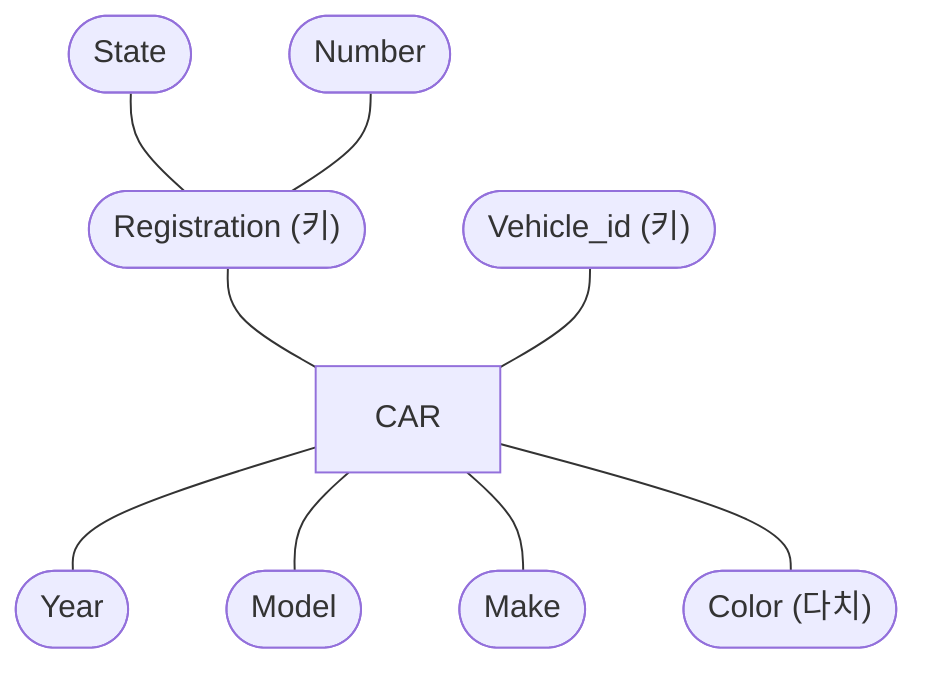



요약

학번은 학생마다 달라서, 학번 하나만 대면 누구인지 정해진다. 이렇게 값만 대면 대상 하나가 정해지는 항목을 따로 표시해 둔다. 항목 하나로 안 되면 둘을 묶어 쓸 수도 있고, 그런 항목이 둘 이상 있을 수도 있다. 다만 "지금 들어 있는 자료에서 안 겹친다"로는 부족하고, 앞으로 어떤 자료가 들어와도 안 겹친다는 약속이어야 한다.

## 예시로 보기

개체를 저장했으면 나중에 "바로 그 개체"를 다시 찾을 수 있어야 한다. 값이 겹치는 속성으로 찾으면 두 개가 나와 어느 것인지 모른다.

차 세 대가 들어 있는 CAR 개체 집합이다.

| 차 | Number | State | Vehicle_id | Make | Model | Year |
|---|---|---|---|---|---|---|
| CAR₁ | ABC 123 | TEXAS | TK629 | Ford Mustang | convertible | 2004 |
| CAR₂ | ABC 123 | NEW YORK | WP9872 | Nissan Maxima | 4-door | 2005 |
| CAR₃ | VSY 720 | TEXAS | TD729 | Chrysler LeBaron | 4-door | 2002 |

- 번호판 Number로 찾으면 "ABC 123"이 두 대다. 주가 다르면 같은 번호를 쓸 수 있기 때문이다.
- State로 찾아도 TEXAS가 두 대다.
- Number와 State를 묶으면 세 대가 다 다르다. 이 묶음이 복합 속성 Registration이다.
- 차대번호 Vehicle_id는 혼자서 세 대가 다 다르다.

그래서 CAR에는 개체를 가려내는 길이 둘 있다. Registration(Number, State)과 Vehicle_id다. 이런 속성을 키 속성이라 부른다.

ER 다이어그램에서는 키 속성의 이름에 밑줄을 긋는다. 위 그림은 밑줄 대신 "(키)"라고 적었다[^s1].

검증: Number만·State만으로는 겹치고 (Number, State)와 Vehicle_id는 안 겹치는 것, Year가 우연히 안 겹치다가 한 대를 넣으면 깨지는 것 — [21_key-attribute_verify.py](/Hongs_Blog/studies/database-design/code/21_key-attribute_verify/)

## 정의

키 속성은 값이 개체마다 다른 속성이다. 그 값으로 개체 하나를 가려낼 수 있다. 학생의 학번, 회사의 이름, 사람의 사회보장번호가 예다.

- **속성 여러 개가 함께 키가 될 수 있다.** 이때는 값의 묶음이 개체마다 달라야 한다. ER 다이어그램에서는 그 속성들을 성분으로 하는 복합 속성을 만들고 거기에 밑줄을 긋는다. CAR의 Registration이 그렇다.
- **한 개체 타입에 키가 둘 이상 있을 수 있다.** CAR의 Registration과 Vehicle_id, DEPARTMENT의 Name과 Number가 그렇다.
- **"값이 다르다"는 지금 자료가 아니라 규칙에 대한 말이다.** 그 개체 타입에 어떤 개체들이 들어오더라도 값이 겹치면 안 된다[^s2].

"키가 둘"과 "둘을 묶은 키 하나"는 다르다.

| | DEPARTMENT의 Name, Number | CAR의 Number, State |
|---|---|---|
| 혼자서 개체를 가려내는가 | 각각 가려낸다 | 각각은 못 가려낸다 |
| 키의 수 | 둘(Name, Number) | 하나(Registration) |
| 그림 | 타원 두 개에 따로 밑줄 | 복합 속성 타원 하나에 밑줄 |

## 활용

- 키는 자료를 보고 찾는 것이 아니라 요구사항에서 정한다. COMPANY에서 부서의 Name과 Number가 키인 까닭은 요구사항이 둘 다 "unique"라고 했기 때문이다.
- 흔한 실수: 지금 자료에서 안 겹친다고 키로 삼는 것. 위 표에서 Year는 2004, 2005, 2002로 세 대가 다 다르다. 하지만 2004년식 차가 한 대 더 들어오면 바로 겹친다. Year는 키가 아니다[^s2].
- 키 속성이 하나도 없는 개체 타입도 있다. 그런 개체는 딸려 있는 다른 개체를 함께 대야 가려진다: [약한 개체 타입](/Hongs_Blog/studies/database-design/weak-entity-type/)

## 연결

- 표로 옮기면 키 속성 가운데 하나가 그 표의 기본 키가 된다. 표에서 쓰는 키의 낱말들(슈퍼키, 후보 키, 기본 키): [슈퍼키·후보 키·기본 키](/Hongs_Blog/studies/database-design/relational-keys/), [개체 타입의 사상](/Hongs_Blog/studies/database-design/mapping-entity-types/)
- ER의 키 속성, 부분 키, 표의 여러 키를 한자리에서 가르기: [키의 종류 비교](/Hongs_Blog/studies/database-design/key-kinds-comparison/)
- B-트리에서 말하는 키는 "찾는 값"이라는 뜻의 다른 말이다: [B-트리](/Hongs_Blog/studies/database-design/b-tree/)

## 확인 문제

**C1** 위 CAR 표의 세 대만 놓고, 다음이 "값(묶음)이 차마다 다른가"를 답하라. (a) Number (b) State (c) (Number, State) (d) Vehicle_id. 그리고 CAR의 키 속성은 무엇인가?

**답:** (a) 아니다. ABC 123이 두 대다. (b) 아니다. TEXAS가 두 대다. (c) 다르다. (d) 다르다. 키 속성은 Registration(Number, State)과 Vehicle_id 둘이다. 
**이유:** Number와 State는 각각으로는 겹치지만 묶으면 안 겹친다. 그래서 둘을 성분으로 하는 복합 속성 Registration 하나가 키다. "Number도 키, State도 키"라고 답하면 틀린다.

**C2** 위 표에서 Year는 세 대가 다 다르다(2004, 2005, 2002). 그런데 Year를 키 속성으로 삼으면 안 된다. 깨지는 예를 하나 들어라.

**답:** 2004년식 차를 한 대 더 넣는다. 예: (KLM 555, OHIO, ZZ101, Honda Civic, 4-door, 2004). 그러면 Year 2004가 두 대가 되어 Year로는 차를 가려내지 못한다. Registration과 Vehicle_id는 이 차를 넣어도 그대로 안 겹친다. 
**이유:** 키는 "지금 들어 있는 개체들에서 안 겹친다"가 아니라 "어떤 개체가 들어와도 안 겹쳐야 한다"는 규칙이다. 자료는 키가 아니라는 증거(겹치는 값)는 줄 수 있어도, 키라는 증거는 못 준다[^s2].

**C3** DEPARTMENT는 Name과 Number 둘 다에 밑줄이 있고, CAR는 State와 Number를 성분으로 하는 Registration 하나에 밑줄이 있다. 두 그림이 말하는 것은 어떻게 다른가?

**답:** DEPARTMENT는 키가 둘이다. Name만 대도, Number만 대도 부서 하나가 정해진다. CAR의 Registration은 키가 하나다. Number와 State를 함께 대야 차 하나가 정해지고, 어느 하나만으로는 안 정해진다. 
**이유:** 타원마다 따로 밑줄이면 "각각이 키", 복합 속성 하나에 밑줄이면 "묶음이 키"다. 흔한 오답은 DEPARTMENT를 "(Name, Number) 묶음이 키"로 읽는 것이다. 그렇게 읽으면 이름이 같은 부서가 번호만 다르면 들어올 수 있게 된다.

[^s1]: 밑줄과 겹타원을 그릴 수 없어 "(키)", "(다치)"로 적었다.
[^s2]: Elmasri & Navathe, *Fundamentals of Database Systems* 7판, 3장의 설명이다.

