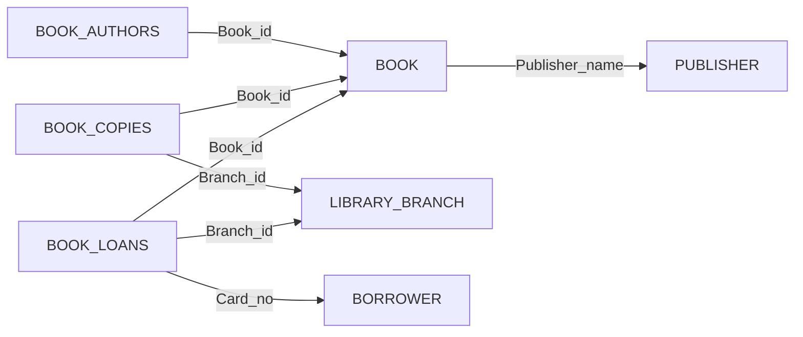


사용 개념: [참조 동작](/Hongs_Blog/studies/database-design/referential-triggered-actions/)의 `ON DELETE`·`ON UPDATE`, [CREATE TABLE](/Hongs_Blog/studies/database-design/sql-create-table/), [PRIMARY KEY·FOREIGN KEY 절](/Hongs_Blog/studies/database-design/sql-key-clauses/).

도서관 데이터베이스 LIBRARY의 스키마다. 밑줄 대신 "(키)"로 기본 키를 적었다[^1].

| 릴레이션 | 속성 |
|---|---|
| BOOK | Book_id (키), Title, Publisher_name |
| BOOK_AUTHORS | Book_id (키), Author_name (키) |
| PUBLISHER | Name (키), Address, Phone |
| BOOK_COPIES | Book_id (키), Branch_id (키), No_of_copies |
| BOOK_LOANS | Book_id (키), Branch_id (키), Card_no (키), Date_out, Due_date |
| LIBRARY_BRANCH | Branch_id (키), Branch_name, Address |
| BORROWER | Card_no (키), Name, Address, Phone |

외래 키는 일곱 개다. 화살표는 "가리킨다"는 뜻이다.



표 일곱 개와 외래 키 일곱 개를 한 장에 모았다. PUBLISHER, LIBRARY_BRANCH, BORROWER는 가리키는 화살표가 하나도 없다[^s2].

## 문제 p1 · 참조 동작 고르기

외래 키 일곱 개마다 알맞은 동작을 거부, `CASCADE`, `SET NULL`, `SET DEFAULT` 가운데에서 고르라. 가리킴 받는 행이 지워질 때와, 그 행의 기본 키 값이 고쳐질 때를 따로 고른다[^1].

풀이 전략: 외래 키마다 두 가지를 묻는다. 지워질 때는 "가리키는 행이, 가리킴 받는 행 없이도 뜻이 있는가? 그 삭제를 막아야 할 사정이 있는가?" 고쳐질 때는 "번호가 바뀌어도 누가 누구를 가리키는지는 그대로여야 하는가?"[^s1]

<details class="callout callout-answer" markdown="1">
<summary class="callout-title" markdown="span">답</summary>

| 외래 키 | 지워질 때 | 고쳐질 때 | 지워질 때의 이유 |
|---|---|---|---|
| BOOK_AUTHORS.Book_id → BOOK | `CASCADE` | `CASCADE` | 책이 지워지면 그 책의 지은이 정보는 더 필요 없다 |
| BOOK.Publisher_name → PUBLISHER | 거부 | `CASCADE` | 그 출판사가 낸 책이 남아 있으면 출판사를 못 지우게 한다 |
| BOOK_COPIES.Book_id → BOOK | `CASCADE` | `CASCADE` | 도서 목록에서 책을 빼면 그 책을 몇 권 가졌는지도 필요 없다 |
| BOOK_COPIES.Branch_id → LIBRARY_BRANCH | `CASCADE` | `CASCADE` | 지점 행을 지우는 것은 지점을 닫는 것이다. 그 지점의 보유 권수는 더 챙기지 않는다 |
| BOOK_LOANS.Book_id → BOOK | 거부 (또는 `CASCADE`) | `CASCADE` | 목록에서 책을 빼도 빌려 간 책은 돌려받아야 한다 |
| BOOK_LOANS.Branch_id → LIBRARY_BRANCH | `CASCADE` (또는 거부) | `CASCADE` | 지점을 닫으면 그 지점의 대출은 없던 일로 한다 |
| BOOK_LOANS.Card_no → BORROWER | 거부 | `CASCADE` | 빌린 책을 다 돌려줄 때까지는 회원을 탈퇴시키지 않는다 |

고쳐질 때는 일곱 개 모두 `CASCADE`다. 책 번호, 출판사 이름, 지점 번호, 회원 번호가 바뀌어도 그것을 가리키던 행이 계속 같은 책, 같은 출판사, 같은 지점, 같은 회원을 가리켜야 하기 때문이다[^2].

괄호 안의 다른 답은 도서관의 방침에 따라 갈린다. 정답이 하나로 정해지는 문제가 아니라, 고른 동작에 맞는 이유를 대는 문제다.

</details>


<div class="callout callout-warning" markdown="1">
<div class="callout-title" markdown="span">원본 오류 의심</div>

원문: 문제(10 p.22)의 보기 "REJECT"와 풀이(p.13~16, p.19)의 `ON DELETE REJECT` / 문제점: REJECT는 SQL의 낱말이 아니다. 그대로 적으면 구문 오류다 / 수정안: 거부하려면 `ON DELETE`를 아예 안 적는다. 굳이 적으려면 `ON DELETE RESTRICT`나 `ON DELETE NO ACTION`이라고 쓴다 / 근거: `ON DELETE REJECT`는 SQLite와 PostgreSQL 16 모두 구문 오류다. 풀이 p.17이 BOOK의 외래 키에 `ON UPDATE CASCADE`만 적고 "No ON DELETE action?"이라고 묻는 것도 이 뜻이다. 안 적은 것이 곧 거부다 — [53_library-ddl-practice_p2.sql](/Hongs_Blog/studies/database-design/code/53_library-ddl-practice_p2-sql/)

</div>


## 문제 p2 · DDL 쓰기

LIBRARY 스키마를 만드는 `CREATE TABLE` 문 일곱 개를 쓰라. 키와, p1에서 고른 참조 동작을 적는다[^1].

풀이 전략: ① 만드는 순서부터 정한다. 외래 키는 이미 있는 표만 가리킬 수 있으므로 가리킴 받는 표를 먼저 만든다. 위 그림에서 나가는 화살표가 없는 표가 첫 줄이다 ② 표마다 열과 자료형을 적는다 ③ 기본 키를 적는다. 키 속성이 둘이면 괄호 하나에 함께 적는다 ④ 외래 키마다 `FOREIGN KEY … REFERENCES …` 바로 뒤에 동작을 붙인다. 거부는 안 적는다[^s1].

<details class="callout callout-answer" markdown="1">
<summary class="callout-title" markdown="span">답</summary>

1. *만드는 순서:* PUBLISHER, LIBRARY_BRANCH, BORROWER(아무것도 안 가리킨다) → BOOK(PUBLISHER를 가리킨다) → BOOK_AUTHORS, BOOK_COPIES, BOOK_LOANS.
2. *문장:*

```sql
CREATE TABLE PUBLISHER
( Name          VARCHAR(50)   NOT NULL,
  Address       VARCHAR(50),
  Phone         VARCHAR(15),
  PRIMARY KEY (Name) );

CREATE TABLE LIBRARY_BRANCH
( Branch_id     INT           NOT NULL,
  Branch_name   VARCHAR(50),
  Address       VARCHAR(50),
  PRIMARY KEY (Branch_id) );

CREATE TABLE BORROWER
( Card_no       INT           NOT NULL,
  Name          VARCHAR(50)   NOT NULL,
  Address       VARCHAR(50),
  Phone         VARCHAR(15),
  PRIMARY KEY (Card_no) );

CREATE TABLE BOOK
( Book_id         CHAR(15)      NOT NULL,
  Title           VARCHAR(100)  NOT NULL,
  Publisher_name  VARCHAR(50),
  PRIMARY KEY (Book_id),
  FOREIGN KEY (Publisher_name) REFERENCES PUBLISHER(Name)
              ON UPDATE CASCADE );

CREATE TABLE BOOK_AUTHORS
( Book_id       CHAR(15)      NOT NULL,
  Author_name   VARCHAR(50)   NOT NULL,
  PRIMARY KEY (Book_id, Author_name),
  FOREIGN KEY (Book_id) REFERENCES BOOK(Book_id)
              ON DELETE CASCADE   ON UPDATE CASCADE );

CREATE TABLE BOOK_COPIES
( Book_id       CHAR(15)      NOT NULL,
  Branch_id     INT           NOT NULL,
  No_of_copies  INT           NOT NULL,
  PRIMARY KEY (Book_id, Branch_id),
  FOREIGN KEY (Book_id) REFERENCES BOOK(Book_id)
              ON DELETE CASCADE   ON UPDATE CASCADE,
  FOREIGN KEY (Branch_id) REFERENCES LIBRARY_BRANCH(Branch_id)
              ON DELETE CASCADE   ON UPDATE CASCADE );

CREATE TABLE BOOK_LOANS
( Book_id       CHAR(15)      NOT NULL,
  Branch_id     INT           NOT NULL,
  Card_no       INT           NOT NULL,
  Date_out      DATE          NOT NULL,
  Due_date      DATE          NOT NULL,
  PRIMARY KEY (Book_id, Branch_id, Card_no),
  FOREIGN KEY (Book_id) REFERENCES BOOK(Book_id)
              ON UPDATE CASCADE,
  FOREIGN KEY (Branch_id) REFERENCES LIBRARY_BRANCH(Branch_id)
              ON DELETE CASCADE   ON UPDATE CASCADE,
  FOREIGN KEY (Card_no) REFERENCES BORROWER(Card_no)
              ON UPDATE CASCADE );
```

열 이름, 자료형, 키, 동작은 풀이 슬라이드의 것이다[^3]. 순서와 쉼표의 자리는 실제로 돌도록 고쳤다(아래 주의).

{: start="3"}
3. *돌려 보기.* 예시 행 몇 개를 넣고 확인한 결과다[^s1].

| 한 일 | 결과 |
|---|---|
| 낸 책이 있는 출판사를 지운다 | 거부 |
| 빌려 간 사람이 있는 책을 지운다 | 거부 |
| 안 돌려준 책이 있는 회원을 지운다 | 거부 |
| 반납된 책을 지운다 | 그 책의 지은이 행과 보유 권수 행이 함께 지워진다 |
| 지점을 지운다 | 그 지점의 보유 권수 행과 대출 행이 함께 지워진다 |
| 출판사 이름, 책 번호, 지점 번호, 회원 번호를 고친다 | 가리키던 칸이 모두 따라 바뀐다. 행 수는 그대로다 |

</details>


<div class="callout callout-warning" markdown="1">
<div class="callout-title" markdown="span">원본 오류 의심</div>

원문: 풀이 슬라이드 p.17이 `CREATE TABLE BOOK`을 맨 먼저 적고 그 안에 `FOREIGN KEY (Publisher_name) REFERENCES PUBLISHER(Name)`을 둔다. BOOK_COPIES(p.18)와 BOOK_LOANS(p.19)도 LIBRARY_BRANCH와 BORROWER(p.20)보다 먼저 나온다 / 문제점: 아직 만들지 않은 표를 가리킨다 / 수정안: 가리킴 받는 표를 먼저 만든다 / 근거: PostgreSQL 16은 "그런 표가 없다"는 오류로 BOOK을 못 만든다. SQLite는 표를 만들 때 가리키는 표가 있는지 보지 않아 순서가 틀려도 받는다 — [53_library-ddl-practice_p2.sql](/Hongs_Blog/studies/database-design/code/53_library-ddl-practice_p2-sql/)

</div>


<div class="callout callout-warning" markdown="1">
<div class="callout-title" markdown="span">원본 오류 의심</div>

원문: 풀이 슬라이드 p.18~19의 `FOREIGN KEY (Book_id) REFERENCES BOOK(Book_id),` 다음 줄 `ON DELETE CASCADE ON UPDATE CASCADE` / 문제점: 쉼표가 동작 앞에 있다. 쉼표에서 외래 키 절이 끝나 버려 다음 줄의 `ON DELETE`가 붙을 데가 없다. 그 뒤의 `FOREIGN KEY` 앞에는 쉼표가 없다 / 수정안: 쉼표를 동작 뒤로 옮긴다 / 근거: 적힌 그대로는 PostgreSQL 16에서 구문 오류다 — [53_library-ddl-practice_p2.sql](/Hongs_Blog/studies/database-design/code/53_library-ddl-practice_p2-sql/)

</div>


<div class="callout callout-check" markdown="1">
<div class="callout-title" markdown="span">검증: 고친 문장으로 표 일곱 개를 만들고 외래 키 일곱 개의 동작이 p1의 답과 같은지, 위 "돌려 보기" 표의 여섯 줄(SQLite) — [53_library-ddl-practice_p2.py](/Hongs_Blog/studies/database-design/code/53_library-ddl-practice_p2/). 슬라이드에 적힌 그대로가 멈추는 세 곳과 같은 여섯 줄은 PostgreSQL 16에서 실행 — [53_library-ddl-practice_p2.sql](/Hongs_Blog/studies/database-design/code/53_library-ddl-practice_p2-sql/)</div>

</div>


변형: 풀이는 "책에는 출판사 이름이 있어야 한다"는 이유로 출판사의 삭제를 거부했다. 그런데 문장에서 BOOK의 Publisher_name에는 `NOT NULL`이 없다. 이 칸을 비워도 된다고 보고 동작을 `ON DELETE SET NULL`로 바꾸면, 낸 책이 있는 출판사를 지울 때 무슨 일이 생기는가? 풀이의 이유를 지키려면 문장의 어디를 고쳐야 하는가?[^s1]

<details class="callout callout-answer" markdown="1">
<summary class="callout-title" markdown="span">변형의 답</summary>

출판사가 지워지고, 그 출판사가 낸 책의 Publisher_name이 NULL이 된다. 책 행은 남는다. 풀이의 이유("책에는 출판사 이름이 있어야 한다")를 지키려면 Publisher_name에 `NOT NULL`을 붙이고 삭제는 거부로 둔다. `NOT NULL`인 칸에 `SET NULL`을 걸어 두면, 지울 때 `NOT NULL`에 걸려 거부된다.

</details>


[^1]: 데이터베이스 설계 10회 강의 자료 「10_SQL-DDL」, p.22 (Exercise 2, Exercise 3과 LIBRARY 스키마 그림). 같은 문제가 데이터베이스 설계 10회 강의 자료 「10-2_SQL-DML」, p.9에 있다
[^2]: 데이터베이스 설계 11회 강의 자료 「10-11-SQL-Solutions」, p.13~16 (Exercise 2의 풀이: 외래 키마다 고른 동작과 이유)
[^3]: 데이터베이스 설계 11회 강의 자료 「10-11-SQL-Solutions」, p.17~20 (Exercise 3의 풀이: CREATE TABLE 일곱 문장)
[^s1]: <span class="fn-tag" title="수업 자료에 없고 따로 보탠 내용">보충</span> 풀이 전략, 만드는 순서, "돌려 보기"의 예시 행과 결과(슬라이드에는 행이 없다), 변형 문제와 그 답은 슬라이드에 없다. 예시 행은 출판사 2, 지점 2, 회원 2, 책 2, 지은이 6, 보유 권수 3, 대출 2행이고 문제 코드에 적혀 있다. 결과는 SQLite 3.50과 PostgreSQL 16에서 실행해 확인했다.
[^s2]: <span class="fn-tag" title="수업 자료에 없고 따로 보탠 내용">보충</span> 다이어그램 1개는 슬라이드 10 p.22의 스키마 그림에 있는 화살표 일곱 개를 표 단위로 옮겨 그린 것이다.

