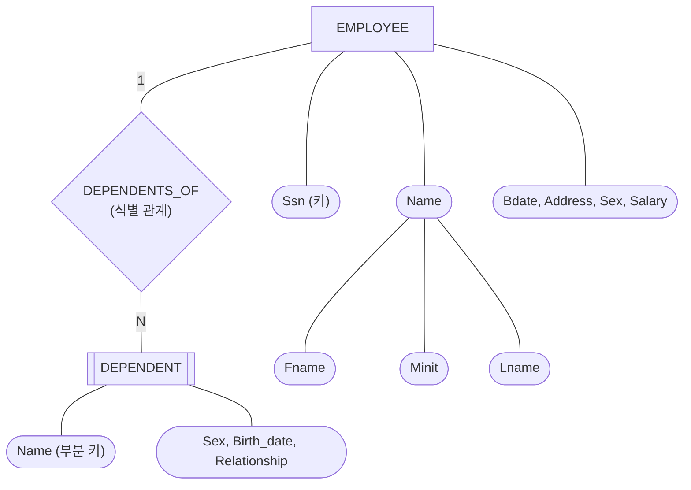



요약

ER 그림의 네모 하나는 표 하나가 된다. 네모에 달린 동그라미가 표의 칸이 되고, 밑줄 친 동그라미가 줄을 가려내는 대표 값이 된다. 여러 부분으로 된 동그라미는 가장 작은 부분만 칸이 되고, 값이 여럿인 동그라미는 여기서는 넣지 않는다. 혼자서는 줄을 가려낼 수 없는 겹네모는 주인 표의 대표 값을 빌려 와 자기 값과 묶어서 대표로 삼는다.

## 예시로 보기

ER 그림은 사람이 읽는 설계도다. DBMS에 넣으려면 릴레이션으로 옮겨야 한다. 이 옮기는 일을 사상(mapping)이라 부른다. 가장 먼저 옮기는 것이 개체 타입이다.

COMPANY ER 그림의 한 부분이다. 네모는 개체 타입, 겹네모는 약한 개체 타입, 마름모는 관계 타입, 둥근 칸은 속성이다. 자리를 아끼려고 단순 속성 몇 개를 한 칸에 모아 적었다.

이 그림에서 릴레이션 둘이 나온다.

| 릴레이션 | 속성 (굵은 것이 기본 키) |
|---|---|
| EMPLOYEE | Fname, Minit, Lname, **Ssn**, Bdate, Address, Sex, Salary |
| DEPENDENT | **Essn**, **Dependent_name**, Sex, Bdate, Relationship |

EMPLOYEE에는 Name이라는 칸이 없다. 성분인 Fname, Minit, Lname만 있다. DEPENDENT에는 그림에 없던 Essn이 생겼다. 주인인 직원의 Ssn을 빌려 온 것이다.

검증: 일반 개체 타입 셋을 옮긴 결과(EMPLOYEE 8열, DEPARTMENT 2열, PROJECT 3열)와 빠지는 속성, Dname·Pname도 값이 안 겹침, DEPENDENT 7줄에서 이름 6가지·주인 3명·짝 7가지, 주인 없는 부양가족은 거부, CAR를 옮긴 결과 — [39_mapping-entity-types_verify.py](/Hongs_Blog/studies/database-design/code/39_mapping-entity-types_verify/)

## 옮기는 규칙

**일반 개체 타입.** 자기 키 속성이 있는 개체 타입 $$E$$마다 릴레이션 $$R$$을 하나 만든다. 이렇게 만든 릴레이션을 개체 릴레이션(entity relation)이라 부른다.

1. $$E$$의 단순 속성을 모두 $$R$$의 속성으로 넣는다.
2. 복합 속성은 그 단순 성분만 넣는다.
3. $$E$$의 키 속성 가운데 하나를 골라 $$R$$의 기본 키로 삼는다.

COMPANY에서 일반 개체 타입 셋을 옮기면 이렇게 된다.

| 개체 타입 | 릴레이션 | 기본 키 | 아직 안 들어간 것 |
|---|---|---|---|
| EMPLOYEE | EMPLOYEE(Fname, Minit, Lname, Ssn, Bdate, Address, Sex, Salary) | Ssn | — |
| DEPARTMENT | DEPARTMENT(Dname, Dnumber) | Dnumber | Locations(값이 여럿), Number_of_employees(계산해서 얻는 값) |
| PROJECT | PROJECT(Pname, Pnumber, Plocation) | Pnumber | — |

- 값이 여럿인 Locations는 한 칸에 못 들어간다. 이 속성은 다음 단계에서 따로 옮긴다. 방법은 [다치 속성의 사상](/Hongs_Blog/studies/database-design/mapping-multivalued-attributes/)에 있다.
- 직원 수 Number_of_employees는 완성된 릴레이션 어디에도 없다. 직원 튜플을 세면 나오는 값이라 따로 적어 두지 않는다[^s2].
- DEPARTMENT와 PROJECT는 그림에서 Name과 Number에 둘 다 밑줄이 있다. 키 속성이 둘이라는 뜻이다. 하나(번호)만 기본 키가 되고, 이름은 값이 안 겹친다는 조건만 따로 건다. `CREATE TABLE`에서는 이것을 `UNIQUE (Dname)`으로 적는다[^s2].
- 그림의 Name, Number가 릴레이션에서는 Dname, Dnumber로 바뀌었다. 여러 릴레이션의 속성을 섞어 쓸 때 헷갈리지 않게 머리글자를 붙인 것이다[^s2].
- 키 속성이 복합 속성이면 그 성분들을 묶은 것이 기본 키다. 영화를 (제목, 개봉 해)로 가려낸다면 기본 키는 (Title, Year)다[^s2].

**약한 개체 타입.** 자기 키 속성이 없는 개체 타입 $$W$$도 릴레이션 $$R$$을 하나 만든다. 주인 개체 타입(소유 개체 타입)의 도움을 받는다.

1. $$W$$의 단순 속성을 모두 넣는다. 복합 속성은 단순 성분만 넣는다.
2. 주인의 릴레이션의 기본 키를 외래 키로 넣는다. 이것으로 식별 관계 타입도 함께 옮겨진다.
3. 기본 키는 주인의 기본 키와 $$W$$의 부분 키를 묶은 것이다.

DEPENDENT의 주인은 EMPLOYEE다. 그래서 Ssn을 Essn이라는 이름으로 넣고, 기본 키를 (Essn, Dependent_name)으로 삼는다. 마름모 DEPENDENTS_OF는 따로 옮기지 않는다. Essn이 이미 "누구의 부양가족인가"를 적고 있다.

왜 두 속성을 묶어야 할까? 상태를 보면 알 수 있다.

| Essn | Dependent_name | Relationship |
|---|---|---|
| 333445555 | Alice | Daughter |
| 123456789 | Alice | Daughter |
| 333445555 | Theodore | Son |

Dependent_name만으로는 Alice가 둘이라 겹친다. Essn만으로도 333445555가 여러 줄에 나와 겹친다. 둘을 묶으면 일곱 줄이 모두 다르다. 부분 키는 "같은 주인 안에서만" 값이 다르기 때문이다.

덤으로 따라오는 것이 있다. Essn은 기본 키의 한 부분이라 NULL일 수 없다([개체 무결성 제약](/Hongs_Blog/studies/database-design/entity-integrity-constraint/)). 외래 키라서 없는 직원을 가리킬 수도 없다. 그래서 주인 없는 부양가족은 넣을 수 없다. 약한 개체는 식별 관계에 늘 전체 참여한다는 ER의 규칙이 릴레이션에서 저절로 지켜진다.

## 활용

- **알아보는 신호.** 그림에 네모가 있으면 표 하나, 겹네모가 있으면 "주인의 키를 빌려 오는 표" 하나다. 마름모를 보기 전에 네모부터 모두 옮긴다. 관계를 옮길 때 양쪽 릴레이션의 기본 키가 정해져 있어야 하기 때문이다.
- **대표 문제.** ① 복합 속성과 키 속성이 여럿인 일반 개체(위의 EMPLOYEE, DEPARTMENT, 아래 카드의 CAR). ② 주인이 있는 약한 개체(DEPENDENT).
- **흔한 실수.** 복합 속성의 이름(Name)까지 칸으로 넣는 것. 약한 개체의 기본 키를 부분 키 하나로만 적는 것.
- 전체 절차와 연습: [ER-관계형 사상 절차](/Hongs_Blog/studies/database-design/er-to-relational-mapping/), [ER-관계형 사상 예제 사다리](/Hongs_Blog/studies/database-design/er-mapping-ladder/)

## 연결

- 선수: [개체 타입과 개체 집합](/Hongs_Blog/studies/database-design/entity-type-and-set/), [속성의 종류](/Hongs_Blog/studies/database-design/er-attribute-types/), [약한 개체 타입](/Hongs_Blog/studies/database-design/weak-entity-type/)
- 두 개체 타입의 차이: [일반 개체 타입과 약한 개체 타입 비교](/Hongs_Blog/studies/database-design/regular-vs-weak-entity/)
- ER의 키 속성이 릴레이션의 기본 키가 된다: [키 속성](/Hongs_Blog/studies/database-design/key-attribute/), [슈퍼키·후보 키·기본 키](/Hongs_Blog/studies/database-design/relational-keys/)
- 다음 단계: [다치 속성의 사상](/Hongs_Blog/studies/database-design/mapping-multivalued-attributes/)

## 확인 문제

**C1** 개체 타입 CAR의 속성은 Vehicle_id(키), Registration(Number, State)(복합 속성이자 키), Make, Model, Year, 그리고 값이 여럿인 Color다. 이 개체 타입을 릴레이션으로 옮겨라. 기본 키로 삼을 수 있는 것은 무엇인가?

**답:** CAR(Vehicle_id, Reg_number, Reg_state, Make, Model, Year). 여섯 칸이다. 기본 키는 Vehicle_id로 삼거나 (Reg_number, Reg_state)로 삼는다. 속성이 하나인 Vehicle_id가 더 낫다. Color는 이 릴레이션에 넣지 않는다. 
**이유:** Registration은 복합 속성이라 성분 둘만 들어간다. 번호만으로는 키가 아니다. 예를 들어 번호가 ABC 123인 차가 텍사스와 뉴욕에 한 대씩 있을 수 있다. Registration의 성분 이름은 Number와 State뿐이다. Reg_number, Reg_state는 무엇의 번호인지 드러나게 여기서 붙인 칸 이름이다.

**C2** DEPENDENT의 기본 키는 왜 Dependent_name 하나가 아니라 (Essn, Dependent_name)인가? COMPANY의 상태에서 반례를 들어라.

**답:** 부분 키는 같은 주인에게 딸린 개체들 사이에서만 값이 다르다. 상태에 Alice가 둘 있다(직원 333445555의 딸과 직원 123456789의 딸). 이름만으로는 두 튜플을 가려낼 수 없다. 주인의 키 Essn과 묶어야 일곱 줄이 모두 다르다.

**C3** 개체 타입을 옮길 때 다음 가운데 그 릴레이션의 칸이 되는 것을 골라라. (가) 단순 속성 Salary (나) 복합 속성의 이름 Name (다) 복합 속성의 성분 Fname (라) 다치 속성 Locations (마) 유도 속성 Number_of_employees (바) 약한 개체의 주인이 가진 기본 키

**답:** (가), (다), (바). 
**이유:** (나) 복합 속성은 성분만 들어간다. (라) 값이 여럿이라 릴레이션을 따로 만든다. (마) 다른 값에서 계산되므로 적지 않는다. (바) 외래 키로 들어가 기본 키의 한 부분이 된다.

[^s2]: 복합 키 속성은 Elmasri & Navathe, *Fundamentals of Database Systems* 7판 9.1절의 1단계 설명을 따랐다 [확인필요: 판과 절 번호].

