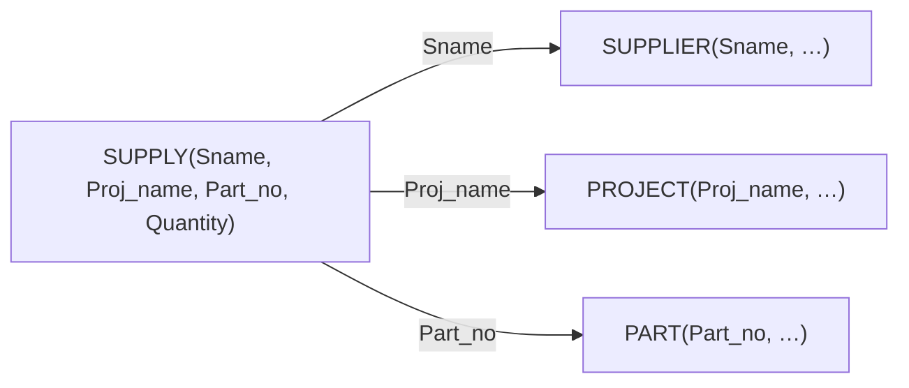



요약

직원 한 명이 여러 프로젝트에서 일하고, 프로젝트 하나에 직원이 여럿 붙는다. 이런 연결은 어느 쪽 표에 칸을 더해도 한 칸에 여러 값이 필요해서 적을 수 없다. 그래서 "직원, 프로젝트" 짝 하나를 한 줄로 적는 표를 따로 만들고, 두 값을 묶은 것을 대표 값으로 삼고, 일한 시간처럼 짝에 달린 값도 여기에 적는다. 셋 이상이 한꺼번에 엮이는 연결도 같은 방법으로 적는다.

## 예시로 보기

일대다 관계는 "여럿" 쪽에 칸 하나를 더하면 됐다([일대다 관계 타입의 사상](/Hongs_Blog/studies/database-design/mapping-one-to-many-relationship/)). WORKS_ON은 양쪽이 다 "여럿"이다. COMPANY의 상태에서 세어 본다[^s1].

| 칸을 두는 곳 | 한 줄에 적어야 할 값의 수 |
|---|---|
| EMPLOYEE에 프로젝트 번호 | 많게는 4개 (Wong: 프로젝트 2, 3, 10, 20) |
| PROJECT에 직원 번호 | 많게는 3개 (프로젝트 2: Smith, English, Wong) |

어느 쪽도 한 칸으로는 안 된다. 다대다 관계 타입은 외래 키 속성 하나로는 적을 수 없다[^1]. 그래서 짝마다 한 줄을 쓰는 릴레이션을 새로 만든다[^1].

| Essn | Pno | Hours |
|---|---|---|
| 123456789 | 1 | 32.5 |
| 123456789 | 2 | 7.5 |
| 453453453 | 1 | 20.0 |
| 333445555 | 2 | 10.0 |
| … | … | … |

WORKS_ON의 16줄 가운데 앞부분이다. 전체는 [관계형 데이터베이스 스키마와 상태](/Hongs_Blog/studies/database-design/relational-database-schema/)에 있다. Smith(123456789)는 두 줄에 나오고, 프로젝트 1도 두 줄에 나온다. (Smith, 1)이라는 짝은 한 번만 나온다.

Hours는 직원의 값도 프로젝트의 값도 아니다. Smith는 프로젝트 1에서 32.5시간, 프로젝트 2에서 7.5시간 일한다. 짝에 달린 값이라 짝을 적는 이 릴레이션에 함께 들어간다[^s1].

검증: WORKS_ON 16줄에서 Essn 8가지·Pno 6가지·짝 16가지, 한 직원이 많게는 4개(Wong)·한 프로젝트에 많게는 3명, Smith의 시간, 같은 짝과 없는 직원·프로젝트는 거부, SUPPLY의 외래 키 셋과 기본 키, 프로젝트 2의 직원과 Wong의 프로젝트 — [43_mapping-many-to-many-relationship_verify.py](/Hongs_Blog/studies/database-design/code/43_mapping-many-to-many-relationship_verify/)

## 옮기는 규칙

**다대다 이항 관계 타입.** 방법은 관계 릴레이션(교차 참조) 하나뿐이다[^2].

1. 관계 타입 $$R$$을 나타내는 릴레이션 $$S$$를 따로 만든다.
2. 참여하는 개체 타입들을 옮긴 릴레이션의 기본 키를 $$S$$에 외래 키로 넣는다.
3. $$S$$의 기본 키는 그 외래 키를 모두 묶은 것이다.
4. 관계 타입의 단순 속성도 $$S$$의 속성으로 넣는다.

WORKS_ON을 옮기면 이렇게 된다[^1].

| 릴레이션 | 속성 (굵은 것이 기본 키) | 외래 키 |
|---|---|---|
| WORKS_ON | **Essn**, **Pno**, Hours | Essn → EMPLOYEE.Ssn, Pno → PROJECT.Pnumber |

기본 키가 왜 둘의 묶음일까? Essn은 16줄에 8가지 값뿐이라 겹친다. Pno도 6가지 값뿐이라 겹친다. 짝 (Essn, Pno)는 16가지로 모두 다르다. 같은 직원이 같은 프로젝트에 두 번 적힐 까닭이 없기 때문이다[^s1].

**n항 관계 타입.** 셋 이상의 개체 타입이 한꺼번에 엮인 관계 타입도 같은 규칙이다. 외래 키가 $$n$$개가 될 뿐이다[^3].

SUPPLY는 공급자, 프로젝트, 부품을 한꺼번에 엮는다. 공급자 $$s$$가 프로젝트 $$j$$에 부품 $$p$$를 지금 대고 있을 때 인스턴스 하나가 생긴다[^3].

| 릴레이션 | 속성 (굵은 것이 기본 키) | 외래 키 |
|---|---|---|
| SUPPLIER | **Sname**, … | — |
| PROJECT | **Proj_name**, … | — |
| PART | **Part_no**, … | — |
| SUPPLY | **Sname**, **Proj_name**, **Part_no**, Quantity | Sname → SUPPLIER, Proj_name → PROJECT, Part_no → PART |

관계 릴레이션 SUPPLY에서 화살표 셋이 나가 세 개체 릴레이션의 기본 키로 간다[^s2].

기본 키에 셋이 다 들어가야 하는 까닭은 작은 예로 보인다. 공급자 s1이 프로젝트 j1에 부품 1과 2를 대고, j2에도 부품 1을 대고, 공급자 s2도 j1에 부품 1을 댄다고 하자. 네 줄 (s1, j1, 1), (s1, j1, 2), (s1, j2, 1), (s2, j1, 1)에서 어느 두 속성을 골라도 값이 겹치는 줄이 있다. 셋을 묶어야 네 줄이 모두 다르다[^s2].

## 활용

- **알아보는 신호.** 마름모 양쪽에 M과 N이 적혀 있다. (min, max) 표기에서는 양쪽의 max가 모두 N이다. 마름모에 선이 셋 이상 붙어 있으면 n항이다.
- **대표 문제.** ① 속성이 달린 다대다(WORKS_ON과 Hours). ② 삼항 관계(SUPPLY와 Quantity).
- **릴레이션 수.** 일대일과 일대다는 외래 키로 옮기면 릴레이션이 늘지 않는다. 다대다와 n항은 관계 타입 하나에 릴레이션이 하나씩 는다. COMPANY의 관계 타입 여섯 가운데 릴레이션이 된 것은 WORKS_ON 하나다.
- **질의.** "Smith가 일하는 프로젝트의 이름"을 보려면 EMPLOYEE, WORKS_ON, PROJECT 셋을 이어야 한다: [SELECT-FROM-WHERE](/Hongs_Blog/studies/database-design/select-from-where/)
- **흔한 실수.** 관계 릴레이션의 기본 키를 외래 키 하나로만 잡는 것. Essn만 기본 키로 하면 직원이 프로젝트 하나에만 들어갈 수 있어 일대다가 되어 버린다.

## 연결

- 선수: [관계 타입과 관계 집합](/Hongs_Blog/studies/database-design/relationship-type-and-set/)(차수, 삼항 관계), [카디널리티 비율](/Hongs_Blog/studies/database-design/cardinality-ratio/), [일대다 관계 타입의 사상](/Hongs_Blog/studies/database-design/mapping-one-to-many-relationship/)
- Hours를 한쪽 개체로 옮길 수 없는 까닭: [관계 타입의 속성](/Hongs_Blog/studies/database-design/relationship-attributes/)
- 같은 꼴의 기본 키: [다치 속성의 사상](/Hongs_Blog/studies/database-design/mapping-multivalued-attributes/)
- 수학으로 보면: 관계 릴레이션의 상태는 개체 집합들의 곱집합의 부분집합, 곧 관계다. [관계와 그 성질](/Hongs_Blog/studies/discrete-math/relations/)

## 확인 문제

**C1** 학생(STUDENT, 기본 키 SId)과 분반(SECTION, 기본 키 SecId) 사이에 TAKES 관계 타입이 있고 속성 Grade가 달려 있다. (min, max) 표기로 학생 쪽은 (0, N), 분반 쪽은 (5, N)이다. 릴레이션으로 옮겨라.

**답:** 양쪽의 max가 N이라 다대다다. TAKES(SId, SecId, Grade). 기본 키는 (SId, SecId). 외래 키는 SId → STUDENT.SId, SecId → SECTION.SecId. 
**이유:** Grade는 "어느 학생이 어느 분반에서 받은 성적"이라 짝에 달린 값이다. 7주차 연습의 풀이가 이 답이다[^4]. 분반마다 학생이 다섯 이상이어야 한다는 (5, N)의 5는 이 릴레이션의 키와 외래 키로는 적히지 않는다.

**C2** WORKS_ON을 EMPLOYEE나 PROJECT에 외래 키 하나를 더하는 것으로 옮길 수 없는 까닭을 COMPANY의 상태로 보여라.

**답:** EMPLOYEE에 Pno를 넣으면 Wong의 한 칸에 프로젝트 넷(2, 3, 10, 20)을 적어야 한다. PROJECT에 Essn을 넣으면 프로젝트 2의 한 칸에 직원 셋(Smith, English, Wong)을 적어야 한다. 릴레이션의 한 칸에는 값 하나만 들어간다.

**C3** SUPPLY(Sname, Proj_name, Part_no, Quantity)의 기본 키를 (Sname, Proj_name) 둘로만 잡으면 넣을 수 없게 되는 사실을 하나 들어라.

**답:** 공급자 s1이 프로젝트 j1에 부품 1과 부품 2를 둘 다 대는 경우다. (s1, j1, 1)과 (s1, j1, 2)는 (Sname, Proj_name) 값이 같아서 둘째 줄이 거부된다. 세 속성을 모두 묶어야 두 줄이 다 들어간다.

[^1]: 데이터베이스 설계 7회 강의 자료 「7_relational-model」, p.27 (WORKS_ON(Essn, Pno, Hours), "An M:N relationship type cannot be represented by a single foreign key attribute"). 복습: 데이터베이스 설계 9회 강의 자료 「9_introduction-to-basic-SQL」, p.12
[^2]: 데이터베이스 설계 7회 강의 자료 「7_relational-model」, p.26 ("The only option for M:N relationships is the relationship relation (cross-reference)"), p.27 (옮기는 순서)
[^3]: 같은 자료, p.28 (Mapping of N-ary Relationship Types, SUPPLY). 복습: 데이터베이스 설계 9회 강의 자료 「9_introduction-to-basic-SQL」, p.13
[^4]: 데이터베이스 설계 7회 강의 자료 「7-relational-model-solutions」, p.6 (TAKES(SId, SecId, Grade))
[^s1]: 보충 한 줄에 적어야 할 값의 수, 값의 가짓수(8, 6, 16), Hours가 짝에 달린 값이라는 설명, 카드 C2는 원본에 없다. 6-2 p.21의 상태에서 검증 코드로 세었다.
[^s2]: 보충 Mermaid 그림 1개, SUPPLY의 네 줄 예, 카드 C3은 원본에 없다. 그림은 7 p.28의 화살표 셋을 옮긴 것이다. 슬라이드에는 SUPPLY의 튜플이 없어 네 줄을 지어냈고 검증 코드로 확인했다.

