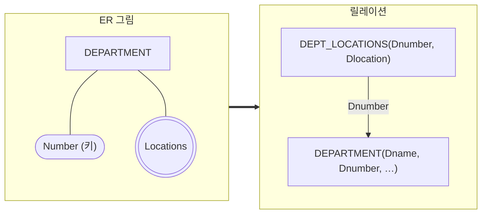



요약

부서 하나가 여러 곳에 있으면 그 위치를 표의 한 칸에 다 적을 수 없다. 그래서 "부서 번호, 위치" 두 칸짜리 표를 따로 만들고 위치마다 한 줄씩 적는다. 부서 번호는 원래 표의 부서를 가리키고, 두 칸을 묶어야 줄이 서로 겹치지 않는다. 그 대신 부서와 위치를 함께 보려면 표 둘을 이어 읽어야 한다.

## 예시로 보기

5번 부서(Research)는 Bellaire, Sugarland, Houston 세 곳에 있다. ER 그림에서는 DEPARTMENT에 겹동그라미 Locations를 달면 끝이다. 릴레이션에서는 한 칸에 값 하나만 들어간다([릴레이션의 특성](/Hongs_Blog/studies/database-design/relation-characteristics/)). 어디에 적어야 할까?

DEPARTMENT에 그대로 두고 위치마다 줄을 늘리면 이렇게 된다.

| Dname | Dnumber | Mgr_ssn | Dlocation |
|---|---|---|---|
| Research | 5 | 333445555 | Bellaire |
| Research | 5 | 333445555 | Sugarland |
| Research | 5 | 333445555 | Houston |
| Administration | 4 | 987654321 | Stafford |
| Headquarters | 1 | 888665555 | Houston |

Dnumber 5가 세 번 나온다. 기본 키 값이 겹쳐서 Dnumber는 더는 기본 키가 못 된다. 부서 이름과 관리자도 세 번 적힌다. 관리자가 바뀌면 세 줄을 다 고쳐야 한다.

그래서 위치만 따로 떼어 낸다.

| DEPT_LOCATIONS | |
|---|---|
| **Dnumber** | **Dlocation** |
| 1 | Houston |
| 4 | Stafford |
| 5 | Bellaire |
| 5 | Sugarland |
| 5 | Houston |

DEPARTMENT는 부서마다 한 줄 그대로이고, 위치는 DEPT_LOCATIONS에 다섯 줄로 들어간다.

검증: DEPT_LOCATIONS 5줄에서 부서 번호 3가지·위치 4가지·짝 5가지, 없는 부서의 위치와 같은 짝은 거부, 부서별로 다시 모은 값, 한 표에 두었을 때 Dnumber 5와 Research가 세 번, Houston에 있는 부서, CAR의 색 5줄 — [40_mapping-multivalued-attributes_verify.py](/Hongs_Blog/studies/database-design/code/40_mapping-multivalued-attributes_verify/)

## 옮기는 규칙

다치 속성 $$A$$마다 릴레이션 $$R$$을 따로 하나 만든다.

1. $$R$$에 $$A$$를 나타내는 속성을 넣는다.
2. $$A$$를 가진 개체 타입(또는 관계 타입)을 옮긴 릴레이션의 기본 키를 $$R$$에 외래 키로 넣는다. 이 기본 키를 $$K$$라 부른다[^s2].
3. $$R$$의 기본 키는 $$A$$와 $$K$$를 묶은 것이다.

COMPANY에서는 $$A$$가 Locations, $$K$$가 DEPARTMENT의 Dnumber다. 그래서 DEPT_LOCATIONS(Dnumber, Dlocation)가 나오고, 기본 키는 (Dnumber, Dlocation), 외래 키는 Dnumber → DEPARTMENT.Dnumber다.

겹동그라미 Locations가 릴레이션 하나로 나오고, 그 릴레이션의 Dnumber가 DEPARTMENT를 가리킨다.

왜 기본 키가 두 속성의 묶음일까? 값이 여럿이니 개체의 키 값이 되풀이되어 들어간다. Dnumber 5가 세 번 나온다. Dlocation도 혼자서는 겹친다. Houston에 부서가 둘(1번과 5번) 있다. 둘을 묶은 (5, Houston)은 한 번만 나온다.

다치 속성이 관계 타입에 달려 있어도 같은 규칙이다. 그때 $$K$$는 그 관계 타입을 옮긴 릴레이션의 기본 키다. 영화 예제의 "배우가 그 영화에서 한 대사들"이 그런 경우다: [ER-관계형 사상 예제 사다리](/Hongs_Blog/studies/database-design/er-mapping-ladder/)

## 활용

- **알아보는 신호.** ER 그림의 겹동그라미, 요구 사항의 "하나 이상의", "여러" 같은 말.
- **값을 다시 모으기.** "5번 부서는 어디에 있나"는 DEPT_LOCATIONS에서 Dnumber가 5인 줄을 모으면 된다. 부서 이름과 함께 보려면 DEPARTMENT와 이어야 한다. 떼어 낸 값을 얻는 대신 표를 잇는 일이 하나 생긴다.
- **흔한 실수.** `Bellaire, Sugarland, Houston`을 한 칸에 글자로 적는 것. Dlocation1, Dlocation2, Dlocation3처럼 칸을 여러 개 만드는 것. 앞의 것은 원자값이 아니고, 뒤의 것은 위치가 네 곳인 부서를 적을 수 없다.
- 전체 절차: [ER-관계형 사상 절차](/Hongs_Blog/studies/database-design/er-to-relational-mapping/)

## 연결

- 선수: [속성의 종류](/Hongs_Blog/studies/database-design/er-attribute-types/)(다치 속성), [릴레이션의 특성](/Hongs_Blog/studies/database-design/relation-characteristics/)(원자값), [개체 타입의 사상](/Hongs_Blog/studies/database-design/mapping-entity-types/)
- 같은 꼴: 약한 개체를 옮긴 릴레이션도 "남의 기본 키 + 자기 값"을 기본 키로 삼는다. 다대다 관계를 옮긴 릴레이션도 외래 키를 묶어 기본 키로 삼는다([다대다·n항 관계 타입의 사상](/Hongs_Blog/studies/database-design/mapping-many-to-many-relationship/)).

## 확인 문제

**C1** 개체 타입 CAR의 기본 키는 Vehicle_id이고, 값이 여럿인 속성 Color가 있다. 세 대의 색은 TK629가 {red, black}, WP9872가 {blue}, TD729가 {white, blue}다. Color를 릴레이션으로 옮기고, 그 릴레이션이 몇 줄인지, 기본 키와 외래 키가 무엇인지 쓰라.

**답:** CAR_COLOR(Vehicle_id, Color). 다섯 줄이다: (TK629, red), (TK629, black), (WP9872, blue), (TD729, white), (TD729, blue). 기본 키는 (Vehicle_id, Color), 외래 키는 Vehicle_id → CAR.Vehicle_id. 
**이유:** TK629가 두 번, blue가 두 번 나와서 어느 속성도 혼자서는 키가 아니다. 릴레이션 이름 CAR_COLOR는 DEPT_LOCATIONS를 본떠 붙인 것이다.

**C2** DEPT_LOCATIONS의 기본 키는 왜 Dnumber 하나가 아닌가? Dlocation 하나도 아닌 까닭은? 상태에서 근거를 들어라.

**답:** Dnumber 5가 세 줄에 나오고, Houston이 두 줄(1번, 5번 부서)에 나온다. 어느 쪽도 혼자서는 값이 겹친다. (Dnumber, Dlocation)을 묶어야 다섯 줄이 모두 다르다.

**C3** COMPANY의 상태에서 Houston에 있는 부서의 번호를 모두 구하라. 어느 릴레이션을 보면 되는가?

**답:** DEPT_LOCATIONS에서 Dlocation이 Houston인 줄을 고른다. 1번과 5번이다.

[^s2]: Elmasri & Navathe, *Fundamentals of Database Systems* 7판 9.1절의 같은 단계는 $$K$$를 "그 속성을 가진 개체 타입이나 관계 타입을 나타내는 릴레이션의 기본 키"로 적는다 [확인필요: 판과 절 번호].

