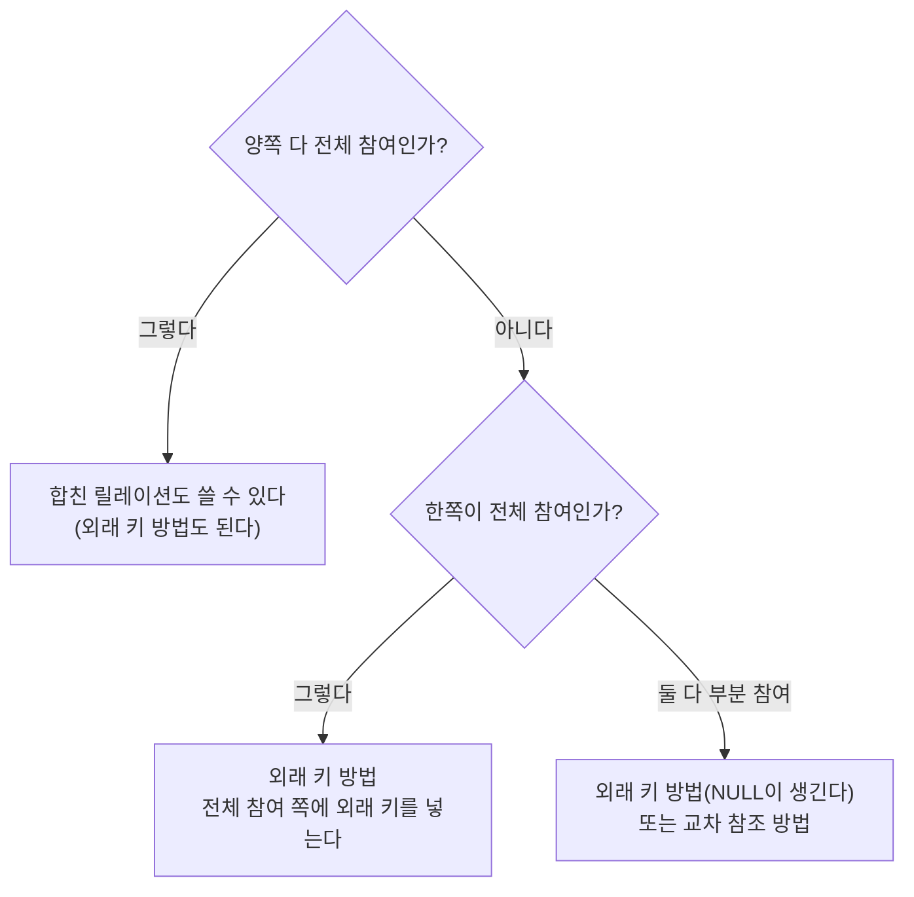



요약

부서마다 관리자가 한 명이고, 한 사람은 많아야 한 부서만 관리한다. 이런 일대일 연결은 한쪽 표에 상대의 대표 값을 적는 칸 하나를 더하면 적을 수 있다. 어느 쪽에 더하느냐가 문제인데, 빠짐없이 연결되는 쪽에 더해야 빈칸이 안 생긴다. 두 표를 하나로 합치는 길(양쪽이 모두 빠짐없이 연결될 때만 된다)과 연결만 적는 표를 따로 만드는 길(표가 하나 늘어난다)도 있다.

## 예시로 보기

개체 타입을 다 옮기고 나면 EMPLOYEE와 DEPARTMENT 릴레이션이 따로 있다. "누가 어느 부서를 관리하는가"(MANAGES)는 아직 어디에도 없다. MANAGES는 직원 1 : 부서 1인 관계 타입이다. 모든 부서에는 관리자가 있어야 하고(전체 참여), 직원은 대부분 관리자가 아니다(부분 참여)[^1].

상대의 기본 키를 적는 칸을 어느 쪽에 둘지 두 가지로 해 본다. COMPANY의 상태로 세면 이렇다[^s1].

| 칸을 두는 곳 | 더하는 칸 | 채워지는 칸 | NULL인 칸 |
|---|---|---|---|
| DEPARTMENT (전체 참여 쪽) | Mgr_ssn | 3개 가운데 3개 | 0개 |
| EMPLOYEE (부분 참여 쪽) | D_managed | 8개 가운데 3개 | 5개 |

DEPARTMENT에 두면 빈칸이 없다. EMPLOYEE에 두면 관리자가 아닌 직원 다섯 명의 칸이 NULL이다. 직원 여덟 명 가운데 다섯 명이다. 관리를 시작한 날짜(Mgr_start_date)까지 EMPLOYEE로 옮기면 NULL은 열 칸이 된다.

검증: Mgr_ssn 3칸 모두 값, D_managed는 8명 가운데 5명이 NULL(날짜까지 10칸), 합치면 8줄 가운데 5줄의 부서 칸이 NULL, MANAGES(Essn, Dno) 3줄과 두 방법의 질의 결과가 같음, UNIQUE가 없으면 한 직원이 두 부서의 관리자가 됨 — [41_mapping-one-to-one-relationship_verify.py](/Hongs_Blog/studies/database-design/code/41_mapping-one-to-one-relationship_verify/)

## 세 가지 방법

1:1인 이항 관계 타입 $$R$$을 옮기는 방법은 셋이다. 관계에 참여하는 두 개체 타입을 옮긴 릴레이션을 $$S$$와 $$T$$라 부른다[^2].

**방법 1. 외래 키 방법.** 가장 자주 쓰고 쓸모도 가장 크다[^2].

1. 두 릴레이션 가운데 하나를 $$S$$로 고르고, $$T$$의 기본 키를 $$S$$에 외래 키로 넣는다.
2. $$R$$에 전체 참여하는 개체 타입 쪽을 $$S$$로 고르는 것이 좋다.
3. $$R$$의 단순 속성도 $$S$$의 속성으로 넣는다.

MANAGES에서는 DEPARTMENT가 전체 참여라 $$S$$가 된다. EMPLOYEE의 기본 키 Ssn을 Mgr_ssn이라는 이름으로 넣고, 관계의 속성 Start_date를 Mgr_start_date로 넣는다[^3].

| 릴레이션 | 속성 (굵은 것이 기본 키) | 외래 키 |
|---|---|---|
| EMPLOYEE | Fname, Minit, Lname, **Ssn**, Bdate, Address, Sex, Salary | — |
| DEPARTMENT | Dname, **Dnumber**, Mgr_ssn, Mgr_start_date | Mgr_ssn → EMPLOYEE.Ssn |

왜 전체 참여 쪽일까? 부분 참여 쪽을 $$S$$로 고르면 관계에 끼지 않는 튜플의 외래 키가 NULL이 된다. 부서를 관리하지 않는 직원의 D_managed가 NULL이다[^4].

**방법 2. 합친 릴레이션 방법.** 두 개체 타입과 관계를 릴레이션 하나로 합친다. 양쪽이 모두 전체 참여일 때 쓸 수 있다. 그때는 두 릴레이션의 튜플 수가 늘 같다[^5].

한쪽이라도 전체 참여가 아니면 어떻게 될까? COMPANY는 직원 8명, 부서 3개라 튜플 수가 다르다. 억지로 합치면 여덟 줄 가운데 다섯 줄의 부서 칸(Dname, Dnumber)이 NULL이다. NULL이 든 Dnumber는 기본 키가 못 된다([개체 무결성 제약](/Hongs_Blog/studies/database-design/entity-integrity-constraint/)). 그래서 MANAGES에는 이 방법을 쓸 수 없다[^s2].

**방법 3. 교차 참조 방법.** 두 릴레이션은 그대로 두고, $$S$$와 $$T$$의 기본 키를 서로 이어 주는 릴레이션을 하나 더 만든다. 관계 타입의 이름 $$R$$을 그대로 붙인다. 이 릴레이션을 관계 릴레이션(relationship relation) 또는 조회 표(lookup table)라 부른다[^6].

1. $$S$$와 $$T$$의 기본 키를 $$R$$에 외래 키로 넣는다.
2. $$R$$의 기본 키는 두 외래 키 가운데 하나다.

| 릴레이션 | 속성 | 외래 키 |
|---|---|---|
| MANAGES | Essn, Dno | Essn → EMPLOYEE.Ssn, Dno → DEPARTMENT.Dnumber |

$$R$$의 튜플 하나는 관계 인스턴스 하나다. $$S$$의 튜플 하나와 $$T$$의 튜플 하나를 잇는다. COMPANY에서는 세 줄이다. 이 방법에는 치르는 값이 있다. 릴레이션 하나만큼 자리가 더 들고 계산도 더 든다[^6]. "부서 이름과 관리자의 성"을 보려면 외래 키 방법은 표 둘을, 이 방법은 표 셋을 이어야 한다[^s1]. 다대다 관계에서는 이 방법밖에 없다[^6]([다대다·n항 관계 타입의 사상](/Hongs_Blog/studies/database-design/mapping-many-to-many-relationship/)).

참여 제약을 보고 방법을 고르는 순서다. 가운데 갈래가 MANAGES다[^s3].

### 외래 키만으로는 "일대일"이 다 지켜지지 않는다

DEPARTMENT의 한 줄에는 Mgr_ssn 칸이 하나뿐이다. 그래서 부서 하나에 관리자가 둘일 수는 없다. 반대쪽은 다르다. 같은 Ssn을 두 부서의 Mgr_ssn에 적어도 외래 키 조건은 어기지 않는다. COMPANY의 표에 Wong을 관리자로 하는 부서를 하나 더 넣으면 그대로 들어간다. "한 직원은 많아야 한 부서를 관리한다"까지 지키려면 Mgr_ssn의 값이 겹치지 않는다는 조건(`UNIQUE`)을 따로 걸어야 한다[^s4].

## 활용

- **알아보는 신호.** 마름모 양쪽에 1이 적혀 있다. (min, max) 표기에서는 양쪽의 max가 모두 1이다([(min, max) 표기](/Hongs_Blog/studies/database-design/min-max-notation/)).
- **대표 문제.** ① MANAGES처럼 한쪽만 전체 참여: 그쪽에 외래 키. ② UNIVERSITY의 DEAN(단과대학마다 학장 한 명, 교수는 많아야 한 단과대학의 학장): 전체 참여인 COLLEGE에 DeanId를 넣는다([UNIVERSITY 사상 연습](/Hongs_Blog/studies/database-design/university-mapping-practice/)).
- **관계의 속성.** 관계 타입에 달린 속성은 외래 키를 넣은 쪽으로 함께 간다([관계 타입의 속성](/Hongs_Blog/studies/database-design/relationship-attributes/)).
- **흔한 실수.** 양쪽 릴레이션에 외래 키를 하나씩 다 넣는 것. 같은 사실을 두 곳에 적게 되어 한쪽만 고치면 서로 어긋난다.

## 연결

- 선수: [카디널리티 비율](/Hongs_Blog/studies/database-design/cardinality-ratio/), [참여 제약](/Hongs_Blog/studies/database-design/participation-constraint/), [개체 타입의 사상](/Hongs_Blog/studies/database-design/mapping-entity-types/)
- 다른 비율의 관계: [일대다 관계 타입의 사상](/Hongs_Blog/studies/database-design/mapping-one-to-many-relationship/), [다대다·n항 관계 타입의 사상](/Hongs_Blog/studies/database-design/mapping-many-to-many-relationship/)
- 전체 절차: [ER-관계형 사상 절차](/Hongs_Blog/studies/database-design/er-to-relational-mapping/)

## 확인 문제

**C1** 단과대학(COLLEGE, 기본 키 CName)과 교수(INSTRUCTOR, 기본 키 Id) 사이에 DEAN이라는 1:1 관계 타입이 있다. 단과대학마다 학장이 꼭 한 명 있고, 교수는 학장이 아닐 수도 있다. 외래 키 방법으로 옮겨라.

**답:** 전체 참여인 COLLEGE가 $$S$$다. COLLEGE에 INSTRUCTOR의 기본 키를 외래 키로 넣는다: COLLEGE(CName, COffice, CPhone, DeanId), DeanId → INSTRUCTOR.Id. 
**이유:** INSTRUCTOR에 넣으면 학장이 아닌 교수의 칸이 모두 NULL이 된다. 7주차 연습의 풀이가 이 답이다[^7].

**C2** MANAGES의 외래 키를 EMPLOYEE에 넣으면 COMPANY의 상태에서 NULL이 몇 칸 생기는가? DEPARTMENT에 넣으면? 이 차이는 어디서 오는가?

**답:** EMPLOYEE에 넣으면 8명 가운데 관리자가 아닌 5명의 칸이 NULL이다. DEPARTMENT에 넣으면 0칸이다. 부서는 모두 관계에 참여하고(전체 참여) 직원은 일부만 참여해서(부분 참여) 생기는 차이다.

**C3** 다음 1:1 관계 타입에는 세 방법 가운데 무엇을 쓸 수 있는가? (가) 양쪽이 모두 전체 참여다. (나) 한쪽만 전체 참여다. 합친 릴레이션 방법을 (나)에 쓰면 무엇이 곤란한가?

**답:** (가)는 세 방법을 다 쓸 수 있다. 두 릴레이션의 튜플 수가 늘 같아서 합쳐도 빈칸이 없다. (나)는 외래 키 방법(전체 참여 쪽에 넣는다)이나 교차 참조 방법을 쓴다. 합치면 짝이 없는 튜플의 절반 칸이 NULL이 되고, NULL이 든 쪽의 키는 기본 키가 못 된다.

**C4** DEPARTMENT(Dname, Dnumber, Mgr_ssn, Mgr_start_date)에 외래 키 Mgr_ssn → EMPLOYEE.Ssn만 걸었다. "한 직원은 많아야 한 부서를 관리한다"를 어기는데도 들어가는 튜플을 하나 들어라. 무엇을 더 걸어야 막히는가?

**답:** ('Planning', 9, '333445555', NULL). Wong은 이미 Research의 관리자인데 이 튜플도 들어간다. 외래 키는 "있는 직원을 가리키는가"만 본다. Mgr_ssn에 값이 겹치지 않는다는 조건(`UNIQUE`)을 걸어야 거부된다.

[^1]: 데이터베이스 설계 7회 강의 자료 「7_relational-model」, p.16~17 (MANAGES, "Every department should have a manager (total participation)")
[^2]: 같은 자료, p.16 (세 방법, "most frequently used and useful"), p.17 (외래 키 방법의 순서). 복습: 데이터베이스 설계 9회 강의 자료 「9_introduction-to-basic-SQL」, p.10
[^3]: 데이터베이스 설계 7회 강의 자료 「7_relational-model」, p.17 ("The entity type DEPARTMENT is chosen as the role of S", Mgr_ssn과 Mgr_start_date)
[^4]: 같은 자료, p.18 (D_managed, "NULL value for employees who do not manage a department")
[^5]: 같은 자료, p.19 (Merged relation approach, "both participation are total (otherwise?)")
[^6]: 같은 자료, p.20 (Cross-reference approach, MANAGES(Essn, Dno), 빨간 글씨 "Requiring extra space for a new relation and extra computational overhead", "This approach is required for binary M:N relationships")
[^7]: 데이터베이스 설계 7회 강의 자료 「7-relational-model-solutions」, p.4 (COLLEGE에 DeanId)
[^s1]: 보충 NULL인 칸의 수(0, 5, 10), 교차 참조 릴레이션의 줄 수, 표를 둘 잇는 질의와 셋 잇는 질의의 견줌, 카드 C2는 원본에 없다. 6-2 p.21의 상태에서 검증 코드로 세었다.
[^s2]: 보충 슬라이드 p.19의 "(otherwise?)"에는 답이 없다. 튜플 수가 다른 두 릴레이션을 합쳤을 때의 NULL과 기본 키 문제는 검증 코드로 확인한 것이다.
[^s3]: 보충 Mermaid 그림 1개는 원본에 없다. 위 두 갈래는 슬라이드 p.17~19의 글이고, "둘 다 부분 참여" 갈래는 슬라이드에 없어 p.18(NULL이 생긴다)과 p.20(교차 참조)에서 이어 붙였다.
[^s4]: 보충 외래 키만으로는 반대쪽의 "많아야 하나"가 지켜지지 않는다는 절과 카드 C4는 원본에 없다. 9 p.17의 `CREATE TABLE DEPARTMENT`에는 Mgr_ssn에 `UNIQUE`가 없다. SQLite에서 실행해 확인했다.

