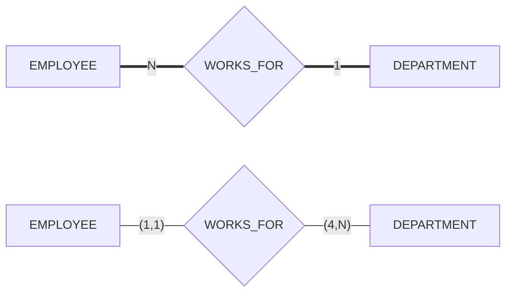



요약

놀이기구 앞의 "한 번에 2명 이상 4명까지" 팻말처럼, 이어질 수 있는 횟수의 아래 한계와 위 한계를 숫자 두 개로 적는 방법이다. 어떤 대상 하나가 그 관계에 적어도 몇 번, 많아야 몇 번 끼는지를 그 대상 바로 옆에 적는다. "하나 대 여럿"으로만 적는 방식보다 자세해서 "2번에서 4번"처럼 딱 잘라 적을 수 있다. 조심할 점은 숫자가 놓이는 자리가 "하나 대 여럿" 방식과 정반대쪽이라, 어느 방식으로 그린 그림인지 모르고 읽으면 뜻을 거꾸로 읽는다는 것이다.

## 예시로 보기

"교수는 2과목에서 4과목을 가르친다"는 요구가 있다[^3]. 1, N으로 적는 방식으로는 이것을 "여럿(N)"이라고밖에 못 적는다. 1과목만 맡은 교수도, 10과목을 맡은 교수도 막지 못한다.

(min, max) 표기는 INSTRUCTOR 옆에 (2,4)를 적는다. "교수 한 명은 TEACHES 관계에 2번 이상 4번 이하 낀다"는 뜻이다.

| 교수 한 명이 가르치는 과목 | 낀 횟수 | (2,4)를 지키는가 |
|---|---|---|
| $$c_1$$, $$c_2$$ | 2 | 지킨다 |
| $$c_2$$, $$c_3$$, $$c_4$$ | 3 | 지킨다 |
| $$c_1$$, $$c_2$$, $$c_3$$, $$c_4$$ | 4 | 지킨다 |
| $$c_1$$ | 1 | 어긴다(아래 한계 2에 못 미친다) |
| $$c_1$$ ~ $$c_5$$ | 5 | 어긴다(위 한계 4를 넘는다) |

COMPANY의 WORKS_FOR를 두 방식으로 나란히 그리면 숫자의 자리가 바뀌는 것이 보인다[^1][^2][^s1].

윗줄은 1, N과 겹선으로 적은 그림이고 아랫줄은 (min, max)로 적은 그림이다. 둘은 같은 관계 타입이다. 윗줄에서 1은 DEPARTMENT 옆에 있는데, 아랫줄에서 (1,1)은 EMPLOYEE 옆에 있다.

- 아랫줄 읽기: 직원 한 명은 WORKS_FOR에 정확히 한 번 낀다. 곧 부서 하나에 속한다. 부서 하나는 WORKS_FOR에 4번 이상 낀다. 곧 직원이 4명 이상이다.
- 윗줄 읽기: 부서 하나에 직원 여럿(N), 직원 한 명에 부서 하나(1).

검증: (2,4)를 지키는 횟수와 어기는 횟수, COMPANY 여섯 관계의 (min, max)에서 뽑은 1/N 숫자·겹선이 슬라이드 4-2 p.5 그림과 모두 같은 것, 5주차 p.25~30의 글과 견준 결과(SUPERVISION의 참여만 다름), COMPANY 자료가 (4,N)만 어기는 것, 카드 C1~C5 — [30_min-max-notation_verify.py](/Hongs_Blog/studies/database-design/code/30_min-max-notation_verify/)

## 정의

관계 타입 $$R$$에 참여하는 개체 타입 $$E$$마다 숫자쌍 (min, max)를 하나씩 붙인다. 뜻은 이렇다. $$E$$의 개체는 누구든, 어느 때든, $$R$$의 관계 인스턴스에 min번 이상 max번 이하 끼어야 한다[^s2]. 숫자쌍은 $$E$$와 $$R$$을 잇는 선에서 $$E$$ 쪽에 적는다[^2].

기호로 쓰면, 개체 $$e$$가 낀 인스턴스의 수를 $$c(e)$$라 할 때

$$\forall e \in E:\quad \min \le c(e) \le \max, \qquad 0 \le \min \le \max,\ \max \ge 1$$

$$\forall e \in E$$는 "$$E$$의 모든 개체 $$e$$에 대해"로 읽는다. max 자리의 N은 위 한계가 없다는 뜻이다. 이항 관계에서는 인스턴스 하나가 상대 개체 하나와의 짝이므로, $$c(e)$$는 $$e$$와 이어진 상대 개체의 수와 같다[^s2].

**네 가지 기본 꼴.**

| 숫자쌍 | 옆에 있는 개체 하나는 | 참여 |
|---|---|---|
| (0,1) | 안 껴도 되고, 껴도 한 번뿐이다 | 부분 |
| (1,1) | 정확히 한 번 낀다 | 전체 |
| (0,N) | 안 껴도 되고, 몇 번이든 낀다 | 부분 |
| (1,N) | 적어도 한 번, 몇 번이든 낀다 | 전체 |

**1, N 표기와 오가는 법.** 같은 내용을 [카디널리티 비율](/Hongs_Blog/studies/database-design/cardinality-ratio/)과 [참여 제약](/Hongs_Blog/studies/database-design/participation-constraint/)으로 적은 것과 이렇게 이어진다.

- min이 0이면 부분 참여(홑선), 1 이상이면 전체 참여(겹선)다. 선은 같은 쪽에 그대로 있다[^4].
- max는 건너편으로 간다. $$E$$ 옆의 max가 1이면 1, N 표기에서는 **상대편** 개체 타입 옆에 1을 적는다. max가 N이면 상대편 옆에 N을 적는다[^s1].

거꾸로 가면 잃는 것이 있다. (2,4)를 1, N 표기로 옮기면 "N, 전체 참여"가 되고, 이것을 다시 (min, max)로 옮기면 (1,N)이다. 2와 4는 사라진다. (min, max)가 더 많은 것을 적는다.

**설계 이유.** 숫자쌍을 개체 타입 옆에 붙이는 까닭은 이 제약이 "그 개체 타입의 개체 하나하나"가 지켜야 하는 것이기 때문이다. 직원 옆의 (1,1)은 직원마다 따져 보면 되는 규칙이다.[^s4]

### COMPANY의 (min, max)

슬라이드 그림의 숫자쌍 열두 개다[^2].

| 관계 타입 | 개체 타입 (역할 이름) | (min, max) | 읽기 |
|---|---|---|---|
| WORKS_FOR | EMPLOYEE (Employee) | (1,1) | 직원은 정확히 한 부서에서 일한다 |
| | DEPARTMENT (Department) | (4,N) | 부서에는 직원이 4명 이상 있다 |
| MANAGES | EMPLOYEE (Manager) | (0,1) | 직원은 부서를 많아야 하나 관리한다 |
| | DEPARTMENT (Department Managed) | (1,1) | 부서의 관리자는 정확히 한 명이다 |
| CONTROLS | DEPARTMENT (Controlling Department) | (0,N) | 부서는 프로젝트를 몇 개든 관리한다. 없어도 된다 |
| | PROJECT (Controlled Project) | (1,1) | 프로젝트의 관리 부서는 정확히 하나다 |
| SUPERVISION | EMPLOYEE (Supervisor) | (0,N) | 직원은 부하를 몇 명이든 둔다. 없어도 된다 |
| | EMPLOYEE (Supervisee) | (0,1) | 직원의 상사는 많아야 한 명이다 |
| WORKS_ON | EMPLOYEE (Worker) | (1,N) | 직원은 프로젝트를 하나 이상 맡는다 |
| | PROJECT (Project) | (1,N) | 프로젝트에는 직원이 한 명 이상 있다 |
| DEPENDENTS_OF | EMPLOYEE (Employee) | (0,N) | 직원은 부양가족을 몇 명이든 둔다. 없어도 된다 |
| | DEPENDENT (Dependent) | (1,1) | 부양가족은 정확히 한 직원에 딸린다 |

이 열두 개에서 뽑은 비율과 참여는 1, N으로 그린 COMPANY 그림과 여섯 관계 모두 같다. 슬라이드의 글과는 SUPERVISION의 참여 한 군데만 다르다. 글 쪽이 틀린 것으로 보인다: [역할 이름과 재귀 관계](/Hongs_Blog/studies/database-design/recursive-relationship/)의 원본 오류 의심.

원본 오류 의심

원문: WORKS_FOR의 DEPARTMENT 쪽 (4,N) (5주차 p.34, p.31) / 문제점: 뒤에 나오는 COMPANY의 자료(6주차 6-2 p.21)에서 부서별 직원 수는 5번 4명, 4번 3명, 1번 1명이다. 4번과 1번 부서가 "직원 4명 이상"을 어긴다. 요구사항 설명(4주차 4-2 p.4)과 WORKS_FOR 설명(5주차 p.26)에도 4명이라는 조건은 없다. / 수정안: 자료에 맞추면 (1,N)이다. p.26의 "양쪽 다 전체 참여"와도 맞는다. / 근거: 검증 코드로 자료를 세면 열두 개 가운데 이 하나만 어기고, (1,N)으로 바꾸면 모두 지킨다.

### 스스로 설명해 보기

WORKS_FOR의 (1,1)과 (4,N)을 "부서 1 : 직원 N, 양쪽 전체 참여"로 옮기는 과정이다.

1. EMPLOYEE 옆의 (1,1)에서 "직원 한 명의 부서는 하나"가 나오는 근거

정의에서 나온다. EMPLOYEE 옆의 숫자쌍은 직원 한 명이 끼는 인스턴스 수의 한계다. WORKS_FOR의 인스턴스 하나는 (직원, 부서) 짝이고 같은 짝은 한 번만 들어간다. 그래서 직원이 낀 인스턴스의 수는 그 직원과 이어진 부서의 수와 같다. 위 한계가 1이니 부서는 많아야 하나다.

2. 그 1을 1, N 표기에서는 DEPARTMENT 옆에 적는 근거

1, N 표기의 약속에서 나온다. 그 표기에서 어떤 개체 타입 옆의 글자는 "건너편 개체 하나에 이쪽 개체가 몇 개까지 붙는가"다. "직원 한 명에 부서가 몇 개까지 붙는가"의 답 1은 부서 쪽, 곧 DEPARTMENT 옆에 적는다.

3. DEPARTMENT 옆의 (4,N)에서 EMPLOYEE 옆의 N이 나오는 근거

부서 하나가 끼는 인스턴스의 위 한계가 없다는 것은 부서 하나에 직원이 여럿 붙는다는 뜻이다. "부서 하나에 직원이 몇 명까지 붙는가"의 답 N은 직원 쪽, 곧 EMPLOYEE 옆에 적는다.

4. 양쪽 선이 모두 겹선이 되는 근거

아래 한계가 1과 4로 둘 다 1 이상이다. 아래 한계가 1 이상이면 그 개체 타입의 모든 개체가 적어도 한 번은 끼어야 하므로 전체 참여다.

이 변환의 핵심 아이디어는?

"누구 하나를 붙잡고 세는가"다. (min, max)는 숫자 옆에 있는 개체 하나를 붙잡고 센다. 1, N 표기는 건너편 개체 하나를 붙잡고 센 수를 이쪽에 적는다. 그래서 위 한계는 서로 반대쪽에 놓인다.

이 방법을 쓸 수 있는 다른 상황은?

처음 보는 표기의 그림을 읽을 때다. 숫자의 뜻을 짐작하기 전에 "이 숫자는 어느 쪽 개체 하나를 붙잡고 센 것인가"부터 확인한다. 숫자를 건너편에 적는 표기도 있고 옆에 적는 표기도 있다.

## 활용

- 요구 문장을 숫자쌍으로 옮길 때는 문장의 주어를 본다. 주어인 개체 타입 옆에 적는다. "A paper is reviewed by 2 to 4 reviewers"의 주어는 논문이므로 PAPER 옆에 (2,4)를 적는다[^5].
- 낱말이 한계를 알려 준다. 슬라이드의 풀이는 "does not have to"를 아래 한계 0으로, "has to"와 "at least one"을 아래 한계 1로 옮겼다[^4][^5]. "a single"은 위 한계 1, "many"는 위 한계 N이다[^s3].
- 표로 옮길 때: 위 한계가 1인 쪽의 표에 상대를 가리키는 열을 둘 수 있다. 아래 한계까지 1이면 그 열은 비면 안 된다: [일대다 관계 타입의 사상](/Hongs_Blog/studies/database-design/mapping-one-to-many-relationship/). (2,4)나 (4,N)처럼 0, 1, N이 아닌 한계는 열 하나로는 지킬 수 없어 따로 검사하는 규칙이 있어야 한다: [주장 CREATE ASSERTION](/Hongs_Blog/studies/database-design/sql-assertion/)[^s3]
- 다른 표기를 만나면: UML 클래스 다이어그램은 같은 숫자를 이 표기와 반대쪽 끝에 적는다[^s3].

## 연결

- 두 숫자가 각각 무엇을 대신하는가: 위 한계는 [카디널리티 비율](/Hongs_Blog/studies/database-design/cardinality-ratio/), 아래 한계는 [참여 제약](/Hongs_Blog/studies/database-design/participation-constraint/)
- 1, N으로 그린 그림과 기호: [ER 다이어그램 표기법](/Hongs_Blog/studies/database-design/er-diagram-notation/)
- 요구 문장에서 숫자쌍 뽑기 연습: [ER 모델 연습](/Hongs_Blog/studies/database-design/er-model-practice/)의 p3, [ER 다이어그램 설계 연습](/Hongs_Blog/studies/database-design/er-diagram-design-practice/)의 문제 3

## 자주 하는 오해

"(4,N)처럼 N이 적힌 쪽이 N쪽이다"

틀렸다. WORKS_FOR에서 (4,N)은 DEPARTMENT 옆에 있지만, 1:N의 N쪽은 EMPLOYEE다. 그럴듯해 보이는 까닭은 두 표기가 모두 숫자를 개체 타입 옆에 적어서, 같은 자리의 숫자는 같은 뜻이라고 여기기 때문이다. 실제로는 세는 방향이 반대다. (min, max)는 옆에 있는 개체 하나가 몇 번 끼는지를 적고, 1, N 표기는 건너편 개체 하나에 이쪽이 몇 개 붙는지를 적는다. 확인하는 법: 직원 한 명을 붙잡고 부서를 세면 1이고, 부서 하나를 붙잡고 직원을 세면 여럿이다. 여럿이 모이는 쪽인 EMPLOYEE가 N쪽이다. 그 "여럿"을 (min, max)는 DEPARTMENT 옆에 (4,N)으로 적는다.

## 확인 문제

**C1** MANAGES는 EMPLOYEE 옆에 (0,1), DEPARTMENT 옆에 (1,1)이다. 1, N 표기로 옮기면 비율은 무엇이고 겹선은 어느 쪽에 긋는가?

**답:** 비율은 1:1이다. 겹선은 DEPARTMENT 쪽에만 긋는다. EMPLOYEE 쪽은 홑선이다. 
**이유:** 위 한계가 양쪽 다 1이므로 건너편에 각각 1을 적는다. 아래 한계는 DEPARTMENT만 1이라 DEPARTMENT만 전체 참여다. 위 한계는 건너편으로 가지만 겹선(아래 한계)은 제자리에 있다는 점을 섞으면 "EMPLOYEE 쪽이 겹선"이라고 틀린다.

**C2** "학생은 동아리에 들지 않아도 되고, 들어도 2개까지만 든다. 동아리에는 회원이 5명 이상 있어야 한다." MEMBER_OF의 숫자쌍을 어느 개체 타입 옆에 무엇으로 적는가? 1, N 표기로는 어떻게 되는가?

**답:** STUDENT 옆에 (0,2), CLUB 옆에 (5,N)을 적는다. 1, N 표기로는 M:N이고, CLUB만 전체 참여(겹선)다. 
**이유:** 문장의 주어 옆에 적는다. "학생은 … 2개까지"는 학생 옆, "동아리에는 … 5명 이상"은 동아리 옆이다. 위 한계가 양쪽 다 1보다 크므로 M:N이다. 2와 5는 1, N 표기로 옮기면 사라진다[^s4].

**C3** 1, N 표기의 1과 (min, max)의 위 한계 1이 서로 반대쪽에 놓이는 까닭을 WORKS_FOR로 설명하라.

**답:** (min, max)는 옆에 있는 개체 하나를 붙잡고 센다. 직원 한 명이 끼는 횟수가 많아야 1이므로 (1,1)을 EMPLOYEE 옆에 적는다. 1, N 표기는 건너편 개체 하나에 이쪽 개체가 몇 개 붙는지를 이쪽에 적는다. 직원 한 명에 붙는 부서가 1개이므로 1을 DEPARTMENT 옆에 적는다. 같은 사실을 한쪽은 세는 개체 옆에, 한쪽은 세어지는 개체 옆에 적는 것이다. 
**이유:** 두 표기는 같은 사실을 적는데, 적는 자리의 약속만 다르다.

**C4** DEPENDENTS_OF에서 DEPENDENT 옆의 (1,1)을 어기는 자료를 두 가지 만들어라. 하나는 아래 한계를, 하나는 위 한계를 어기게 하라.

**답:** 아래 한계: 부양가족 $$x_1$$을 넣고 어느 직원에도 잇지 않는다(낀 횟수 0). 위 한계: $$x_1$$을 직원 $$e_1$$과 $$e_2$$ 둘 다에 잇는다(낀 횟수 2). 
**이유:** (1,1)은 "정확히 한 번"이다. 0번이면 주인 없는 부양가족이고, 2번이면 주인이 둘인 부양가족이다. 약한 개체는 주인 하나에 딸려야 하므로 둘 다 안 된다.

**C5** 다음 문장에 맞는 숫자쌍을 (0,1), (1,1), (0,N), (1,N)에서 고르고, 어느 개체 타입 옆에 적는지 쓰라. (a) 직원은 부서를 관리하지 않아도 되고, 관리해도 하나만 관리한다. (b) 프로젝트는 반드시 한 부서의 관리를 받는다. (c) 부서는 프로젝트를 관리하지 않아도 되고 여럿 관리해도 된다. (d) 프로젝트에는 직원이 한 명 이상 있다.

**답:** (a) (0,1), MANAGES의 EMPLOYEE 옆. (b) (1,1), CONTROLS의 PROJECT 옆. (c) (0,N), CONTROLS의 DEPARTMENT 옆. (d) (1,N), WORKS_ON의 PROJECT 옆. 
**이유:** "않아도 되고"는 아래 한계 0, "반드시"와 "한 명 이상"은 아래 한계 1이다. "하나만"과 "한 부서"는 위 한계 1, "여럿"과 "이상"은 위 한계 N이다. 숫자쌍은 늘 문장의 주어 옆에 간다.

[^1]: 데이터베이스 설계 4회 강의 자료 「4-2_ERmodel」, p.5 (COMPANY ER 다이어그램: 1, N, M과 겹선)
[^2]: 데이터베이스 설계 5회 강의 자료 「5_ERmodel」, p.34 (ER Diagram of COMPANY Database: (min, max)와 역할 이름). p.31에 같은 그림이 작게 있다.
[^3]: 데이터베이스 설계 5회 강의 자료 「5_ERmodel」, p.36 (Exercise 3: "Instructors teach from two to four courses"). 답 (2, 4)는 데이터베이스 설계 5회 강의 자료 「5_ERmodel-solution」, p.3
[^4]: 데이터베이스 설계 6회 강의 자료 「6-1_ER-diagram-solution」, p.33 (IS_CONTACT: "total participation (the minimum cardinality = 1)", "partial participation (the minimum cardinality = 0)")
[^5]: 데이터베이스 설계 6회 강의 자료 「6-1_ER-diagram-solution」, p.34 (REVIEWS: "A paper is reviewed by 2 to 4 reviewers, so its (min, max) constraint is (2,4) (i.e., total participation)")
[^s1]: 보충 두 방식을 나란히 놓은 다이어그램과 "위 한계는 건너편으로 간다"는 규칙은 슬라이드에 글로 적혀 있지 않다. 슬라이드의 두 COMPANY 그림(4-2 p.5와 5주차 p.34)을 견주어 썼고, 여섯 관계 모두에서 맞는 것을 검증 코드로 확인했다.
[^s2]: 보충 슬라이드는 (min, max)를 그림과 연습으로만 보이고 글로 정의하지 않는다. 정의와 식은 Elmasri & Navathe, *Fundamentals of Database Systems* 7판, 3장(ER 다이어그램의 다른 표기)의 것이다.
[^s3]: 보충 "a single", "many"를 한계로 옮기는 요령, 표로 옮길 때의 설명, UML의 숫자 자리는 슬라이드에 없다. UML에 대한 말은 Elmasri & Navathe, 같은 책 3장(UML 클래스 다이어그램)의 설명이다. "a single", "many"는 6주차 6-1 풀이 p.15~17의 문장과 답(1:N, M:N)에서 읽었다.
[^s4]: 보충 설계 이유, 스스로 설명해 보기, 오해 항목, 카드 C1~C5와 C2의 동아리 예는 원본에 없다. 답은 검증 코드로 확인했다.

