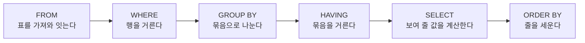


<div class="callout callout-summary" markdown="1">
<div class="callout-title callout-title--default" markdown="span">요약</div>

질의의 결과는 줄 순서가 정해져 있지 않아서, 같은 질의도 제품이나 때에 따라 줄이 다른 순서로 나올 수 있다. 줄을 세우려면 "무엇을 기준으로, 작은 것부터인지 큰 것부터인지"를 질의 맨 끝에 따로 적는다. 기준을 여러 개 적으면 앞 기준이 같은 줄끼리만 다음 기준으로 다시 세운다. 질의는 여섯 가지 절을 정해진 차례로 적는데, 적는 차례와 처리되는 차례가 달라서 뒤에서 붙인 이름을 앞 절에서 쓰지 못한다.

</div>


## 예시로 보기

표의 행에는 순서가 없다([릴레이션의 특성](/Hongs_Blog/studies/database-design/relation-characteristics/)). 그래서 "직원과 그가 일하는 프로젝트"를 뽑으면 16행이 뒤섞여 나온다. 같은 부서끼리, 그 안에서는 이름순으로 보고 싶으면 순서를 적어 줘야 한다[^1].

```sql
SELECT   D.Dname, E.Lname, E.Fname, P.Pname
FROM     DEPARTMENT AS D, EMPLOYEE AS E, WORKS_ON AS W, PROJECT AS P
WHERE    D.Dnumber = E.Dno AND E.Ssn = W.Essn AND W.Pno = P.Pnumber
ORDER BY D.Dname, E.Lname, E.Fname;
```

먼저 부서 이름으로 세우고, 부서 이름이 같은 행끼리는 성으로, 성도 같으면 이름으로 세운다. SQLite가 낸 결과의 앞 여덟 행은 이렇다[^s1].

| Dname | Lname | Fname | Pname |
|---|---|---|---|
| Administration | Jabbar | Ahmad | Computerization |
| Administration | Jabbar | Ahmad | Newbenefits |
| Administration | Wallace | Jennifer | Reorganization |
| Administration | Wallace | Jennifer | Newbenefits |
| Administration | Zelaya | Alicia | Computerization |
| Administration | Zelaya | Alicia | Newbenefits |
| Headquarters | Borg | James | Reorganization |
| Research | English | Joyce | ProductX |

그 뒤로 Research의 English, Narayan, Smith, Wong이 이어진다. 한 직원의 여러 프로젝트는 세 기준이 모두 같다. 그런 행끼리의 순서는 정해지지 않는다. English의 두 행을 SQLite는 ProductX, ProductY 순으로, PostgreSQL은 ProductY, ProductX 순으로 냈다.

<div class="callout callout-check" markdown="1">
<div class="callout-title" markdown="span">검증: 위 질의의 16행과 직원이 서는 순서, `DESC`를 붙인 판, 여섯 절을 모두 쓴 예의 (1, 1, 55000), (5, 3, 36000), `SELECT`에서 붙인 이름을 쓸 수 있는 절, NULL이 서는 자리. SQLite 3.50.4와 PostgreSQL 16에서 실행했고 두 가지가 다르다. `WHERE`와 `HAVING`에서 `SELECT`의 이름을 쓰면 PostgreSQL은 오류, SQLite는 받는다. 오름차순에서 NULL을 PostgreSQL은 맨 뒤에, SQLite는 맨 앞에 둔다 — [72_order-by-clause-order_verify.py](/Hongs_Blog/studies/database-design/code/72_order-by-clause-order_verify/), [72_order-by-clause-order_verify.sql](/Hongs_Blog/studies/database-design/code/72_order-by-clause-order_verify-sql/)</div>

</div>


## 정의

`ORDER BY` 절은 결과에 나오는 열 하나 이상의 값을 기준으로 결과 행을 줄 세운다[^1].

```
ORDER BY 열1 [ASC | DESC], 열2 [ASC | DESC], …
```

- `ASC`는 작은 값부터(오름차순), `DESC`는 큰 값부터(내림차순)다. 아무것도 적지 않으면 `ASC`다[^s1].
- 기준이 여럿이면 왼쪽 기준부터 견준다. 왼쪽 기준이 같은 행끼리만 다음 기준을 본다. `ASC`와 `DESC`는 기준마다 따로 붙는다.

기호로 쓰면, 기준이 $$A_1, A_2$$ 둘일 때 행 $$s$$가 행 $$t$$보다 앞에 오는 조건은 $$s[A_1] < t[A_1]$$이거나, $$s[A_1] = t[A_1]$$이면서 $$s[A_2] < t[A_2]$$인 것이다. $$s[A_1]$$은 "행 $$s$$의 $$A_1$$ 칸에 든 값"으로 읽는다. `DESC`가 붙은 기준은 $$<$$를 $$>$$로 바꾼다. 사전에서 낱말을 찾을 때 첫 글자부터 견주는 것과 같다([정렬과 정렬 기준](/Hongs_Blog/studies/algorithms/sorting/))[^s1].

`ORDER BY Dno ASC, Salary DESC`로 직원을 세우면 부서 번호가 작은 것부터, 같은 부서 안에서는 급여가 많은 사람부터다. Borg(1번), Wallace(4번, 43000), 그다음에 4번 부서의 25000 두 명(Zelaya, Jabbar), 이어서 5번 부서의 Wong, Narayan, Smith, English다. Zelaya와 Jabbar는 두 기준이 모두 같아 누가 앞인지 정해지지 않는다[^s1].

### 여섯 절을 적는 차례

검색 질의에는 절이 여섯 가지 있고, 이 차례로 적는다. 대괄호 안의 넷은 필요할 때만 적는다[^2].

```
SELECT   <속성과 함수의 목록>
FROM     <표의 목록>
[ WHERE    <조건> ]
[ GROUP BY <묶는 속성> ]
[ HAVING   <묶음 조건> ]
[ ORDER BY <속성 목록> ];
```

### 처리되는 차례

적는 차례는 `SELECT`가 맨 앞이지만, 뜻을 따질 때는 다음 차례로 읽는다[^s2].



여섯 절을 모두 쓴 질의로 따라가 본다. "남자 직원만 놓고 부서마다 인원과 평균 급여를 구하되, 평균이 30000을 넘는 부서만 평균이 큰 순으로 보여라."

```sql
SELECT   Dno, COUNT(*) AS N, AVG(Salary) AS Avg_sal
FROM     EMPLOYEE
WHERE    Sex = 'M'
GROUP BY Dno
HAVING   AVG(Salary) > 30000
ORDER BY Avg_sal DESC;
```

| 차례 | 절 | 그때의 표 |
|---|---|---|
| 1 | `FROM EMPLOYEE` | 8행 |
| 2 | `WHERE Sex = 'M'` | 5행: Smith(5, 30000), Wong(5, 40000), Narayan(5, 38000), Jabbar(4, 25000), Borg(1, 55000) |
| 3 | `GROUP BY Dno` | 3묶음: 5번(3명), 4번(1명), 1번(1명) |
| 4 | `HAVING AVG(Salary) > 30000` | 2묶음: 5번(36000), 1번(55000). 4번(25000)은 빠진다 |
| 5 | `SELECT …` | (5, 3, 36000), (1, 1, 55000) |
| 6 | `ORDER BY Avg_sal DESC` | (1, 1, 55000), (5, 3, 36000) |

이 차례 때문에 생기는 규칙이 둘 있다.

- `SELECT`에서 `AS`로 붙인 이름은 그보다 뒤인 `ORDER BY`에서 쓸 수 있다. 위의 `ORDER BY Avg_sal`이 그렇다. 그보다 앞인 `WHERE`와 `HAVING`에서는 쓸 수 없다. `SELECT Lname, Salary * 12 AS Yearly FROM EMPLOYEE WHERE Yearly > 400000`은 PostgreSQL 16에서 "column "yearly" does not exist" 오류다. SQLite는 받아 준다.
- `WHERE`는 묶기 전이라 집계 함수를 쓸 수 없다([WHERE와 HAVING 비교](/Hongs_Blog/studies/database-design/where-vs-having/)).

## 활용

- `ORDER BY`가 없는 질의의 줄 순서는 믿지 않는다. [GROUP BY](/Hongs_Blog/studies/database-design/group-by/)의 부서별 평균을 SQLite는 1, 4, 5번 순으로, PostgreSQL은 5, 4, 1번 순으로 냈다. 순서가 뜻이 있으면 적는다.
- NULL이 서는 자리는 제품마다 다르다. `ORDER BY Super_ssn`에서 상사가 없는 Borg는 PostgreSQL 16에서 맨 뒤에, SQLite에서 맨 앞에 선다. `DESC`를 붙이면 둘 다 반대가 된다([NULL 값과 IS NULL](/Hongs_Blog/studies/database-design/sql-null/))[^s1].
- 줄을 세우는 일은 결과가 다 만들어진 뒤에 한 번 더 하는 일이라, 필요할 때만 쓴다.
- 연습: [JOIN·GROUP BY 종합 연습](/Hongs_Blog/studies/database-design/advanced-sql-practice/)

## 연결

- 선수: [SELECT-FROM-WHERE](/Hongs_Blog/studies/database-design/select-from-where/), [HAVING](/Hongs_Blog/studies/database-design/having-clause/)
- 여러 기준으로 줄 세우기를 프로그램에서 하는 법: [정렬과 정렬 기준](/Hongs_Blog/studies/algorithms/sorting/)
- 표의 행에 순서가 없는 까닭: [릴레이션의 특성](/Hongs_Blog/studies/database-design/relation-characteristics/)

## 확인 문제

<details class="callout callout-question" markdown="1">
<summary class="callout-title" markdown="span">**C1** 검색 질의의 여섯 절을 적는 차례대로 쓰고, 꼭 있어야 하는 절 둘을 고르라.</summary>

**답:** SELECT, FROM, WHERE, GROUP BY, HAVING, ORDER BY. 꼭 있어야 하는 것은 SELECT와 FROM이다.

</details>


<details class="callout callout-question" markdown="1">
<summary class="callout-title" markdown="span">**C2** 직원의 (부서, 성, 급여)는 (5, Smith, 30000), (5, Wong, 40000), (4, Zelaya, 25000), (4, Wallace, 43000), (5, Narayan, 38000), (5, English, 25000), (4, Jabbar, 25000), (1, Borg, 55000)이다. `SELECT Dno, Lname, Salary FROM EMPLOYEE ORDER BY Dno ASC, Salary DESC;`의 첫 두 행과 마지막 행을 쓰라. 셋째 행은 누구로 정해지는가?</summary>

**답:** 첫 행 (1, Borg, 55000), 둘째 행 (4, Wallace, 43000), 마지막 행 (5, English, 25000). 셋째 행은 Zelaya일 수도 Jabbar일 수도 있다.<br>
**이유:** 부서 번호가 작은 것부터 서고, 같은 부서 안에서는 급여가 큰 것부터 선다. Zelaya와 Jabbar는 부서도 급여도 같아 두 기준으로는 앞뒤가 갈리지 않는다. 정하고 싶으면 `, Lname` 같은 기준을 하나 더 적는다.

</details>


<details class="callout callout-question" markdown="1">
<summary class="callout-title" markdown="span">**C3** `SELECT Dno, COUNT(*) AS N FROM EMPLOYEE GROUP BY Dno HAVING N > 2 ORDER BY N;`은 PostgreSQL에서 오류다. 어느 절이 틀렸고 왜 그런가? `ORDER BY N`은 왜 괜찮은가?</summary>

**답:** `HAVING N > 2`가 틀렸다. `N`이라는 이름은 `SELECT`에서 붙는데, `HAVING`은 `SELECT`보다 먼저 처리되어 그 이름을 아직 모른다. `HAVING COUNT(*) > 2`로 적어야 한다. `ORDER BY`는 `SELECT`보다 뒤에 처리되어 `N`을 쓸 수 있다.<br>
**이유:** 처리되는 차례가 FROM, WHERE, GROUP BY, HAVING, SELECT, ORDER BY이기 때문이다. SQLite는 이 질의를 받아 주지만, 그것은 SQLite가 너그러워서다.

</details>


[^1]: 데이터베이스 설계 11회 강의 자료 「11-2_SQL-DML-Complex」, p.35 (ORDER BY Clause: 결과에 나오는 속성의 값으로 줄 세우기, DESC와 ASC, Query 15). 데이터베이스 설계 12회 강의 자료 「12_SQL-DML-Complex-practices」, p.12에 같은 쪽이 다시 나온다.
[^2]: 데이터베이스 설계 11회 강의 자료 「11-2_SQL-DML-Complex」, p.37 (Summary: 여섯 절의 틀)
[^s1]: <span class="fn-tag" title="수업 자료에 없고 따로 보탠 내용">보충</span> Query 15의 결과 표, `ASC`가 기본이라는 점, 기호로 쓴 정의, `ORDER BY Dno ASC, Salary DESC`의 예, 세 기준이 같은 행의 순서와 NULL이 서는 자리, 카드 C2는 슬라이드에 없다. `ASC`가 기본이라는 것과 `DESC`를 섞어 쓰는 꼴은 Elmasri & Navathe, *Fundamentals of Database Systems* 7판 6.3절 "Ordering of Query Results"에 있다. 값은 SQLite와 PostgreSQL 16에서 실행해 확인했다.
[^s2]: <span class="fn-tag" title="수업 자료에 없고 따로 보탠 내용">보충</span> 절이 처리되는 차례와 그 그림, 여섯 절을 모두 쓴 예, `SELECT`에서 붙인 이름을 쓸 수 있는 절, 카드 C3은 슬라이드에 없다. 슬라이드는 적는 차례만 보인다. 처리되는 차례는 같은 교재 7.1절 "Discussion and Summary of SQL Queries"가 개념상의 차례로 설명한다. 표의 각 단계와 두 제품의 동작은 실행해 확인했다.

