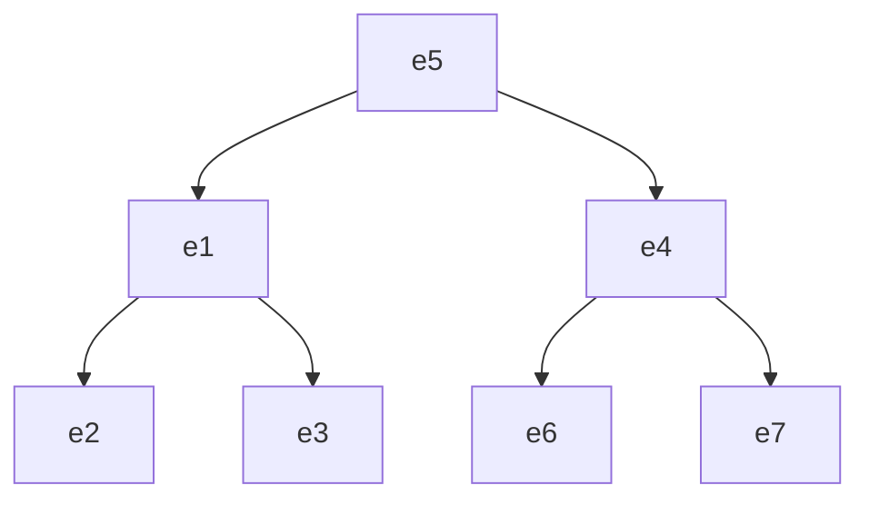



요약

회사에서는 직원이 직원을 감독한다. 줄의 양쪽 끝이 둘 다 "직원"이라, "김씨와 박씨가 감독으로 이어져 있다"고만 적으면 누가 윗사람인지 알 수 없다. 그래서 줄의 끝마다 "상사", "부하" 같은 이름표를 단다. 직원과 부서처럼 서로 다른 대상을 이을 때는 이름표가 없어도 되지만, 같은 종류의 대상이 양쪽에 다 올 때는 이름표가 없으면 뜻이 정해지지 않는다.

## 예시로 보기

"$$e_1$$과 $$e_2$$가 감독 관계"라는 줄은 두 가지로 읽힌다. $$e_1$$이 $$e_2$$의 상사일 수도 있고 그 반대일 수도 있다. 급여 결재선을 뽑으려면 어느 쪽인지 알아야 한다.

SUPERVISION을 그림으로 그리면 EMPLOYEE 개체 집합 하나에서 선이 두 가닥씩 나와 인스턴스에 닿는다. 선마다 1이나 2를 적는다. 1은 상사 구실, 2는 부하 구실이다. 그 그림을 표로 옮기면 이렇다.

| 줄 | 상사(선 1) | 부하(선 2) |
|---|---|---|
| $$r_1$$ | $$e_5$$ | $$e_1$$ |
| $$r_2$$ | $$e_1$$ | $$e_2$$ |
| $$r_3$$ | $$e_1$$ | $$e_3$$ |
| $$r_4$$ | $$e_5$$ | $$e_4$$ |
| $$r_5$$ | $$e_4$$ | $$e_6$$ |
| $$r_6$$ | $$e_4$$ | $$e_7$$ |

같은 $$e_1$$이 $$r_1$$에서는 부하이고 $$r_2$$, $$r_3$$에서는 상사다. 누가 누구 위인지 나무 모양으로 그리면 한눈에 보인다[^s1].

화살표는 상사에서 부하로 간다. 화살표 하나가 인스턴스 하나다.

검증: 인스턴스 여섯 개의 (상사, 부하), 부하 구실로는 누구나 많아야 한 번 나오는 것, $$e_5$$는 상사가 없고 $$e_2, e_3, e_6, e_7$$은 부하가 없는 것, COMPANY 자료의 감독 관계 7줄 — [23_recursive-relationship_verify.py](/Hongs_Blog/studies/database-design/code/23_recursive-relationship_verify/)

## 정의

**역할 이름(role name).** 관계 인스턴스 하나하나에서, 참여하는 개체가 맡는 구실을 나타내는 이름이다. WORKS_FOR에서 EMPLOYEE 쪽의 역할은 worker(일하는 사람), DEPARTMENT 쪽의 역할은 employer(고용하는 곳)다.

**재귀 관계(recursive relationship).** 같은 개체 타입이 한 관계 타입에 두 번 이상 참여하는 관계다. 이때는 참여할 때마다 맡는 구실이 다르므로, 구실을 가르는 역할 이름을 반드시 적어야 한다.

기호로 쓰면 SUPERVISION의 인스턴스는 직원 둘의 짝이고, 자리마다 역할이 정해져 있다.

$$r_i = (\text{상사}, \text{부하}), \qquad \text{상사} \in \text{EMPLOYEE},\ \text{부하} \in \text{EMPLOYEE}$$

$$(e_5, e_1)$$과 $$(e_1, e_5)$$는 서로 다른 인스턴스다. 앞은 "$$e_5$$가 $$e_1$$의 상사", 뒤는 "$$e_1$$이 $$e_5$$의 상사"다. 인스턴스 하나가 개체 둘을 이으므로 차수는 2다[^s2].

**COMPANY의 SUPERVISION.** ER 다이어그램에서는 EMPLOYEE 네모에서 선 두 가닥이 나와 마름모 SUPERVISION에 닿고, 선에 Supervisor와 Supervisee를 적는다.

- 비율은 1:N이다. 상사 구실 쪽이 1, 부하 구실 쪽이 N이다. 부하에게 상사는 많아야 한 명이고, 상사 한 명 아래에는 부하가 여럿일 수 있다.
- 참여는 양쪽 다 부분이다. 상사가 없는 직원도 있고(맨 위 사람), 부하가 없는 직원도 있다.

## 활용

- 역할 이름은 재귀 관계가 아니어도 적을 수 있다. COMPANY 그림은 모든 선에 역할 이름을 적었다(Employee, Department, Manager, Worker 등). 개체 타입 이름만으로 구실이 드러날 때는 생략해도 된다[^s2].
- COMPANY의 데이터에서 세면 감독 관계는 7줄이다. 맨 위에 Borg, 그 아래 Wong과 Wallace, 그 아래 다섯 명이다. 위 그림과 같은 모양이다[^s1].
- 표로 옮기면 EMPLOYEE 표 안에 "내 상사의 번호" 열(Super_ssn)이 생긴다. 표가 자기 자신을 가리킨다: [일대다 관계 타입의 사상](/Hongs_Blog/studies/database-design/mapping-one-to-many-relationship/)
- 질의에서는 같은 표를 두 번 불러 한 번은 직원으로, 한 번은 상사로 쓴다. 역할 이름이 SQL에서는 별칭이 된다: [별칭과 자기 조인](/Hongs_Blog/studies/database-design/sql-alias-self-join/)

## 연결

- 관계 인스턴스가 개체의 묶음이라는 것: [관계 타입과 관계 집합](/Hongs_Blog/studies/database-design/relationship-type-and-set/)
- 1:N에서 어느 쪽이 N인지 읽는 법: [카디널리티 비율](/Hongs_Blog/studies/database-design/cardinality-ratio/)
- 한 집합의 원소끼리 잇는 관계는 이산수학에서 "집합 위의 관계"라고 부른 것이다. SUPERVISION의 관계 집합은 EMPLOYEE 위의 관계다: [관계와 그 성질](/Hongs_Blog/studies/discrete-math/relations/)[^s2]

## 확인 문제

**C1** 위 SUPERVISION 표를 보고 답하라. (a) $$e_4$$의 상사는 누구인가? (b) $$e_1$$의 부하를 모두 쓰라. (c) $$e_2$$의 상사의 상사는 누구인가? (d) 상사가 없는 직원은?

**답:** (a) $$e_5$$ ($$r_4$$). (b) $$e_2$$, $$e_3$$ ($$r_2$$, $$r_3$$). (c) $$e_2$$의 상사는 $$e_1$$, $$e_1$$의 상사는 $$e_5$$이므로 $$e_5$$. (d) $$e_5$$. 부하 자리에 한 번도 나오지 않는다. 
**이유:** 상사를 찾을 때는 그 직원이 부하 자리에 있는 줄을 찾고, 부하를 찾을 때는 상사 자리에 있는 줄을 찾는다. 자리를 바꿔 읽으면 (a)를 "$$e_6$$, $$e_7$$"이라고 답하게 된다.

**C2** WORKS_FOR에서는 역할 이름을 빼도 되는데 SUPERVISION에서는 반드시 적어야 하는 까닭은?

**답:** WORKS_FOR의 인스턴스 (직원, 부서)는 두 자리의 개체 타입이 달라서, 어느 쪽이 일하는 사람이고 어느 쪽이 일터인지 타입 이름만 봐도 안다. SUPERVISION의 인스턴스는 두 자리가 모두 EMPLOYEE라 타입 이름으로는 가를 수 없다. 역할 이름이 없으면 누가 상사인지 정해지지 않는다. 
**이유:** 역할 이름은 "같은 개체 타입이 맡는 서로 다른 구실"을 가르는 데 쓴다. 같은 타입이 두 번 끼는 재귀 관계에서만 이 구별이 꼭 필요하다.

**C3** "감독 관계는 두 사람 사이의 일이니 $$(e_5, e_1)$$로 적든 $$(e_1, e_5)$$로 적든 같다"는 말이 틀렸음을 위 자료로 보여라.

**답:** 위 표에는 $$(e_5, e_1)$$이 있다($$r_1$$: 상사 $$e_5$$, 부하 $$e_1$$). $$(e_1, e_5)$$는 없다. 둘이 같다면 "$$e_1$$의 부하"를 물었을 때 $$e_5$$도 나와야 하지만, 실제 답은 $$e_2$$, $$e_3$$뿐이다. 
**이유:** 자리(역할)가 뜻을 정한다. 친구 사이처럼 뒤집어도 같은 관계와 달리, 감독은 뒤집으면 다른 사실이 된다.

[^s1]: 둘 다 검증 코드로 확인했다.
[^s2]: Elmasri & Navathe, *Fundamentals of Database Systems* 7판, 3장의 설명이다.

