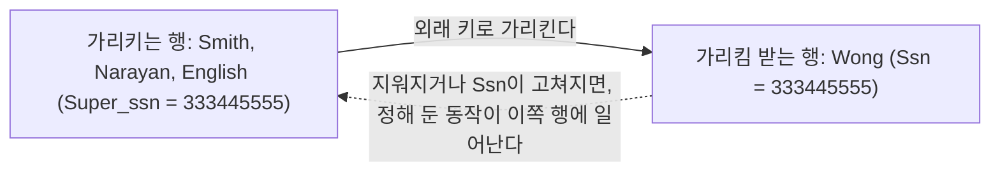
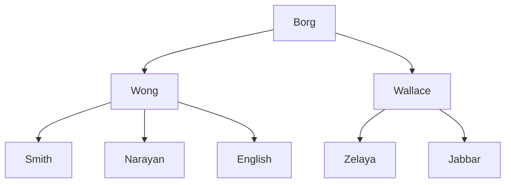


<div class="callout callout-summary" markdown="1">
<div class="callout-title callout-title--default" markdown="span">요약</div>

다른 행이 가리키고 있는 행을 지우거나 그 행의 번호를 고칠 때 어떻게 할지 미리 정해 두는 규칙이다. 팀장이 퇴사하면 팀원들의 "담당 팀장" 칸을 비워 둘지, 임시 팀장으로 채울지, 팀원 기록까지 함께 지울지 정해 두는 것과 같다. 아무것도 정하지 않으면 그런 삭제와 수정은 거부된다. 함께 지우는 규칙은 편하지만, 가리킴이 줄줄이 이어진 표에서는 한 행을 지웠는데 표 전체가 사라질 수도 있다.

</div>


## 예시로 보기

직원 Wong(Ssn 333445555)을 지우려 한다. 그런데 Smith, Narayan, English의 상사 칸(Super_ssn)에 Wong의 번호가 적혀 있다. 그냥 지우면 세 행이 없는 직원을 가리키게 된다. 그래서 기본으로는 거부된다([갱신 연산과 제약 위반](/Hongs_Blog/studies/database-design/update-constraint-violations/)).

매번 세 행을 손으로 먼저 고치고 나서 지우기는 번거롭다. 외래 키를 적을 때 "가리키던 행이 지워지면 이 칸을 NULL로 바꿔라"를 함께 적어 두면 DBMS가 알아서 한다.

```sql
CONSTRAINT EMPSUPERFK
  FOREIGN KEY (Super_ssn) REFERENCES EMPLOYEE(Ssn)
              ON DELETE SET NULL      ON UPDATE CASCADE,
```

직원 표 하나만 놓고 돌리면 이렇게 된다.

| 직원 | 처음의 Super_ssn | Wong을 지운 뒤 | Wong의 Ssn을 444335555로 고친 뒤 |
|---|---|---|---|
| Smith | 333445555 | NULL | 444335555 |
| Narayan | 333445555 | NULL | 444335555 |
| English | 333445555 | NULL | 444335555 |
| Zelaya | 987654321 | 그대로 | 그대로 |

- `ON DELETE SET NULL`: 상사인 직원의 행이 지워지면, 그 행을 가리키던 모든 직원 행의 Super_ssn이 저절로 NULL이 된다. 지워지는 것은 Wong 한 행뿐이다.
- `ON UPDATE CASCADE`: 상사의 Ssn이 고쳐지면, 그 행을 가리키던 모든 직원 행의 Super_ssn에 새 값이 따라 들어간다.

<div class="callout callout-check" markdown="1">
<div class="callout-title" markdown="span">검증: 위 표, 여섯 표가 다 있을 때의 결과, `CASCADE`로 Borg를 지웠을 때 0행, 기본값이 가리키는 행이 사라질 때의 거부, `REJECT`와 `DELETE EMPLOYEE …`의 구문 오류(SQLite) — [53_referential-triggered-actions_verify.py](/Hongs_Blog/studies/database-design/code/53_referential-triggered-actions_verify/). 같은 내용을 PostgreSQL 16에서 실행 — [53_referential-triggered-actions_verify.sql](/Hongs_Blog/studies/database-design/code/53_referential-triggered-actions_verify-sql/)</div>

</div>


## 정의

참조 무결성은 행을 넣거나 지울 때, 외래 키나 기본 키의 값을 고칠 때 깨질 수 있다. SQL은 그런 연산을 기본으로 거부한다. 외래 키에 참조 동작을 적어 두면 거부하는 대신 그 동작을 한다.

참조 동작은 "언제"와 "무엇을"의 짝이다.

- **언제(두 가지):** `ON DELETE`는 가리킴 받는 행이 지워질 때, `ON UPDATE`는 가리킴 받는 행의 기본 키 값이 고쳐질 때다.
- **무엇을(세 가지):** `SET NULL`, `CASCADE`, `SET DEFAULT`.

| 동작 | `ON DELETE`에 적으면 | `ON UPDATE`에 적으면 |
|---|---|---|
| (안 적음) | 거부한다 | 거부한다 |
| `SET NULL` | 가리키던 외래 키를 NULL로 바꾼다 | 가리키던 외래 키를 NULL로 바꾼다 |
| `SET DEFAULT` | 가리키던 외래 키를 그 칸의 [기본값](/Hongs_Blog/studies/database-design/sql-attribute-constraints/)으로 바꾼다 | 가리키던 외래 키를 기본값으로 바꾼다 |
| `CASCADE` | 가리키던 행을 함께 지운다 | 가리키던 외래 키를 새 값으로 따라 고친다 |

거부를 굳이 적고 싶으면 `ON DELETE RESTRICT`나 `ON DELETE NO ACTION`이라고 쓴다. "거부"를 영어로 옮긴 `ON DELETE REJECT`는 SQL에 없는 말이라, SQLite와 PostgreSQL 16 모두 구문 오류를 낸다.

동작은 늘 한 방향으로 일어난다. 가리킴 받는 쪽에서 일이 나면, 가리키는 쪽에 동작이 일어난다.



실선은 외래 키가 가리키는 방향이고, 점선은 동작이 퍼지는 방향이다. 둘은 반대다.

COMPANY의 네 외래 키에 동작을 적으면 이렇다.

```sql
CREATE TABLE EMPLOYEE
( … ,
  Dno INT NOT NULL DEFAULT 1,
  CONSTRAINT EMPPK
    PRIMARY KEY (Ssn),
  CONSTRAINT EMPSUPERFK
    FOREIGN KEY (Super_ssn) REFERENCES EMPLOYEE(Ssn)
                ON DELETE SET NULL      ON UPDATE CASCADE,
  CONSTRAINT EMPDEPTFK
    FOREIGN KEY (Dno) REFERENCES DEPARTMENT(Dnumber)
                ON DELETE SET DEFAULT   ON UPDATE CASCADE );
CREATE TABLE DEPARTMENT
( … ,
  Mgr_ssn CHAR(9) NOT NULL DEFAULT '888665555',
  … ,
  CONSTRAINT DEPTPK
    PRIMARY KEY (Dnumber),
  CONSTRAINT DEPTSK
    UNIQUE (Dname),
  CONSTRAINT DEPTMGRFK
    FOREIGN KEY (Mgr_ssn) REFERENCES EMPLOYEE(Ssn)
                ON DELETE SET DEFAULT   ON UPDATE CASCADE );
CREATE TABLE DEPT_LOCATIONS
( … ,
  PRIMARY KEY (Dnumber, Dlocation),
  FOREIGN KEY (Dnumber) REFERENCES DEPARTMENT(Dnumber)
                ON DELETE CASCADE       ON UPDATE CASCADE );
```

| 외래 키 | 가리킴 받는 행이 지워지면 | 그 행의 키가 고쳐지면 |
|---|---|---|
| EMPLOYEE.Super_ssn → EMPLOYEE | 상사 칸을 비운다(`SET NULL`) | 따라 고친다 |
| EMPLOYEE.Dno → DEPARTMENT | 기본 부서 1번으로 옮긴다(`SET DEFAULT`) | 따라 고친다 |
| DEPARTMENT.Mgr_ssn → EMPLOYEE | 기본 관리자 888665555로 바꾼다(`SET DEFAULT`) | 따라 고친다 |
| DEPT_LOCATIONS.Dnumber → DEPARTMENT | 그 부서의 위치 행을 함께 지운다(`CASCADE`) | 따라 고친다 |

Dno와 Mgr_ssn에 `SET NULL`이 아니라 `SET DEFAULT`를 쓴 데는 까닭이 있다. 두 칸은 `NOT NULL`이라 비울 수 없다. 비울 수 없는 칸에 `SET NULL`을 적어 두면, 막상 가리킴 받는 행을 지울 때 `NOT NULL`에 걸려 거부된다[^s1].

### 여섯 표가 다 있을 때

Ssn이 333445555인 행을 지우면 어떻게 될까? Wong의 Ssn을 444335555로 고치면? 직원 표만 보면 답은 위의 표다. 여섯 표를 다 놓고 보면 Wong을 가리키는 행이 더 있다[^s1].

| Wong을 가리키는 행 | 외래 키에 적힌 동작 |
|---|---|
| EMPLOYEE 3행 (Smith, Narayan, English의 Super_ssn) | `SET NULL` / `CASCADE` |
| DEPARTMENT 1행 (Research의 Mgr_ssn) | `SET DEFAULT` / `CASCADE` |
| WORKS_ON 4행 (Essn) | 없음 → 거부 |
| DEPENDENT 3행 (Essn) | 없음 → 거부 |

위의 동작대로면 삭제도 수정도 거부된다. 한 문장이 건드리는 외래 키 가운데 하나라도 거부하면 문장 전체가 거부되기 때문이다. WORKS_ON과 DEPENDENT의 일곱 행을 먼저 지우고 다시 하면 된다.

- 지우면: 세 부하의 Super_ssn이 NULL이 되고, Research 부서의 Mgr_ssn이 기본값 888665555(Borg)가 된다.
- 고치면: 세 부하의 Super_ssn과 Research 부서의 Mgr_ssn이 모두 444335555가 된다.

### CASCADE가 줄줄이 퍼질 때

이번에는 EMPSUPERFK의 삭제 동작을 `SET NULL` 대신 `CASCADE`로 바꿨다고 하자. 지금 상태에서 Borg를 지우면 무슨 일이 생기는가? 그리고 어느 동작이 EMPSUPERFK에 더 나은가?

```sql
DELETE FROM EMPLOYEE WHERE Lname = 'Borg';
```

`FROM`을 빼고 `DELETE EMPLOYEE WHERE …`라고 쓰면 SQLite와 PostgreSQL 16 모두 구문 오류를 낸다.

누가 누구의 상사인지 그리면 답이 보인다. 화살표는 상사에서 부하로 간다.



Borg가 지워지면 Borg를 가리키던 Wong과 Wallace가 함께 지워진다. 두 사람이 지워지면 그들을 가리키던 Smith, Narayan, English, Zelaya, Jabbar가 또 함께 지워진다. 한 사람을 지웠는데 EMPLOYEE가 0행이 된다[^s1].

더 나은 동작은 처음에 적은 `SET NULL`이다. 상사가 회사를 떠났다고 부하의 기록까지 지울 까닭이 없다. 상사 칸은 비워 둘 수 있는 칸이기도 하다. `SET NULL`이면 Borg 한 행만 지워지고 Wong과 Wallace의 상사 칸이 빈다[^s1].

여섯 표가 다 있으면 이 삭제는 다른 외래 키에 막혀 통째로 거부된다. Borg는 Headquarters의 관리자다. DEPTMGRFK의 `SET DEFAULT`가 관리자를 기본값 888665555로 바꾸려 하는데, 그 번호가 지금 지우려는 Borg 자신이다[^s1].


### 스스로 설명해 보기

<details class="callout callout-question" markdown="1">
<summary class="callout-title" markdown="span">1. Wong을 지웠을 때 Zelaya의 Super_ssn은 왜 그대로인가</summary>

Zelaya의 Super_ssn은 987654321로 Wallace를 가리킨다. 동작은 지워진 행을 가리키던 행에만 일어난다. Wong을 가리키지 않는 행은 건드리지 않는다.

</details>


<details class="callout callout-question" markdown="1">
<summary class="callout-title" markdown="span">2. EMPSUPERFK에 `ON UPDATE CASCADE`가 없다면 Wong의 Ssn을 고치는 문장은 어떻게 되는가</summary>

거부된다. 옛 번호 333445555를 가리키는 Super_ssn이 세 개 있고, 동작을 안 적은 외래 키는 그런 수정을 거부한다.

</details>


<details class="callout callout-question" markdown="1">
<summary class="callout-title" markdown="span">3. 5번 부서를 지우면 직원 네 명의 Dno는 무엇이 되는가. 왜 NULL이 아닌가</summary>

1이 된다. EMPDEPTFK의 삭제 동작이 `SET DEFAULT`이고 Dno의 기본값이 1이다. Dno는 `NOT NULL`이라 NULL로는 못 바꾼다. 다만 여섯 표가 다 있으면, 5번 부서를 가리키는 PROJECT 세 행에 동작이 없어서 그 행들을 먼저 정리해야 한다.

</details>


<details class="callout callout-question" markdown="1">
<summary class="callout-title" markdown="span">이 규칙의 핵심 아이디어는?</summary>

참조 무결성을 지키는 길이 "그 연산을 막는다" 하나가 아니다. 연산은 받아 주고, 대신 가리키던 쪽을 고쳐서(비우거나, 기본값으로 돌리거나, 함께 지우거나) 다시 맞게 만들 수도 있다.

</details>


<details class="callout callout-question" markdown="1">
<summary class="callout-title" markdown="span">같은 생각이 쓰이는 다른 곳은?</summary>

표나 칸을 없앨 때 붙이는 `CASCADE`와 `RESTRICT`다. 기대고 있는 것까지 함께 없앨지, 기대는 것이 있으면 그만둘지를 고른다([DROP 명령](/Hongs_Blog/studies/database-design/sql-drop/), [ALTER TABLE](/Hongs_Blog/studies/database-design/sql-alter-table/)).

</details>


## 활용

**동작 고르기.** 도서관 스키마의 외래 키마다 동작을 고를 때 대는 이유를 모으면 물음 넷이 된다.

| 물음 | 맞으면 | 예 |
|---|---|---|
| 가리키는 행이, 가리킴 받는 행 없이는 쓸모가 없는가 | `ON DELETE CASCADE` | 책이 지워지면 그 책의 지은이 행도 필요 없다 |
| 가리킴 받는 행을 지우면 안 되는 사정이 있는가 | 거부(안 적는다) | 책을 빌려 간 회원은 탈퇴시키지 않는다 |
| 가리키는 행은 남기되 칸을 비워도 되는가 | `ON DELETE SET NULL` | 상사가 떠난 직원의 상사 칸 |
| 칸을 비울 수 없지만 대신 넣을 값이 있는가 | `ON DELETE SET DEFAULT` | 부서가 없어진 직원을 기본 부서로 |

키 값을 고칠 때는 도서관 스키마의 일곱 외래 키 모두에 `ON UPDATE CASCADE`를 고른다. 번호가 바뀌어도 누가 누구를 가리키는지는 그대로여야 하기 때문이다. 문제 전체는 [LIBRARY 스키마 DDL 연습](/Hongs_Blog/studies/database-design/library-ddl-practice/)에 있다.

- **기본값이 가리키는 행도 지킨다.** `SET DEFAULT`는 기본값이 가리키는 행이 있어야 통한다. 기본 관리자인 Borg를 지우거나 기본 부서인 1번을 지우려 하면 거부된다[^s1].
- **흔한 실수.** `CASCADE`를 "편하니까" 모든 외래 키에 건다. 가리킴이 이어진 표에서는 지운 행 하나가 줄줄이 다른 행을 지운다.

## 연결

- 선수: [PRIMARY KEY·UNIQUE·FOREIGN KEY 절](/Hongs_Blog/studies/database-design/sql-key-clauses/), [갱신 연산과 제약 위반](/Hongs_Blog/studies/database-design/update-constraint-violations/)
- 정해진 세 동작으로 안 되는 일(다른 표에 기록을 남기기, 조건을 따져 막기)은 트리거로 적는다: [트리거와 ECA 규칙](/Hongs_Blog/studies/database-design/sql-trigger/)
- 상사를 가리키는 Super_ssn처럼 한 표가 자기 자신을 가리키게 되는 까닭: [역할 이름과 재귀 관계](/Hongs_Blog/studies/database-design/recursive-relationship/)

## 자주 하는 오해

<div class="callout callout-misconception" markdown="1">
<div class="callout-title" markdown="span">"ON DELETE CASCADE를 걸면, 그 외래 키가 있는 행을 지울 때 가리키던 행도 함께 지워진다"</div>

틀렸다. 방향이 반대다. "함께 지운다"는 말만 들으면 어느 쪽을 지워도 다른 쪽이 따라 지워질 것 같다. 실제로는 가리킴 받는 행(부서)이 지워질 때 가리키는 행(그 부서의 위치)이 지워진다. 가리키는 행을 지울 때는 아무 일도 없다. DEPT_LOCATIONS에서 (5, Houston)을 지워 보면 확인된다. DEPARTMENT는 세 행 그대로다. 반대로 5번 부서를 지우면 DEPT_LOCATIONS에서 5번의 위치 세 행이 함께 사라진다.

</div>


## 확인 문제

<details class="callout callout-question" markdown="1">
<summary class="callout-title" markdown="span">**C1** 참조 동작이 일어나는 두 경우와 세 가지 동작을 쓰라. 아무 동작도 안 적으면 어떻게 되는가?</summary>

**답:** 경우는 `ON DELETE`(가리킴 받는 행이 지워질 때)와 `ON UPDATE`(그 행의 기본 키 값이 고쳐질 때)다. 동작은 `SET NULL`, `CASCADE`, `SET DEFAULT`다. 안 적으면 그런 삭제와 수정을 거부한다.

</details>


<details class="callout callout-question" markdown="1">
<summary class="callout-title" markdown="span">**C2** EMPLOYEE 표 하나에서 EMPSUPERFK가 `ON DELETE SET NULL`이다. Wallace(Ssn 987654321)의 행을 지운 뒤 EMPLOYEE는 몇 행인가? 상사 칸이 NULL인 직원은 누구인가?</summary>

**답:** 7행이다. 상사 칸이 NULL인 직원은 Borg(처음부터 NULL), Zelaya, Jabbar다.<br>
**이유:** Wallace를 가리키던 행은 Zelaya와 Jabbar 둘이다. `SET NULL`은 그 두 행의 Super_ssn만 NULL로 바꾸고, 지우는 것은 Wallace 한 행이다.

</details>


<details class="callout callout-question" markdown="1">
<summary class="callout-title" markdown="span">**C3** 같은 표에서 EMPSUPERFK가 `ON DELETE CASCADE`라면, Wong을 지운 뒤 남는 직원은 누구인가?</summary>

**답:** Borg, Wallace, Zelaya, Jabbar 네 명이다.<br>
**이유:** Wong과 함께 Wong을 가리키던 Smith, Narayan, English가 지워진다. 이 셋을 가리키는 직원은 없어서 거기서 멈춘다. Wallace 쪽 가지는 Wong과 이어져 있지 않다.

</details>


<details class="callout callout-question" markdown="1">
<summary class="callout-title" markdown="span">**C4** 세 경우에 알맞은 삭제 동작을 고르고 이유를 대라. (가) 주문이 지워질 때 그 주문에 딸린 "주문 품목" 행 (나) 담당 직원이 퇴사할 때 고객 표의 "담당 직원" 칸. 담당자가 없는 고객도 있다 (다) 상품을 지우려는데 그 상품이 적힌 지난 주문 기록이 남아 있다</summary>

**답:** (가) `CASCADE`. 주문 없이 주문 품목만 남으면 쓸모가 없다. (나) `SET NULL`. 고객은 남아야 하고 담당 칸은 비울 수 있다. (다) 거부. 지난 주문 기록이 가리킬 상품이 사라지면 안 된다.<br>
**이유:** 가리키는 행이 혼자서도 뜻이 있는지, 칸을 비울 수 있는지, 가리킴 받는 행을 지워도 되는 사정인지를 차례로 묻는다.

</details>


<details class="callout callout-question" markdown="1">
<summary class="callout-title" markdown="span">**C5** "외래 키에 `ON DELETE SET DEFAULT`를 적어 두면 가리킴 받는 행은 언제든 지울 수 있다"가 틀린 예를 COMPANY에서 들라.</summary>

**답:** Borg(888665555)를 지우는 경우다. Headquarters의 Mgr_ssn을 기본값 888665555로 바꿔야 하는데, 그 번호가 지우려는 Borg 자신이라 가리킬 행이 없다. 거부된다.<br>
**이유:** `SET DEFAULT`도 바꾼 뒤의 값이 상대 표에 있어야 한다. 기본값이 가리키는 행까지 사라지면 참조 무결성을 맞출 수 없다.

</details>


[^s1]: 결과는 SQLite 3.50과 PostgreSQL 16에서 실행해 확인했다.

