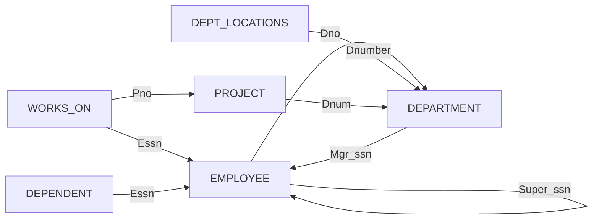



요약

데이터베이스 하나는 표 여러 개와, 그 표들이 지켜야 할 규칙으로 되어 있다. 표의 틀과 규칙을 적은 것이 설계도이고, 어느 순간 표에 들어 있는 줄 전부가 그때의 모습이다. 규칙을 하나라도 어긴 모습은 올바르지 않은 것으로 친다. 이 문서 모음은 표 여섯 개, 줄 마흔다섯 개짜리 회사 예제 하나를 끝까지 쓴다.

## 예시로 보기

회사 자료를 표 하나에 다 넣을 수는 없다. 직원, 부서, 프로젝트는 적을 항목이 서로 다르다. 그래서 표를 여러 개 만들고 한 묶음으로 다룬다. COMPANY 데이터베이스의 스키마는 릴레이션 스키마 여섯 개다.

| 릴레이션 | 속성 (굵은 것이 기본 키) | 무엇을 적나 |
|---|---|---|
| EMPLOYEE | Fname, Minit, Lname, **Ssn**, Bdate, Address, Sex, Salary, Super_ssn, Dno | 직원 |
| DEPARTMENT | Dname, **Dnumber**, Mgr_ssn, Mgr_start_date | 부서와 그 관리자 |
| DEPT_LOCATIONS | **Dnumber**, **Dlocation** | 부서가 있는 곳(여러 곳일 수 있다) |
| PROJECT | Pname, **Pnumber**, Plocation, Dnum | 프로젝트와 맡은 부서 |
| WORKS_ON | **Essn**, **Pno**, Hours | 어느 직원이 어느 프로젝트에서 몇 시간 일하나 |
| DEPENDENT | **Essn**, **Dependent_name**, Sex, Bdate, Relationship | 직원의 부양가족 |

스키마 그림에서는 기본 키 속성에 밑줄을 그어 표시한다. 위 표에서는 굵게 적었다. 기본 키가 두 속성인 릴레이션이 셋 있다.

표끼리는 값으로 이어진다. EMPLOYEE의 Dno 5는 DEPARTMENT의 Dnumber 5를 가리킨다. 이렇게 다른 릴레이션의 기본 키를 가리키는 속성이 여덟 개 있다.

화살표는 가리키는 속성에서 출발해 상대 릴레이션의 기본 키로 간다. EMPLOYEE의 Ssn으로 네 개, DEPARTMENT의 Dnumber로 세 개, PROJECT의 Pnumber로 한 개가 들어간다[^s1]. 이 속성의 정확한 뜻은 [참조 무결성 제약과 외래 키](/Hongs_Blog/studies/database-design/referential-integrity-foreign-key/)에 있다.

## 정의

**관계형 데이터베이스 스키마** $$S$$는 릴레이션 스키마의 집합 $$S = \{R_1, \dots, R_m\}$$과 무결성 제약의 집합 $$IC$$로 되어 있다. 무결성 제약은 실세계의 규칙에서 나온, 값이 지켜야 할 조건이다. 어떤 상태든 이 조건을 따라야 한다.

**데이터베이스 상태**는 릴레이션 상태의 집합 $$\{r_1, \dots, r_m\}$$이다. $$r_i$$는 $$R_i$$의 상태이고, $$IC$$의 제약을 모두 지킨다. 제약을 하나라도 어긴 상태는 올바르지 않은(not valid) 상태라 한다.

관계형 모델에서 가장 중요한 제약은 셋이다.

| 제약 | 무엇을 지키나 | 어디에 걸리나 | 문서 |
|---|---|---|---|
| 키 제약 | 키 값이 튜플마다 다르다 | 릴레이션 하나 | [슈퍼키·후보 키·기본 키](/Hongs_Blog/studies/database-design/relational-keys/) |
| 개체 무결성 제약 | 기본 키 값이 NULL이 아니다 | 릴레이션 하나 | [개체 무결성 제약](/Hongs_Blog/studies/database-design/entity-integrity-constraint/) |
| 참조 무결성 제약 | 가리키는 튜플이 정말 있다 | 릴레이션 둘 사이 | [참조 무결성 제약과 외래 키](/Hongs_Blog/studies/database-design/referential-integrity-foreign-key/) |

## COMPANY의 상태

아래는 COMPANY 스키마의 올바른 상태 하나다. 이 문서 모음의 SQL 예제는 모두 이 상태에 질의한다.

**EMPLOYEE** (8줄)

| Fname | Minit | Lname | Ssn | Bdate | Address | Sex | Salary | Super_ssn | Dno |
|---|---|---|---|---|---|---|---|---|---|
| John | B | Smith | 123456789 | 1965-01-09 | 731 Fondren, Houston, TX | M | 30000 | 333445555 | 5 |
| Franklin | T | Wong | 333445555 | 1955-12-08 | 638 Voss, Houston, TX | M | 40000 | 888665555 | 5 |
| Alicia | J | Zelaya | 999887777 | 1968-01-19 | 3321 Castle, Spring, TX | F | 25000 | 987654321 | 4 |
| Jennifer | S | Wallace | 987654321 | 1941-06-20 | 291 Berry, Bellaire, TX | F | 43000 | 888665555 | 4 |
| Ramesh | K | Narayan | 666884444 | 1962-09-15 | 975 Fire Oak, Humble, TX | M | 38000 | 333445555 | 5 |
| Joyce | A | English | 453453453 | 1972-07-31 | 5631 Rice, Houston, TX | F | 25000 | 333445555 | 5 |
| Ahmad | V | Jabbar | 987987987 | 1969-03-29 | 980 Dallas, Houston, TX | M | 25000 | 987654321 | 4 |
| James | E | Borg | 888665555 | 1937-11-10 | 450 Stone, Houston, TX | M | 55000 | NULL | 1 |

**DEPARTMENT** (3줄)

| Dname | Dnumber | Mgr_ssn | Mgr_start_date |
|---|---|---|---|
| Research | 5 | 333445555 | 1988-05-22 |
| Administration | 4 | 987654321 | 1995-01-01 |
| Headquarters | 1 | 888665555 | 1981-06-19 |

**DEPT_LOCATIONS** (5줄)

| Dnumber | Dlocation |
|---|---|
| 1 | Houston |
| 4 | Stafford |
| 5 | Bellaire |
| 5 | Sugarland |
| 5 | Houston |

**PROJECT** (6줄)

| Pname | Pnumber | Plocation | Dnum |
|---|---|---|---|
| ProductX | 1 | Bellaire | 5 |
| ProductY | 2 | Sugarland | 5 |
| ProductZ | 3 | Houston | 5 |
| Computerization | 10 | Stafford | 4 |
| Reorganization | 20 | Houston | 1 |
| Newbenefits | 30 | Stafford | 4 |

**WORKS_ON** (16줄)

| Essn | Pno | Hours |
|---|---|---|
| 123456789 | 1 | 32.5 |
| 123456789 | 2 | 7.5 |
| 666884444 | 3 | 40.0 |
| 453453453 | 1 | 20.0 |
| 453453453 | 2 | 20.0 |
| 333445555 | 2 | 10.0 |
| 333445555 | 3 | 10.0 |
| 333445555 | 10 | 10.0 |
| 333445555 | 20 | 10.0 |
| 999887777 | 30 | 30.0 |
| 999887777 | 10 | 10.0 |
| 987987987 | 10 | 35.0 |
| 987987987 | 30 | 5.0 |
| 987654321 | 30 | 20.0 |
| 987654321 | 20 | 15.0 |
| 888665555 | 20 | NULL |

**DEPENDENT** (7줄)

| Essn | Dependent_name | Sex | Bdate | Relationship |
|---|---|---|---|---|
| 333445555 | Alice | F | 1986-04-05 | Daughter |
| 333445555 | Theodore | M | 1983-10-25 | Son |
| 333445555 | Joy | F | 1958-05-03 | Spouse |
| 987654321 | Abner | M | 1942-02-28 | Spouse |
| 123456789 | Michael | M | 1988-01-04 | Son |
| 123456789 | Alice | F | 1988-12-30 | Daughter |
| 123456789 | Elizabeth | F | 1967-05-05 | Spouse |

줄 수는 8, 3, 5, 6, 16, 7로 모두 45줄이다. NULL은 두 칸뿐이다. 사장 Borg는 상사가 없어 Super_ssn이 NULL이고, Borg가 20번 프로젝트에서 일한 시간도 NULL이다[^s1]. 그래서 이 상태를 담을 WORKS_ON 표를 만들 때 Hours에 NOT NULL을 걸면 안 된다. 걸면 Borg의 줄 (888665555, 20, NULL)이 거부되어 상태 전체가 들어가지 않는다. 이 문서 모음의 검증 코드는 모두 Hours가 NULL을 받게 만든다.

이 상태는 세 제약을 모두 지킨다. 기본 키 값이 겹치는 튜플이 없고, 기본 키가 NULL인 튜플이 없고, 가리키는 속성 여덟 개의 값은 모두 상대 릴레이션에 있거나 NULL이다. 값 하나만 바꿔도 올바르지 않은 상태가 된다. Smith의 Dno를 7로 바꾸면 7번 부서가 없어서 참조 무결성이 깨진다[^s1].

검증: 릴레이션 6개의 속성·기본 키·가리키는 속성 8개, 줄 수 8·3·5·6·16·7, 세 제약 위반 0건, Smith의 Dno를 7로 바꾼 상태는 위반 1건, Hours가 NOT NULL이면 상태가 안 들어감 — [35_relational-database-schema_verify.py](/Hongs_Blog/studies/database-design/code/35_relational-database-schema_verify/)

검증: PostgreSQL 16에서 실행. 교재(Elmasri & Navathe)의 COMPANY CREATE TABLE 문과 같은 자료형과 제약으로 표 6개를 만들고 45줄을 넣음, 기본 키 6개와 가리키는 속성 8개가 카탈로그에 있음, Hours에 NOT NULL을 걸면 거부됨 — [35_relational-database-schema_verify.sql](/Hongs_Blog/studies/database-design/code/35_relational-database-schema_verify-sql/)

## 활용

- **서로 가리키는 표.** EMPLOYEE는 DEPARTMENT를, DEPARTMENT는 EMPLOYEE를 가리킨다. PostgreSQL 16은 아직 없는 표를 가리키는 선언을 거부하므로, 표를 먼저 만들고 가리키는 선언을 나중에 붙여야 한다. SQLite는 그런 선언도 받는다[^s2]. 자세한 것은 [CREATE SCHEMA와 CREATE TABLE](/Hongs_Blog/studies/database-design/sql-create-table/)에 있다.
- **이 스키마가 나온 곳.** COMPANY의 ER 그림을 정해진 순서로 옮기면 이 여섯 릴레이션이 나온다: [ER-관계형 사상 절차](/Hongs_Blog/studies/database-design/er-to-relational-mapping/)
- **상태를 바꿀 때.** 튜플을 넣고 지우고 고칠 때마다 DBMS가 제약을 검사한다: [갱신 연산과 제약 위반](/Hongs_Blog/studies/database-design/update-constraint-violations/)

## 연결

- 선수: [릴레이션과 도메인·속성·튜플](/Hongs_Blog/studies/database-design/relational-model-relation/), [슈퍼키·후보 키·기본 키](/Hongs_Blog/studies/database-design/relational-keys/)
- 틀과 내용을 가르는 생각: [스키마와 인스턴스](/Hongs_Blog/studies/database-design/schema-and-instance/)
- 이어지는 개념: [개체 무결성 제약](/Hongs_Blog/studies/database-design/entity-integrity-constraint/), [참조 무결성 제약과 외래 키](/Hongs_Blog/studies/database-design/referential-integrity-foreign-key/)

## 확인 문제

**C1** COMPANY의 릴레이션 여섯 개와 각각의 기본 키를 쓰라.

**답:** EMPLOYEE(Ssn), DEPARTMENT(Dnumber), DEPT_LOCATIONS(Dnumber, Dlocation), PROJECT(Pnumber), WORKS_ON(Essn, Pno), DEPENDENT(Essn, Dependent_name). 
**이유:** 흔한 실수는 DEPT_LOCATIONS, WORKS_ON, DEPENDENT의 기본 키를 속성 하나로 적는 것이다. 셋 다 두 속성을 묶어야 값이 안 겹친다.

**C2** 다음 가운데 스키마가 바뀌는 것과 상태만 바뀌는 것을 갈라라. (가) 새 직원을 한 명 넣는다. (나) EMPLOYEE에 Email 속성을 더한다. (다) Smith의 급여를 올린다. (라) "급여는 0보다 커야 한다"는 규칙을 더한다.

**답:** (가)와 (다)는 상태만 바뀐다. (나)와 (라)는 스키마가 바뀐다. 
**이유:** 스키마는 릴레이션 스키마들과 무결성 제약의 묶음이다. 그래서 규칙을 더하는 (라)도 스키마를 바꾸는 일이다.

**C3** COMPANY의 상태에서 값 하나만 바꿔 올바르지 않은 상태를 만들어라. 어느 제약이 깨지는가?

**답:** 예: Smith의 Dno를 7로 바꾼다. DEPARTMENT에 Dnumber 7이 없어 참조 무결성 제약이 깨진다. 다른 예: Wong의 Ssn을 123456789로 바꾸면 키 제약이, NULL로 바꾸면 개체 무결성 제약이 깨진다.

[^s1]: 수는 검증 코드로 셌다.
[^s2]: PostgreSQL 16에서 undefined_table 오류를, SQLite에서 오류 없이 만들어지는 것을 실행해 확인했다.

