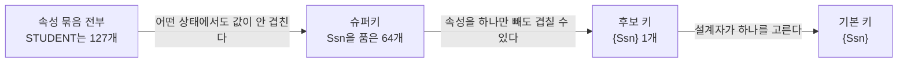



요약

학생 다섯 명을 헷갈리지 않고 부르려면 사람마다 다른 값이 있어야 한다. 표에서 줄마다 값이 다른 칸, 또는 칸 묶음을 키라고 한다. 칸을 여럿 묶으면 값이 겹치기 어렵지만 쓸데없는 칸이 섞이므로, "겹치지 않는다"와 "더 뺄 칸이 없다"를 둘 다 지키는 묶음을 고르고 그중 하나를 대표로 정한다. 조심할 점은 지금 표에서 우연히 안 겹친다고 키가 되는 것이 아니라, 앞으로 들어올 어떤 줄과도 겹치지 않아야 한다는 것이다.

## 예시로 보기

릴레이션은 튜플의 집합이다. 집합에는 같은 원소가 두 번 들어가지 않으니, 모든 속성의 값이 똑같은 튜플 둘은 있을 수 없다[^1]. 그런데 튜플을 가리킬 때마다 일곱 칸의 값을 다 대는 것은 불편하다. 더 적은 칸으로 튜플 하나를 집어낼 수 있을까?

| Name | Ssn | Home_phone | Address | Office_phone | Age | Gpa |
|---|---|---|---|---|---|---|
| Benjamin Bayer | 305-61-2435 | (817)373-1616 | 2918 Bluebonnet Lane | NULL | 19 | 3.21 |
| Chung-cha Kim | 381-62-1245 | (817)375-4409 | 125 Kirby Road | NULL | 18 | 2.89 |
| Dick Davidson | 422-11-2320 | NULL | 3452 Elgin Road | (817)749-1253 | 25 | 3.53 |
| Rohan Panchal | 489-22-1100 | (817)376-9821 | 265 Lark Lane | (817)749-6492 | 28 | 3.93 |
| Barbara Benson | 533-69-1238 | (817)839-8461 | 7384 Fontana Lane | NULL | 19 | 3.25 |

- Age는 안 된다. Bayer와 Benson이 둘 다 19다.
- Ssn은 된다. 사회보장번호는 사람마다 다르게 주는 번호다.
- Name은 이 다섯 줄에서는 안 겹친다. 하지만 이름이 같은 학생이 내일 들어올 수 있다. 그러니 Name은 믿을 수 없다.

{Ssn}처럼 어떤 경우에도 값이 안 겹치는 속성 묶음이 슈퍼키다. {Ssn, Name, Age}도 Ssn이 들어 있어 안 겹치지만 Name과 Age는 군더더기다. 군더더기가 없는 {Ssn}이 후보 키다[^2].

검증: STUDENT의 속성 묶음 127개 가운데 이 상태에서 안 겹치는 것 124개와 그중 최소 5개, Ssn을 품은 슈퍼키 64개, CAR의 Model이 이 상태에서만 안 겹침, CAR의 슈퍼키 24개, WORKS_ON의 {Essn, Pno}, 최소성의 두 정의가 같음, {Ssn, Name}을 기본 키로 선언했을 때 — [34_relational-keys_verify.py](/Hongs_Blog/studies/database-design/code/34_relational-keys_verify/)

## 정의

**슈퍼키.** 릴레이션 스키마 $$R$$의 속성 가운데 몇 개를 고른 묶음 $$SK$$로, $$R$$의 어떤 상태에서도 서로 다른 두 튜플의 $$SK$$ 값이 같을 수 없는 것이다. 이 조건을 유일성(uniqueness)이라 부른다[^1].

기호로 쓰면, 모든 상태 $$r(R)$$과 그 안의 서로 다른 두 튜플 $$t_1$$, $$t_2$$에 대해

$$t_1[SK] \ne t_2[SK]$$

이다. $$t[SK]$$(티의 에스케이 값)는 튜플 $$t$$에서 $$SK$$에 든 속성의 값만 뽑은 것이다. 모든 릴레이션에는 슈퍼키가 적어도 하나 있다. 속성 전부를 모은 묶음이다. 쓸모는 없다[^1].

**후보 키.** 슈퍼키 $$K$$ 가운데, 속성을 어느 것 하나라도 빼면 남은 묶음 $$K'$$이 더는 슈퍼키가 아닌 것이다. 더 줄일 수 없다는 뜻에서 최소(minimal) 슈퍼키라고 한다. 이 최소성은 후보 키에게는 꼭 있어야 하고 슈퍼키에게는 없어도 된다[^2].

**기본 키.** 릴레이션 스키마에 키가 둘 이상일 수 있다. 그 하나하나가 후보 키다. 설계자가 그중 하나를 골라 튜플을 가려내는 데 쓰기로 한 것이 기본 키다. 스키마에서 밑줄을 그어 표시한다. 보통 속성이 하나이거나 적은 것을 고른다[^3].

CAR 릴레이션에는 후보 키가 둘이다. 번호판(License_number)도, 엔진 일련번호(Engine_serial_number)도 차마다 다르다. 슬라이드는 License_number를 기본 키로 골랐다[^3].

| License_number (기본 키) | Engine_serial_number | Make | Model | Year |
|---|---|---|---|---|
| Texas ABC-739 | A69352 | Ford | Mustang | 02 |
| Florida TVP-347 | B43696 | Oldsmobile | Cutlass | 05 |
| New York MPO-22 | X83554 | Oldsmobile | Delta | 01 |
| California 432-TFY | C43742 | Mercedes | 190-D | 99 |
| California RSK-629 | Y82935 | Toyota | Camry | 04 |
| Texas RSK-629 | U028365 | Jaguar | XJS | 04 |

세 낱말은 이렇게 포개진다: 기본 키는 후보 키 가운데 하나이고, 후보 키는 슈퍼키 가운데 최소인 것이다.

STUDENT의 속성 7개로 만들 수 있는 묶음은 $$2^7 - 1 = 127$$개다. 후보 키가 {Ssn} 하나라면 슈퍼키는 Ssn을 품은 묶음이고, 나머지 여섯 속성을 넣거나 빼는 방법의 수인 $$2^6 = 64$$개다[^s1].

### 상태는 "키가 아니다"만 알려 준다

키는 스키마의 성질이다. 모든 상태에서 안 겹쳐야 한다. 그래서 표 하나를 들여다봐서는 반쪽만 알 수 있다.

- 값이 겹치는 튜플 둘을 찾았다 → 그 묶음은 키가 아니다. 반례 하나면 끝난다.
- 값이 안 겹친다 → 키일 수도 있고, 아직 겹치는 튜플이 안 들어왔을 뿐일 수도 있다.

STUDENT의 다섯 줄만 보면 Name, Ssn, Home_phone, Address, Gpa가 모두 혼자서 안 겹친다. CAR의 여섯 줄만 보면 Model도 혼자서 안 겹친다. 머스탱 한 대가 더 등록되면 바로 겹친다. 어느 것이 정말 키인지는 "사회보장번호는 사람마다 다르다", "번호판은 차마다 다르다" 같은 실세계의 규칙이 정한다[^s1].

### 최소성을 말하는 두 가지 방법

슬라이드는 "속성을 하나 빼면 슈퍼키가 아니다"로 적는다. "어떤 진부분집합도 슈퍼키가 아니다"로 적어도 같은 말이다[^s2].

두 말이 같은 까닭

1. 슈퍼키에 속성을 더한 묶음도 슈퍼키다. 두 튜플이 더 작은 묶음에서 이미 값이 다르면, 속성을 더 견주어도 여전히 다르다. — 유일성의 정의
2. (⇐) 어떤 진부분집합도 슈퍼키가 아니면, 속성 하나를 뺀 묶음도 진부분집합이므로 슈퍼키가 아니다. — 특수한 경우
3. (⇒) 대우로 보인다. $$K$$의 어떤 진부분집합 $$K''$$이 슈퍼키라고 하자. $$K$$에는 있고 $$K''$$에는 없는 속성 $$a$$를 하나 고른다. $$K - \{a\}$$는 $$K''$$을 품는다. 1에 따라 $$K - \{a\}$$도 슈퍼키다. 그러면 "하나를 빼면 슈퍼키가 아니다"가 깨진다. — 대우
4. 그래서 두 조건은 같은 묶음을 고른다. ∎

### 스스로 설명해 보기

1. 증명 1번 줄: 슈퍼키에 속성을 더해도 슈퍼키인 까닭을 STUDENT로 말해 보라.

{Ssn}에서 두 학생의 값이 다르면 {Ssn, Name}에서도 Ssn 자리가 이미 다르다. 견주는 속성을 늘린다고 다르던 것이 같아지지 않는다.

2. 증명 3번 줄에서 $$K - \{a\}$$가 $$K''$$을 품는다는 것은 어디서 나오는가?

$$a$$를 $$K''$$에 없는 속성으로 골랐기 때문이다. $$K''$$의 속성은 모두 $$K$$에 있고 $$a$$가 아니므로 $$K - \{a\}$$에 남아 있다.

3. "지금 상태에서 안 겹친다"가 "슈퍼키다"를 뜻하지 않는 까닭은 정의의 어느 낱말 때문인가?

"어떤 상태에서도"다. 슈퍼키는 스키마 $$R$$의 모든 상태에 거는 조건이다. 상태 하나는 그 가운데 한 경우일 뿐이다.

이 정의의 핵심 생각은?

유일성으로 "가려낼 수 있다"를, 최소성으로 "군더더기가 없다"를 따로 요구한다. 슈퍼키는 앞의 것만, 후보 키는 둘 다 지킨다.

같은 생각을 쓰는 다른 곳은?

튜플에서 키 값으로 가는 함수가 서로 다른 입력을 서로 다른 출력으로 보낸다는 말과 같다([단사 함수](/Hongs_Blog/studies/discrete-math/function-properties/)). 가능한 묶음을 모두 늘어놓고 유일성과 최소성을 검사하는 코드는 [후보키](/Hongs_Blog/studies/algorithms/pg42890/) 문제의 풀이와 같다.

## 예제

**키인 예.** {Ssn}(STUDENT의 후보 키이자 기본 키), {Engine_serial_number}(CAR의 후보 키. 기본 키로는 뽑히지 않았다), {Essn, Pno}(WORKS_ON의 기본 키. 두 속성을 묶어야 한다).

**후보 키가 아닌 예.** {Ssn, Name}은 슈퍼키지만 Name을 빼도 슈퍼키라 후보 키가 아니다. {Age}는 Bayer와 Benson이 겹쳐 슈퍼키도 아니다.

**WORKS_ON으로 최소성 확인하기.** {Essn, Pno}에서 하나씩 빼 본다[^s1].

1. *Pno를 뺀다:* Essn 123456789가 두 줄에 나온다(프로젝트 1과 2). 겹친다.
2. *Essn을 뺀다:* Pno 1이 두 줄에 나온다(직원 123456789와 453453453). 겹친다.
3. *결론:* 어느 하나를 빼도 슈퍼키가 아니다. {Essn, Pno}는 최소다.

**왜 최소인 것을 키로 삼는가.** {Ssn, Name}을 기본 키로 선언하면 DBMS는 "Ssn과 Name이 둘 다 같은 튜플"만 막는다. Ssn이 같고 이름 표기만 다른 두 줄(Benjamin Bayer와 Ben Bayer)이 그대로 들어간다. 정말 지키려던 "Ssn은 안 겹친다"가 검사되지 않는다. {Ssn}으로 선언하면 둘째 줄이 거부된다[^s1].

## 활용

- **SQL로 적으면.** 기본 키는 `PRIMARY KEY`, 기본 키로 뽑히지 않은 후보 키는 `UNIQUE`로 적는다: [PRIMARY KEY·UNIQUE·FOREIGN KEY 절](/Hongs_Blog/studies/database-design/sql-key-clauses/)
- **키를 어기는 갱신.** 이미 있는 키 값으로 튜플을 넣으면 키 제약 위반이다: [갱신 연산과 제약 위반](/Hongs_Blog/studies/database-design/update-constraint-violations/)
- **흔한 실수.** 표의 지금 내용만 보고 키를 정하는 것. 이름, 전화번호, 주소처럼 "지금은 안 겹치는" 값은 키로 쓰지 않는다.

## 연결

- ER 모델에서 온 곳: [키 속성](/Hongs_Blog/studies/database-design/key-attribute/). ER의 키 속성 가운데 하나가 릴레이션의 기본 키가 된다([개체 타입의 사상](/Hongs_Blog/studies/database-design/mapping-entity-types/)).
- 기본 키에 걸리는 다른 규칙: [개체 무결성 제약](/Hongs_Blog/studies/database-design/entity-integrity-constraint/)(NULL일 수 없다)
- 기본 키를 가리키는 속성: [참조 무결성 제약과 외래 키](/Hongs_Blog/studies/database-design/referential-integrity-foreign-key/)
- 네 가지 키를 한자리에서: [키의 종류 비교](/Hongs_Blog/studies/database-design/key-kinds-comparison/)
- 다른 뜻의 "키": [B-트리](/Hongs_Blog/studies/database-design/b-tree/)의 키는 찾는 값이다. 값이 안 겹친다는 뜻이 아니다.

## 자주 하는 오해

"슈퍼키면 후보 키다"

틀렸다. 둘 다 "값이 안 겹치는 묶음"이라 같은 말처럼 들린다. 후보 키는 슈퍼키 가운데 더 줄일 수 없는 것만이다. STUDENT에서 슈퍼키는 Ssn을 품은 묶음 64개이고 후보 키는 {Ssn} 하나다. {Ssn, Name}은 슈퍼키지만 Name을 빼도 안 겹치므로 후보 키가 아니다. 확인하는 법: 속성을 하나씩 빼 보고, 빼도 여전히 안 겹치는 속성이 하나라도 있으면 후보 키가 아니다. 거꾸로는 맞다. 후보 키는 모두 슈퍼키다.

"지금 표에서 값이 안 겹치면 키다"

틀렸다. 눈앞의 표에 겹치는 값이 없으니 키처럼 보인다. 키는 앞으로 올 수 있는 모든 상태에서 안 겹쳐야 한다. CAR의 여섯 줄에서 Model은 안 겹치지만 같은 차종이 한 대 더 들어오면 겹친다. 표가 알려 주는 것은 "겹치는 두 줄이 있으니 키가 아니다" 쪽뿐이다.

## 확인 문제

**C1** 슈퍼키, 후보 키, 기본 키를 정의하라. 유일성과 최소성이 각각 어디에 필요한지도 쓰라.

**답:** 슈퍼키는 어떤 상태에서도 서로 다른 두 튜플의 값이 같을 수 없는 속성 묶음이다(유일성). 후보 키는 슈퍼키 가운데 속성을 하나 빼면 슈퍼키가 아니게 되는 것이다(유일성 + 최소성). 기본 키는 후보 키 가운데 설계자가 튜플을 가려내는 데 쓰려고 고른 하나다. 
**이유:** 최소성은 후보 키에게만 필요하다. 슈퍼키는 군더더기 속성이 있어도 된다.

**C2** STUDENT에서 사람마다 다른 것이 Ssn뿐이라고 하자. {Ssn}, {Ssn, Name}, {Name, Age}, 속성 일곱 개 전부는 각각 슈퍼키인가, 후보 키인가?

**답:** {Ssn}은 슈퍼키이자 후보 키. {Ssn, Name}과 일곱 개 전부는 슈퍼키이지만 후보 키가 아니다(Ssn만 남기고 빼도 안 겹친다). {Name, Age}는 슈퍼키도 아니다(이름과 나이가 같은 두 학생이 있을 수 있다). 
**이유:** 흔한 오답은 지금 표에서 {Name, Age}가 안 겹친다고 슈퍼키라고 답하는 것이다.

**C3** 속성이 7개이고 후보 키가 {Ssn} 하나인 STUDENT의 슈퍼키는 몇 개인가? 속성이 5개이고 후보 키가 {License_number}, {Engine_serial_number} 둘인 CAR는?

**답:** STUDENT는 $$2^6 = 64$$개. CAR는 두 후보 키 가운데 하나라도 품은 묶음이므로 전체 $$2^5 = 32$$개에서 둘 다 안 품은 $$2^3 = 8$$개를 뺀 24개. 
**이유:** 슈퍼키는 후보 키를 하나라도 품은 묶음이다. 빈 묶음은 둘 다 안 품은 8개에 들어 있어 함께 빠진다.

**C4** $$R(A, B, C)$$의 상태가 $$\{(1, x, p), (1, y, p), (2, x, q)\}$$다. 이 상태만으로 "키가 아니다"라고 확정할 수 있는 묶음을 모두 쓰라. 후보 키일 수 있는 묶음은 무엇인가?

**답:** {A}(1이 두 번), {B}(x가 두 번), {C}(p가 두 번), {A, C}((1, p)가 두 번)는 키가 아니다. 이 상태에서 안 겹치는 것은 {A, B}, {B, C}, {A, B, C}이고, 후보 키일 수 있는 것은 최소인 {A, B}와 {B, C}다. 
**이유:** 이 둘이 정말 후보 키인지는 이 상태만으로는 알 수 없다. 겹치는 튜플이 아직 안 들어왔을 수 있다.

**C5** {Ssn, Name}은 값이 안 겹치는데 왜 기본 키로 선언하면 안 되는가? 무슨 일이 생기는지 예를 들어라.

**답:** 최소가 아니기 때문이다. DBMS는 Ssn과 Name이 모두 같은 튜플만 막으므로 (305-61-2435, Benjamin Bayer)와 (305-61-2435, Ben Bayer)가 둘 다 들어간다. "Ssn은 안 겹친다"는 규칙이 지켜지지 않는다.

[^1]: 데이터베이스 설계 6회 강의 자료 「6-2_relational-model」, p.17 (Key Constraints, Superkey, default superkey). 복습: 데이터베이스 설계 7회 강의 자료 「7_relational-model」, p.6, 데이터베이스 설계 9회 강의 자료 「9_introduction-to-basic-SQL」, p.3
[^2]: 데이터베이스 설계 6회 강의 자료 「6-2_relational-model」, p.18 (Candidate key, minimal superkey, "Candidate key: {Ssn}", "Superkey: any set of attributes that include Ssn")
[^3]: 같은 자료, p.19 (후보 키가 둘인 CAR, primary key, 밑줄, 속성이 적은 것을 고른다)
[^s1]: 보충 Mermaid 그림 1개(세 낱말이 포개지는 모양), 묶음의 개수(127, 64, 24), "상태는 키가 아니다만 알려 준다"는 절과 CAR의 Model 예, WORKS_ON의 최소성 확인, {Ssn, Name}을 기본 키로 선언했을 때의 예, 카드 C3~C5는 원본에 없다. 슬라이드 p.17의 "in any relation state"와 p.18의 최소성 정의에서 끌어냈고 검증 코드로 전수 확인했다.
[^s2]: 보충 최소성의 두 표현이 같다는 증명과 스스로 설명해 보기는 원본에 없다. 슬라이드 p.18은 "속성 하나를 빼면"으로만 적는다. 네 가지 상태에서 두 정의가 같은 묶음을 고르는 것을 검증 코드로 확인했다(실험). 일반적인 경우는 위 증명이 보인다.

