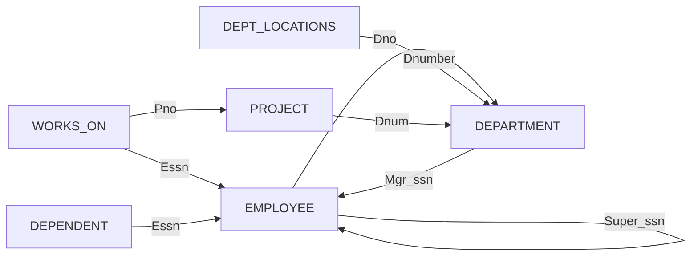


<div class="callout callout-summary" markdown="1">
<div class="callout-title callout-title--default" markdown="span">요약</div>

표를 쓰려면 먼저 빈 표의 틀을 만들어야 한다. 장부의 첫 줄에 칸 이름을 적고 칸마다 "숫자만", "빈칸 금지" 같은 규칙을 걸어 두는 일과 같아서, 틀을 잘 만들어 두면 잘못된 값은 들어올 때 걸러진다. 다만 표끼리 서로를 가리킬 때는 만드는 순서가 꼬인다. 아직 없는 표를 가리키는 규칙은 적을 수 없어서, 그런 규칙은 표를 다 만든 뒤에 따로 붙인다.

</div>


## 예시로 보기

행을 넣으려면 넣을 표가 있어야 한다. DBMS는 그 표에 어떤 칸이 있고 칸마다 어떤 값을 받는지 알아야 한다. 이것을 알려 주는 문장이 `CREATE TABLE`이다.

회사 데이터베이스의 부서 표는 이렇게 만든다.

```sql
CREATE TABLE DEPARTMENT
( Dname           VARCHAR(15)   NOT NULL,
  Dnumber         INT           NOT NULL,
  Mgr_ssn         CHAR(9)       NOT NULL,
  Mgr_start_date  DATE,
  PRIMARY KEY (Dnumber),
  UNIQUE (Dname),
  FOREIGN KEY (Mgr_ssn) REFERENCES EMPLOYEE(Ssn) );
```

문장은 세 덩어리다.

1. **표 이름.** `DEPARTMENT`.
2. **열 목록.** 한 줄이 열 하나다. 열 이름 뒤에 그 열이 받는 값의 꼴을 적는다. `Dname VARCHAR(15)`는 "Dname 칸은 15글자까지의 글자"라는 뜻이다. 이 꼴을 자료형이라 부른다: [SQL 자료형](/Hongs_Blog/studies/database-design/sql-data-types/).
3. **처음 거는 제약.** `NOT NULL`은 "이 칸은 비울 수 없다"다: [속성 제약](/Hongs_Blog/studies/database-design/sql-attribute-constraints/). 아래 세 줄은 어느 열이 행을 가려내고(`PRIMARY KEY`, `UNIQUE`) 어느 열이 다른 표를 가리키는지(`FOREIGN KEY`) 적는다: [PRIMARY KEY·UNIQUE·FOREIGN KEY 절](/Hongs_Blog/studies/database-design/sql-key-clauses/).

## 정의

**스키마 만들기.** SQL에서 스키마는 표와 자료형, 제약, [뷰](/Hongs_Blog/studies/database-design/sql-view/)처럼 데이터베이스를 이루는 것들을 한 이름 아래 묶은 것이다. 스키마에는 이름과 주인이 있다. 주인을 적는 자리를 권한 식별자(authorization identifier)라고 한다.

```sql
CREATE SCHEMA COMPANY AUTHORIZATION 'Jsmith';
```

이름이 COMPANY이고 주인이 Jsmith인 스키마를 만든다.

**표 만들기.** `CREATE TABLE`은 새 릴레이션의 이름, 속성, 처음 거는 제약을 적어 표를 만든다.

- **표 이름.** 앞에 스키마 이름을 붙여 `CREATE TABLE COMPANY.EMPLOYEE …`처럼 쓸 수 있다. 안 붙이고 `CREATE TABLE EMPLOYEE …`라고 써도 된다.
- **속성.** 〈속성 이름, 자료형〉 짝을 쉼표로 이어 적는다.
- **처음 거는 제약.** 속성 하나에 거는 제약(`NOT NULL`, 기본값)과 무결성 제약(키, 참조 무결성)을 적는다.

회사 데이터베이스의 표 여섯 개를 만드는 문장 전체는 다음과 같다. 표의 열과 화살표는 [관계형 데이터베이스 스키마와 상태](/Hongs_Blog/studies/database-design/relational-database-schema/)의 스키마 그림과 한 줄씩 맞아떨어진다.

<details class="callout callout-note" markdown="1">
<summary class="callout-title" markdown="span">COMPANY의 CREATE TABLE 여섯 문장</summary>

```sql
CREATE TABLE EMPLOYEE
( Fname           VARCHAR(15)    NOT NULL,
  Minit           CHAR,
  Lname           VARCHAR(15)    NOT NULL,
  Ssn             CHAR(9)        NOT NULL,
  Bdate           DATE,
  Address         VARCHAR(30),
  Sex             CHAR,
  Salary          DECIMAL(10,2),
  Super_ssn       CHAR(9),
  Dno             INT            NOT NULL,
  PRIMARY KEY (Ssn) );
CREATE TABLE DEPARTMENT
( Dname           VARCHAR(15)    NOT NULL,
  Dnumber         INT            NOT NULL,
  Mgr_ssn         CHAR(9)        NOT NULL,
  Mgr_start_date  DATE,
  PRIMARY KEY (Dnumber),
  UNIQUE (Dname),
  FOREIGN KEY (Mgr_ssn) REFERENCES EMPLOYEE(Ssn) );
CREATE TABLE DEPT_LOCATIONS
( Dnumber         INT            NOT NULL,
  Dlocation       VARCHAR(15)    NOT NULL,
  PRIMARY KEY (Dnumber, Dlocation),
  FOREIGN KEY (Dnumber) REFERENCES DEPARTMENT(Dnumber) );
CREATE TABLE PROJECT
( Pname           VARCHAR(15)    NOT NULL,
  Pnumber         INT            NOT NULL,
  Plocation       VARCHAR(15),
  Dnum            INT            NOT NULL,
  PRIMARY KEY (Pnumber),
  UNIQUE (Pname),
  FOREIGN KEY (Dnum) REFERENCES DEPARTMENT(Dnumber) );
CREATE TABLE WORKS_ON
( Essn            CHAR(9)        NOT NULL,
  Pno             INT            NOT NULL,
  Hours           DECIMAL(3,1),
  PRIMARY KEY (Essn, Pno),
  FOREIGN KEY (Essn) REFERENCES EMPLOYEE(Ssn),
  FOREIGN KEY (Pno) REFERENCES PROJECT(Pnumber) );
CREATE TABLE DEPENDENT
( Essn            CHAR(9)        NOT NULL,
  Dependent_name  VARCHAR(15)    NOT NULL,
  Sex             CHAR,
  Bdate           DATE,
  Relationship    VARCHAR(8),
  PRIMARY KEY (Essn, Dependent_name),
  FOREIGN KEY (Essn) REFERENCES EMPLOYEE(Ssn) );
```

</details>


WORKS_ON의 Hours에는 `NOT NULL`을 걸지 않는다. COMPANY 상태에는 사장 Borg가 20번 프로젝트에서 일한 시간을 비워 둔 행 (888665555, 20, NULL)이 있다. Hours를 `NOT NULL`로 만들면 이 행은 들어가지 못한다. SQLite는 "NOT NULL constraint failed: WORKS_ON.Hours"라는 오류로 막는다.


### 서로를 가리키는 표

여섯 문장을 다 적었으면 물어볼 것이 있다. 이것으로 충분한가? 어떤 문제가 생길 수 있는가?

위 문장에서 EMPLOYEE만 `FOREIGN KEY` 줄이 없다. 스키마 그림에는 EMPLOYEE에서 나가는 화살표가 둘 있다. 상사를 가리키는 Super_ssn → EMPLOYEE.Ssn과, 부서를 가리키는 Dno → DEPARTMENT.Dnumber다. 이 둘이 문장에서 빠져 있다. 그러니 이것만으로는 충분하지 않다[^s1].

그냥 적어 넣으면 안 될까? 안 된다. EMPLOYEE를 맨 먼저 만드는데, `FOREIGN KEY (Dno) REFERENCES DEPARTMENT(Dnumber)`는 아직 없는 표 DEPARTMENT를 가리킨다. PostgreSQL 16에서 돌리면 "그런 표가 없다"는 오류가 난다.

그럼 DEPARTMENT를 먼저 만들면? 이번에는 DEPARTMENT의 `FOREIGN KEY (Mgr_ssn) REFERENCES EMPLOYEE(Ssn)`이 아직 없는 EMPLOYEE를 가리킨다. 직원은 부서를 가리키고 부서는 직원(관리자)을 가리킨다. 어느 쪽을 먼저 만들어도 걸린다.



화살표 "A → B"는 A가 B를 가리킨다는 뜻이다. 그래서 B가 먼저 있어야 한다. EMPLOYEE와 DEPARTMENT 사이는 화살표가 양쪽으로 나 있어 "먼저"를 정할 수 없다. 나머지 네 표는 가리킴 받는 표를 먼저 만들면 된다.

푸는 방법은 걸리는 외래 키를 빼고 표를 다 만든 뒤, 표의 틀을 고치는 `ALTER TABLE` 문으로 나중에 붙이는 것이다([ALTER TABLE](/Hongs_Blog/studies/database-design/sql-alter-table/)).

```sql
ALTER TABLE EMPLOYEE ADD CONSTRAINT EMPSUPERFK
      FOREIGN KEY (Super_ssn) REFERENCES EMPLOYEE(Ssn);
ALTER TABLE EMPLOYEE ADD CONSTRAINT EMPDEPTFK
      FOREIGN KEY (Dno) REFERENCES DEPARTMENT(Dnumber);
```

자기 자신을 가리키는 Super_ssn은 PostgreSQL 16에서 `CREATE TABLE` 안에 바로 적어도 받는다. 걸리는 것은 다른 표를 가리키는 Dno 쪽이다.

행을 넣을 때도 같은 일이 생긴다. 빈 데이터베이스에 첫 직원 Borg를 넣으려면 그가 일하는 1번 부서가 있어야 한다. 1번 부서를 넣으려면 관리자 Borg가 있어야 한다. 둘 다 거부된다. 길은 둘이다. 외래 키를 붙이기 전에 행을 먼저 넣거나, 외래 키 검사를 한 묶음의 작업이 끝날 때로 미룬다[^s1].

<div class="callout callout-check" markdown="1">
<div class="callout-title" markdown="span">검증: 표 여섯 개의 열 수(10, 4, 2, 4, 3, 5)와 외래 키 여덟 개, Hours에 `NOT NULL`을 걸면 상태의 NULL 행이 막힘, 서로 가리키는 두 표에 첫 행 넣기(SQLite) — [46_sql-create-table_verify.py](/Hongs_Blog/studies/database-design/code/46_sql-create-table_verify/). `CREATE SCHEMA … AUTHORIZATION`, 아직 없는 표를 가리키는 외래 키의 오류, `ALTER TABLE`로 나중에 붙이기는 PostgreSQL 16에서 실행 — [46_sql-create-table_verify.sql](/Hongs_Blog/studies/database-design/code/46_sql-create-table_verify-sql/)</div>

</div>


## 활용

- **설계에서 문장으로.** ER 그림을 표로 옮긴 결과([ER-관계형 사상 절차](/Hongs_Blog/studies/database-design/er-to-relational-mapping/))를 `CREATE TABLE` 문으로 적으면 데이터베이스가 된다. 릴레이션 하나가 문장 하나, 밑줄 친 속성이 `PRIMARY KEY`, 화살표가 `FOREIGN KEY`다.
- **만드는 순서.** 외래 키를 문장 안에 적으려면 가리킴 받는 표부터 만든다. COMPANY에서 EMPLOYEE의 Dno 외래 키만 뒤로 미루면 EMPLOYEE → DEPARTMENT → DEPT_LOCATIONS, PROJECT → WORKS_ON, DEPENDENT 순서로 만들 수 있다.
- **제품마다 다른 점.** 위의 `CREATE SCHEMA COMPANY AUTHORIZATION 'Jsmith';`를 PostgreSQL 16은 따옴표 때문에 구문 오류로 본다. 따옴표를 떼면, Jsmith라는 사용자가 있을 때 돈다. SQLite에는 `CREATE SCHEMA`가 없다. 또 SQLite는 `CREATE TABLE` 때 가리키는 표가 있는지 보지 않아서, 아직 없는 표를 가리키는 외래 키도 받는다[^s1].
- **흔한 실수.** 마지막 열이나 제약 뒤에 쉼표를 남긴다. 닫는 괄호 앞의 쉼표는 구문 오류다.

## 연결

- 선수: [SQL 한눈에 보기](/Hongs_Blog/studies/database-design/sql-overview/), [관계형 데이터베이스 스키마와 상태](/Hongs_Blog/studies/database-design/relational-database-schema/)
- 스키마(틀)와 상태(지금 든 행)의 구분: [스키마와 인스턴스](/Hongs_Blog/studies/database-design/schema-and-instance/). `CREATE TABLE`은 틀만 만들고 행은 하나도 넣지 않는다.
- "가리킴 받는 표를 먼저"는 선후 관계가 있는 일들을 한 줄로 세우는 문제다: [부분순서와 위상 정렬](/Hongs_Blog/studies/discrete-math/partial-orders/). 서로 가리키는 두 표처럼 고리가 있으면 그런 줄 세우기가 없다.
- 만든 표를 고치고 없애는 문장: [ALTER TABLE](/Hongs_Blog/studies/database-design/sql-alter-table/), [DROP 명령과 CASCADE·RESTRICT](/Hongs_Blog/studies/database-design/sql-drop/)

## 확인 문제

<details class="callout callout-question" markdown="1">
<summary class="callout-title" markdown="span">**C1** `CREATE TABLE` 문에 적는 세 가지는 무엇인가? 표 이름 앞에 스키마 이름을 붙인 꼴도 써 보라.</summary>

**답:** 표의 이름, 속성 목록(속성 이름과 자료형의 짝), 처음 거는 제약(속성 제약과 키·참조 무결성 제약)이다. 스키마 이름을 붙이면 `CREATE TABLE COMPANY.EMPLOYEE ( … );`다.

</details>


<details class="callout callout-question" markdown="1">
<summary class="callout-title" markdown="span">**C2** 위 여섯 문장 가운데 EMPLOYEE 문장에는 스키마 그림에 있는 외래 키 둘이 빠져 있다. 왜 그 자리에 적지 못하는가? 어떻게 붙이는가?</summary>

**답:** EMPLOYEE를 맨 먼저 만드는데 Dno의 외래 키는 아직 없는 DEPARTMENT를 가리키기 때문이다. DEPARTMENT를 먼저 만들어도 그쪽의 Mgr_ssn이 EMPLOYEE를 가리켜 똑같이 걸린다. 표를 다 만든 뒤 `ALTER TABLE EMPLOYEE ADD CONSTRAINT … FOREIGN KEY (Dno) REFERENCES DEPARTMENT(Dnumber);`로 붙인다.<br>
**이유:** 두 표가 서로를 가리키면 "가리킴 받는 표 먼저"라는 순서가 없다. PostgreSQL 16은 없는 표를 가리키는 `FOREIGN KEY`를 오류로 막는다.

</details>


<details class="callout callout-question" markdown="1">
<summary class="callout-title" markdown="span">**C3** 프로젝트 표 PROJECT(Pname, Pnumber, Plocation, Dnum)를 만드는 문장을 쓰라. 프로젝트 번호가 기본 키이고, 프로젝트 이름도 겹치면 안 되며, Dnum은 그 프로젝트를 맡은 부서의 번호다. 이름, 번호, 부서 번호는 비울 수 없다. 이 문장은 여섯 표 가운데 어느 표가 먼저 있어야 도는가?</summary>

**답:**
```sql
CREATE TABLE PROJECT
( Pname      VARCHAR(15)  NOT NULL,
  Pnumber    INT          NOT NULL,
  Plocation  VARCHAR(15),
  Dnum       INT          NOT NULL,
  PRIMARY KEY (Pnumber),
  UNIQUE (Pname),
  FOREIGN KEY (Dnum) REFERENCES DEPARTMENT(Dnumber) );
```
DEPARTMENT가 먼저 있어야 한다. Dnum이 DEPARTMENT의 Dnumber를 가리키기 때문이다.

</details>


[^s1]: Elmasri & Navathe, *Fundamentals of Database Systems* 7판 6.1.2절이 같은 문제와 `ALTER TABLE`로 나중에 붙이는 방법을 적는다. 오류와 해결은 PostgreSQL 16과 SQLite에서 실행해 확인했다.

