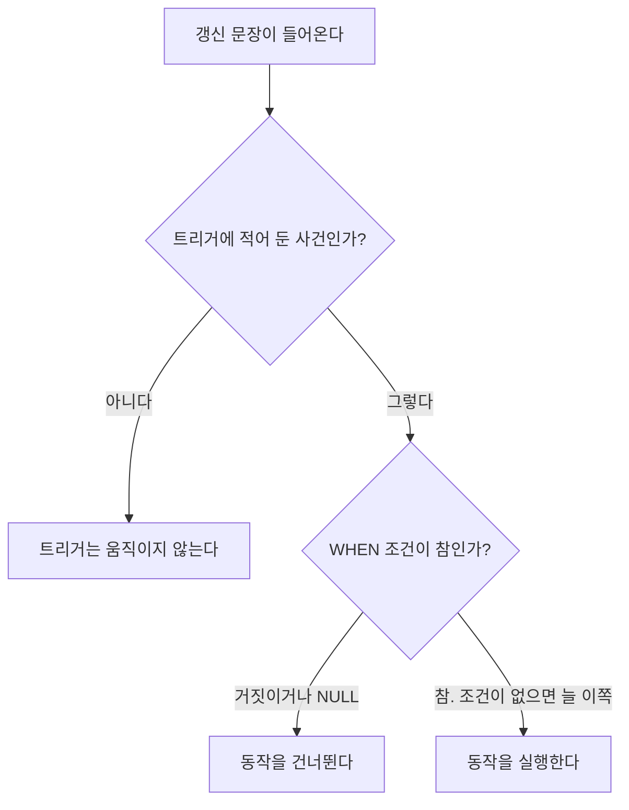


<div class="callout callout-summary" markdown="1">
<div class="callout-title callout-title--default" markdown="span">요약</div>

현관의 센서등은 누가 지나가면 어두운지 보고, 어두울 때만 불을 켠다. 트리거는 표에 행을 넣거나 고치는 일이 일어나면 정해 둔 조건을 보고, 조건이 맞을 때 정해 둔 일을 데이터베이스가 스스로 하도록 걸어 두는 규칙이다. 어느 프로그램이 표를 건드리든 빠짐없이 움직여서 사람이 지켜볼 필요가 없다. 대신 적어 둔 일에만 반응해서, 반응할 일을 하나라도 빠뜨리면 그 길로 들어온 변화는 그냥 지나간다.

</div>


센서등은 사람이 지나간 뒤에 켜진다. 트리거는 일이 일어나기 전에 움직이게 할 수도 있고, 불만 켜는 것이 아니라 그 일을 막을 수도 있다.

## 예시로 보기

부장이 "직원 출장비가 한도를 넘으면 알려 달라"고 한다. 출장비를 넣는 프로그램이 하나뿐이면 그 프로그램에 확인하는 코드를 넣으면 된다. 프로그램이 셋이면 셋 모두에 넣어야 하고, 누가 표를 직접 고치면 아무도 확인하지 않는다. 확인을 프로그램이 아니라 데이터베이스에 걸어 두면 이 문제가 없어진다.

여기서 다룰 예는 급여다. **직원의 급여가 직속 상사의 급여보다 많아지면 상사에게 알린다.** 이 일이 생길 수 있는 때는 셋이다. 새 직원을 넣을 때, 직원의 급여를 고칠 때, 직원의 상사를 바꿀 때다.

COMPANY에 이 규칙을 걸고 문장 일곱 개를 차례로 실행했다. "알림"은 알림 표에 쌓인 줄이다[^s1].

| 순서 | 문장 | 트리거가 깨어나는 때인가 | 새 급여 > 상사 급여 | 알림 |
|---|---|---|---|---|
| 1 | Lee(45000, 상사 Wong 40000)를 넣는다 | 그렇다 (삽입) | 45000 > 40000, 참 | Wong에게 1건 |
| 2 | Roh(20000, 상사 Wong)를 넣는다 | 그렇다 (삽입) | 거짓 | 없음 |
| 3 | Smith의 급여를 30000에서 41000으로 | 그렇다 (급여 수정) | 41000 > 40000, 참 | Wong에게 1건 |
| 4 | Zelaya(25000)의 상사를 Roh(20000)로 | 그렇다 (상사 수정) | 25000 > 20000, 참 | Roh에게 1건 |
| 5 | 상사가 없는 Borg의 급여를 99000으로 | 그렇다 (급여 수정) | 견줄 상사 급여가 없다. 참이 아니다 | 없음 |
| 6 | Smith의 주소를 고친다 | 아니다 | 보지 않는다 | 없음 |
| 7 | Wallace의 급여를 43000에서 20000으로 | 그렇다 (급여 수정) | 20000 > Borg 99000, 거짓 | 없음 |

1번 줄에서 Lee의 행은 그대로 들어간다. 이 트리거는 알리기만 하고 막지 않는다.

7번 줄이 함정이다. Wallace의 급여가 내려가서 부하 Jabbar(25000)가 상사보다 많이 받게 되었다. 알려야 할 일이 생겼는데 알림이 없다. 트리거는 고쳐진 행인 Wallace만 보고, Wallace는 자기 상사보다 적게 받기 때문이다.

<div class="callout callout-check" markdown="1">
<div class="callout-title" markdown="span">검증: PostgreSQL 16에서 실행 — 위 일곱 줄, 아래 교재 문법의 문장이 그대로는 구문 오류인 것, 둘째 트리거를 단 뒤 7번이 잡히는 것, BEFORE와 AFTER가 보는 행 수 — [74_sql-trigger_verify.sql](/Hongs_Blog/studies/database-design/code/74_sql-trigger_verify-sql/). SQLite 판(트리거를 둘로 나눔)과 카드 C2 — [74_sql-trigger_verify.py](/Hongs_Blog/studies/database-design/code/74_sql-trigger_verify/)</div>

</div>


## 세 요소: 사건, 조건, 동작

트리거는 사건(Event), 조건(Condition), 동작(Action) 세 조각으로 된 규칙이다. 머리글자를 따 ECA 규칙이라 부른다.

```sql
CREATE TRIGGER SALARY_VIOLATION
BEFORE INSERT OR UPDATE OF Salary, Super_ssn
    ON EMPLOYEE
FOR EACH ROW
    WHEN ( NEW.Salary > ( SELECT Salary FROM EMPLOYEE
                          WHERE Ssn = NEW.Super_ssn ) )
         INFORM_SUPERVISOR( NEW.Super_ssn, NEW.Ssn );
```

| 요소 | 위 문장의 어디 | 뜻 |
|---|---|---|
| 사건 | `BEFORE INSERT OR UPDATE OF Salary, Super_ssn ON EMPLOYEE` | 트리거를 깨우는 갱신 연산. EMPLOYEE에 행을 넣거나, 급여 열이나 상사 열을 고칠 때다 |
| 조건 | `WHEN ( … )` | 사건이 일어난 뒤 따져 보는 식. 참일 때만 동작을 한다. 조건을 안 적으면 사건이 일어날 때마다 동작을 한다 |
| 동작 | `INFORM_SUPERVISOR(…)` | 저절로 실행되는 일. SQL 문장 여러 개, 트랜잭션 하나, 바깥 프로그램 가운데 무엇이든 된다 |

`SALARY_VIOLATION`은 트리거의 이름이고, 동작에서 부르는 프로시저는 `INFORM_SUPERVISOR`다. 이 프로시저는 상사의 Ssn과 직원의 Ssn을 받아 상사에게 알린다. `NEW`는 새로 들어가는 행, 또는 고친 뒤의 행이다. `NEW.Salary`는 그 행의 급여다. `FOR EACH ROW`는 문장 하나가 여러 행을 건드리면 행마다 한 번씩 따져 보라는 말이다[^s2].



위 표의 6번 줄은 첫 갈림길에서 "아니다"로 빠졌다. 2번, 5번, 7번 줄은 둘째 갈림길에서 빠졌다[^s3].

**사건.** 사건은 데이터베이스에 직접 가한 갱신 연산이다. 설계자는 규칙이 깨질 수 있는 사건을 빠짐없이 챙겨야 한다. 트리거 하나로 안 되면 여러 개를 써야 한다.

**BEFORE와 AFTER.** 사건 앞에 붙는 이 낱말이 트리거가 움직이는 때를 정한다. `BEFORE`면 그 갱신을 하기 전에, `AFTER`면 한 뒤에 움직인다. 5행짜리 DEPT_LOCATIONS에 한 행을 넣으면서 두 트리거에게 표의 행 수를 세게 했더니, `BEFORE` 쪽은 5를, `AFTER` 쪽은 6을 봤다[^s1].

**조건.** 사건이 일어나면 먼저 조건을 따진다. 참이면 동작을 하고, 아니면 아무 일도 없다. 위 표의 5번 줄에서 Borg는 상사가 없다. 괄호 안의 질의가 아무 값도 못 찾아 비교 결과가 [NULL](/Hongs_Blog/studies/database-design/sql-null/)이 된다. NULL은 참이 아니라서 동작을 하지 않는다[^s1].

## 실행해 보기

위 `CREATE TRIGGER` 문장은 교재(Elmasri & Navathe)의 문법이다. PostgreSQL 16도 SQLite 3.50도 그대로는 받지 않았고, 고쳐야 하는 곳이 서로 다르다[^s1].

| | 교재의 문장 | PostgreSQL 16 | SQLite 3.50 |
|---|---|---|---|
| 사건 여러 개를 한 트리거에 | `INSERT OR UPDATE OF …` | 받는다 | 안 받는다. 사건마다 트리거를 하나씩 만든다 |
| `WHEN` 안의 질의 | 쓴다 | 안 받는다. 조건을 함수 안의 `IF`로 옮긴다 | 받는다 |
| 동작 적는 법 | 프로시저 이름을 바로 쓴다 | `EXECUTE FUNCTION 함수이름()` | `BEGIN`과 `END` 사이에 SQL 문장 |

PostgreSQL 16에서 실행한 판이다. 알림은 `NOTICE` 표에 한 줄 넣는 것으로 대신했다.

```sql
CREATE FUNCTION inform_supervisor() RETURNS trigger AS $$
BEGIN
  IF NEW.Salary > (SELECT Salary FROM EMPLOYEE WHERE Ssn = NEW.Super_ssn) THEN   -- 조건
    INSERT INTO NOTICE (Supervisor_ssn, Emp_ssn) VALUES (NEW.Super_ssn, NEW.Ssn); -- 동작
  END IF;
  RETURN NEW;
END $$ LANGUAGE plpgsql;

CREATE TRIGGER SALARY_VIOLATION
BEFORE INSERT OR UPDATE OF Salary, Super_ssn ON EMPLOYEE                          -- 사건
FOR EACH ROW EXECUTE FUNCTION inform_supervisor();
```


## 보장하는 것과 보장하지 않는 것

**보장하는 것.** 적어 둔 사건이 일어나고 조건이 참이면, 누가 어떤 프로그램으로 표를 고쳤든 동작이 실행된다.

**보장하지 않는 것.**

- **적지 않은 사건.** 위 표의 7번 줄이다. "상사의 급여가 내려간다"는 사건을 적지 않아서 놓쳤다. 급여가 바뀐 사람의 부하를 살피는 둘째 트리거(`AFTER UPDATE OF Salary`)를 달고 같은 문장을 다시 실행하자 Jabbar 건이 알림에 올라왔다[^s1].
- **규칙 그 자체.** 이 트리거의 동작은 알림이다. 급여가 상사보다 많은 행은 그대로 들어간다. 막으려면 동작을 "오류를 내고 그 문장을 취소한다"로 적어야 한다.
- **이미 있던 위반.** 트리거를 달기 전에 Narayan의 급여를 41000으로 올려 두었다. 트리거를 단 뒤에도 이 건은 알림이 없다. 트리거는 앞으로 일어날 사건에만 움직인다[^s1].

## 활용

트리거의 쓰임새는 셋이다.

- **데이터베이스의 일관성 지키기.** 동작을 "거부"로 적으면 [주장](/Hongs_Blog/studies/database-design/sql-assertion/)으로 적고 싶던 규칙을 막을 수 있다. SQLite에서 동작을 `RAISE(ABORT, …)`로 바꾼 트리거는 45000인 행을 거부하고 39000인 행은 받았다[^s1].
- **갱신 지켜보기.** 위의 급여 알림, 출장비 알림이 이쪽이다.
- **다른 값에서 계산되는 값을 저절로 고치기.** 부서별 인원과 급여 합을 표에 따로 적어 두고, 직원이 바뀔 때마다 트리거가 그 줄을 고치게 한다. [질의 수정과 뷰 실체화](/Hongs_Blog/studies/database-design/view-implementation/)의 즉시 갱신이 이 방법이다.

흔한 실수는 사건을 하나만 생각하는 것이다. 규칙에 나오는 값이 바뀔 수 있는 길을 모두 적어 본다. 급여 규칙에는 "직원의 급여", "직원의 상사", "상사의 급여" 세 값이 나오고, 셋 다 바뀔 수 있다.

## 연결

- 선수: [INSERT·DELETE·UPDATE](/Hongs_Blog/studies/database-design/sql-insert-delete-update/)(사건이 되는 문장), [중첩 질의와 IN](/Hongs_Blog/studies/database-design/nested-query-in/)(조건 안의 질의), [주장 CREATE ASSERTION](/Hongs_Blog/studies/database-design/sql-assertion/)
- [참조 동작](/Hongs_Blog/studies/database-design/referential-triggered-actions/)도 같은 틀이다. 사건은 "가리킴을 받는 행을 지우거나 고친다", 동작은 `SET NULL`이나 `CASCADE`다. 사건과 동작의 종류가 미리 정해져 있다는 점만 다르다. 그래서 참조 동작의 `ON DELETE`, `ON UPDATE`를 트리거라고 부르기도 한다.
- 뷰에 트리거를 달아 뷰를 고치는 길을 정해 주는 쓰임: [뷰 갱신 문제](/Hongs_Blog/studies/database-design/view-update-problem/)

## 확인 문제

<details class="callout callout-question" markdown="1">
<summary class="callout-title" markdown="span">**C1** ECA 규칙의 세 요소를 말하고, 위 `SALARY_VIOLATION` 트리거에서 각각이 어느 줄인지 짚으라.</summary>

**답:** 사건: `BEFORE INSERT OR UPDATE OF Salary, Super_ssn ON EMPLOYEE`. 조건: `WHEN (NEW.Salary > (SELECT Salary FROM EMPLOYEE WHERE Ssn = NEW.Super_ssn))`. 동작: `INFORM_SUPERVISOR(NEW.Super_ssn, NEW.Ssn)`.<br>
**이유:** 사건이 일어나면 조건을 따지고, 참일 때만 동작을 한다. 조건은 적지 않아도 되고, 그때는 사건이 일어날 때마다 동작을 한다.

</details>


<details class="callout callout-question" markdown="1">
<summary class="callout-title" markdown="span">**C2** COMPANY 상태에 급여 알림 트리거를 걸고 다음 세 문장을 차례로 실행한다. 알림은 몇 건이고 누구에게 가는가? ① 급여 45000, 상사 Wong인 새 직원 Lee를 넣는다. ② Smith의 급여를 41000으로 고친다. ③ Wallace의 급여를 20000으로 고친다.</summary>

**답:** 2건이고 둘 다 Wong에게 간다. ①은 45000 > Wong 40000, ②는 41000 > 40000이라 한 건씩 생긴다. ③은 0건이다.<br>
**이유:** ③에서 트리거가 보는 행은 Wallace다. Wallace의 새 급여 20000은 상사 Borg의 55000보다 적어서 조건이 거짓이다. 이 문장 뒤에 부하 Zelaya와 Jabbar(둘 다 25000)가 Wallace보다 많이 받게 되지만, 두 사람의 행은 고쳐지지 않았으니 트리거가 움직이지 않는다. 흔한 오답은 "③에서 2건이 더 생긴다"이다.

</details>


<details class="callout callout-question" markdown="1">
<summary class="callout-title" markdown="span">**C3** (a) "부서장보다 급여가 많은 직원이 있으면 안 된다." (b) "출장비가 한도를 넘으면 부장에게 메시지를 보낸다." 주장과 트리거 가운데 어느 쪽에 맞는가? 둘의 차이를 두 가지 쓰라.</summary>

**답:** (a)는 주장, (b)는 트리거다. 차이 ①: 주장은 늘 참이어야 하는 조건만 적는다. 언제 확인할지는 DBMS가 알아서 한다. 트리거는 언제(사건) 움직일지를 설계자가 적는다. 차이 ②: 주장은 조건을 어기는 상태를 허락하지 않는다. 트리거는 할 일(동작)을 적는 것이라 알리기만 하고 넘어갈 수도, 다른 표를 고칠 수도 있다.<br>
**이유:** (b)에는 지켜야 할 상태가 없고 할 일만 있다. 한도를 넘는 출장비 자체는 들어가도 된다. 그래서 주장으로는 적을 수 없다.

</details>


[^s1]: PostgreSQL 16과 SQLite 3.50.4에서 실행해 확인했다. 알림은 알림 표에 한 줄 넣는 것으로 흉내 냈다.
[^s2]: 한 문장이 세 행을 고칠 때 트리거가 세 번 도는 것을 PostgreSQL 16에서 확인했다.
[^s3]: 조건이 NULL일 때 동작을 건너뛰는 것은 5번 줄(Borg)의 실행 결과다.

