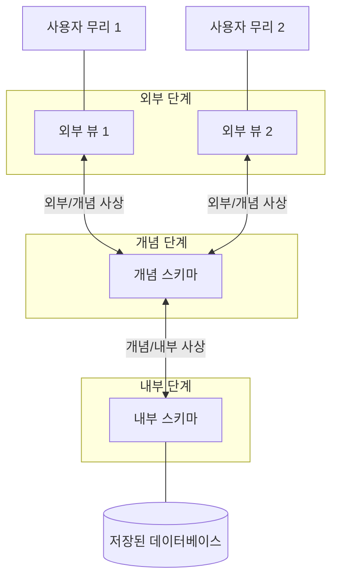



요약

식당에서 손님은 차림표만 보고 주문하고, 주방은 조리법대로 만들고, 재료는 창고에 있다. 데이터베이스도 사용자 무리마다 보는 모습, 전체를 한 벌로 적은 모습, 디스크에 실제로 놓인 모습의 세 층으로 가르고, 요청이 층을 건널 때마다 관리 프로그램(DBMS)이 옮겨 적어 준다. 이렇게 갈라 두면 사용자의 프로그램이 디스크의 저장 모양에 매이지 않아서, 아래층을 고쳐도 위층은 그대로 둘 수 있다. 대신 요청과 결과를 층마다 옮겨 적는 수고가 든다.

## 예시로 보기

두 학과 사무실이 같은 학생 데이터를 쓴다. 보는 칸도 다르고 칸을 부르는 이름도 다르다. 두 학과의 프로그램이 "디스크의 몇 번째 바이트를 읽는다"까지 알고 있다면, 저장 모양을 한 번 바꿀 때마다 두 프로그램을 모두 고쳐야 한다. 그래서 학과가 보는 모습과 디스크의 모습 사이에 층을 하나 더 두고, 층마다 설명을 따로 적는다.

대학 예에는 설명이 넷 있다.

| 층 | 이름 | 내용 |
|---|---|---|
| 맨 위 (학과 A) | ST | SN INT, NAME CHAR(10), GRADE INT, DEPT CHAR(5) |
| 맨 위 (학과 B) | STUDENT | SNO PIC 9(4), SNAME PIC X(10), YEAR PIC 9(2), ADDR PIC X(44) |
| 가운데 | STUDENT | SNUMBER INTEGER, NAME CHAR(10), YEAR SMALLINT, GRADE SMALLINT, DEPT CHAR(5), ADDRESS CHAR(44) |
| 맨 아래 | STORED-STUDENT | 길이 71바이트. 아래 표의 일곱 칸 |

가운데 층은 학생에 대해 저장하는 여섯 칸을 모두 적는다. 두 학과는 그 가운데 네 칸씩만 본다. 맨 아래 층은 레코드 하나가 디스크에서 몇 바이트이고 칸마다 어디서 시작하는지를 적는다. 오프셋(offset)은 레코드 맨 앞에서 몇 바이트 떨어져 있는지를 0부터 센 수다.

같은 칸을 층마다 어떻게 부르는지 한 줄에 놓으면 이렇다.

| 학과 A | 학과 B | 가운데 층 | 맨 아래 층 | 오프셋 | 길이(바이트) |
|---|---|---|---|---|---|
| — | — | — | prefix | 0 | 4 |
| SN | SNO | SNUMBER | SNO (색인 STINDX) | 4 | 4 |
| NAME | SNAME | NAME | SNAME | 8 | 10 |
| — | YEAR | YEAR | SYEAR | 18 | 2 |
| GRADE | — | GRADE | SGRADE | 20 | 2 |
| DEPT | — | DEPT | SDEPT | 22 | 5 |
| — | ADDR | ADDRESS | SADDR | 27 | 44 |

오프셋은 앞 칸들의 길이를 더한 값이다. SNAME은 $$4 + 4 = 8$$, SADDR은 $$4 + 4 + 10 + 2 + 2 + 5 = 27$$에서 시작한다. 길이를 모두 더하면 $$4 + 4 + 10 + 2 + 2 + 5 + 44 = 71$$이라 맨 아래 층에 적힌 LENGTH = 71과 맞는다. 학과 A는 YEAR와 ADDRESS를, 학과 B는 GRADE와 DEPT를 보지 못한다. prefix는 어느 학과에도 보이지 않는다. SNO 옆의 INDEX = STINDX는 이 칸의 값으로 레코드를 빨리 찾게 해 주는 색인이 있고 그 이름이 STINDX라는 표시다. 색인은 책 뒤의 찾아보기 같은 것이다[^s1].

학과 A의 프로그램이 "SN이 1002인 학생의 GRADE"를 달라고 하면 요청은 두 번 옮겨진다[^s1].

1. 맨 위에서 가운데로. SN은 SNUMBER로, GRADE는 GRADE로 바꿔 읽는다.
2. 가운데에서 맨 아래로. SNUMBER는 저장 레코드의 SNO다. 색인 STINDX로 그 학생의 레코드를 찾는다. GRADE는 SGRADE이고, 레코드의 오프셋 20에서 2바이트다.
3. 디스크에서 그 2바이트를 읽는다.
4. 읽은 값을 거꾸로 옮겨, 학과 A가 아는 이름 GRADE로 돌려준다.

학과 A의 프로그램은 20이라는 숫자를 모른다. 그 숫자는 맨 아래 층의 설명에만 있다.

식당 비유는 한 군데서 어긋난다. 차림표, 조리법, 창고에는 서로 다른 물건이 있지만, 세 층의 설명은 모두 같은 데이터 한 벌을 가리킨다. 데이터가 실제로 있는 곳은 맨 아래뿐이다[^s2].

검증: 오프셋 0, 4, 8, 18, 20, 22, 27과 전체 71바이트, 두 학과가 여섯 칸 가운데 네 칸씩 봄, 세 층에서 길이가 맞음, 두 번 옮긴 요청이 오프셋 20의 2바이트와 오프셋 27의 44바이트를 읽고 SQLite의 뷰와 같은 값을 냄, 바탕 표를 고치면 두 뷰가 모두 바뀜 — [07_three-schema-architecture_verify.py](/Hongs_Blog/studies/database-design/code/07_three-schema-architecture_verify/)

## 정확히 말하면

3단계 스키마 구조는 사용자 응용을 물리적 데이터베이스에서 떼어 놓으려는 구조다. 사용자 프로그램과 데이터가 서로 매이지 않게 하는 것이 목적이다.

단계마다 그 단계의 스키마가 있다. 스키마는 데이터베이스에 대한 설명이다.

| 단계 | 가진 것 | 무엇을 적나 | 쓰는 데이터 모델 |
|---|---|---|---|
| 외부 단계 (뷰 단계) | 외부 스키마 여러 개. 사용자 뷰라고도 한다 | 어느 한 사용자 무리가 관심 있는, 데이터베이스 구조의 일부. 나머지는 그 무리에게 가린다 | 고수준 데이터 모델. 표현적 모델이나 개념적 모델 |
| 개념 단계 | 개념 스키마 | 데이터베이스의 논리 구조. 물리 저장 구조의 세부는 가리고 개체, 자료형, 관계, 사용자 연산, 제약 같은 고수준 개념을 적는다 | 표현적 데이터 모델 |
| 내부 단계 | 내부 스키마 | 데이터베이스의 물리 저장 구조. 데이터 저장과 접근 경로의 세부를 빠짐없이 적는다 | 물리적 데이터 모델 |

세 단계를 위에서부터 End User View, Community User View, Storage View라고 부르기도 한다. 최종 사용자가 보는 모습, 사용자 모두가 함께 보는 모습, 저장된 모습이라는 뜻이다. 대학 예에서 학과 A와 B의 두 설명이 외부 스키마, 가운데 층이 개념 스키마, 맨 아래 층이 내부 스키마다.

**사상(mapping).** 세 단계 사이에서 요청과 결과를 바꿔 주는 과정이다. 외부 스키마로 적은 사용자의 요청을 개념 스키마에 대한 요청으로 바꾸고, 그것을 다시 내부 스키마에 대한 요청으로 바꿔 저장된 데이터베이스에서 처리한다. 저장된 데이터베이스에서 얻은 결과는 외부 뷰에 맞게 바꿔 돌려준다. 외부 단계와 개념 단계 사이를 외부/개념 사상, 개념 단계와 내부 단계 사이를 개념/내부 사상이라 한다. 사용자 무리마다 자기 외부 스키마에 적힌 대로의 데이터베이스만 보는데도 DBMS가 요청을 처리할 수 있는 것은 이 사상 덕분이다.

**내부 단계는 누가 신경 쓰나.** 최종 사용자는 내부 단계의 정보에 관심이 없을 수 있다. 하지만 데이터베이스 설계자는 이 부분을 챙겨야 한다. 내부 스키마의 주된 목표는 디스크 입출력을 줄이는 것이다. 이 목표가 [B-트리](/Hongs_Blog/studies/database-design/b-tree/)로 이어진다.

### 이 구조가 주는 것과 주지 않는 것

- 주는 것: 한 단계의 스키마를 바꿔도 그 위 단계를 안 바꿔도 되는 성질. [데이터 독립성](/Hongs_Blog/studies/database-design/data-independence/)에서 다룬다.
- 주지 않는 것: 속도. 요청마다 두 번 옮겨 적는 일이 컴파일하거나 실행할 때 부담이 된다. 그래서 세 단계를 완전히 따로 구현한 DBMS는 드물다[^s2].

## 연결

- 선수: [데이터 모델의 종류](/Hongs_Blog/studies/database-design/data-model-categories/)(단계마다 쓰는 모델), [스키마와 인스턴스](/Hongs_Blog/studies/database-design/schema-and-instance/)
- 세 스키마와 사상을 적는 언어: [DBMS 언어와 인터페이스](/Hongs_Blog/studies/database-design/dbms-languages-interfaces/)
- 외부 스키마를 SQL로 만드는 방법: [뷰](/Hongs_Blog/studies/database-design/sql-view/)
- 저장 세부를 가린다는 생각의 출발점: [데이터베이스 방식의 네 가지 특징](/Hongs_Blog/studies/database-design/database-approach-characteristics/)

## 확인 문제

**C1** 세 단계의 이름과 각 단계의 스키마가 적는 것을 쓰라. 사상은 무엇인가?

**답:** 내부 단계의 내부 스키마는 물리 저장 구조, 곧 데이터 저장과 접근 경로의 세부를 적는다. 개념 단계의 개념 스키마는 데이터베이스의 논리 구조를 적고 저장 세부는 가린다. 외부 단계의 외부 스키마(사용자 뷰)는 어느 사용자 무리가 관심 있는 일부만 적고 나머지는 가린다. 사상은 단계 사이에서 요청과 결과를 바꿔 주는 과정이고, 외부/개념 사상과 개념/내부 사상 둘이 있다.

**C2** 위 대학 예에서 학과 B의 프로그램이 "SNO가 1002인 학생의 ADDR"을 달라고 한다. 이름이 층마다 어떻게 바뀌고, 저장 레코드의 어디를 읽게 되는가?

**답:** ADDR → ADDRESS → SADDR. 레코드의 오프셋 27에서 44바이트를 읽는다. 학생을 찾는 데 쓰는 SNO는 SNUMBER를 거쳐 저장 레코드의 SNO(오프셋 4, 4바이트)가 되고, 색인 STINDX로 찾는다. 
**이유:** 외부/개념 사상이 학과 B의 이름을 개념 스키마의 이름으로 바꾸고, 개념/내부 사상이 그것을 저장 칸의 이름과 위치로 바꾼다. $$27 + 44 = 71$$이라 주소가 레코드의 마지막 칸이다.

**C3** 스키마가 세 단계에 있으면 학생 데이터도 세 벌 저장되는가? 학과 A의 프로그램은 학생의 주소를 읽을 수 있는가?

**답:** 한 벌만 저장된다. 세 스키마는 모두 설명이고, 데이터는 내부 스키마에 적힌 모양으로 저장 장치에만 있다. 학과 A는 주소를 읽지 못한다. 학과 A의 외부 스키마 ST에 주소 칸이 없기 때문이다. 
**이유:** 외부 스키마는 그 무리가 관심 있는 부분만 적고 나머지를 가린다. 가운데 층의 값을 하나 고치면 두 학과가 보는 값이 함께 바뀌는 것도 데이터가 한 벌이라서다[^s2].

[^s1]: INDEX = STINDX의 풀이는 표기를 읽은 것이다. PIC 9(4)는 COBOL에서 숫자 네 자리, PIC X(10)은 글자 열 칸을 적는 표기다.
[^s2]: 세 스키마는 설명일 뿐이고 데이터는 물리 단계에만 있다는 것, 사상이 부담이 되어 세 단계를 완전히 구현한 DBMS가 드물다는 것은 Elmasri & Navathe, *Fundamentals of Database Systems* 7판 2.2.1~2.2.2절을 따랐다. 식당 비유와 그 한계는 보탠 것이다. 뷰가 행을 따로 갖지 않고 바탕 표를 고치면 두 뷰가 함께 바뀌는 것은 검증 코드로 확인했다.

