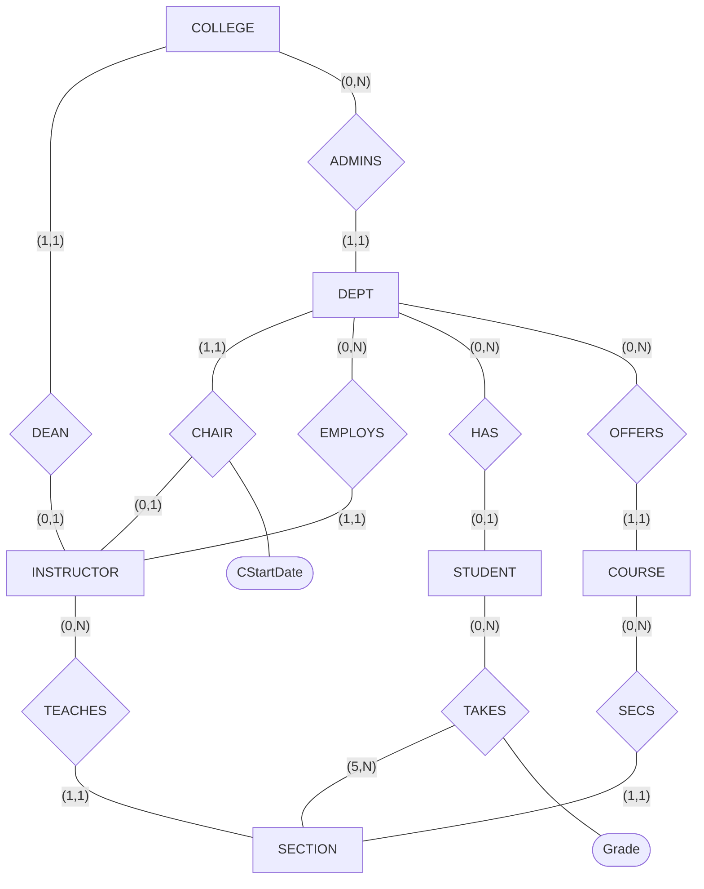


사용 개념: [ER-관계형 사상 절차](/Hongs_Blog/studies/database-design/er-to-relational-mapping/)의 일곱 단계, [(min, max) 표기](/Hongs_Blog/studies/database-design/min-max-notation/) 읽기.

7주차 슬라이드의 연습이다. 여기의 UNIVERSITY는 2주차의 UNIVERSITY 표 다섯 개와는 다른 스키마다.

## p1 · UNIVERSITY ER 그림을 릴레이션으로 옮기기

아래 UNIVERSITY ER 그림을 관계형 데이터베이스 스키마로 옮겨라. 힌트: 개체 릴레이션 6개와 관계 릴레이션 1개가 나온다[^1].

선에 적힌 (min, max)는 그 선이 붙은 개체 타입의 것이다. COLLEGE와 DEAN 사이의 (1,1)은 "단과대학 하나는 DEAN 관계에 딱 한 번 참여한다"는 뜻이다. 개체 타입의 속성은 아래 표에 적었다[^s1].

| 개체 타입 | 속성 |
|---|---|
| COLLEGE | CName(키), COffice, CPhone |
| INSTRUCTOR | Id(키), Rank, IName, IOffice, IPhone |
| DEPT | DName(키), DCode(키), DOffice, DPhone |
| COURSE | CCode(키), CoName(키), Credits, Level, CDesc |
| SECTION | SecId(키), SecNo, Sem, Year, DaysTime, CRoom(Bldg, RoomNo) |
| STUDENT | SId(키), DOB, SName(FName, MName, LName), Addr, Phone, Major |

**풀이 전략.** 그림이 (min, max) 표기라서 관계의 종류부터 읽어야 한다. 관계 타입마다 양쪽의 max를 본다. 둘 다 1이면 1:1, 한쪽만 1이면 1:N, 둘 다 N이면 M:N이다. 1:N에서 외래 키를 받는 쪽은 max가 1인 개체 타입이다. 상대를 많아야 하나만 가지는 쪽이기 때문이다. 그다음은 절차의 순서대로 간다. 이 그림에는 약한 개체 타입, 다치 속성, n항 관계 타입이 없어서 네 단계만 남는다[^2].

**0단계 · 관계의 종류 읽기**

| 관계 타입 | 양쪽의 (min, max) | 종류 | 외래 키를 받는 쪽 |
|---|---|---|---|
| DEAN | COLLEGE (1,1), INSTRUCTOR (0,1) | ______ | ______ |
| CHAIR | DEPT (1,1), INSTRUCTOR (0,1) | ______ | ______ |
| ADMINS | COLLEGE (0,N), DEPT (1,1) | ______ | ______ |
| EMPLOYS | DEPT (0,N), INSTRUCTOR (1,1) | ______ | ______ |
| HAS | DEPT (0,N), STUDENT (0,1) | ______ | ______ |
| OFFERS | DEPT (0,N), COURSE (1,1) | ______ | ______ |
| SECS | COURSE (0,N), SECTION (1,1) | ______ | ______ |
| TEACHES | INSTRUCTOR (0,N), SECTION (1,1) | ______ | ______ |
| TAKES | STUDENT (0,N), SECTION (5,N) | ______ | ______ |

답

| 관계 타입 | 종류 | 외래 키를 받는 쪽 | 까닭 |
|---|---|---|---|
| DEAN | 1:1 | COLLEGE | 양쪽 max가 1. COLLEGE의 min이 1(전체 참여) |
| CHAIR | 1:1 | DEPT | 양쪽 max가 1. DEPT의 min이 1(전체 참여) |
| ADMINS | 1:N | DEPT | DEPT의 max가 1. 학과는 단과대학 하나에 딸린다 |
| EMPLOYS | 1:N | INSTRUCTOR | INSTRUCTOR의 max가 1. 교수는 학과 하나에 속한다 |
| HAS | 1:N | STUDENT | STUDENT의 max가 1. 학생은 학과가 많아야 하나다 |
| OFFERS | 1:N | COURSE | COURSE의 max가 1 |
| SECS | 1:N | SECTION | SECTION의 max가 1 |
| TEACHES | 1:N | SECTION | SECTION의 max가 1 |
| TAKES | M:N | (새 릴레이션) | 양쪽 max가 N |

1:1이 2개, 1:N이 6개, M:N이 1개다. (0,N)이 적힌 쪽이 N쪽이 아니라는 점에 조심한다. ADMINS에서 (0,N)은 COLLEGE에 적혀 있고, 외래 키를 받는 N쪽은 DEPT다[^s2].

**1단계 · 일반 개체 타입**

답

개체 타입마다 릴레이션 하나를 만든다. 복합 속성 SName과 CRoom은 성분만 들어간다. 굵은 것이 기본 키다[^3].

| 릴레이션 | 속성 |
|---|---|
| COLLEGE | **CName**, COffice, CPhone |
| INSTRUCTOR | **Id**, Rank, IName, IOffice, IPhone |
| DEPARTMENT | **DName**, DCode, DOffice, DPhone |
| COURSE | **CCode**, Credits, CoName, Level, CDesc |
| SECTION | **SecId**, SecNo, Sem, Year, Bldg, RoomNo, DaysTime |
| STUDENT | **SId**, DOB, FName, MName, LName, Addr, Phone, Major |

풀이 슬라이드는 개체 타입 DEPT의 릴레이션 이름을 DEPARTMENT로 적었다. DEPT와 COURSE는 키 속성이 둘씩인데 DName과 CCode를 기본 키로 골랐다. 남은 DCode와 CoName은 값이 안 겹친다는 조건을 따로 걸어야 하는 보조 키다[^s2].

**2단계 · 1:1 관계 타입 (DEAN, CHAIR)**

답

전체 참여 쪽 릴레이션에 상대의 기본 키를 넣는다. 관계의 속성 CStartDate도 따라간다[^4].

| 릴레이션 | 붙는 속성 | 외래 키 |
|---|---|---|
| COLLEGE | DeanId | DeanId → INSTRUCTOR.Id |
| DEPARTMENT | ChairId, CStartDate | ChairId → INSTRUCTOR.Id |

INSTRUCTOR에 넣으면 학장도 학과장도 아닌 교수의 칸이 모두 NULL이 된다.

**3단계 · 1:N 관계 타입 (여섯 개)**

답

max가 1인 쪽 릴레이션에 상대의 기본 키를 넣는다[^5].

| 관계 타입 | 릴레이션 | 붙는 속성 | 외래 키 |
|---|---|---|---|
| EMPLOYS | INSTRUCTOR | Employed | Employed → DEPARTMENT.DName |
| ADMINS | DEPARTMENT | Admined | Admined → COLLEGE.CName |
| OFFERS | COURSE | Offered | Offered → DEPARTMENT.DName |
| TEACHES | SECTION | Taught | Taught → INSTRUCTOR.Id |
| SECS | SECTION | Belongs | Belongs → COURSE.CCode |
| HAS | STUDENT | Dept | Dept → DEPARTMENT.DName |

**4단계 · M:N 관계 타입 (TAKES)**

답

관계 릴레이션을 새로 만든다. 양쪽 기본 키를 외래 키로 넣고 둘을 묶어 기본 키로 삼는다. 관계의 속성 Grade도 넣는다[^6].

| 릴레이션 | 속성 | 외래 키 |
|---|---|---|
| TAKES | **SId**, **SecId**, Grade | SId → STUDENT.SId, SecId → SECTION.SecId |

**마지막 스키마**

답

릴레이션 7개(개체 릴레이션 6개 + 관계 릴레이션 1개), 외래 키 10개다[^6].

| 릴레이션 | 속성 (굵은 것이 기본 키, 기울인 것이 외래 키) |
|---|---|
| COLLEGE | **CName**, COffice, CPhone, *DeanId* |
| INSTRUCTOR | **Id**, Rank, IName, IOffice, IPhone, *Employed* |
| DEPARTMENT | **DName**, DCode, DOffice, DPhone, *ChairId*, CStartDate, *Admined* |
| COURSE | **CCode**, Credits, CoName, Level, CDesc, *Offered* |
| SECTION | **SecId**, SecNo, Sem, Year, Bldg, RoomNo, DaysTime, *Taught*, *Belongs* |
| STUDENT | **SId**, DOB, FName, MName, LName, Addr, Phone, Major, *Dept* |
| TAKES | ***SId***, ***SecId***, Grade |

개수는 그림에서 바로 셀 수 있다. 릴레이션은 일반 개체 6 + M:N 1 = 7개, 외래 키는 1:1 2 + 1:N 6 + M:N 2 × 1 = 10개다.

원본 오류 의심

원문: 풀이 슬라이드 p.4(2단계)는 DEPARTMENT에 붙는 외래 키를 ChairId로 적고, p.5~6(3·4단계)은 같은 자리를 Chaired로 적는다. / 문제점: 한 속성의 이름이 쪽마다 다르다. COLLEGE의 DeanId는 끝까지 그대로다. / 수정안: 같은 속성이다. 이 문서는 DeanId와 짝이 맞는 ChairId로 적었다. / 근거: 세 쪽 모두 그 속성에서 INSTRUCTOR의 Id로 화살표가 가고, 바로 옆에 CStartDate가 있다.

검증: 강의의 단계를 코드로 옮긴 사상기에 이 ER을 넣어 0단계의 종류(1:1 2개, 1:N 6개, M:N 1개), 1~4단계의 중간 결과, 릴레이션 7개, 외래 키 10개가 가리키는 곳이 풀이 슬라이드와 같음. 만든 표가 SQLite에서 돌아가고 외래 키가 걸림. 변형 두 문제의 답 — [44_university-mapping-practice_p1.py](/Hongs_Blog/studies/database-design/code/44_university-mapping-practice_p1/)

### 옮긴 뒤에 볼 것

- **NULL을 받는 외래 키는 하나다.** STUDENT.Dept만 그렇다. HAS에서 STUDENT가 (0,1)이라 학과가 없는 학생이 있을 수 있다. 다른 외래 키는 min이 1인 쪽에 들어가 비어 있을 수 없다[^s3].
- **(5, N)의 5는 사라진다.** 분반마다 학생이 다섯 이상이어야 한다는 규칙은 TAKES의 키와 외래 키로는 적히지 않는다. 수강생이 한 명뿐인 분반도 들어간다[^s3].
- **릴레이션들이 서로를 가리킨다.** INSTRUCTOR는 DEPARTMENT를(Employed), DEPARTMENT는 INSTRUCTOR를(ChairId) 가리킨다. COLLEGE, INSTRUCTOR, DEPARTMENT도 돌아가며 가리킨다. 표를 만들 때 순서를 따져야 한다: [CREATE SCHEMA와 CREATE TABLE](/Hongs_Blog/studies/database-design/sql-create-table/)

### 변형

**(가)** HAS를 외래 키가 아니라 교차 참조 방법으로 옮기면 스키마가 어떻게 달라지는가? 어떤 때 이쪽이 나은가?

답

STUDENT에서 Dept가 빠지고 HAS(**SId**, DName)가 생긴다. 기본 키는 N쪽의 키인 SId다. 외래 키는 SId → STUDENT.SId, DName → DEPARTMENT.DName. 릴레이션은 8개가 된다. 학과가 없는 학생이 대부분이면 STUDENT.Dept가 거의 다 NULL이 되므로 이쪽이 낫다[^s3].

**(나)** STUDENT의 Phone이 값이 여럿인 속성이라면?

답

STUDENT에서 Phone을 빼고 STUDENT_PHONE(**SId**, **Phone**)을 만든다. 기본 키는 둘의 묶음, 외래 키는 SId → STUDENT.SId. 릴레이션은 8개가 된다([다치 속성의 사상](/Hongs_Blog/studies/database-design/mapping-multivalued-attributes/))[^s3].

[^1]: 데이터베이스 설계 7회 강의 자료 「7_relational-model」, p.31 (Exercise: ER-to-Relational Mapping for UNIVERSITY DB, "Hint: 6 entity relations + 1 relationship relation")
[^2]: 데이터베이스 설계 7회 강의 자료 「7-relational-model-solutions」, p.6 ("No weak entity types / No multivalued attributes / No n-ary relationship types")
[^3]: 같은 자료, p.3 (Step 1: Mapping of regular entity types)
[^4]: 같은 자료, p.4 (Steps 2: Mapping of binary 1:1 relationship types)
[^5]: 같은 자료, p.5 (Steps 3: Mapping of binary 1:N relationship types)
[^6]: 같은 자료, p.6 (Steps 4: Mapping of binary M:N relationship types)
[^s1]: 보충 Mermaid 그림 1개는 원본에 없다. 7 p.31의 Chen 표기 그림을 옮긴 것이고 개체 타입의 속성은 표로 뺐다. 밑줄(키)은 그림을 크게 뽑아 확인했다.
[^s2]: 보충 0단계의 표와 "max가 1인 쪽이 외래 키를 받는다"는 읽는 법, 보조 키에 대한 말은 풀이 슬라이드에 없다. 풀이는 단계마다의 그림만 보여 준다. 읽는 법대로 옮긴 결과가 풀이의 그림과 같음을 문제 코드로 확인했다.
[^s3]: 보충 "옮긴 뒤에 볼 것"과 변형 두 문제는 원본에 없다. 문제 코드로 확인했다(NOT NULL이 되는 외래 키, 수강생 한 명인 분반, 두 변형의 릴레이션 수).

