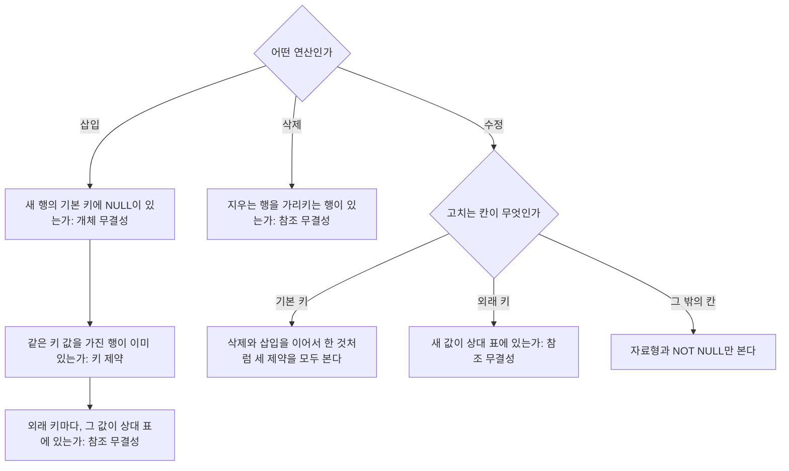



요약

행을 넣거나 지우거나 고칠 때, 표에 걸어 둔 규칙 가운데 무엇이 깨질 수 있는지 미리 짚어 보는 방법이다. 도서관에서 책을 새로 등록할 때, 폐기할 때, 등록 번호를 고칠 때 확인할 것이 서로 다른 것과 같다. 넣을 때는 모든 규칙을 봐야 하고, 지울 때는 "이 행을 가리키는 다른 행이 있는가" 하나만 보면 된다. 고칠 때는 어느 칸을 고치느냐에 달렸는데, 행을 가려내는 칸도 다른 표를 가리키는 칸도 아니면 대개 문제가 없다.

## 예시로 보기

`INSERT` 한 줄이 거부됐는데 왜 거부됐는지 모르면 고칠 수 없다. DBMS는 대개 먼저 걸린 규칙 하나만 알려 준다. 그래서 연산을 보고 "이것이 어길 수 있는 규칙은 무엇무엇이다"를 스스로 짚을 수 있어야 한다.

직원 표에 네 사람을 넣어 본다. 지금 EMPLOYEE에는 여덟 명이 있고 부서는 1, 4, 5번뿐이다.

| 넣으려는 행 | 결과 | 까닭 |
|---|---|---|
| 〈Cecilia, F, Kolonsky, **NULL**, 1960-04-05, …, 28000, NULL, 4〉 | 거부 | 기본 키 Ssn이 NULL이다. 개체 무결성 위반 |
| 〈Alicia, J, Zelaya, **999887777**, 1960-04-05, …, 28000, 987654321, 4〉 | 거부 | Ssn이 999887777인 행이 이미 있다. 키 제약 위반 |
| 〈Cecilia, F, Kolonsky, 677678989, 1960-04-05, …, 28000, 987654321, **7**〉 | 거부 | 7번 부서가 없다. 참조 무결성 위반 |
| 〈Cecilia, F, Kolonsky, 677678989, 1960-04-05, …, 28000, NULL, 4〉 | 들어간다 | 세 제약을 모두 지킨다 |

넣는 행은 어떤 제약도 어겨서는 안 된다. 하나라도 어기면 거부된다.

검증: 본문의 삽입 넷·삭제 셋·수정 넷의 결과, 아래 판정표, 제약을 하나하나 손으로 따지는 검사기와 SQLite의 판정이 무작위 연산 900개(삽입·삭제·수정 300개씩)에서 일치 — [52_update-constraint-violations_verify.py](/Hongs_Blog/studies/database-design/code/52_update-constraint-violations_verify/)

## 연산마다 볼 제약

따질 제약은 셋이다.

- **키 제약:** 키 값이 같은 행이 둘 있으면 안 된다([슈퍼키·후보 키·기본 키](/Hongs_Blog/studies/database-design/relational-keys/)).
- **개체 무결성:** 기본 키는 NULL일 수 없다([개체 무결성 제약](/Hongs_Blog/studies/database-design/entity-integrity-constraint/)).
- **참조 무결성:** 외래 키 값은 가리키는 표의 기본 키에 있는 값이거나 NULL이어야 한다([참조 무결성 제약과 외래 키](/Hongs_Blog/studies/database-design/referential-integrity-foreign-key/)).

연산마다 어길 수 있는 제약이 다르다.

| 연산 | 키 제약 | 개체 무결성 | 참조 무결성 |
|---|---|---|---|
| 삽입 | 새 행의 키 값이 이미 있을 때 | 새 행의 기본 키가 NULL일 때 | 새 행의 외래 키 값이 상대 표에 없을 때 |
| 삭제 | 못 어긴다 | 못 어긴다 | 지우는 행을 다른 행이 가리킬 때 |
| 수정: 기본 키 칸 | 새 값이 이미 있을 때 | NULL로 고칠 때 | 옛 값을 가리키던 행이 있을 때 |
| 수정: 외래 키 칸 | — | — | 새 값이 상대 표에 없을 때 |
| 수정: 그 밖의 칸 | — | — | — (대개 문제없다) |

삭제가 키 제약과 개체 무결성을 못 어기는 까닭은 간단하다. 행이 줄어들기만 해서는 겹치는 키도, NULL인 키도 새로 생기지 않는다.

기본 키 칸을 고치는 일은 옛 행을 지우고 새 행을 넣는 일과 같다고 보면 된다. 그래서 삭제가 어기는 것과 삽입이 어기는 것을 모두 본다[^s1].

갈림길은 연산의 종류에서 한 번, 수정이면 고치는 칸에서 한 번 더 있다. 삽입은 세 물음을 모두 지나야 하고 삭제는 물음이 하나뿐이다[^s2].

### 삭제의 예

지금 WORKS_ON에는 16행이 있다.

| 지우려는 행 | 결과 | 까닭 |
|---|---|---|
| WORKS_ON의 (Essn = 999887777, Pno = 10) | 지워진다 | WORKS_ON의 행을 가리키는 표가 없다 |
| EMPLOYEE의 Ssn = 999887777 (Zelaya) | 거부 | WORKS_ON의 두 행이 이 직원을 가리킨다 |
| EMPLOYEE의 Ssn = 333445555 (Wong) | 거부 | 네 표의 11행이 이 직원을 가리킨다. EMPLOYEE 3행(부하의 Super_ssn), DEPARTMENT 1행(Mgr_ssn), WORKS_ON 4행, DEPENDENT 3행 |

### 수정의 예

Ssn이 999887777인 직원 Zelaya의 행을 고친다.

| 고치는 것 | 결과 | 까닭 |
|---|---|---|
| Salary를 28000으로 | 고쳐진다 | Salary는 키도 외래 키도 아니다 |
| Dno를 1로 | 고쳐진다 | 외래 키지만 1번 부서가 있다 |
| Dno를 7로 | 거부 | 7번 부서가 없다. 참조 무결성 위반 |
| Ssn을 987654321로 | 거부 | 그 번호의 직원(Wallace)이 이미 있다. 키 제약 위반. 또 옛 번호를 가리키던 WORKS_ON 두 행이 갈 곳을 잃는다. 참조 무결성 위반 |

수정에서 얻는 교훈을 한 줄로 줄이면 이렇다. "기본 키에도 외래 키에도 들지 않은 속성을 고치는 것은 대개 문제를 일으키지 않는다." "대개"라고 한 까닭이 있다. 그런 칸이라도 `UNIQUE`나 `NOT NULL`이 걸려 있으면 걸린다. Administration 부서의 Dname을 'Research'로 고치면 거부된다. Dname은 기본 키가 아니지만 `UNIQUE`로 적은 또 다른 키라서다[^s1].

### 어겼을 때 할 수 있는 일

기본은 그 연산을 거부하는 것이다. 다른 길도 있다[^s1].

- **삽입이 거부됐을 때:** 값을 고쳐 다시 넣는다. 참조 무결성 때문이면 가리킬 행을 먼저 넣고 다시 넣는다.
- **삭제나 기본 키 수정이 거부됐을 때:** 가리키는 행을 먼저 지우거나 고친 뒤 다시 한다. 이 뒤처리를 외래 키에 미리 적어 두어 DBMS가 알아서 하게 할 수도 있다: [참조 동작 SET NULL·CASCADE·SET DEFAULT](/Hongs_Blog/studies/database-design/referential-triggered-actions/).

### 스스로 설명해 보기

1. "삭제는 참조 무결성만 어길 수 있다"의 근거

키 제약과 개체 무결성은 "표에 지금 들어 있는 행들"에 대한 조건이다. 행을 빼면 남은 행들은 원래부터 이 조건을 지키고 있었으므로 그대로 지킨다. 참조 무결성만 다른 행의 값이 "이 행이 있다"는 것에 기대고 있어서, 행이 사라지면 깨질 수 있다.

2. "기본 키 값을 새 값으로 고쳐도 참조 무결성이 깨질 수 있다"의 근거

외래 키의 조건은 "그 값이 상대 표의 기본 키에 있어야 한다"다. 기본 키 값을 고치면 옛 값은 표에서 사라진다. 옛 값을 가리키던 행은 없는 값을 가리키게 된다. 새 값이 겹치는지와는 상관없는 일이다.

3. "Dno를 1로 고치는 것은 되고 7로 고치는 것은 안 된다"의 근거

Dno는 DEPARTMENT의 Dnumber를 가리키는 외래 키다. 고친 뒤의 값이 DEPARTMENT에 있어야 한다. 1번 부서는 있고 7번 부서는 없다.

이 방법의 핵심 아이디어는?

연산이 무엇을 새로 생기게 하고 무엇을 사라지게 하는지를 본다. 새 값이 생기면 그 값이 지켜야 할 조건(키가 안 겹치는가, 기본 키가 NULL이 아닌가, 가리키는 곳이 있는가)을 본다. 값이 사라지면 그 값에 기대던 쪽(그 행을 가리키던 외래 키)을 본다.

이 방법을 쓸 수 있는 다른 상황은?

표나 칸을 통째로 없앨 때도 같은 물음을 한다. "이것에 기대고 있는 것이 있는가." [DROP 명령](/Hongs_Blog/studies/database-design/sql-drop/)의 `RESTRICT`와 `CASCADE`, [ALTER TABLE](/Hongs_Blog/studies/database-design/sql-alter-table/)의 `DROP COLUMN`이 그렇다.

## 예제

**이 방법을 꺼낼 신호.** "이 연산이 어기는 무결성 제약을 모두 말하라" 꼴의 문제, 그리고 `INSERT`·`DELETE`·`UPDATE`가 거부됐을 때다.

**예제 1.** DEPARTMENT에 〈Research, 6, 123456789, NULL〉을 넣는다[^s1].

1. *연산의 종류:* 삽입이다. 세 제약을 모두 본다.
2. *개체 무결성:* 기본 키 Dnumber가 6으로 NULL이 아니다. 통과.
3. *키 제약:* 6번 부서는 없다. 그런데 DEPARTMENT에는 키가 하나 더 있다. `UNIQUE (Dname)`이다. Research라는 이름이 이미 있다. 위반.
4. *참조 무결성:* 외래 키 Mgr_ssn의 값 123456789는 직원 Smith의 번호다. 통과.
5. *답:* 키 제약 하나를 어긴다. 이름을 Sales로 바꾸면 들어간다.

**예제 2.** WORKS_ON의 (Essn = 123456789, Pno = 1) 행에서 Pno를 2로, 40으로, 3으로 고치는 세 경우를 따진다[^s1].

1. *고치는 칸:* Pno는 기본 키 {Essn, Pno}의 한 부분이면서 PROJECT를 가리키는 외래 키다. 키 제약과 참조 무결성을 둘 다 본다.
2. *2로:* (123456789, 2)인 행이 이미 있다. 키 제약 위반. 2번 프로젝트는 있으므로 참조 무결성은 지킨다.
3. *40으로:* (123456789, 40)은 새 짝이라 키 제약은 지킨다. 40번 프로젝트가 없다. 참조 무결성 위반.
4. *3으로:* (123456789, 3)은 새 짝이고 3번 프로젝트가 있다. 고쳐진다.
5. *옛 값을 가리키던 행:* WORKS_ON을 가리키는 표가 없으므로 볼 것이 없다.

## 활용

- **두 제약을 함께 어기면.** DBMS는 먼저 걸린 것 하나만 알려 주고 멈춘다. 그것만 고쳐 다시 돌리면 다음 것이 나온다. 그래서 문제를 풀 때는 표의 세 칸을 모두 따져야 한다.
- **자료형과 속성 제약.** 위 셋 말고도 넣거나 고친 값이 자료형의 길이, `NOT NULL`, `CHECK`에 어긋나면 거부된다([속성 제약](/Hongs_Blog/studies/database-design/sql-attribute-constraints/))[^s1].
- **흔한 실수.** 참조 무결성을 한쪽으로만 본다. 넣을 때는 "이 행이 가리키는 곳이 있는가"를, 지울 때는 "이 행을 가리키는 것이 있는가"를 본다. 방향이 반대다.
- 연습: [제약 위반 찾기 연습](/Hongs_Blog/studies/database-design/constraint-violation-practice/)(a~k 열한 문항)

## 연결

- 선수: [INSERT·DELETE·UPDATE](/Hongs_Blog/studies/database-design/sql-insert-delete-update/), [PRIMARY KEY·UNIQUE·FOREIGN KEY 절](/Hongs_Blog/studies/database-design/sql-key-clauses/)
- 거부 대신 가리키는 쪽을 고쳐 맞추기: [참조 동작 SET NULL·CASCADE·SET DEFAULT](/Hongs_Blog/studies/database-design/referential-triggered-actions/)

## 자주 하는 오해

"지우는 것은 없애기만 하니 규칙을 어길 일이 없다"

틀렸다. 넣을 때는 새 값이 규칙에 맞는지 걱정하지만, 지울 때는 새 값이 없으니 안전해 보인다. 실제로 삭제는 키 제약과 개체 무결성은 못 어긴다. 그러나 참조 무결성은 어긴다. 지운 행을 다른 행이 가리키고 있었다면 그 행은 없는 것을 가리키게 된다. `DELETE FROM EMPLOYEE WHERE Ssn = '333445555';`를 돌려 보면 거부된다. Wong을 가리키는 행이 네 표에 11개 있어서다.

## 확인 문제

**C1** 삽입, 삭제, 수정이 각각 어길 수 있는 제약을 키 제약·개체 무결성·참조 무결성 가운데에서 고르라.

**답:** 삽입은 셋 모두. 삭제는 참조 무결성만. 수정은 고치는 칸에 따라 다르다. 기본 키 칸이면 셋 모두, 외래 키 칸이면 참조 무결성, 그 밖의 칸이면 셋 다 어기지 않는다.

**C2** 다음 네 삽입이 어기는 제약을 모두 쓰라. ① DEPARTMENT에 〈Sales, 6, 123456789, NULL〉 ② DEPARTMENT에 〈Research, 6, 123456789, NULL〉 ③ DEPT_LOCATIONS에 〈5, Houston〉 ④ DEPT_LOCATIONS에 〈2, NULL〉

**답:** ① 없음. ② 키 제약(`UNIQUE`인 Dname이 겹친다). ③ 키 제약(기본 키 {Dnumber, Dlocation}의 짝 (5, Houston)이 이미 있다). ④ 개체 무결성(기본 키의 한 칸 Dlocation이 NULL)과 참조 무결성(2번 부서가 없다). 
**이유:** 삽입은 세 제약을 모두 본다. 키는 기본 키만이 아니라 `UNIQUE`로 적은 것도 본다. ④처럼 둘을 함께 어기면 DBMS는 먼저 걸린 하나만 알려 준다.

**C3** DEPARTMENT에서 1번 부서(Headquarters)의 행을 지우면 무엇을 어기는가? 그 행을 가리키는 행을 표별로 세어라.

**답:** 참조 무결성을 어긴다. EMPLOYEE 1행(Borg의 Dno), DEPT_LOCATIONS 1행((1, Houston)), PROJECT 1행(Reorganization의 Dnum)이 1번 부서를 가리킨다. 
**이유:** 삭제는 지우는 행을 가리키는 외래 키만 보면 된다. DEPARTMENT의 Dnumber를 가리키는 외래 키는 EMPLOYEE.Dno, DEPT_LOCATIONS.Dnumber, PROJECT.Dnum 셋이다.

**C4** "기본 키에도 외래 키에도 들지 않은 속성을 고치는 것은 문제를 일으키지 않는다"에서 "대개"를 빼면 틀린다. 반례를 하나 들라.

**답:** `UPDATE DEPARTMENT SET Dname = 'Research' WHERE Dnumber = 4;`. Dname은 기본 키도 외래 키도 아니지만 `UNIQUE`라서 이미 있는 이름으로는 못 고친다. 
**이유:** 키는 기본 키 하나만이 아니다. `UNIQUE`로 적은 다른 키가 있고, `NOT NULL`인 칸을 NULL로 고쳐도 거부된다.

**C5** 기본 키 칸을 고칠 때 왜 세 제약을 모두 봐야 하는지, "옛 행을 지우고 새 행을 넣는 것과 같다"는 말로 설명하라.

**답:** 옛 키 값이 사라지는 것은 삭제와 같아서, 그 값을 가리키던 외래 키가 갈 곳을 잃는다(참조 무결성). 새 키 값이 생기는 것은 삽입과 같아서, 그 값이 이미 있는지(키 제약), NULL은 아닌지(개체 무결성)를 봐야 한다.

[^s1]: 기본 키 수정을 삭제와 삽입으로 보는 설명과 위반했을 때의 선택지는 Elmasri & Navathe, *Fundamentals of Database Systems* 7판 5.3절에 있다. 판정은 모두 SQLite 3.50에서 실행해 확인했고, 삽입·삭제·수정 300개씩의 무작위 연산으로 판정표를 확인했다.
[^s2]: 위 판정표를 따지는 순서로 그렸다.

