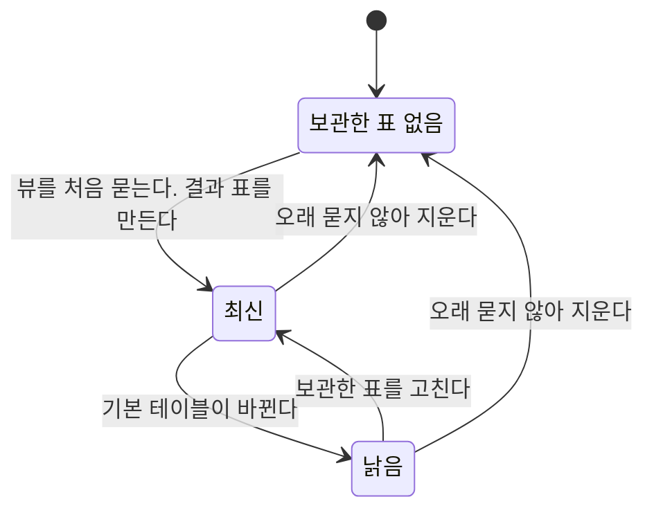


<div class="callout callout-summary" markdown="1">
<div class="callout-title callout-title--default" markdown="span">요약</div>

뷰에 질문이 들어왔을 때 답을 만드는 길은 둘이다. 주문을 받을 때마다 새로 조리하는 식당처럼 물을 때마다 원래 표로 가서 계산하거나, 반찬을 미리 만들어 두는 식당처럼 계산한 결과를 한동안 보관했다가 꺼내 준다. 앞의 길은 늘 새 답을 주지만 복잡한 뷰를 자주 물으면 같은 계산을 되풀이한다. 뒤의 길은 빨리 답하지만 자리를 차지하고, 원래 표가 바뀔 때 보관한 결과를 제때 고치지 않으면 낡은 답이 나간다.

</div>


미리 만든 반찬은 상하면 버리고 통째로 새로 만든다. 보관한 결과는 바뀐 부분만 골라 고칠 수 있다.

## 예시로 보기

[뷰](/Hongs_Blog/studies/database-design/sql-view/)는 늘 최신이어야 하고, 그 일은 DBMS의 몫이다. 그런데 뷰의 행은 저장돼 있지 않다. DBMS는 뷰에 온 질의에 어떻게 답할까?[^1]

`WORKS_ON1`은 EMPLOYEE, PROJECT, WORKS_ON 세 표를 이은 뷰다. 여기에 "ProductX에서 일하는 사람"을 묻는다.

**물을 때마다 계산한다.** DBMS가 뷰 이름 자리에 뷰의 정의를 끼워 넣어 기본 테이블에 대한 질의로 바꾼다[^2].

```sql
-- 사용자가 쓴 질의
SELECT Fname, Lname
FROM   WORKS_ON1
WHERE  Pname = 'ProductX';

-- DBMS가 바꿔서 실행하는 질의
SELECT Fname, Lname
FROM   EMPLOYEE, PROJECT, WORKS_ON
WHERE  Ssn = Essn AND Pno = Pnumber
  AND  Pname = 'ProductX';
```

답은 John Smith와 Joyce English다. 이 질의를 100번 던지면 세 표를 100번 잇는다.

**결과를 보관한다.** 처음 물었을 때 16행짜리 결과 표를 실제로 만들어 둔다. 다음부터는 그 표 하나만 훑는다. 조인이 없다[^3].

여기서 WORKS_ON에 한 행을 넣는다. Narayan이 ProductX에서 3시간 일하게 되었다.

| 묻는 곳 | ProductX에서 일하는 사람 |
|---|---|
| 뷰 `WORKS_ON1` (물을 때마다 계산) | Smith, English, Narayan |
| 보관해 둔 결과 표 | Smith, English |

보관한 표가 낡은 답을 낸다. 보관하는 길을 고르면 이 표를 고치는 일이 따라온다[^s1].

<div class="callout callout-check" markdown="1">
<div class="callout-title" markdown="span">검증: 두 질의의 답과 실행 계획이 같은 것, 보관한 표가 낡는 것, 점진적 갱신이 다시 계산한 값과 무작위 변경 300번 내내 같은 것, 세 갱신 시점의 횟수, 카드 C2 — [76_view-implementation_verify.py](/Hongs_Blog/studies/database-design/code/76_view-implementation_verify/). PostgreSQL 16에서 실행: 실행 계획에 뷰 이름이 없는 것, `CREATE MATERIALIZED VIEW`가 `REFRESH` 전까지 옛 답을 내는 것 — [76_view-implementation_verify.sql](/Hongs_Blog/studies/database-design/code/76_view-implementation_verify-sql/)</div>

</div>


## 두 가지 방법

DBMS가 뷰를 효율적으로 구현하는 문제는 복잡하고, 방법마다 장단점이 있다. 큰 갈래는 둘이다[^4].

| | 질의 수정 (query modification)[^2] | 뷰 실체화 (view materialization)[^3] |
|---|---|---|
| 하는 일 | 뷰에 대한 질의를 기본 테이블에 대한 질의로 바꾼다 | 뷰를 처음 물을 때 임시 표를 실제로 만들고 한동안 둔다 |
| 믿는 것 | 없다 | 같은 뷰를 곧 또 물을 것이다 |
| 답이 최신인가 | 늘 그렇다 | 보관한 표를 제때 고쳐야 그렇다 |
| 값 | 물을 때마다 뷰의 질의를 다시 실행한다 | 저장 자리가 더 든다. 기본 테이블이 바뀌면 고치는 일이 든다 |
| 불리한 때 | 실행에 오래 걸리는 복잡한 뷰를 짧은 사이에 여러 번 물을 때 | 기본 테이블이 자주 바뀌고 뷰는 드물게 물을 때[^s2] |

슬라이드는 질의 수정의 약점을 두고 "뷰의 철학과 맞지 않는다"고 적는다. 복잡한 질의를 자주 던질 때 편하자고 만든 것이 뷰인데, 바로 그때 느려지기 때문이다[^2].

보관한 표가 지나는 상태는 이렇다[^s3].



뷰를 한동안 아무도 묻지 않으면 시스템이 보관한 표를 지울 수 있다. 나중에 누가 다시 물으면 처음부터 다시 계산한다[^5].

## 점진적 갱신

보관한 표를 고칠 때 전부 다시 계산할 필요는 없다. 정의 테이블 하나에 갱신이 들어오면, 보관한 표에 어떤 튜플을 넣고 지우고 고쳐야 하는지를 DBMS가 알아낼 수 있다. 이것을 점진적 갱신(incremental update)이라 한다[^5].

- **조인 뷰.** WORKS_ON에 (Narayan, 1번 프로젝트, 3시간)을 넣었다. 보관한 `WORKS_ON1`에는 이 행에서 생기는 (Ramesh, Narayan, ProductX, 3.0) 한 줄만 더하면 된다. 더한 뒤의 17행은 처음부터 다시 만든 17행과 같다[^s1].
- **집계 뷰.** 5번 부서에 급여 27000인 직원이 들어왔다. 보관한 `DEPT_INFO`에서는 Research 줄 하나만 고친다. 인원에 1을 더하고 급여 합에 27000을 더해 (Research, 5, 160000)으로 만든다. 다른 두 부서의 줄은 건드리지 않는다[^s1].

직원을 넣고, 지우고, 급여를 고치는 일을 무작위로 300번 하면서 바뀐 부서의 줄만 고쳤다. 300번 내내 처음부터 다시 계산한 값과 같았다. 조심할 곳은 경계다. 부서의 마지막 직원이 나가면 그 부서 줄을 인원 0으로 두지 말고 지워야 뷰와 같아진다[^s1].

## 언제 고치나

보관한 표를 고치는 때는 셋 가운데 고른다[^6].

| 방식 | 고치는 때 | 슬라이드의 설명 |
|---|---|---|
| 즉시 갱신 (immediate update) | 기본 테이블이 바뀌자마자 | — |
| 지연 갱신 (lazy update) | 뷰에 질의가 들어와 필요해졌을 때 | 뷰를 묻는 그 순간에만 고친다. 뷰가 계속 물어지는 동안은 보관한 표로 둔다 |
| 주기 갱신 (periodic update) | 정해 둔 때마다 | 뷰 질의가 최신이 아닌 답을 받을 수 있다 |

사건 열 하나로 세 방식을 견줘 본다. U는 기본 테이블 수정, Q는 뷰 질의다.

```
U U U Q U U Q Q U Q U U        (U 8번, Q 4번)
```

| 방식 | 보관한 표를 고친 횟수 | 낡은 답을 낸 횟수 |
|---|---|---|
| 즉시 | 8 (U마다) | 0 |
| 지연 | 3 (4, 7, 10번째 사건의 Q에서) | 0 |
| 주기 (여섯 사건마다) | 2 | 2 (4, 10번째 사건의 Q) |

지연 갱신에서 8번째 사건의 Q는 고치지 않는다. 바로 앞 Q에서 고친 뒤로 바뀐 것이 없기 때문이다. 주기 갱신은 가장 덜 일하지만 Q 네 번 가운데 두 번이 낡은 답이다[^s1].

## 보장하는 것과 보장하지 않는 것

| 방법 | 답이 늘 최신 | 대신 치르는 것 |
|---|---|---|
| 질의 수정 | 보장한다 | 질의마다 뷰의 계산을 다시 한다 |
| 실체화 + 즉시 갱신 | 보장한다 | 기본 테이블을 고치는 문장마다 일이 붙는다 |
| 실체화 + 지연 갱신 | 보장한다 | 바뀐 뒤 첫 질의가 느리다 |
| 실체화 + 주기 갱신 | **보장하지 않는다** | — |

주기 갱신은 "뷰는 늘 최신이어야 한다"는 약속을 깬다. 조금 낡아도 되는 보고서에만 쓴다[^s2].

## 활용

- **PostgreSQL 16과 SQLite의 보통 뷰는 질의 수정으로 돈다.** 뷰에 던진 질의와 손으로 풀어 쓴 질의의 실행 계획을 받아 보면 글자까지 같고, 계획 어디에도 뷰 이름이 없다. 기본 테이블 셋만 나온다[^s4].
- **PostgreSQL 16의 `CREATE MATERIALIZED VIEW`.** 행을 실제로 저장한다. Smith의 급여를 30000에서 33000으로 고친 뒤 보통 뷰는 Research의 합을 136000으로, 실체화된 뷰는 여전히 133000으로 낸다. `REFRESH MATERIALIZED VIEW`를 실행한 뒤에야 136000이 된다. 저절로 맞춰 주지 않으므로, 사람이 정한 때에 고치는 주기 갱신 쪽이다[^s4].
- **즉시 갱신을 직접 만들기.** SQLite에는 실체화된 뷰가 없다. 결과를 보통 표로 떠 두고, 기본 테이블에 [트리거](/Hongs_Blog/studies/database-design/sql-trigger/)를 달아 바뀐 줄만 고치게 했다. 위의 300번 시험이 이 방법이다[^s1].
- **흔한 실수.** 결과를 표로 떠 두고 고치는 장치를 안 다는 것. 처음에는 답이 맞아서 문제를 모른다. 기본 테이블이 바뀐 뒤에야 답이 틀린다.

## 연결

- 선수: [뷰](/Hongs_Blog/studies/database-design/sql-view/)
- 보관한 뷰가 기본 테이블과 뷰 사이 어디쯤인지: [뷰와 기본 테이블 비교](/Hongs_Blog/studies/database-design/view-vs-base-table/)
- 여기서는 기본 테이블의 변화를 뷰로 옮긴다. 거꾸로 뷰에 가한 변화를 기본 테이블로 옮기는 문제: [뷰 갱신 문제](/Hongs_Blog/studies/database-design/view-update-problem/)
- 질의를 다른 꼴로 바꿔 실행하는 일을 맡는 부분: [DBMS 구성 모듈](/Hongs_Blog/studies/database-design/dbms-component-modules/)의 질의 컴파일러

## 확인 문제

<details class="callout callout-question" markdown="1">
<summary class="callout-title" markdown="span">**C1** DBMS가 뷰에 온 질의에 답하는 두 방법의 이름과 하는 일, 각각의 약점을 쓰라.</summary>

**답:** 질의 수정은 뷰에 대한 질의를 기본 테이블에 대한 질의로 바꿔 실행한다. 복잡한 뷰를 짧은 사이에 여러 번 물으면 같은 계산을 되풀이한다. 뷰 실체화는 뷰를 처음 물을 때 결과 표를 실제로 만들어 한동안 둔다. 저장 자리가 들고, 기본 테이블이 바뀔 때 그 표를 고쳐야 최신이 된다.

</details>


<details class="callout callout-question" markdown="1">
<summary class="callout-title" markdown="span">**C2** 사건 열 `U Q U U Q Q U`가 있다(U는 기본 테이블 수정, Q는 뷰 질의). 즉시 갱신, 지연 갱신, 네 사건마다 고치는 주기 갱신에서 보관한 표를 각각 몇 번 고치고, 낡은 답은 몇 번 나가는가?</summary>

**답:** 즉시: 4번 고치고 낡은 답 0번. 지연: 2번 고치고 0번. 주기: 1번 고치고 낡은 답 1번.<br>
**이유:** 즉시는 U마다 고치니 4번이다. 지연은 2번째 사건의 Q(앞에 U가 있었다)와 5번째 사건의 Q에서 고친다. 6번째 사건의 Q는 바뀐 것이 없어 그냥 답한다. 주기는 4번째 사건이 끝날 때 한 번 고친다. 그 전에 온 2번째 사건의 Q가 낡은 답을 받는다. 7번째 사건의 U는 다음 주기까지 그대로 남는다.

</details>


<details class="callout callout-question" markdown="1">
<summary class="callout-title" markdown="span">**C3** (a) 기본 테이블은 초마다 바뀌고, 뷰는 하루에 한 번 묻는다. (b) 기본 테이블은 하루에 한 번 바뀌고, 조인과 집계가 든 뷰를 초마다 수백 번 묻는다. 질의 수정과 뷰 실체화 가운데 어느 쪽이 맞는가?</summary>

**답:** (a)는 질의 수정이다. 보관해 봐야 묻기도 전에 수없이 낡고, 즉시 갱신이면 쓰이지도 않는 표를 초마다 고친다. (b)는 뷰 실체화다. 한 번 계산한 결과를 수백 번 다시 쓰고, 고칠 일은 하루에 한 번이다.<br>
**이유:** 실체화는 "같은 뷰를 곧 또 물을 것이다"가 맞을 때만 이득이다. 가르는 것은 뷰를 묻는 횟수와 기본 테이블이 바뀌는 횟수의 비다[^s2].

</details>


[^1]: 데이터베이스 설계 13회 강의 자료 「13-View」, p.8 (Characteristics of Views: "How can the DBMS keep a view up-to-date?")
[^2]: 같은 자료, p.10 (Approach 1: Query Modification. 바뀐 질의, 복잡한 뷰를 짧은 사이에 여러 번 물을 때 비효율적)
[^3]: 같은 자료, p.11 (Approach 2: View Materialization. 처음 물을 때 임시 표를 만든다, 추가 저장 자리, 다른 질의가 뒤따를 것이라는 가정)
[^4]: 같은 자료, p.9 (View Implementation: Two main approaches)
[^5]: 같은 자료, p.12 (The Concept of Incremental Update in Views. 오래 묻지 않으면 표를 지우고, 다시 물으면 처음부터 계산)
[^6]: 같은 자료, p.13 (Immediate update, Lazy update, Periodic update)
[^s1]: <span class="fn-tag" title="수업 자료에 없고 따로 보탠 내용">보충</span> Narayan의 행을 넣는 예, 점진적 갱신의 두 예와 무작위 300번 시험, 부서의 마지막 직원이 나가는 경계, 사건 열과 횟수 표는 슬라이드에 없다. SQLite 3.50.4에서 실행해 확인했다. 즉시 갱신은 EMPLOYEE에 삽입·삭제·급여 수정 트리거 셋을 달아 만들었다(부서를 옮기는 수정은 다루지 않았다).
[^s2]: <span class="fn-tag" title="수업 자료에 없고 따로 보탠 내용">보충</span> 실체화가 불리한 때, 주기 갱신을 써도 되는 곳, 카드 C3의 판단은 슬라이드에 없다. 슬라이드 p.10의 "짧은 사이에 여러 번 물으면 질의 수정이 비효율적"과 p.11의 가정, p.13의 "최신이 아닌 답을 받을 수 있다"에서 끌어냈다.
[^s3]: <span class="fn-tag" title="수업 자료에 없고 따로 보탠 내용">보충</span> 다이어그램 1개는 원본에 없다. 슬라이드 p.11~13의 설명(처음 물을 때 만든다, 고친다, 오래 묻지 않으면 지운다)을 근거로 그렸다.
[^s4]: <span class="fn-tag" title="수업 자료에 없고 따로 보탠 내용">보충</span> 두 제품이 어느 방법을 쓰는지는 슬라이드에 없다. PostgreSQL 16의 `EXPLAIN`과 SQLite 3.50.4의 `EXPLAIN QUERY PLAN` 결과, PostgreSQL 16의 `CREATE MATERIALIZED VIEW`와 `REFRESH MATERIALIZED VIEW`를 실행해 확인했다. 조인만 든 `WORKS_ON1`으로 확인했고, 다른 제품은 실행해 보지 않았다.

