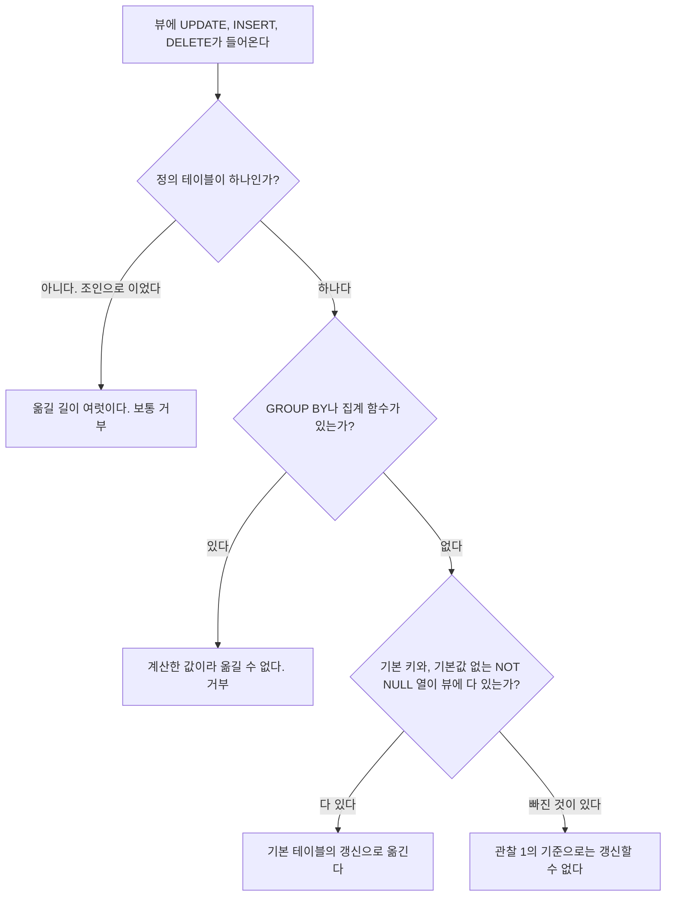


<div class="callout callout-summary" markdown="1">
<div class="callout-title callout-title--default" markdown="span">요약</div>

뷰는 원래 표를 가공해 보여 주는 창이라서, 창에 대고 "이 줄을 고쳐라"고 하면 데이터베이스가 그 말을 원래 표를 고치는 말로 바꿔야 한다. 표 하나에서 행과 열만 골라 보여 주는 뷰는 바꿀 길이 하나뿐이라 고칠 수 있다. 여러 표를 이어 붙인 뷰는 바꿀 길이 여럿이고, 개수나 합계를 보여 주는 뷰는 바꿀 길을 정할 수가 없어서 보통 고칠 수 없다. 읽는 것은 어느 뷰에서나 된다.

</div>


## 예시로 보기

[뷰](/Hongs_Blog/studies/database-design/sql-view/)의 행은 저장돼 있지 않다. 그러니 뷰의 행을 고치라는 문장은 그대로는 실행할 곳이 없다. 기본 테이블의 어느 행을 어떻게 고치면 뷰에 그 결과가 보이는지를 DBMS가 거꾸로 찾아야 한다.

`WORKS_ON1`은 EMPLOYEE, PROJECT, WORKS_ON을 이은 뷰다. 여기에 "John Smith의 프로젝트를 ProductX에서 ProductY로 바꿔라"를 시킨다.

```sql
UPDATE WORKS_ON1
SET    Pname = 'ProductY'
WHERE  Lname = 'Smith' AND Fname = 'John'
  AND  Pname = 'ProductX';
```

뷰의 (John, Smith, ProductX, 32.5) 한 줄은 기본 테이블의 세 행이 만나서 생긴 줄이다.

| 기본 테이블 | 만난 행 |
|---|---|
| EMPLOYEE | (John, Smith, Ssn 123456789, …) |
| WORKS_ON | (Essn 123456789, Pno 1, Hours 32.5) |
| PROJECT | (Pname ProductX, Pnumber 1, …) |

뷰에 보이는 'ProductX'라는 글자는 PROJECT에서 온다. 그런데 Smith가 어느 PROJECT 행과 만날지는 WORKS_ON의 Pno가 정한다. 그래서 길이 둘 생긴다.

```sql
-- (a) WORKS_ON에서 Smith의 프로젝트 번호를 ProductY의 번호로 바꾼다
UPDATE WORKS_ON
SET    Pno = ( SELECT Pnumber FROM PROJECT WHERE Pname = 'ProductY' )
WHERE  Essn IN ( SELECT Ssn FROM EMPLOYEE WHERE Lname = 'Smith' AND Fname = 'John' )
  AND  Pno = ( SELECT Pnumber FROM PROJECT WHERE Pname = 'ProductX' );

-- (b) PROJECT에서 ProductX의 이름을 ProductY로 바꾼다
UPDATE PROJECT SET Pname = 'ProductY'
WHERE  Pname = 'ProductX';
```

(a)는 "Smith가 다른 프로젝트로 옮겼다"이고, (b)는 "프로젝트의 이름이 바뀌었다"이다.

다만 지금 데이터에 두 문장을 그대로 실행하면 둘 다 거부된다. Smith는 이미 ProductY(2번)에서도 일한다. 그래서 (a)를 실행하면 WORKS_ON의 기본 키 (Essn, Pno)가 (123456789, 2)인 행이 둘이 된다. (b)도 막힌다. PROJECT의 Pname에는 UNIQUE가 걸려 있고, ProductY라는 이름이 이미 있다. 두 길은 "제약이 없다면 갈 수 있는 길"이다. 길이 여럿이라는 사정은 그대로다.

제약을 뗀 복사본에서 두 길을 실행하면 뷰가 이렇게 바뀐다[^s1].

| 실행한 뒤 | (a) WORKS_ON을 고침 | (b) PROJECT를 고침 |
|---|---|---|
| 뷰의 (John, Smith, ProductX, 32.5) | ProductY로 바뀜 | ProductY로 바뀜 |
| 뷰의 (Joyce, English, ProductX, 20.0) | 그대로 | **ProductY로 바뀜** |
| PROJECT에 ProductX라는 이름 | 남아 있다 | 없어졌다 |
| 뷰에서 바뀐 줄 수 | 1 | 2 |

바라던 줄은 두 길 모두 바뀐다. 그런데 (b)는 시키지 않은 English의 줄까지 바꿨다. 사용자가 어느 쪽을 뜻했는지 DBMS는 알 길이 없다. 그래서 이런 갱신은 받지 않는다.


<div class="callout callout-check" markdown="1">
<div class="callout-title" markdown="span">검증: PostgreSQL 16에서 실행 — 아래 "실행 결과" 표의 모든 칸, 두 길 (a)·(b)의 효과와 제약 위반, 조건을 벗어난 행과 `WITH CHECK OPTION`, 집계 값을 맞추는 두 길, INSTEAD OF 트리거 — [77_view-update-problem_verify.sql](/Hongs_Blog/studies/database-design/code/77_view-update-problem_verify-sql/). SQLite 판(모든 뷰가 읽기 전용, 두 길의 효과) — [77_view-update-problem_verify.py](/Hongs_Blog/studies/database-design/code/77_view-update-problem_verify/)</div>

</div>


## 세 부류와 규칙

뷰에 던지는 검색 질의는 언제나 된다. `INSERT`, `DELETE`, `UPDATE`는 많은 경우에 안 된다. 되고 안 되고는 뷰를 어떻게 만들었느냐로 갈린다.

| 뷰를 만든 방법 | 갱신 | 까닭 |
|---|---|---|
| 표 하나, 집계 함수 없음 | 조건이 맞으면 된다 | 뷰의 한 줄이 기본 테이블의 한 행이다. 옮길 길이 하나다 |
| 여러 표를 조인 | 보통 안 된다 | 기본 테이블 갱신으로 옮기는 길이 여럿이다 |
| 묶기와 집계 함수 | 안 된다 | 뷰의 값이 저장된 값이 아니라 계산한 값이다 |

일반 규칙은 이렇다.

> 뷰에 가한 갱신을 해낼 수 있는 기본 테이블 갱신이 **딱 하나**일 때만 그 뷰 갱신을 할 수 있다. 기본 테이블 갱신으로 옮기는 길이 둘 이상이면 보통 허락하지 않는다.


관찰 셋으로 다시 적으면 다음과 같다.

1. 정의 테이블이 하나인 뷰는, 뷰의 속성에 그 표의 **기본 키**와 **기본값이 없는 NOT NULL 속성**이 모두 들어 있으면 갱신할 수 있다.
2. 여러 표를 조인으로 이어 만든 뷰는 보통 갱신할 수 없다.
3. 묶기와 집계 함수로 만든 뷰는 갱신할 수 없다.



### 관찰 1의 조건은 왜 필요한가

**기본 키가 빠지면** 뷰의 한 줄이 기본 테이블의 어느 행인지 집어낼 수 없다. 급여만 보이는 뷰 `SALARIES`(`SELECT Salary FROM EMPLOYEE`)에는 25000인 줄이 셋 있다. Zelaya, English, Jabbar다. "25000인 한 사람의 급여를 26000으로"를 이 뷰로는 시킬 수 없다. `UPDATE SALARIES SET Salary = 26000 WHERE Salary = 25000`은 세 행을 한꺼번에 고친다[^s2].

**NOT NULL 열이 빠지면** 새 줄을 넣을 수 없다. `BASIC_EMP_DATA`(Fname, Lname, Address)에 한 줄을 넣으면 EMPLOYEE에 새 행이 생겨야 하는데, 뷰에 없는 Ssn과 Dno에는 넣을 값이 없다. 둘 다 비워 둘 수 없는 열이다[^s2].

### 집계 뷰는 왜 안 되는가

```sql
UPDATE DEPT_INFO
SET    Total_sal = 100000
WHERE  Dept_name = 'Research';
```

`Total_sal`은 직원 급여의 합으로 정의한 값이다. 어느 기본 테이블에도 저장돼 있지 않다. Research의 합은 지금 133000이다. 100000으로 만들려면 직원들의 급여를 합쳐서 33000만큼 깎아야 하는데, 누구에게서 얼마를 깎을지는 정해져 있지 않다. 네 사람에게서 8250씩 깎아도 100000이고, Wong 한 사람에게서 33000을 깎아도 100000이다[^s1].

조건에는 뷰의 열 이름 `Dept_name`을 쓴다. `DEPT_INFO`는 열 이름을 따로 붙여 만든 뷰라서 `Dname`이라는 열이 없다. 기본 테이블의 이름대로 `WHERE Dname = 'Research'`라고 쓰면, PostgreSQL 16은 갱신할 수 있는지 따지기도 전에 "column dname does not exist"를 낸다. 열 이름을 바로잡아야 "Views containing GROUP BY are not automatically updatable"로 거부된다.


### 스스로 설명해 보기

조인 뷰 `WORKS_ON1`의 `UPDATE`가 거부되기까지의 추론이다. 줄마다 근거를 말해 본다.

<details class="callout callout-question" markdown="1">
<summary class="callout-title" markdown="span">1. 뷰의 행을 고치려면 기본 테이블의 행을 고쳐야 한다. 왜인가?</summary>

뷰에는 행이 저장돼 있지 않다. 저장된 것은 정의(질의)뿐이고, 뷰의 내용은 기본 테이블에서 그때그때 나온다. 뷰의 내용을 바꾸는 길은 기본 테이블을 바꾸는 것밖에 없다. — 뷰의 정의(가상 테이블)

</details>


<details class="callout callout-question" markdown="1">
<summary class="callout-title" markdown="span">2. 뷰의 (John, Smith, ProductX, 32.5)를 ProductY로 바꾸는 길이 둘인 까닭은?</summary>

이 줄은 EMPLOYEE, WORKS_ON, PROJECT의 세 행이 조인 조건 `Ssn = Essn AND Pno = Pnumber`로 만나서 생겼다. Pname은 PROJECT 행의 값이고, 어느 PROJECT 행과 만나는지는 WORKS_ON의 Pno가 정한다. 만나는 상대를 바꿔도(WORKS_ON 수정), 상대의 이름을 바꿔도(PROJECT 수정) 뷰의 Pname이 달라진다. — 뷰 정의의 조인 조건

</details>


<details class="callout callout-question" markdown="1">
<summary class="callout-title" markdown="span">3. (b)가 English의 줄까지 바꾸는 까닭은?</summary>

PROJECT의 1번 행 하나가 뷰의 여러 줄에 쓰인다. Smith의 줄과 English의 줄이 같은 PROJECT 행에서 이름을 가져온다. 그 행의 이름을 바꾸면 그 행을 쓰는 줄이 모두 바뀐다. — 조인에서 한 행이 여러 번 쓰인다

</details>


<details class="callout callout-question" markdown="1">
<summary class="callout-title" markdown="span">4. 길이 둘이면 왜 DBMS가 하나를 골라 실행하지 않는가?</summary>

두 길은 다른 줄에 미치는 영향이 다르다. 어느 쪽이 사용자의 뜻인지는 문장에 적혀 있지 않다. 잘못 고르면 시키지 않은 데이터가 바뀐다. 그래서 길이 둘 이상이면 보통 허락하지 않는다. — 뷰 갱신의 일반 규칙

</details>


<details class="callout callout-question" markdown="1">
<summary class="callout-title" markdown="span">이 추론의 핵심 아이디어는?</summary>

뷰 갱신은 "기본 테이블 → 뷰"로 가는 계산을 거꾸로 푸는 일이다. 거꾸로 푼 답이 하나일 때만 안심하고 실행할 수 있다.

</details>


<details class="callout callout-question" markdown="1">
<summary class="callout-title" markdown="span">이 생각을 쓸 수 있는 다른 상황은?</summary>

스프레드시트에서 합계 칸의 숫자를 직접 고치고 싶을 때다. 합계가 100이 되게 하는 입력 칸의 값은 여러 가지라서, 프로그램은 합계 칸에 식 대신 숫자를 덮어쓸 뿐 입력 칸을 고쳐 주지 않는다. 표 하나짜리 뷰가 되는 까닭도 같다. 뷰의 한 줄이 기본 테이블의 한 행이라 거꾸로 푼 답이 하나다.

</details>


## 실행 결과

PostgreSQL 16에서 네 뷰에 세 가지 갱신을 모두 해 보았다[^s1].

| 뷰 | 만든 방법 | UPDATE | INSERT | DELETE |
|---|---|---|---|---|
| `DEPT5EMP` | EMPLOYEE 하나, `WHERE Dno = 5`, 모든 열 | 된다 | 된다 | 된다 |
| `BASIC_EMP_DATA` | EMPLOYEE 하나, 열 셋(기본 키 없음) | 된다 | 안 된다 (Ssn이 비어 NOT NULL 위반) | 된다 |
| `WORKS_ON1` | 세 표 조인 | 거부 | 거부 | 거부 |
| `DEPT_INFO` | 두 표 조인, GROUP BY, 집계 | 거부 | 거부 | 거부 |

- `DEPT5EMP`로 Smith의 급여를 31000으로 고치면 EMPLOYEE의 Smith 행이 31000이 된다. 뷰로 넣은 직원은 EMPLOYEE에 들어가고, 뷰로 지운 직원은 EMPLOYEE에서 없어진다.
- `WORKS_ON1`의 오류 글은 "Views that do not select from a single table or view are not automatically updatable"이다. `DEPT_INFO`는 "Views containing GROUP BY are not automatically updatable"이다.
- **관찰 1과 다른 곳.** `BASIC_EMP_DATA`에는 기본 키가 없으니 관찰 1대로면 갱신할 수 없는 뷰다. PostgreSQL 16은 이 뷰의 `UPDATE`와 `DELETE`를 받는다. 막히는 것은 `INSERT`뿐이다. 관찰 1은 "이 조건이면 된다"는 말이지 "이 조건이 아니면 어느 제품에서도 안 된다"는 말이 아니다.
- **SQLite는 전부 거부한다.** 표 하나짜리 `DEPT5EMP`의 `UPDATE`도 "cannot modify DEPT5EMP because it is a view"로 끝난다. 위 표의 "된다" 칸은 SQLite에서는 하나도 나오지 않는다.

### 뷰의 조건을 벗어나는 행

`DEPT5EMP`는 `Dno = 5`인 행만 보인다. 이 뷰로 4번 부서 직원을 넣으면 어떻게 될까? PostgreSQL 16은 받아 준다. 행은 EMPLOYEE에 들어가지만 뷰에는 보이지 않는다. 넣은 사람이 자기가 넣은 행을 못 본다. 뷰로 English의 `Dno`를 4로 고쳐도 된다. 그 순간 English는 뷰에서 사라져 뷰가 4행에서 3행이 된다[^s3].

뷰 정의 끝에 `WITH CHECK OPTION`을 붙이면 이런 갱신을 막는다.

```sql
CREATE VIEW DEPT5EMP_CK AS
SELECT * FROM EMPLOYEE WHERE Dno = 5
WITH CHECK OPTION;
```

`DEPT5EMP_CK`로 4번 부서 직원을 넣거나 `Dno`를 4로 고치면 "new row violates check option for view"로 거부된다[^s3].

## 보장하는 것과 보장하지 않는 것

**보장하는 것.**

- 어느 뷰에든 검색 질의는 던질 수 있다.
- 뷰 갱신이 받아들여졌다면 그 결과는 기본 테이블에 남는다. 같은 기본 테이블을 쓰는 다른 뷰에도 보인다.

**보장하지 않는 것.**

- **고친 행이 뷰에 남아 있다는 것.** `WITH CHECK OPTION`이 없으면 고친 행이 뷰 밖으로 나갈 수 있다.
- **제품이 달라도 같은 판정이 나온다는 것.** 같은 `DEPT5EMP`를 PostgreSQL 16은 고치게 두고 SQLite는 거부한다.
- **길이 하나면 실행도 된다는 것.** 기본 테이블로 옮긴 갱신은 기본 테이블의 [제약](/Hongs_Blog/studies/database-design/update-constraint-violations/)을 다시 통과해야 한다. 위 예의 (a)와 (b)가 유일성 제약에 걸린 것이 그 예다.

## 활용

- **뷰로 갱신을 받고 싶으면** 표 하나에서 기본 키를 빼지 않고 만든다. 조건(`WHERE`)이 있으면 `WITH CHECK OPTION`을 붙인다.
- **길을 직접 정해 주기.** 어느 갱신이 가장 그럴듯한지 DBMS가 고르게 하자는 연구와, 뷰를 정의할 때 사용자가 고르게 하자는 연구가 있었다. 대부분의 상용 DBMS는 이런 선택지를 주지 않는다. PostgreSQL 16과 SQLite에는 뷰에 `INSTEAD OF` [트리거](/Hongs_Blog/studies/database-design/sql-trigger/)를 달아 설계자가 길을 적어 주는 기능이 있다. `WORKS_ON1`에 "Pname을 고치면 길 (a)로 옮긴다"는 트리거를 달았더니, Narayan을 ProductZ에서 ProductX로 옮기는 뷰 `UPDATE`가 실행되어 WORKS_ON의 Pno가 3에서 1로 바뀌었다. PROJECT는 그대로였다[^s4].
- **흔한 실수.** 뷰를 갱신할 수 있는지 데이터를 넣어 보고 판단하는 것이다. 판정은 뷰의 정의가 한다(아래 오해).

## 연결

- 선수: [뷰](/Hongs_Blog/studies/database-design/sql-view/), [INSERT·DELETE·UPDATE](/Hongs_Blog/studies/database-design/sql-insert-delete-update/), [GROUP BY](/Hongs_Blog/studies/database-design/group-by/), [슈퍼키·후보 키·기본 키](/Hongs_Blog/studies/database-design/relational-keys/)
- 반대 방향(기본 테이블의 변화를 보관한 뷰에 옮기기): [질의 수정과 뷰 실체화](/Hongs_Blog/studies/database-design/view-implementation/)
- 헷갈리는 짝: [뷰와 기본 테이블 비교](/Hongs_Blog/studies/database-design/view-vs-base-table/)
- 연습: [뷰 연습](/Hongs_Blog/studies/database-design/view-practice/)의 연습 2

## 자주 하는 오해

<div class="callout callout-misconception" markdown="1">
<div class="callout-title" markdown="span">"조건에 맞는 행이 하나도 없으면 고칠 것이 없으니, 그 문장은 그냥 실행되고 끝난다"</div>

틀렸다. 기본 테이블에서는 `DELETE … WHERE`의 조건에 맞는 행이 없으면 0행을 지우고 조용히 끝난다. 그래서 뷰에서도 그럴 것 같다. 실제로는 뷰를 갱신할 수 있는지를 **뷰의 정의**가 정한다. 안에 든 데이터는 상관없다. `DEPT_SUMMARY`(부서별 인원 C, 급여 합, 평균)에 `DELETE FROM DEPT_SUMMARY WHERE C > 4`를 실행하면, 인원이 4를 넘는 부서가 하나도 없는데도 PostgreSQL 16은 "cannot delete from view"로 거부한다[^s5].

</div>


<div class="callout callout-misconception" markdown="1">
<div class="callout-title" markdown="span">"표 하나로 만든 뷰는 언제나 고칠 수 있다"</div>

틀렸다. `DEPT_SUMMARY`는 EMPLOYEE 하나로 만든 뷰다. 조인이 없다. 그래도 `GROUP BY`와 집계 함수가 있어서 `UPDATE`도 `DELETE`도 거부된다. 표가 하나라는 것은 조건의 절반이다. 집계가 없어야 하고, `INSERT`까지 하려면 기본 키와 NOT NULL 열이 뷰에 있어야 한다[^s5].

</div>


## 확인 문제

<details class="callout callout-question" markdown="1">
<summary class="callout-title" markdown="span">**C1** 뷰 갱신에 대한 관찰 셋과 일반 규칙을 쓰라.</summary>

**답:** ① 정의 테이블이 하나이고, 뷰의 속성에 그 표의 기본 키와 기본값 없는 NOT NULL 속성이 모두 있으면 갱신할 수 있다. ② 여러 표를 조인한 뷰는 보통 갱신할 수 없다. ③ 묶기와 집계 함수를 쓴 뷰는 갱신할 수 없다. 일반 규칙: 뷰 갱신을 해낼 기본 테이블 갱신이 딱 하나일 때만 할 수 있고, 둘 이상으로 옮길 수 있으면 보통 허락하지 않는다.

</details>


<details class="callout callout-question" markdown="1">
<summary class="callout-title" markdown="span">**C2** 네 뷰 가운데 `UPDATE`를 받는 것은 어느 것인가? 까닭을 하나씩 대라. `DEPT5EMP`(EMPLOYEE에서 Dno = 5인 행 전부), `WORKS_ON1`(EMPLOYEE, PROJECT, WORKS_ON 조인), `DEPT_INFO`(DEPARTMENT와 EMPLOYEE 조인, GROUP BY Dname), `DEPT_SUMMARY`(EMPLOYEE 하나, GROUP BY Dno).</summary>

**답:** `DEPT5EMP`만 받는다. 표 하나에 집계가 없고 기본 키 Ssn을 포함한 모든 열이 있다. `WORKS_ON1`은 조인 뷰라 옮길 길이 여럿이다. `DEPT_INFO`와 `DEPT_SUMMARY`는 집계 뷰라 뷰의 값이 저장된 값이 아니다.<br>
**이유:** 흔한 오답은 "`DEPT_SUMMARY`도 표가 하나니까 된다"이다. 표의 수와 집계의 유무를 둘 다 봐야 한다.

</details>


<details class="callout callout-question" markdown="1">
<summary class="callout-title" markdown="span">**C3** `UPDATE WORKS_ON1 SET Pname = 'ProductY' WHERE Lname = 'Smith' AND Fname = 'John' AND Pname = 'ProductX'`를 기본 테이블 갱신으로 옮기는 두 길을 쓰고, DBMS가 둘 가운데 하나를 골라 실행하지 않는 근거를 대라.</summary>

**답:** (a) WORKS_ON에서 Smith의 행의 Pno를 ProductX의 번호에서 ProductY의 번호로 바꾼다. (b) PROJECT에서 ProductX의 Pname을 'ProductY'로 바꾼다. 둘 다 뷰의 그 줄을 ProductY로 만들지만 곁따르는 효과가 다르다. (b)는 ProductX에서 일하는 다른 직원(English)의 줄까지 바꾼다.<br>
**이유:** 사용자의 뜻이 "Smith가 옮겼다"인지 "프로젝트 이름이 바뀌었다"인지 문장만으로는 알 수 없다. 옮기는 길이 둘 이상이면 보통 허락하지 않는다는 일반 규칙이 여기서 나온다.

</details>


<details class="callout callout-question" markdown="1">
<summary class="callout-title" markdown="span">**C4** "정의 테이블이 하나인 뷰에는 `INSERT`를 할 수 있다"가 틀렸음을 보이는 뷰를 하나 만들고, 무엇이 막는지 말하라.</summary>

**답:** `CREATE VIEW BASIC_EMP_DATA AS SELECT Fname, Lname, Address FROM EMPLOYEE`. 이 뷰에 `INSERT INTO BASIC_EMP_DATA VALUES ('Zed', 'Yoon', '3 Oak, Dallas, TX')`를 하면 EMPLOYEE에 새 행이 생겨야 한다. 뷰에 없는 Ssn(기본 키)과 Dno(NOT NULL)에 넣을 값이 없어 NOT NULL 제약에 걸린다.<br>
**이유:** 관찰 1의 조건 "기본 키와 기본값 없는 NOT NULL 속성이 뷰에 모두 있어야 한다"가 빠지면 깨지는 예다. PostgreSQL 16에서 "null value in column ssn … violates not-null constraint"로 거부되었다.

</details>


<details class="callout callout-question" markdown="1">
<summary class="callout-title" markdown="span">**C5** 처음 데이터에서 `DEPT5EMP`는 4행이다. PostgreSQL 16에서 `UPDATE DEPT5EMP SET Dno = 4 WHERE Lname = 'English'`를 실행한 뒤 `SELECT COUNT(*) FROM DEPT5EMP`는 얼마인가? 같은 문장을 `WITH CHECK OPTION`을 붙인 `DEPT5EMP_CK`에 실행하면?</summary>

**답:** 3이다. English의 행은 EMPLOYEE에서 4번 부서로 바뀌었고 `Dno = 5`가 아니게 되어 뷰에서 사라졌다. `DEPT5EMP_CK`에서는 "new row violates check option"으로 거부되고 4행 그대로다.<br>
**이유:** 흔한 오답은 "뷰의 조건이 `Dno = 5`니까 `Dno`를 4로 고치는 문장은 원래 거부된다"이다. `WITH CHECK OPTION`을 붙여야 거부된다[^s3].

</details>


[^s1]: PostgreSQL 16에서 실행해 확인했다. 두 길의 효과는 EMPLOYEE, PROJECT, WORKS_ON을 제약 없이 복사한 표에서 실행한 결과다.
[^s2]: PostgreSQL 16에서 세 행이 함께 바뀌는 것과 `BASIC_EMP_DATA`의 INSERT가 NOT NULL 위반으로 거부되는 것을 확인했다.
[^s3]: Elmasri & Navathe, *Fundamentals of Database Systems* 7판 7.3절이 뷰를 갱신하려면 뷰 정의 끝에 이 절을 붙이라고 적는다. PostgreSQL 16에서 실행해 확인했다.
[^s4]: PostgreSQL 16과 SQLite 3.50.4에서 실행해 확인했다. 다른 제품은 실행해 보지 않았다.
[^s5]: `DEPT_SUMMARY`에 대한 UPDATE와 DELETE(조건에 맞는 행이 0개인 경우 포함)가 거부되는 것은 PostgreSQL 16에서 실행해 확인했다 — [77_view-practice_p2.sql](/Hongs_Blog/studies/database-design/code/77_view-practice_p2-sql/)

