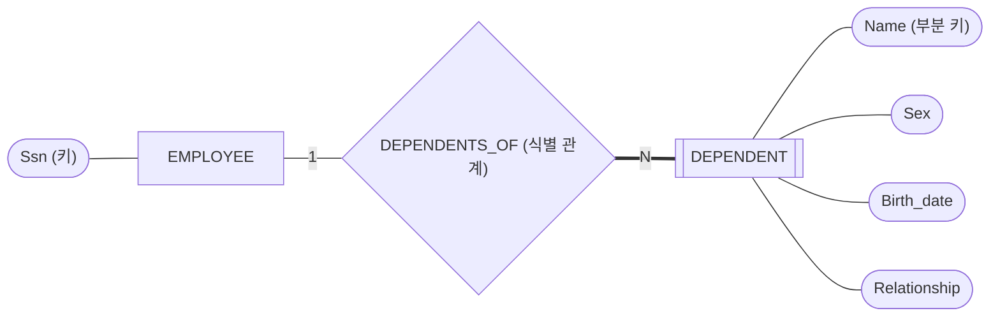



요약

아파트의 "302호"는 호수만으로는 어느 집인지 알 수 없고, 몇 동인지를 함께 대야 한다. 이렇게 자기 항목만으로는 서로 가려지지 않아서, 딸려 있는 주인을 함께 대야 가려지는 대상이 있다. 주인이 없으면 가려낼 길이 없으므로, 이런 대상은 반드시 주인 하나에 이어져 있어야 한다.

## 예시로 보기

회사는 보험 때문에 직원의 부양가족을 적는다. 부양가족에 적는 항목은 이름, 성별, 생일, 직원과의 관계다. 이 가운데 부양가족 한 사람을 가려낼 항목이 있을까.

COMPANY의 자료에 든 부양가족 일곱 명이다.

| 주인 직원 | Dependent_name | Sex | Bdate | Relationship |
|---|---|---|---|---|
| Wong (333445555) | Alice | F | 1986-04-05 | Daughter |
| Wong (333445555) | Theodore | M | 1983-10-25 | Son |
| Wong (333445555) | Joy | F | 1958-05-03 | Spouse |
| Wallace (987654321) | Abner | M | 1942-02-28 | Spouse |
| Smith (123456789) | Michael | M | 1988-01-04 | Son |
| Smith (123456789) | Alice | F | 1988-12-30 | Daughter |
| Smith (123456789) | Elizabeth | F | 1967-05-05 | Spouse |

Alice가 두 명이다. 한 명은 Wong의 딸이고 한 명은 Smith의 딸이다. 이름만으로는 가려지지 않는다. "Wong의 Alice", "Smith의 Alice"처럼 주인 직원을 함께 대면 일곱 명이 모두 가려진다.

DEPENDENT처럼 자기 속성 안에 키가 없는 개체 타입을 약한 개체 타입이라 부른다. 주인인 EMPLOYEE는 소유 개체 타입이고, 둘을 잇는 DEPENDENTS_OF는 식별 관계다.

겹네모가 약한 개체 타입이고, 굵은 선은 전체 참여(ER 다이어그램의 겹선)다[^s1].

검증: Alice가 두 명인 것, (주인 직원, 이름)은 일곱 명이 다 다른 것, 생일은 우연히 다 다를 뿐 같은 생일이 들어오면 겹치는 것, 부양가족 모두 주인 직원이 있고 직원 8명 중 3명만 부양가족이 있는 것 — [27_weak-entity-type_verify.py](/Hongs_Blog/studies/database-design/code/27_weak-entity-type_verify/)

## 정의

- **약한 개체 타입(weak entity type):** 자기 속성 안에 키 속성이 없는 개체 타입. 다른 개체 타입의 특정 개체에 이어져 있다는 사실과 자기 속성 값을 합쳐서 가려낸다.
- **소유 개체 타입(owner entity type):** 약한 개체를 가려내는 데 쓰이는 그 다른 개체 타입. 식별 개체 타입(identifying entity type)이라고도 한다.
- **식별 관계(identifying relationship):** 약한 개체 타입을 소유 개체 타입에 잇는 관계 타입. 약한 개체 타입은 이 관계에 늘 전체 참여한다.
- **부분 키(partial key):** 같은 주인에 딸린 약한 개체들끼리 서로 가려내는 속성. 식별 관계와 합치면 키 구실을 한다.

DEPENDENT에서는 "한 직원의 부양가족 가운데 이름이 같은 사람은 없다"고 볼 때 Dependent_name이 부분 키다.

COMPANY의 DEPENDENTS_OF는 1:N이다. 1쪽이 EMPLOYEE, N쪽이 DEPENDENT다. EMPLOYEE는 부분 참여이고(부양가족이 없는 직원도 있다), DEPENDENT는 전체 참여다(부양가족은 반드시 직원에 딸려 있다).

**그림 기호.** 약한 개체 타입은 겹네모, 식별 관계는 겹마름모로 그린다. 부분 키는 이름 아래에 점선 밑줄을 긋는다.

## 활용

- 왜 늘 전체 참여인가: 약한 개체는 주인을 대야만 가려진다. 주인에 이어지지 않은 약한 개체는 가려낼 길이 없어 저장할 수 없다.
- 흔한 실수: 부분 키를 키로 여기는 것. Dependent_name은 같은 직원 안에서만 안 겹친다. 회사 전체에서는 Alice가 두 명이다.
- 자료만 보고 판단하면 안 되는 것은 키 속성과 같다. 위 표에서 생일은 일곱 명이 우연히 다 다르다. 하지만 생일이 같은 부양가족이 들어오면 겹치므로 생일은 키가 아니다.
- 표로 옮기면 주인의 키가 약한 개체의 표에 열로 들어오고, 그 열과 부분 키를 묶은 것이 표의 키가 된다. DEPENDENT 표의 키는 (Essn, Dependent_name)이다: [개체 타입의 사상](/Hongs_Blog/studies/database-design/mapping-entity-types/)

## 연결

- 키 속성이 있는 보통의 개체 타입과 견주기: [일반 개체 타입과 약한 개체 타입 비교](/Hongs_Blog/studies/database-design/regular-vs-weak-entity/)
- 키 속성, 부분 키, 표의 키를 한자리에서: [키의 종류 비교](/Hongs_Blog/studies/database-design/key-kinds-comparison/)
- 전체 참여의 뜻: [참여 제약](/Hongs_Blog/studies/database-design/participation-constraint/)

## 확인 문제

**C1** 위 표에서 (a) Dependent_name만으로 부양가족이 가려지는가? (b) 무엇을 더하면 가려지는가? (c) DEPENDENT의 부분 키, 소유 개체 타입, 식별 관계를 쓰라.

**답:** (a) 아니다. Alice가 두 명이다. (b) 주인 직원을 더한다. (Wong, Alice)와 (Smith, Alice)는 다르다. (c) 부분 키는 Dependent_name, 소유 개체 타입은 EMPLOYEE, 식별 관계는 DEPENDENTS_OF다. 
**이유:** 부분 키는 같은 주인에 딸린 개체들끼리만 가려낸다. 주인까지 대야 전체에서 하나가 정해진다.

**C2** 약한 개체 타입은 식별 관계에 왜 늘 전체 참여하는가? 부분 참여를 허용하면 무엇이 곤란한가?

**답:** 약한 개체는 "어느 주인의 것인가"와 부분 키를 합쳐야 가려진다. 부분 참여를 허용하면 주인이 없는 약한 개체가 생긴다. 그 개체는 가려낼 길이 없다. 이름이 Alice인 주인 없는 부양가족이 둘 있으면 둘을 가를 수 없다. 
**이유:** 전체 참여는 여기서 고를 수 있는 것이 아니라 정의에서 따라 나온다. 식별 관계에는 늘 전체 참여 제약이 걸린다.

**C3** 위 표에서 Bdate는 일곱 명이 다 다르다. "그러니 Bdate가 DEPENDENT의 키 속성이고 DEPENDENT는 약한 개체 타입이 아니다"라는 말에 반례를 들어라.

**답:** 생일이 1986-04-05인 부양가족이 한 명 더 들어오면 된다. 예: Wallace의 딸 Bella, 1986-04-05. 그러면 Bdate가 Wong의 Alice와 겹친다. (주인, 이름)은 이 사람을 넣어도 겹치지 않는다. 
**이유:** 키는 지금 자료가 아니라 "어떤 개체가 들어와도 안 겹친다"는 규칙이다. 생일이 같은 사람은 얼마든지 있을 수 있다.

[^s1]: 겹마름모와 밑줄을 그릴 수 없어 "(식별 관계)", "(키)", "(부분 키)"로 적었다.

