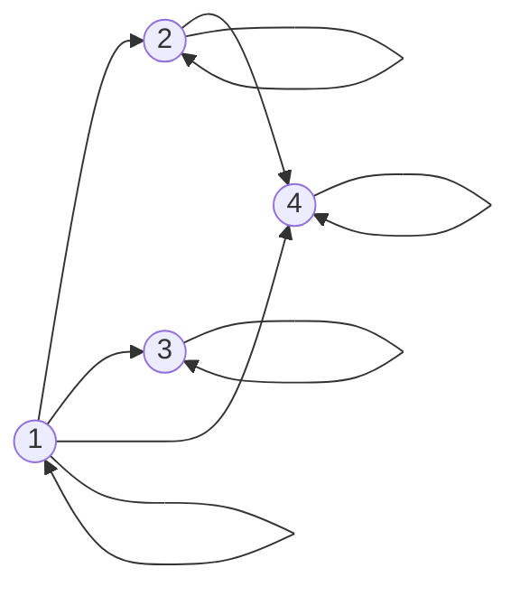



요약

관계는 "누가 누구와 이어져 있는가"를 짝의 모음으로 적은 것이다. 친구, 부모와 자식, 작거나 같다, 선수 과목이 모두 관계다. 반사·대칭·반대칭·추이 네 성질로 관계의 성격을 가르면, 같은 무리로 묶는 관계(동치관계)와 줄을 세우는 관계(순서)가 나온다. 다만 "대칭이 아니면 반대칭"처럼 성질이 서로 반대인 것은 아니어서, 둘 다 아니거나 둘 다일 수 있다.

## 예시로 보기

집합 $$\{1, 2, 3, 4\}$$ 위의 세 관계를 비교한다.

| 관계 | 짝의 예 | 반사 | 대칭 | 반대칭 | 추이 |
|---|---|---|---|---|---|
| $$a$$가 $$b$$를 나눈다 | (1,4), (2,4), (3,3) | O | X | O | O |
| $$a - b$$가 짝수다 | (1,3), (3,1), (2,4) | O | O | X | O |
| $$a < b$$ | (1,2), (2,3), (1,3) | X | X | O | O |

관계는 행렬로도, 화살표 그림으로도 그린다. "나눈다"를 4×4 표로 쓰면 $$(a, b)$$ 칸에 $$a$$가 $$b$$를 나누면 1을 적는다. 화살표 그림에서는 $$a$$에서 $$b$$로 화살표를 긋는다. 반사는 모든 점의 제자리 고리, 대칭은 화살표가 늘 왕복, 추이는 두 걸음으로 가는 곳에 한 걸음 화살표도 있다는 뜻이다.

{1, 2, 3, 4} 위의 '나눈다'를 화살표 그림으로 그린 것이다. 점마다 제자리 고리가 있다. 2 → 4는 있지만 4 → 2는 없다. 1 → 2 → 4처럼 두 걸음으로 가는 곳에는 1 → 4 화살표도 있다[^s1].

## 정의

정의

집합 $$A$$에서 $$B$$로의 **이항 관계**는 $$A \times B$$의 부분집합 $$R$$이다. $$(a, b) \in R$$을 $$a\,R\,b$$로도 쓴다. $$A = B$$이면 "$$A$$ 위의 관계"라 한다[^1]. $$A$$ 위의 관계 $$R$$에 대해
- 반사적: $$\forall a\ (a\,R\,a)$$($$\forall$$은 "모든"). 비반사적: $$\forall a\ \neg(a\,R\,a)$$
- 대칭적: $$a\,R\,b \Rightarrow b\,R\,a$$
- 반대칭적: $$a\,R\,b \wedge b\,R\,a \Rightarrow a = b$$
- 추이적: $$a\,R\,b \wedge b\,R\,c \Rightarrow a\,R\,c$$

**추이 폐포** $$R^+$$는 $$R$$을 포함하는 가장 작은 추이적 관계다. $$a\,R^+\,b$$는 "$$a$$에서 $$b$$로 $$R$$의 화살표를 따라 한 걸음 이상 갈 수 있다"는 뜻이다.

[함수](/Hongs_Blog/studies/discrete-math/function-properties/)는 모든 $$a$$에 짝 $$b$$가 정확히 하나인 특별한 관계다. 원소 $$n$$개인 집합 위의 관계는 $$n^2$$개 칸마다 넣고 빼는 선택이라 $$2^{n^2}$$개다.

## 예제

$$\{1, 2, 3, 4\}$$ 위의 $$R = \{(1,2), (2,3), (3,4)\}$$의 추이 폐포를 구한다(와셜 알고리즘).

1. *경유점 1 허용:* 1로 들어오는 화살표가 없어 새 짝이 없다.
2. *경유점 2 허용:* $$1 \to 2 \to 3$$이므로 (1,3)을 더한다.
3. *경유점 3 허용:* $$1 \to 3 \to 4$$, $$2 \to 3 \to 4$$이므로 (1,4), (2,4)를 더한다.
4. *경유점 4 허용:* 4에서 나가는 화살표가 없다. 결과는 6쌍 $$\{(1,2),(2,3),(3,4),(1,3),(2,4),(1,4)\}$$.

와셜 알고리즘은 "경유해도 되는 점"을 하나씩 늘리며 도달 가능성 표를 채운다. 원소 $$n$$개에 $$O(n^3)$$이다[^2].

검증: 예시 표의 성질을 전수 확인, 대칭도 반대칭도 아닌 관계와 둘 다인 관계, 관계의 개수 $$2^{n^2}$$, 무작위 관계 500개에서 와셜 = 합성 반복, 예제의 6쌍 — [09_relations_verify.py](/Hongs_Blog/studies/discrete-math/code/09_relations_verify/)

## 활용

- **관계형 데이터베이스.** 표 하나가 곱집합의 부분집합, 즉 관계다. 조인(join)은 두 관계의 합성이다.
- **도달 가능성.** "이 함수가 저 함수를 (간접적으로라도) 호출하는가", "이 패키지가 저 패키지에 의존하는가"는 추이 폐포 질문이다.
- **SNS.** "팔로우"는 대칭이 아닌 관계, "친구"는 대칭 관계다. "친구의 친구"가 친구인 것은 아니므로 친구 관계는 추이적이지 않다.
- 알고리즘에서: 위 예제의 와셜 알고리즘에서 참·거짓 대신 거리를, '또는' 대신 min을, '그리고' 대신 +를 쓰면 모든 쌍 최단 거리를 구하는 [플로이드–워셜](/Hongs_Blog/studies/algorithms/floyd-warshall/)이 된다. 관계가 대칭이면 추이 폐포에 자기 자신과의 짝을 더한 것이 동치관계라서, 표 전체를 채우는 대신 무리만 관리하는 [유니온 파인드](/Hongs_Blog/studies/algorithms/union-find/)가 훨씬 빠르다.
- 브리지: [추이 폐포 ↔ 플로이드–워셜](/Hongs_Blog/studies/algorithms/warshall-floyd/)

## 연결

- 선수: [집합](/Hongs_Blog/studies/discrete-math/sets/)
- 이어지는 개념: [동치관계와 분할](/Hongs_Blog/studies/discrete-math/equivalence-relations/)(반사·대칭·추이), [부분순서와 위상 정렬](/Hongs_Blog/studies/discrete-math/partial-orders/)(반사·반대칭·추이), [그래프의 기초](/Hongs_Blog/studies/discrete-math/graph-basics/)

## 자주 하는 오해

"대칭이 아니면 반대칭이다"

틀렸다. 이름이 반대말처럼 들려서 둘 중 하나일 것 같다. 대칭은 "짝이 있으면 거꾸로 짝도 있다", 반대칭은 "서로 다른 두 원소가 양방향으로 이어지지 않는다"로 서로 독립인 조건이다. $$\{(1,2), (2,1), (1,3)\}$$은 (1,3)의 역이 없어 대칭이 아니고, (1,2)와 (2,1)이 있어 반대칭도 아니다. 같음 관계 $$\{(a,a)\}$$는 둘 다다.

## 과목별 관점

**데이터베이스 설계 (2-2학기).** 이 문서의 관계는 집합 두 개의 곱집합에서 고른 짝의 모음이다. 데이터베이스는 집합을 $$n$$개로 늘린 관계를 쓴다. 표가 바로 그것이고, 그래서 표를 릴레이션(relation)이라 부른다.

속성이 $$A_1, \dots, A_n$$인 릴레이션의 상태 $$r(R)$$(어느 순간 표에 들어 있는 줄 전부)은, 속성마다 올 수 있는 값의 집합 $$\text{dom}(A_i)$$들의 곱집합에서 고른 부분집합이다[^b1].

$$r(R) \subseteq \text{dom}(A_1) \times \text{dom}(A_2) \times \dots \times \text{dom}(A_n)$$

짝 $$(a, b)$$ 대신 값 $$n$$개를 늘어놓은 것(튜플)이 원소다. 위 정의의 이항 관계는 $$n = 2$$인 경우다. 곱집합은 만들 수 있는 줄 전부이고, 표에는 그 가운데 지금 참인 줄만 들어 있다[^b1].

- **집합이라서 따라오는 것.** 줄을 어떤 순서로 적어도 같은 릴레이션이다. 똑같은 줄이 두 번 들어가지도 않는다[^b2]. 자세한 것은 [릴레이션과 도메인·속성·튜플](/Hongs_Blog/studies/database-design/relational-model-relation/)에 있다.
- **ER 모델의 연결도 관계다.** "직원 $$e$$가 부서 $$d$$에서 일한다" 같은 연결 하나를 관계 인스턴스 $$r_i = (e_1, \dots, e_n)$$이라 하고, 그 모음을 관계 집합이라 한다. 슬라이드는 이것을 개체 집합 $$E_1, \dots, E_n$$ 위의 관계라고 적는다[^b3]. 자세한 것은 [관계 타입과 관계 집합](/Hongs_Blog/studies/database-design/relationship-type-and-set/)에 있다.
- **낱말 조심.** 이 문서의 관계와 데이터베이스의 릴레이션은 영어로 같은 말(relation)이다. ER 모델의 관계 타입(relationship type)은 다른 말이다. 다만 관계 타입에 지금 들어 있는 연결의 모음은 수학의 관계다[^bs1].

원소 2개와 3개인 두 도메인으로 만들 수 있는 줄은 $$2 \times 3 = 6$$개이고, 가능한 상태는 그 부분집합의 수인 $$2^6 = 64$$가지다. 위에서 센 "원소 $$n$$개인 집합 위의 관계는 $$2^{n^2}$$개"와 같은 셈이다[^bs1].

## 확인 문제

**C1** {1,2,3,4} 위의 관계 "a가 b를 나눈다", "a − b가 짝수다", "a < b"가 각각 반사·대칭·반대칭·추이 중 어느 성질을 갖는가?

**답:** 나눈다: 반사, 반대칭, 추이. 차가 짝수: 반사, 대칭, 추이. $$<$$: 비반사, 반대칭, 추이.

**C2** 대칭도 반대칭도 아닌 관계와, 대칭이면서 반대칭인 관계를 하나씩 들라.

**답:** $$\{(1,2),(2,1),(1,3)\}$$은 둘 다 아니다. 같음 관계 $$\{(1,1),(2,2),(3,3)\}$$(또는 공관계)은 둘 다다.

**C3** {1,2,3,4} 위의 R = {(1,2), (2,3), (3,4)}를 화살표 그림으로 그리고 추이 폐포를 구하라. 폐포의 짝은 그림에서 무엇을 뜻하는가?

**답:** $$1 \to 2 \to 3 \to 4$$인 사슬이다. 폐포는 $$\{(1,2),(2,3),(3,4),(1,3),(2,4),(1,4)\}$$로, "화살표를 따라 한 걸음 이상 갈 수 있는 짝"이다.

**C4** 표 WORKS_ON(Essn, Pno, Hours)에 세 줄 (123456789, 1, 32.5), (123456789, 2, 7.5), (453453453, 1, 20.0)이 있다. Hours를 떼어 내고 "직원 e가 프로젝트 p에서 일한다"는 이항 관계 R을 짝의 집합으로 쓰라. R은 어떤 곱집합의 부분집합인가? 표에서 줄의 순서를 바꾸면 R이 바뀌는가?

**답:** $$R = \{(123456789, 1), (123456789, 2), (453453453, 1)\}$$. 직원 번호의 집합과 프로젝트 번호의 집합의 곱집합의 부분집합이다. 줄의 순서를 바꿔도 같은 집합이라 $$R$$은 그대로다. 
**이유:** 표의 한 줄이 짝 하나다. 123456789가 두 짝에 나오므로 이 관계는 직원에서 프로젝트로 가는 함수가 아니다[^bs1].

[^1]: Lehman·Leighton·Meyer, *Mathematics for Computer Science*, 4장(이항 관계), 10장 "Directed graphs & Partial Orders"(관계의 성질). Rosen, *Discrete Mathematics and Its Applications* 7판, 9장 "Relations".
[^2]: Rosen, *Discrete Mathematics and Its Applications* 7판, 9장(폐포와 와셜 알고리즘)
[^s1]: 보충 다이어그램 1개는 원본에 없다. '예시로 보기' 표의 첫 관계와 화살표 그림 설명을 그렸다.
[^b1]: 데이터베이스 설계 6회 강의 자료 「6-2_relational-model」, p.9~11 (릴레이션 스키마 $$R(A_1, \dots, A_n)$$, $$\text{dom}(A_i)$$, 상태는 곱집합의 부분집합)
[^b2]: 같은 자료, p.12 (릴레이션은 튜플의 집합이라 순서가 없다), p.17 (모든 튜플은 서로 다르다)
[^b3]: 데이터베이스 설계 4회 강의 자료 「4-2_ERmodel」, p.18 (Relationship set, "Relation on entity sets $$E_1, E_2, \dots, E_n$$")
[^bs1]: 보충 세 "관계"라는 말을 가른 설명, 6개와 64가지의 셈, 카드 C4는 슬라이드에 없다. 셈은 [32_relational-model-relation_verify.py](/Hongs_Blog/studies/database-design/code/32_relational-model-relation_verify/)로, 카드의 세 줄은 6-2 p.21의 WORKS_ON 상태에서 [43_mapping-many-to-many-relationship_verify.py](/Hongs_Blog/studies/database-design/code/43_mapping-many-to-many-relationship_verify/)로 확인했다.

