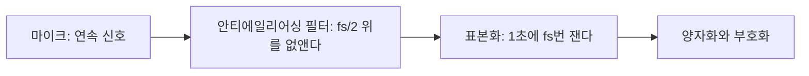



요약

1초에 재는 횟수(표본화율)가 모자라면, 빠르게 떠는 신호가 느리게 떠는 신호와 똑같은 표본을 낸다. 표본만 받은 쪽은 둘을 구별할 길이 없어서, 원래 없던 낮은 소리가 들리거나 영화 속 수레바퀴가 거꾸로 도는 것처럼 보인다. 한번 섞이면 나중에 걸러 낼 수 없으므로, 재기 전에 표본화율의 절반보다 높은 성분을 미리 없애 둔다.

## 예시로 보기

전화는 소리를 1초에 8000번 잰다. 4000 Hz보다 낮은 소리는 [표본화 정리](/Hongs_Blog/studies/human-interface-media/sampling-theorem/)대로 그대로 되살아난다. 그런데 마이크에 5000 Hz 삐 소리가 들어오면 어떻게 될까? 5000 Hz 코사인과 3000 Hz 코사인을 8000 Hz로 잰 값을 나란히 적으면 이렇다[^s1].

| 표본 번호 $$n$$ | 0 | 1 | 2 | 3 | 4 | 5 | 6 | 7 |
|---|---|---|---|---|---|---|---|---|
| 5000 Hz 코사인 | 1 | −0.707 | 0 | 0.707 | −1 | 0.707 | 0 | −0.707 |
| 3000 Hz 코사인 | 1 | −0.707 | 0 | 0.707 | −1 | 0.707 | 0 | −0.707 |

두 줄이 똑같다. 표본만 받은 쪽은 5000 Hz와 3000 Hz를 가를 방법이 없다. 되살리는 필터는 4000 Hz 아래만 통과시키므로 스피커에서는 3000 Hz 소리가 나온다. 높은 주파수가 낮은 주파수의 이름을 빌려 나타난 셈이다. 에일리어스(alias)가 "가명"이라는 뜻이라서 이 현상을 에일리어싱이라 부른다[^s1].

두 줄 모두 1초에 6번 재는 경우다($$\omega_s$$는 표본화 각주파수). 위는 $$\omega_0 = 4\omega_s/6$$인 코사인(회색)이다. 왼쪽에서 오른쪽으로 표본(주황)을 이어 보면 회색 곡선보다 훨씬 느린 점선 곡선 위에 놓이고, 3표본마다 되풀이된다. 아래는 $$\omega_0 = 5\omega_s/6$$인 코사인으로, 표본이 6표본마다 되풀이되는 더 느린 점선 위에 놓인다. $$\omega_s/2$$와 $$\omega_s$$ 사이에서는 원래 주파수가 높을수록 오히려 느리게 보인다[^s2].

## 정의

정의

표본화율 $$f_s$$로 잴 때, 주파수 $$f$$인 성분이 $$f_s/2$$보다 높으면 표본에서는 그보다 낮은 주파수로 보인다. 이 현상이 에일리어싱이다. 보이는 주파수는 $$f$$에서 가장 가까운 $$f_s$$의 정수배까지의 거리다.

**기호로 쓰면.**

$$f_a = \lvert f - k f_s \rvert, \qquad k = \frac{f}{f_s}\text{에 가장 가까운 정수}, \qquad 0 \le f_a \le \frac{f_s}{2}$$

$$f$$는 실제 주파수, $$f_s$$는 1초에 재는 횟수(표본화율), $$f_a$$는 표본에서 보이는 주파수다. $$f \le f_s/2$$이면 $$k = 0$$이라 $$f_a = f$$로 그대로 보인다.

이 공식이 맞는 이유는 코사인의 두 성질에 있다[^s3].

$$\cos\!\left(2\pi\frac{f - kf_s}{f_s}\,n\right) = \cos\!\left(2\pi\frac{f}{f_s}\,n - 2\pi k n\right) = \cos\!\left(2\pi\frac{f}{f_s}\,n\right)$$

- $$f$$ 대신 $$f - kf_s$$를 넣으면 각도가 $$2\pi kn$$만큼 줄어든다. $$k$$와 $$n$$이 정수라서 이것은 한 바퀴의 정수배이고, 코사인 값은 그대로다.
- 코사인은 $$\cos(-\theta) = \cos\theta$$라서 주파수의 부호를 바꿔도 값이 같다. 그래서 공식에 절댓값이 붙는다.

정리하면 $$f$$, $$f \pm f_s$$, $$f \pm 2f_s$$, …와 그 부호를 바꾼 것들이 모두 같은 표본을 낸다. 그 가운데 0과 $$f_s/2$$ 사이에 드는 하나가 $$f_a$$다. 앞의 예에 넣으면 $$5000/8000 = 0.625$$에 가장 가까운 정수는 1이라 $$f_a = \lvert 5000 - 8000 \rvert = 3000$$ Hz다.

표본화율 8 kHz에서 들어온 주파수(가로)와 보이는 주파수(세로)를 그린 것이다. 왼쪽부터 보면 보이는 주파수는 $$f_s/2 = 4$$ kHz까지 함께 오르다가, 그 뒤로는 내려가 8 kHz에서 0이 되고, 다시 오른다. 가로축을 4 kHz마다 접었다 편 모양이라서 $$f_s/2$$를 접힘 주파수(folding frequency)라고도 부른다. 주황 점선 3 kHz와 만나는 3, 5, 11, 13, 19 kHz가 모두 3 kHz로 보인다[^s2][^s3].

**주파수에서 본 에일리어싱.** 표본화하면 스펙트럼이 $$\omega_s$$마다 복사된다. 신호의 최고 각주파수를 $$\omega_M$$이라 할 때 $$\omega_s < 2\omega_M$$이면 복사본의 꼬리가 이웃 복사본과 겹쳐 더해진다. 겹치기 시작하는 곳은 $$\omega_s - \omega_M$$이다.

위는 $$\omega_s > 2\omega_M$$인 경우로, 보라색 통과 구간($$\lvert\omega\rvert < \omega_s/2$$) 안에 가운데 삼각형만 있다. 아래는 $$\omega_s = 1.5\,\omega_M$$인 경우다. 점선 삼각형들이 겹쳐 더해져 굵은 선이 되었고, 꼭짓점 사이가 평평해졌다($$0.5\,\omega_M \le \omega \le \omega_M$$에서 두 삼각형의 합이 일정하다). 통과 구간 안에 이웃 복사본의 꼬리가 들어와 있어서, 필터를 거쳐도 원래 삼각형을 되찾을 수 없다[^s2].

**이산 신호 쪽에서 보기.** 연속 신호 $$e^{j\omega_0 t}$$는 $$\omega_0$$를 키우는 만큼 빨리 떨고, 어떤 $$\omega_0$$에서도 주기 신호다. 이산 신호 $$e^{j\omega_0 n}$$은 다르다. $$e^{j(\omega_0 + 2\pi)n} = e^{j2\pi n}e^{j\omega_0 n} = e^{j\omega_0 n}$$이므로 $$\omega_0$$와 $$\omega_0 \pm 2\pi$$가 같은 신호다. 그래서 $$\omega_0$$를 0에서 키우면 $$\pi$$까지는 빨라지다가, 그 뒤로는 다시 느려져 $$2\pi$$에서 상수가 된다. 이산 신호가 나타낼 수 있는 떨림의 빠르기에는 한계가 있다(유한 대역). 같은 그림이 되는 짝은 이렇다.

| $$\omega_0$$ | 같은 그림이 되는 $$\omega_0$$ |
|---|---|
| $$15\pi/8$$ | $$\pi/8$$ |
| $$7\pi/4$$ | $$\pi/4$$ |
| $$3\pi/2$$ | $$\pi/2$$ |
| $$2\pi$$ | $$0$$ (모든 표본이 1) |

[표본화 정리](/Hongs_Blog/studies/human-interface-media/sampling-theorem/)의 $$\omega = 2\pi f/f_s$$로 바꾸면 이 표가 바로 에일리어싱이다. 예를 들어 $$f_s = 16$$ kHz일 때 $$15\pi/8$$은 15 kHz, $$\pi/8$$은 1 kHz다. 15 kHz를 16 kHz로 재면 $$\lvert 15 - 16 \rvert = 1$$ kHz로 보인다[^s3]. 이산 신호의 이 성질은 [이산 시간 복소 지수 신호](/Hongs_Blog/studies/signals-and-systems/dt-complex-exponential/)에 자세히 있다.

검증: 접힘 공식(무작위 2,000쌍에서 표본 일치, $$0 \le f_a \le f_s/2$$), 5 kHz → 3 kHz 표본 값 표, $$4\omega_s/6$$과 $$5\omega_s/6$$의 되풀이 간격 3과 6, 겹친 복사본 합이 평평한 값($$\frac{1}{T} \times 0.5$$, 표본 합으로도 확인), 이산 주파수 짝 네 개와 16 kHz 환산, 바퀴의 $$-2°$$와 초당 $$-48°$$, 0.6 → 0.4 cycle/pixel, 카드 답 (실험으로 확인됨) — [62_aliasing_verify.py](/Hongs_Blog/studies/human-interface-media/code/62_aliasing_verify/)

단계별 연습: [표본화와 에일리어싱 예제 사다리](/Hongs_Blog/studies/human-interface-media/sampling-aliasing-ladder/)

## 예제

**수레바퀴가 거꾸로 돈다.** 영화는 1초에 24장을 찍는다. 시간을 띄엄띄엄 재는 표본화다. 바큇살이 12개인 바퀴는 30°마다 같은 모양이다. 바퀴가 한 장 사이에 28° 돌면, 사진에서는 바큇살이 2° 뒤로 간 것과 구별되지 않는다. 사람은 가장 가까운 바큇살끼리 이어 보므로, 바퀴가 1초에 48°씩 천천히 거꾸로 도는 것처럼 보인다. 실제로는 1초에 약 1.87바퀴를 앞으로 돈다[^s4].

회전에는 방향이 있다. 코사인과 달리 방향까지 담는 복소 지수 $$e^{j\theta}$$로 보면, 절댓값을 씌우지 않고 부호를 그대로 둔다. 한 장에 28°는 $$28° - 30° = -2°$$로 보이고, 음수라서 거꾸로 돈다. 소리에서도 $$e^{j2\pi \cdot 7000n/8000} = e^{-j2\pi \cdot 1000n/8000}$$처럼 7 kHz 회전이 1 kHz의 반대 방향 회전으로 보인다[^s4].

**촘촘한 줄무늬.** 같은 일이 공간에서도 생긴다. 픽셀 간격으로 담을 수 없을 만큼 촘촘한 줄무늬를 찍으면 굵은 줄무늬로 둔갑한다. 픽셀당 0.6주기인 줄무늬는 $$\lvert 0.6 - 1 \rvert = 0.4$$주기로 보인다([해상도와 공간 주파수](/Hongs_Blog/studies/human-interface-media/resolution-spatial-frequency/)). 화면 속 촘촘한 체크무늬 옷이 물결무늬로 일렁이는 것(모아레)도 이 둔갑이다[^s4].

**막는 방법.** 에일리어싱은 재는 순간에 생긴다. 그래서 재기 전에 연속 신호를 저역 통과 필터에 넣어 $$f_s/2$$보다 높은 성분을 없앤다. 이 필터를 안티에일리어싱 필터라 부른다. 전화는 약 3.4 kHz 위를 잘라 낸 뒤 8 kHz로 재고, CD는 20 kHz 위를 줄인 뒤 44.1 kHz로 잰다[^s5].

필터가 표본화보다 왼쪽에 있어야 한다. 표본화를 거친 뒤에는 둔갑한 성분과 진짜 낮은 성분의 표본 값이 같아서 어떤 필터로도 가를 수 없다[^s5].

## 활용

- 녹음 장치, 휴대폰 마이크 회로, 계측 장비의 A/D 변환기 앞에는 안티에일리어싱 필터가 있다. 디지털카메라 가운데에도 센서 앞에 빛을 살짝 흐리는 광학 필터를 두어 모아레를 줄이는 것이 있다[^s5].
- 스펙트럼 분석([스펙트럼과 스펙트로그램](/Hongs_Blog/studies/human-interface-media/spectrum-spectrogram/))에서 $$f_s/2$$ 위의 주파수는 나타나지 않는다. 그런데 $$f_s/2$$ 아래에서 예상하지 못한 성분이 보이면, 재기 전에 걸러지지 않은 높은 성분이 둔갑한 것일 수 있다.
- 흔한 실수: 보이는 주파수를 $$f - f_s$$로만 계산하는 것. $$f$$가 $$f_s$$의 두 배를 넘으면 $$k = 2, 3, \dots$$이 필요하다. 예: 8 kHz로 재는 19 kHz는 $$\lvert 19 - 2 \times 8 \rvert = 3$$ kHz로 보인다.

## 연결

- 선수: [표본화 정리](/Hongs_Blog/studies/human-interface-media/sampling-theorem/) (복사본이 겹치지 않을 조건), [이산 시간 복소 지수 신호](/Hongs_Blog/studies/signals-and-systems/dt-complex-exponential/) ($$\omega_0$$와 $$\omega_0 + 2\pi$$가 같은 신호)
- 같은 둔갑을 공간에서: [해상도와 공간 주파수](/Hongs_Blog/studies/human-interface-media/resolution-spatial-frequency/)
- 이산 신호의 스펙트럼이 $$2\pi$$마다 되풀이되는 모습: [이산 시간 푸리에 변환](/Hongs_Blog/studies/human-interface-media/dt-fourier-transform/)
- 음수 주파수와 대칭: [실수 신호와 실수 스펙트럼](/Hongs_Blog/studies/human-interface-media/real-signal-real-spectrum/)

## 자주 하는 오해

"표본화율보다 높은 주파수만 둔갑한다"

틀렸다. "1초에 8000번 재면 8000 Hz까지 잴 수 있다"처럼 표본화율을 그대로 한계로 생각하기 쉽다. 실제 한계는 그 절반인 $$f_s/2$$다. 8 kHz로 재면 5 kHz는 8 kHz보다 낮지만 3 kHz로 둔갑한다. 확인 방법: 위 표본 값 표에서 5000 Hz 줄과 3000 Hz 줄이 똑같다.

## 확인 문제

<b>C1</b> 표본화율 10 kHz로 7 kHz 코사인과 12 kHz 코사인을 재면 각각 몇 kHz로 보이는가?

**답:** 7 kHz는 3 kHz, 12 kHz는 2 kHz로 보인다. $$7/10 = 0.7$$에 가장 가까운 정수는 1이라 $$\lvert 7 - 10 \rvert = 3$$이고, $$12/10 = 1.2$$에 가장 가까운 정수도 1이라 $$\lvert 12 - 10 \rvert = 2$$다. 
**흔한 오답:** "7 kHz는 10 kHz보다 낮으니 그대로 7 kHz로 보인다." 한계는 $$f_s/2 = 5$$ kHz다.

<b>C2</b> 에일리어싱을 막는 저역 통과 필터는 왜 표본화 앞에 두어야 하는가? 표본화 뒤에 두면 어떻게 되는가?

**답:** 표본화 뒤에는 진짜 3 kHz 성분과 5 kHz에서 둔갑한 3 kHz 성분이 똑같은 표본 값이라 어떤 필터도 둘을 가르지 못한다. 표본화 앞에서는 5 kHz가 아직 5 kHz라서 필터로 지울 수 있다.

<b>C3</b> $$\omega_0 = 5\omega_s/6$$인 코사인을 재고, 통과 구간 $$\lvert\omega\rvert < \omega_s/2$$인 저역 통과 필터로 되살린다. 주파수 그림에서 통과 구간에 들어오는 임펄스는 어디서 옮겨 온 것이고, 되살린 신호는 무엇인가? 시간 그림에서 표본은 몇 개마다 되풀이되는가?

**답:** 코사인의 스펙트럼은 $$\pm 5\omega_s/6$$의 임펄스 두 개다. $$-5\omega_s/6$$을 $$+\omega_s$$만큼 옮긴 복사본이 $$\omega_s/6$$에, $$5\omega_s/6$$을 $$-\omega_s$$만큼 옮긴 복사본이 $$-\omega_s/6$$에 선다. 통과 구간에는 $$\pm\omega_s/6$$만 있으므로 되살린 신호는 $$\cos(\omega_s t/6)$$이다. 표본은 6개마다 되풀이된다. 
**이유:** 시간 그림의 느린 점선과 주파수 그림의 $$\pm\omega_s/6$$ 임펄스는 같은 신호를 두 가지로 그린 것이다.

[^s1]: 전화의 5 kHz 삐 소리 예와 표본 값 표는 설명용으로 고른 값이다. 이름의 뜻(alias = 가명)은 신호 처리 교재의 표준 설명이다.
[^s2]: 그림 세 장은 [62_aliasing_plot.py](/Hongs_Blog/studies/human-interface-media/code/62_aliasing_plot/)로 그렸다. 같은 코드로 다음을 확인했다: 표본이 점선 곡선 위에 정확히 놓임, 되풀이 간격 3과 6, 겹치지 않을 때 통과 구간 안은 원래 삼각형 하나, 겹칠 때 $$0.5\,\omega_M \le \omega \le \omega_M$$에서 합이 일정, 3·5·11·13·19 kHz가 모두 3 kHz로 보임.
[^s3]: 접힘 공식 $$f_a = \lvert f - kf_s \rvert$$와 그 유도, 접힘 주파수라는 이름은 표준 교재(Oppenheim·Willsky, *Signals and Systems* 2판 7.3절, Proakis·Manolakis의 디지털 신호 처리 교재)의 내용이다.
[^s4]: 수레바퀴 효과의 수치(바큇살 12개, 한 장에 28°, 초당 24장), 복소 지수로 본 회전 방향, 모아레 예는 설명을 위해 보탰다. 가장 가까운 바큇살끼리 이어 본다는 설명은 겉보기 운동에 대한 지각 교재의 표준 설명이다.
[^s5]: 안티에일리어싱 필터, 전화(ITU-T G.711, 약 300~3400 Hz 대역)와 CD(IEC 60908, 44.1 kHz)의 값, 카메라의 광학 저역 통과 필터는 표준 자료의 내용이다.

