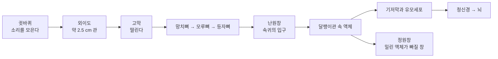



요약

귀는 소리를 세 번 옮겨 싣는다. 바깥귀가 공기의 떨림을 고막까지 모으고, 가운데귀의 작은 뼈 세 개가 그 떨림을 액체로 찬 속귀에 넘기면, 속귀의 달팽이관이 액체의 떨림을 신경 신호로 바꾼다. 공기의 떨림이 액체에 바로 닿으면 거의 다 튕겨 나가므로 가운데 단계가 꼭 필요하다. 작은 뼈들은 넓은 고막에 모인 힘을 좁은 입구 하나에 몰아 압력을 20배 넘게 키운다.

## 예시로 보기

물속에 잠수하면 물 밖에서 부르는 목소리가 거의 안 들린다. 공기 속을 오던 소리가 물 표면에서 대부분 튕겨 나가기 때문이다. 달팽이관 속도 액체로 차 있으니, 귀 안에서도 같은 문제가 생긴다[^s1]. 귀는 이 문제를 가운데귀의 뼈로 푼다.

말소리 하나가 귀 안으로 들어가는 길을 따라가면 이렇다.

왼쪽 세 칸(귓바퀴, 외이도, 고막)까지는 공기가 떨린다. 가운데 칸에서는 뼈가 떨린다. 난원창부터는 액체가 떨린다. 마지막 칸에서 떨림이 신경 신호가 된다. 아래 갈래의 정원창은 액체가 밀려날 자리다.

## 정의

정의

귀는 세 부분으로 나눈다[^s2].
- **바깥귀**(외이)
  - 귓바퀴(pinna): 머리 밖으로 나온 부분. 소리를 모은다.
  - 외이도(auditory canal): 귓바퀴에서 고막까지 이어진 관. 한쪽 끝이 고막으로 막혀 있다.
- **고막**(eardrum): 바깥귀와 가운데귀 사이의 얇은 막. 공기의 압력 변화를 받아 떨린다.
- **가운데귀**(중이): 공기가 찬 작은 방. 그 안에 작은 뼈 세 개(귓속뼈)가 고막에서 속귀까지 사슬처럼 이어진다.
  - 망치뼈(malleus): 고막에 붙어 있다.
  - 모루뼈(incus): 가운데 뼈.
  - 등자뼈(stapes): 발판이 난원창을 덮고 있다.
- **속귀**(내이)
  - 난원창(oval window): 달팽이관의 입구에 난 막. 등자뼈가 밀고 당긴다.
  - 달팽이관(cochlea): 액체로 찬 달팽이 모양 관. 떨림을 신경 신호로 바꾼다([달팽이관과 장소설](/Hongs_Blog/studies/human-interface-media/cochlea-place-theory/)).
  - 정원창(round window): 달팽이관 아래쪽에 난 또 하나의 막. 난원창이 밀려 들어가면 바깥으로 부푼다.
  - 반고리관(semicircular canals): 고리 세 개. 소리가 아니라 몸의 기울기와 회전을 느낀다.
  - 청신경(auditory nerve): 달팽이관의 신호를 뇌로 보낸다.

### 가운데귀가 압력을 키우는 방법

어떤 물질을 같은 빠르기로 흔드는 데 압력이 얼마나 드는지를 그 물질의 소리 저항(음향 임피던스)이라 한다. 밀도 $$\rho$$(로)와 소리 속도 $$c$$의 곱 $$Z = \rho c$$다. 공기는 가볍고 잘 밀려서 $$Z$$가 약 415 Pa·s/m로 작다. 물은 무겁고 잘 안 밀려서 약 $$1.48 \times 10^6$$ Pa·s/m로, 공기의 약 3,600배다[^s3].

소리가 저항이 다른 물질로 곧장 넘어갈 때 넘어가는 세기의 비율 $$T$$는 아래와 같다. 두 저항이 같으면 $$T = 4Z^2 / (2Z)^2 = 1$$로 전부 넘어가고, 차이가 클수록 0에 가까워진다[^s3].

$$ T = \frac{4 Z_1 Z_2}{(Z_1 + Z_2)^2} $$

공기($$Z_1 \approx 415$$)에서 물($$Z_2 \approx 1.48 \times 10^6$$)로 넘어가면 $$T \approx 0.0011$$이다. 에너지의 약 0.11%만 들어가고 99.89%는 튕겨 나온다. dB로는 약 −29.5 dB, 대략 30 dB를 잃는다.

가운데귀는 두 가지 방법으로 고막의 압력을 난원창에서 키운다[^s3].

1. **넓은 곳에서 모아 좁은 곳으로.** 압력은 힘을 넓이로 나눈 값이다. 고막의 넓이는 등자뼈 발판의 약 17배다. 고막 전체가 받은 힘을 발판 하나에 몰면 압력이 약 17배가 된다.
2. **지렛대.** 망치뼈의 팔이 모루뼈의 팔보다 약 1.3배 길다. 지렛대처럼 힘이 약 1.3배 커지고, 그 대신 움직이는 거리는 1.3분의 1로 줄어든다.

두 효과를 곱하면 압력이 약 22배가 된다.

$$ \frac{p_{\text{난원창}}}{p_{\text{고막}}} \approx \frac{A_{\text{고막}}}{A_{\text{발판}}} \times \frac{l_{\text{망치뼈}}}{l_{\text{모루뼈}}} \approx 17 \times 1.3 \approx 22 $$

$$p$$는 압력, $$A$$는 넓이, $$l$$은 지렛대 팔의 길이다. dB로는 $$20 \log_{10} 22 \approx 27$$ dB다. 공기에서 물로 곧장 넘어갈 때 잃는 약 30 dB의 대부분을 되찾는 셈이다[^s3]. 이렇게 저항이 다른 두 물질 사이에서 에너지가 잘 넘어가도록 맞추는 일을 임피던스 정합(impedance matching)이라 한다.

### 정원창이 필요한 이유

달팽이관 속 액체는 거의 압축되지 않는다. 등자뼈가 난원창을 밀어 넣으면 그만큼의 액체가 어딘가로 밀려나야 한다. 정원창이 가운데귀 쪽으로 부풀며 그 자리를 내준다. 그래서 액체가 난원창에서 정원창 쪽으로 움직일 수 있고, 그 길에 놓인 기저막이 흔들린다[^s2].

### 외이도의 울림

외이도는 한쪽이 고막으로 막힌 약 2.5 cm 관이다. 한쪽이 막힌 관은 길이의 4배가 파장인 소리에서 가장 잘 울린다. 주파수로는 소리 속도 $$c$$를 파장 $$4L$$로 나눈 값이다. $$L$$은 관의 길이다[^s4].

$$ f = \frac{c}{4L} = \frac{343\ \text{m/s}}{4 \times 0.025\ \text{m}} \approx 3{,}400\ \text{Hz} $$

그래서 3~4 kHz 소리가 커진 채 고막에 닿는다. 사람이 이 주파수 근처에서 가장 작은 소리까지 듣는 이유 가운데 하나다([가청 대역](/Hongs_Blog/studies/human-interface-media/range-of-hearing/)).

검증: 공기→물 투과율 0.112%(−29.5 dB), $$17 \times 1.3 = 22.1$$배 = 26.9 dB, 2.5 cm 외이도의 울림 3,430 Hz와 그 주파수가 문턱 근사식의 가장 낮은 곳 근처인 것 (계산으로 확인됨) — [49_ear-anatomy_verify.py](/Hongs_Blog/studies/human-interface-media/code/49_ear-anatomy_verify/)

## 활용

- **난청의 두 갈래.** 외이도가 막히거나 고막·귓속뼈가 다치면 떨림이 속귀까지 덜 간다(전음성 난청). 달팽이관이나 청신경이 다치면 떨림이 와도 신호로 바뀌지 않는다(감각신경성 난청). 앞의 것은 소리를 크게 해 주면 상당히 나아지지만, 뒤의 것은 소리를 키워도 또렷해지지 않는 일이 많다[^s5].
- **골전도 이어폰.** 머리뼈를 직접 떨게 해서 바깥귀와 가운데귀를 거치지 않고 달팽이관을 흔든다[^s5].
- **비행기에서 귀가 먹먹한 이유.** 가운데귀는 귀관(유스타키오관)으로 목구멍과 이어져 고막 양쪽의 공기 압력을 맞춘다. 비행기가 빨리 내려오면 바깥 압력이 먼저 바뀌어 고막이 한쪽으로 밀린다. 침을 삼키면 귀관이 열리며 압력이 다시 맞는다[^s5].

## 연결

- 선수: [소리](/Hongs_Blog/studies/human-interface-media/sound/) (공기의 압력 변화), [종파와 횡파](/Hongs_Blog/studies/human-interface-media/longitudinal-transverse-wave/) (소리는 종파)
- 속귀 안쪽의 일: [달팽이관과 장소설](/Hongs_Blog/studies/human-interface-media/cochlea-place-theory/)
- 외이도의 울림과 예민한 주파수: [가청 대역](/Hongs_Blog/studies/human-interface-media/range-of-hearing/), [등청감 곡선](/Hongs_Blog/studies/human-interface-media/equal-loudness-contours/)
- 눈과 견주면 이렇다([눈의 구조](/Hongs_Blog/studies/human-interface-media/eye-anatomy/))[^s6].

| 단계 | 눈 | 귀 |
|---|---|---|
| 감각 세포 앞에서 받은 것을 다듬는다 | 각막과 수정체가 빛을 굽혀 망막에 초점을 맞춘다 | 귓바퀴·외이도가 소리를 모으고 귓속뼈가 압력을 키운다 |
| 감각 세포 | 망막의 간상체와 추상체 | 달팽이관 기저막 위의 유모세포 |
| 신경 | 시신경 | 청신경 |
| 세포가 놓인 자리가 알려 주는 것 | 빛이 바깥 세상의 어디에서 왔는가 | 소리의 주파수가 얼마인가 |

## 자주 하는 오해

"귓속뼈는 소리 에너지를 키우는 증폭기다"

틀렸다. 압력이 22배가 된다는 말 때문에 에너지도 커진다고 생각하기 쉽다. 귓속뼈는 전기 증폭기처럼 바깥에서 에너지를 보태지 않는다. 지렛대는 힘을 1.3배로 키우는 대신 움직이는 거리를 1.3분의 1로 줄이므로, 힘 × 거리인 일은 그대로다. 귓속뼈가 하는 일은 공기와 액체 사이에서 튕겨 나갈 에너지를 액체 안으로 들여보내는 것이다. 확인 방법: 지렛대 양쪽에서 힘 × 움직인 거리를 계산하면 같다. 귓속뼈가 없으면 약 0.1%만 들어가던 에너지가, 귓속뼈가 압력을 맞춰 주면 훨씬 많이 들어간다[^s7].

## 확인 문제

<b>C1</b> 소리가 귓바퀴에서 청신경까지 지나는 부위를 순서대로 쓰고, 각 부위가 바깥귀·가운데귀·속귀 가운데 어디에 속하는지 쓰라.

**답:** 바깥귀: 귓바퀴 → 외이도 → (경계) 고막 → 가운데귀: 망치뼈 → 모루뼈 → 등자뼈 → 속귀: 난원창 → 달팽이관(기저막과 유모세포) → 청신경. 
**흔한 오답:** 반고리관을 소리 경로에 넣는 것. 반고리관은 속귀에 있지만 몸의 기울기와 회전을 느낀다.

<b>C2</b> 가운데귀가 없어서 공기의 떨림이 달팽이관 액체에 곧장 닿는다면, 소리 에너지의 대략 몇 %가 들어가는가? 가운데귀는 이 손실을 어떤 두 방법으로 메우고, 압력을 모두 몇 배쯤 키우는가?

**답:** 공기와 물의 소리 저항이 약 3,600배 달라서 $$T = 4Z_1Z_2/(Z_1+Z_2)^2 \approx 0.0011$$, 약 0.1%만 들어간다(약 −30 dB). 가운데귀는 (1) 넓은 고막의 힘을 약 17분의 1 넓이인 등자뼈 발판에 모으고, (2) 망치뼈와 모루뼈의 지렛대로 힘을 약 1.3배 키운다. 합쳐 압력이 약 22배(약 27 dB)가 된다. 
**흔한 오답:** 두 배율을 더해 약 18배라고 쓰는 것. 두 효과는 차례로 걸리므로 곱한다.

<b>C3</b> 정원창이 단단히 막혀 움직이지 않는다면, 등자뼈가 난원창을 밀 때 무슨 일이 생기는가? 이를 근거로 정원창이 필요한 이유를 쓰라.

**답:** 달팽이관 속 액체는 거의 압축되지 않으므로, 밀려날 곳이 없으면 난원창이 거의 들어가지 못한다. 액체가 움직이지 못하니 기저막도 흔들리지 않고 소리를 잘 듣지 못한다. 정원창은 난원창이 들어간 만큼 가운데귀 쪽으로 부풀어, 액체가 난원창에서 정원창 쪽으로 움직일 자리를 만든다.

[^s1]: 공기와 물의 경계에서 소리가 대부분 튕겨 나간다는 것은 표준 음향학 내용이고, 이 문서의 투과율 계산과 같은 근거다. 물속에서 들리는 정도에는 머리뼈로 전해지는 소리 같은 다른 길도 섞인다.
[^s2]: 각 부위가 하는 일, 고막이 바깥귀와 가운데귀의 경계라는 것, 반고리관이 평형 감각을 맡는다는 것, 정원창이 액체가 밀려날 자리라는 것은 표준 해부학·청각 교재의 내용이다(예: Goldstein, *Sensation and Perception*의 청각 장).
[^s3]: 음향 임피던스 $$Z = \rho c$$(공기 1.21 kg/m³ × 343 m/s, 물 1,000 kg/m³ × 1,480 m/s)와 수직으로 들어갈 때의 세기 투과율 식은 표준 음향학 내용이다. 넓이 비 약 17배와 지렛대 비 약 1.3배는 Wever & Lawrence(1954, *Physiological Acoustics*) 이래 청각 교재가 흔히 쓰는 어림값이며, 책마다 조금씩 다른 값을 쓴다. 실제 가운데귀가 키우는 정도는 주파수에 따라 달라서, "30 dB 손실의 대부분을 되찾는다"는 어림이다.
[^s4]: 한쪽이 막힌 관의 1/4 파장 울림과 성인 외이도 길이 약 2.5 cm는 표준 음향학·청각 교재의 값이다.
[^s5]: 전음성·감각신경성 난청, 골전도, 귀관(유스타키오관)의 압력 조절은 청각학의 표준 내용이다.
[^s6]: 눈과 귀의 비교 표는 이 문서가 덧붙인 해석이다. 근거는 [눈의 구조](/Hongs_Blog/studies/human-interface-media/eye-anatomy/)의 부위별 역할과 [달팽이관과 장소설](/Hongs_Blog/studies/human-interface-media/cochlea-place-theory/)의 자리-주파수 관계다.
[^s7]: 지렛대에서 일(힘 × 거리)이 그대로라는 것은 역학의 에너지 보존이다. 실제 귓속뼈에는 마찰 같은 손실도 조금 있다.

