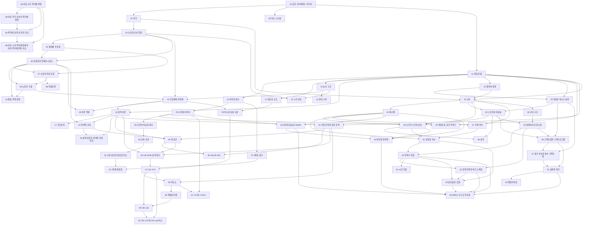


## 먼저 알아야 할 것
- 필요한 사전 지식: 초월 함수의 미분·적분, 기초 확률통계, 푸리에 급수·변환, C/C++ 프로그래밍. 이 과목은 이것들을 따로 가르치지 않는다.
- 파동, 이미지, 모양 맞추기 부분에서 바로 쓰는 다른 과목 문서:
  - [복소수의 극형식과 오일러 공식](/Hongs_Blog/studies/college-math/euler-formula/) (공학수학 대학수학)
  - [공분산과 상관계수](/Hongs_Blog/studies/probability-statistics/covariance/) (공학수학 확률과 통계)
  - [단위 임펄스와 단위 계단](/Hongs_Blog/studies/signals-and-systems/unit-impulse-step/), [컨벌루션 합](/Hongs_Blog/studies/signals-and-systems/convolution-sum/), [컨벌루션 적분](/Hongs_Blog/studies/signals-and-systems/convolution-integral/) (3-1학기 신호 및 시스템)
- 뉴런의 연산 모형, 퍼셉트론, 삼색 이론, 조건등색에는 선형대수(행렬 곱, 역행렬, 영공간)를 쓴다.

## 과목 소개와 들어가기

읽기 전에

1. 사람과 컴퓨터가 "대화"하려면 가운데에 무엇이 있어야 할까? 그것이 하는 일을 한 문장으로 추측해 보라. → [휴먼 인터페이스 미디어](/Hongs_Blog/studies/human-interface-media/human-interface-media/)
2. 사람 눈과 귀가 못 느끼는 부분을 데이터에서 버려도 될까? 어떤 기술이 그렇게 할까? → [휴먼 인터페이스 미디어](/Hongs_Blog/studies/human-interface-media/human-interface-media/)

| 번호 | 개념 | 한 줄 | 개념 코드 | 연습 |
|---|---|---|---|---|
| 01 | [휴먼 인터페이스 미디어](/Hongs_Blog/studies/human-interface-media/human-interface-media/) | 사람의 자극과 컴퓨터의 수치·코드를 서로 바꾸는 매체 | — | — |

떠올려 보기: 노트를 닫고 휴먼 인터페이스 미디어의 그림을 그린 뒤, 이 과목이 다루는 두 갈래(사람 감각의 특성, 자극을 데이터로 바꾸기)와 다루지 않는 것을 써 본다.

## 사람의 지각

읽기 전에

1. 센 자극을 받으면 뉴런은 신호를 "크게" 보낼까, "자주" 보낼까? → [발화율 부호화](/Hongs_Blog/studies/human-interface-media/rate-coding/)
2. 여러 수용기의 신호를 뉴런 하나로 모으면 무엇을 얻고 무엇을 잃을까? → [뉴런의 수렴](/Hongs_Blog/studies/human-interface-media/neuron-convergence/)
3. "입력에 무게를 곱해 더하고 문턱을 넘으면 1"인 기계는 XOR을 배울 수 있을까? → [퍼셉트론](/Hongs_Blog/studies/human-interface-media/perceptron/)

| 번호 | 개념 | 한 줄 | 개념 코드 | 연습 |
|---|---|---|---|---|
| 02 | [지각](/Hongs_Blog/studies/human-interface-media/perception/) | 감각은 수용, 지각은 신호를 골라 정리하고 해석하는 능동적 처리 | — | — |
| 03 | [지능 시스템](/Hongs_Blog/studies/human-interface-media/intelligent-system/) | 사람처럼/이성적으로 × 생각/행동의 네 관점. 기호주의와 연결주의 | — | — |
| 04 | [뉴런과 신호 전달](/Hongs_Blog/studies/human-interface-media/neuron-signaling/) | 수용기가 자극을 전기로, 시냅스가 화학으로 넘김. 휴지 전위 −70 mV | — | — |
| 05 | [발화율 부호화](/Hongs_Blog/studies/human-interface-media/rate-coding/) | 세기는 스파이크 크기가 아니라 빈도. 불응기 1 ms로 상한 | [검증](/Hongs_Blog/studies/human-interface-media/code/05_rate-coding_verify/) · [그림 코드](/Hongs_Blog/studies/human-interface-media/code/05_rate-coding_plot/) · [그림1](/Hongs_Blog/assets/notes/human-interface-media/05_rate-coding_fig1.svg) | — |
| 06 | [흥분성과 억제성 시냅스](/Hongs_Blog/studies/human-interface-media/excitatory-inhibitory/) | 문턱 쪽으로 올리는 흥분, 멀어지게 내리는 억제 | — | — |
| 07 | [뉴런의 연산 모형](/Hongs_Blog/studies/human-interface-media/neuron-computational-model/) | $$a(A\mathbf{x} + \mathbf{b})$$. 활성 함수가 없으면 층을 쌓아도 한 층 | [검증](/Hongs_Blog/studies/human-interface-media/code/07_neuron-computational-model_verify/) · [그림 코드](/Hongs_Blog/studies/human-interface-media/code/07_neuron-computational-model_plot/) · [그림1](/Hongs_Blog/assets/notes/human-interface-media/07_neuron-computational-model_fig1.svg) | — |
| 08 | [퍼셉트론](/Hongs_Blog/studies/human-interface-media/perceptron/) | 가중 합 + 문턱, 틀리면 가중치 수정. 선형 분리만 가능, XOR 불가 | [구현](/Hongs_Blog/studies/human-interface-media/code/08_perceptron_impl/) · [그림 코드](/Hongs_Blog/studies/human-interface-media/code/08_perceptron_plot/) · [그림1](/Hongs_Blog/assets/notes/human-interface-media/08_perceptron_fig1.svg) | — |
| 09 | [뉴런의 수렴](/Hongs_Blog/studies/human-interface-media/neuron-convergence/) | 모으면 약한 신호에 민감해지고 위치를 잃음 | [검증](/Hongs_Blog/studies/human-interface-media/code/09_neuron-convergence_verify/) · [그림 코드](/Hongs_Blog/studies/human-interface-media/code/09_neuron-convergence_plot/) · [그림1](/Hongs_Blog/assets/notes/human-interface-media/09_neuron-convergence_fig1.svg) | [뉴런 수렴 모델링 연습](/Hongs_Blog/studies/human-interface-media/neuron-convergence-modeling/) |
| 10 | [중심-주변 길항](/Hongs_Blog/studies/human-interface-media/center-surround/) | 가운데 흥분·둘레 억제. 고른 빛보다 경계에 반응하는 대역 통과 필터 | [검증](/Hongs_Blog/studies/human-interface-media/code/10_center-surround_verify/) · [그림 코드](/Hongs_Blog/studies/human-interface-media/code/10_center-surround_plot/) · [그림1](/Hongs_Blog/assets/notes/human-interface-media/10_center-surround_fig1.svg) · [그림2](/Hongs_Blog/assets/notes/human-interface-media/10_center-surround_fig2.svg) | — |

떠올려 보기: 노트를 닫고 자극 → 수용기 → 뉴런 → 시냅스의 흐름, 세기를 싣는 방법, 수렴 세 회로의 반응 그래프를 그린 뒤, 이 셋이 연산 모형 $$a(A\mathbf{x} + \mathbf{b})$$의 어느 부분이 되는지 이어 본다.

## 사람의 시각

읽기 전에

1. 모니터 속 노란 꽃에서 오는 빛에 노란 파장(약 580 nm)이 들어 있을까? → [삼색 이론](/Hongs_Blog/studies/human-interface-media/trichromatic-theory/)
2. 밝기가 계단처럼 바뀌는 경계를 보면, 경계 양옆은 실제 밝기대로 보일까? → [측면 억제](/Hongs_Blog/studies/human-interface-media/lateral-inhibition/)
3. 가까운 손가락과 먼 산 중, 두 눈에 비친 상의 어긋남이 큰 것은? → [양안 시차](/Hongs_Blog/studies/human-interface-media/binocular-disparity/)

| 번호 | 개념 | 한 줄 | 개념 코드 | 연습 |
|---|---|---|---|---|
| 11 | [파동과 빛](/Hongs_Blog/studies/human-interface-media/wave-and-light/) | 진폭·주파수·위상. 청각은 1차원 시간, 시각은 2차원 평면 | [검증](/Hongs_Blog/studies/human-interface-media/code/11_wave-and-light_verify/) · [그림 코드](/Hongs_Blog/studies/human-interface-media/code/11_wave-and-light_plot/) · [그림1](/Hongs_Blog/assets/notes/human-interface-media/11_wave-and-light_fig1.svg) | — |
| 12 | [이미지 함수](/Hongs_Blog/studies/human-interface-media/image-function/) | $$i(x, y)$$, 컬러는 세 채널 벡터, 윤곽선은 $$\nabla i$$ | [검증](/Hongs_Blog/studies/human-interface-media/code/12_image-function_verify/) · [그림 코드](/Hongs_Blog/studies/human-interface-media/code/12_image-function_plot/) · [그림1](/Hongs_Blog/assets/notes/human-interface-media/12_image-function_fig1.svg) | — |
| 13 | [휘도와 조도](/Hongs_Blog/studies/human-interface-media/luminance-and-illuminance/) | 조도는 떨어지는 빛, 휘도는 되돌아오는 빛. 대비는 조명과 무관 | [검증](/Hongs_Blog/studies/human-interface-media/code/13_luminance-and-illuminance_verify/) · [그림 코드](/Hongs_Blog/studies/human-interface-media/code/13_luminance-and-illuminance_plot/) · [그림1](/Hongs_Blog/assets/notes/human-interface-media/13_luminance-and-illuminance_fig1.svg) | — |
| 14 | [눈의 구조](/Hongs_Blog/studies/human-interface-media/eye-anatomy/) | 카메라와 닮았지만 센서가 고르지 않고 스스로 가공함 | — | — |
| 15 | [간상체와 추상체](/Hongs_Blog/studies/human-interface-media/rods-and-cones/) | 간상체는 어둠·흑백, 추상체는 밝음·색. 중심와에는 추상체만 | [검증](/Hongs_Blog/studies/human-interface-media/code/15_rods-and-cones_verify/) | — |
| 16 | [삼색 이론](/Hongs_Blog/studies/human-interface-media/trichromatic-theory/) | 색은 세 추상체 반응의 조합. 원색 셋으로 맞추되 못 만드는 색이 있음 | [검증](/Hongs_Blog/studies/human-interface-media/code/16_trichromatic-theory_verify/) · [그림 코드](/Hongs_Blog/studies/human-interface-media/code/16_trichromatic-theory_plot/) · [그림1](/Hongs_Blog/assets/notes/human-interface-media/16_trichromatic-theory_fig1.svg) · [그림2](/Hongs_Blog/assets/notes/human-interface-media/16_trichromatic-theory_fig2.svg) | — |
| 17 | [조건등색](/Hongs_Blog/studies/human-interface-media/metamerism/) | 스펙트럼이 달라도 세 반응이 같으면 같은 색. 영공간 | [검증](/Hongs_Blog/studies/human-interface-media/code/17_metamerism_verify/) · [그림 코드](/Hongs_Blog/studies/human-interface-media/code/17_metamerism_plot/) · [그림1](/Hongs_Blog/assets/notes/human-interface-media/17_metamerism_fig1.svg) | [조건등색 예제 사다리](/Hongs_Blog/studies/human-interface-media/metamerism-ladder/) |
| 18 | [측면 억제](/Hongs_Blog/studies/human-interface-media/lateral-inhibition/) | 이웃을 빼서 경계를 강조. 마하 띠 80·88·8·16, 헤르만 격자 60 대 76 | [검증](/Hongs_Blog/studies/human-interface-media/code/18_lateral-inhibition_verify/) · [그림 코드](/Hongs_Blog/studies/human-interface-media/code/18_lateral-inhibition_plot/) · [그림1](/Hongs_Blog/assets/notes/human-interface-media/18_lateral-inhibition_fig1.svg) | [측면 억제 예제 사다리](/Hongs_Blog/studies/human-interface-media/lateral-inhibition-ladder/) |
| 19 | [반대색 과정](/Hongs_Blog/studies/human-interface-media/opponent-process/) | 빨강-초록, 파랑-노랑, 흰-검 짝을 +와 −로. 잔상 | [검증](/Hongs_Blog/studies/human-interface-media/code/19_opponent-process_verify/) · [그림 코드](/Hongs_Blog/studies/human-interface-media/code/19_opponent-process_plot/) · [그림1](/Hongs_Blog/assets/notes/human-interface-media/19_opponent-process_fig1.svg) | — |
| 20 | [삼색 이론과 반대색 과정 비교](/Hongs_Blog/studies/human-interface-media/contrast--trichromatic--opponent-process/) | 가르는 질문: 세 반응의 크기만으로 정해지는가, 짝의 차이가 필요한가 | — | — |
| 21 | [양안 시차](/Hongs_Blog/studies/human-interface-media/binocular-disparity/) | 두 눈 상의 차이로 깊이. 가까울수록 크고 멀면 급히 줄어듦 | [검증](/Hongs_Blog/studies/human-interface-media/code/21_binocular-disparity_verify/) · [그림 코드](/Hongs_Blog/studies/human-interface-media/code/21_binocular-disparity_plot/) · [그림1](/Hongs_Blog/assets/notes/human-interface-media/21_binocular-disparity_fig1.svg) · [그림2](/Hongs_Blog/assets/notes/human-interface-media/21_binocular-disparity_fig2.svg) | — |
| 22 | [시각 경로](/Hongs_Blog/studies/human-interface-media/visual-pathway/) | 망막 → LGN → 시각 피질. LGN은 피드백을 받아 조절 | — | — |

점묘법은 삼색 이론이 먼저 필요해 [조건등색](/Hongs_Blog/studies/human-interface-media/metamerism/)에서 다룬다.

떠올려 보기: 노트를 닫고 빛이 눈에 들어와 시각 피질에 닿기까지를 한 줄로 그린 뒤, 그 길 위에서 색(삼색 → 반대색), 밝기(측면 억제), 깊이(양안 시차)가 각각 어디서 처리되는지 표시해 본다.

## 파동의 표현

읽기 전에

1. 편광 선글라스는 빛에 쓰는데, 소리에도 "편광 귀마개"를 만들 수 있을까? → [종파와 횡파](/Hongs_Blog/studies/human-interface-media/longitudinal-transverse-wave/)
2. 사인파의 높이 하나만 보고 그 파동이 올라가는 중인지 내려가는 중인지 알 수 있을까? → [파동의 복소수 표현](/Hongs_Blog/studies/human-interface-media/complex-wave/)

| 번호 | 개념 | 한 줄 | 개념 코드 | 연습 |
|---|---|---|---|---|
| 23 | [종파와 횡파](/Hongs_Blog/studies/human-interface-media/longitudinal-transverse-wave/) | 소리는 나아가는 방향으로, 빛은 수직으로 흔들림. 빛은 2차원이라 편광 | [그림 코드](/Hongs_Blog/studies/human-interface-media/code/23_longitudinal-transverse-wave_plot/) · [그림1](/Hongs_Blog/assets/notes/human-interface-media/23_longitudinal-transverse-wave_fig1.svg) | — |
| 24 | [파동의 복소수 표현](/Hongs_Blog/studies/human-interface-media/complex-wave/) | 원 위를 도는 점 $$Ae^{i(2\pi t/T + \phi)}$$. 사인은 그 그림자 | [검증](/Hongs_Blog/studies/human-interface-media/code/24_complex-wave_verify/) · [그림 코드](/Hongs_Blog/studies/human-interface-media/code/24_complex-wave_plot/) · [그림1](/Hongs_Blog/assets/notes/human-interface-media/24_complex-wave_fig1.svg) | — |

떠올려 보기: 노트를 닫고 원 위를 도는 점과 그 그림자 사인파를 그린 뒤, $$A$$, $$T$$, $$\phi$$가 그림의 어디인지 표시하고 $$Ae^{i(2\pi t/T + \phi)}$$의 실수부·허수부를 적어 본다.

## 이미지의 표현

읽기 전에

1. 풀HD 동영상을 압축 없이 보내면 초당 몇 비트쯤일까? 방송 회선(약 19 Mbps)과 비교하면? → [디지털 이미지](/Hongs_Blog/studies/human-interface-media/digital-image/)
2. 사진 데이터를 25%만 남겨야 한다면 픽셀 일부와 낮은 주파수 중 무엇을 남기겠는가? → [해상도와 공간 주파수](/Hongs_Blog/studies/human-interface-media/resolution-spatial-frequency/)
3. 둥근 판을 "가로 모양 × 세로 모양"으로 쓸 수 있을까? → [2차원 함수](/Hongs_Blog/studies/human-interface-media/two-dimensional-functions/)

| 번호 | 개념 | 한 줄 | 개념 코드 | 연습 |
|---|---|---|---|---|
| 25 | [디지털 이미지](/Hongs_Blog/studies/human-interface-media/digital-image/) | 픽셀 배열과 밝기 양자화. $$b$$비트면 $$2^b$$단계, 풀HD는 초당 약 3 Gbps | [검증](/Hongs_Blog/studies/human-interface-media/code/25_digital-image_verify/) | — |
| 26 | [해상도와 공간 주파수](/Hongs_Blog/studies/human-interface-media/resolution-spatial-frequency/) | 픽셀 $$N$$개의 최대 공간 주파수 $$N/2$$. 낮은 주파수에 모양, 높은 주파수에 질감 | [검증](/Hongs_Blog/studies/human-interface-media/code/26_resolution-spatial-frequency_verify/) · [그림 코드](/Hongs_Blog/studies/human-interface-media/code/26_resolution-spatial-frequency_plot/) · [그림1](/Hongs_Blog/assets/notes/human-interface-media/26_resolution-spatial-frequency_fig1.svg) | — |
| 27 | [2차원 함수](/Hongs_Blog/studies/human-interface-media/two-dimensional-functions/) | 사각·원판·델타·그리드. 사각은 분리 가능, 원판은 극좌표로 | [검증](/Hongs_Blog/studies/human-interface-media/code/27_two-dimensional-functions_verify/) | — |

떠올려 보기: 노트를 닫고 이미지 → 픽셀 배열 → 양자화 → 데이터의 흐름을 그린 뒤, 각 단계에서 무엇을 잃는지(위치의 세밀함, 밝기의 세밀함)와 픽셀 $$N$$개의 최대 공간 주파수를 적어 본다.

## 모양 맞추기

읽기 전에

1. 모양은 같고 전체 밝기만 다른 두 사진의 평균 제곱 차이는 클까 작을까? → [모양의 비슷함 재기](/Hongs_Blog/studies/human-interface-media/shape-similarity/)
2. 틀을 옮기며 곱해 더한 값이 가장 큰 곳이 늘 틀과 같은 무늬일까? → [교차 상관](/Hongs_Blog/studies/human-interface-media/cross-correlation/)
3. 3×3 평균 필터를 쓸 때 커널을 180° 돌리든 안 돌리든 결과가 같은 이유는? → [교차 상관과 합성곱 비교](/Hongs_Blog/studies/human-interface-media/correlation-vs-convolution/)

| 번호 | 개념 | 한 줄 | 개념 코드 | 연습 |
|---|---|---|---|---|
| 28 | [모양의 비슷함 재기](/Hongs_Blog/studies/human-interface-media/shape-similarity/) | 평균 제곱 차이는 밝기에 흔들림. 평균 빼고 표준편차로 나눈 상관계수로 | [검증](/Hongs_Blog/studies/human-interface-media/code/28_shape-similarity_verify/) | — |
| 29 | [교차 상관](/Hongs_Blog/studies/human-interface-media/cross-correlation/) | 틀을 옮기며 겹친 값의 곱을 더함. 패턴 찾기에는 정규화 | [구현](/Hongs_Blog/studies/human-interface-media/code/29_cross-correlation_impl/) · [그림 코드](/Hongs_Blog/studies/human-interface-media/code/29_cross-correlation_plot/) · [그림1](/Hongs_Blog/assets/notes/human-interface-media/29_cross-correlation_fig1.svg) | — |
| 30 | [교차 상관과 합성곱 비교](/Hongs_Blog/studies/human-interface-media/correlation-vs-convolution/) | 가르는 질문: 옮기기 전에 뒤집는가 | [검증](/Hongs_Blog/studies/human-interface-media/code/30_correlation-vs-convolution_verify/) | — |
| 31 | [2차원 합성곱](/Hongs_Blog/studies/human-interface-media/two-dimensional-convolution/) | 커널을 180° 돌려 창처럼 밀며 곱해 더함. 흐리기·미분·옮기기 | [구현](/Hongs_Blog/studies/human-interface-media/code/31_two-dimensional-convolution_impl/) · [그림 코드](/Hongs_Blog/studies/human-interface-media/code/31_two-dimensional-convolution_plot/) · [그림1](/Hongs_Blog/assets/notes/human-interface-media/31_two-dimensional-convolution_fig1.svg) | [합성곱 연습](/Hongs_Blog/studies/human-interface-media/convolution-practice/) · [문제 코드 p2](/Hongs_Blog/studies/human-interface-media/code/31_convolution-practice_p2/) · [문제 코드 p4](/Hongs_Blog/studies/human-interface-media/code/31_convolution-practice_p4/) · [문제 코드 p5](/Hongs_Blog/studies/human-interface-media/code/31_convolution-practice_p5/) · [문제 코드 p7](/Hongs_Blog/studies/human-interface-media/code/31_convolution-practice_p7/) |

떠올려 보기: 노트를 닫고 비슷함을 재는 방법을 차례로(평균 차이 → 평균 제곱 차이 → 상관계수 → 교차 상관 → 합성곱) 쓰고, 각 방법이 앞 방법의 어떤 문제를 고쳤는지 한 줄씩 붙인다.

## 색 공간

읽기 전에

1. 파란 물감과 노란 물감을 섞으면 초록이 된다. 파란 빛과 노란 빛을 겹쳐 비추면 무슨 색이 될까? → [가법 혼색과 감법 혼색](/Hongs_Blog/studies/human-interface-media/additive-subtractive-mixing/)
2. 빨강·초록·파랑 세 빛을 양수로만 섞어서 무지개의 모든 색을 맞출 수 있을까? 못 맞춘다면 표준은 어떻게 했을까? → [CIE XYZ](/Hongs_Blog/studies/human-interface-media/cie-xyz/)
3. 빨강 빛과 초록 빛을 같은 밝기로 섞으면, 섞은 색이 색도도에서 두 점의 한가운데에 올까? → [색도도](/Hongs_Blog/studies/human-interface-media/chromaticity-diagram/)

| 번호 | 개념 | 한 줄 | 개념 코드 | 연습 |
|---|---|---|---|---|
| 32 | [가법 혼색과 감법 혼색](/Hongs_Blog/studies/human-interface-media/additive-subtractive-mixing/) | 빛은 파장을 더하고 물감은 반사율을 곱한다. CMY = 1 − RGB | [검증](/Hongs_Blog/studies/human-interface-media/code/32_additive-subtractive-mixing_verify/) · [그림 코드](/Hongs_Blog/studies/human-interface-media/code/32_additive-subtractive-mixing_plot/) · [그림1](/Hongs_Blog/assets/notes/human-interface-media/32_additive-subtractive-mixing_fig1.svg) | — |
| 33 | [비시감 효율 곡선](/Hongs_Blog/studies/human-interface-media/luminous-efficiency/) | 파장별 밝기 감도 $$V(\lambda)$$. 밝을 때 555 nm·683 lm/W, 어두울 때 507 nm | [검증](/Hongs_Blog/studies/human-interface-media/code/33_luminous-efficiency_verify/) · [그림 코드](/Hongs_Blog/studies/human-interface-media/code/33_luminous-efficiency_plot/) · [그림1](/Hongs_Blog/assets/notes/human-interface-media/33_luminous-efficiency_fig1.svg) | — |
| 34 | [색 공간](/Hongs_Blog/studies/human-interface-media/color-space/) | 색은 3차원. LMS를 직교(밝기·반대색)나 극좌표(밝기·색상·채도)로 다시 적음 | [검증](/Hongs_Blog/studies/human-interface-media/code/34_color-space_verify/) · [그림 코드](/Hongs_Blog/studies/human-interface-media/code/34_color-space_plot/) · [그림1](/Hongs_Blog/assets/notes/human-interface-media/34_color-space_fig1.svg) | — |
| 35 | [HSL과 HSV](/Hongs_Blog/studies/human-interface-media/hsl-hsv/) | RGB를 색상 각도·채도·밝기로. HSV는 원뿔 하나, HSL은 둘 | [구현](/Hongs_Blog/studies/human-interface-media/code/35_hsl-hsv_impl/) · [그림 코드](/Hongs_Blog/studies/human-interface-media/code/35_hsl-hsv_plot/) · [그림1](/Hongs_Blog/assets/notes/human-interface-media/35_hsl-hsv_fig1.svg) | — |
| 36 | [CIE RGB 등색 함수](/Hongs_Blog/studies/human-interface-media/cie-rgb/) | 700/546.1/435.8 nm로 맞춘 등색 함수. 약 450~546 nm에서 빨강이 음수 | [검증](/Hongs_Blog/studies/human-interface-media/code/36_cie-rgb_verify/) · [그림 코드](/Hongs_Blog/studies/human-interface-media/code/36_cie-rgb_plot/) · [그림1](/Hongs_Blog/assets/notes/human-interface-media/36_cie-rgb_fig1.svg) | — |
| 37 | [CIE XYZ](/Hongs_Blog/studies/human-interface-media/cie-xyz/) | 음수 없는 가상 원색, $$\bar y = V(\lambda)$$, 흰색 1/3. RGB에 3×3 행렬 | [검증](/Hongs_Blog/studies/human-interface-media/code/37_cie-xyz_verify/) · [그림 코드](/Hongs_Blog/studies/human-interface-media/code/37_cie-xyz_plot/) · [그림1](/Hongs_Blog/assets/notes/human-interface-media/37_cie-xyz_fig1.svg) | — |
| 38 | [색도도](/Hongs_Blog/studies/human-interface-media/chromaticity-diagram/) | 밝기를 뺀 색 지도. 섞은 색은 $$X+Y+Z$$를 무게로 한 무게중심 | [검증](/Hongs_Blog/studies/human-interface-media/code/38_chromaticity-diagram_verify/) · [그림 코드](/Hongs_Blog/studies/human-interface-media/code/38_chromaticity-diagram_plot/) · [그림1](/Hongs_Blog/assets/notes/human-interface-media/38_chromaticity-diagram_fig1.svg) · [그림2](/Hongs_Blog/assets/notes/human-interface-media/38_chromaticity-diagram_fig2.svg) | [색도도 혼합 예제 사다리](/Hongs_Blog/studies/human-interface-media/chromaticity-mixing-ladder/) · [그림 코드](/Hongs_Blog/studies/human-interface-media/code/38_chromaticity-mixing-ladder_plot/) · [그림1](/Hongs_Blog/assets/notes/human-interface-media/38_chromaticity-mixing-ladder_fig1.svg) · [그림2](/Hongs_Blog/assets/notes/human-interface-media/38_chromaticity-mixing-ladder_fig2.svg) · [문제 코드 p1](/Hongs_Blog/studies/human-interface-media/code/38_chromaticity-mixing-ladder_p1/) · [문제 코드 p2](/Hongs_Blog/studies/human-interface-media/code/38_chromaticity-mixing-ladder_p2/) · [문제 코드 p3](/Hongs_Blog/studies/human-interface-media/code/38_chromaticity-mixing-ladder_p3/) · [문제 코드 p4](/Hongs_Blog/studies/human-interface-media/code/38_chromaticity-mixing-ladder_p4/) |
| 39 | [맥애덤 타원](/Hongs_Blog/studies/human-interface-media/macadam-ellipses/) | XYZ 거리는 자리마다 달리 보인다. 초록은 큰 타원, 파랑은 작은 타원 | [검증](/Hongs_Blog/studies/human-interface-media/code/39_macadam-ellipses_verify/) · [그림 코드](/Hongs_Blog/studies/human-interface-media/code/39_macadam-ellipses_plot/) · [그림1](/Hongs_Blog/assets/notes/human-interface-media/39_macadam-ellipses_fig1.svg) | — |
| 40 | [CIE Lab](/Hongs_Blog/studies/human-interface-media/cie-lab/) | 세제곱근으로 휜 밝기와 두 반대색 축. 거리 ΔE ≈ 느끼는 차이 | [검증](/Hongs_Blog/studies/human-interface-media/code/40_cie-lab_verify/) · [그림 코드](/Hongs_Blog/studies/human-interface-media/code/40_cie-lab_plot/) · [그림1](/Hongs_Blog/assets/notes/human-interface-media/40_cie-lab_fig1.svg) | — |
| 41 | [YUV와 YCbCr](/Hongs_Blog/studies/human-interface-media/yuv-ycbcr/) | 장치 RGB를 밝기 하나와 색차 둘로 나누고, 색차는 4:2:0으로 줄인다 | [검증](/Hongs_Blog/studies/human-interface-media/code/41_yuv-ycbcr_verify/) · [그림 코드](/Hongs_Blog/studies/human-interface-media/code/41_yuv-ycbcr_plot/) · [그림1](/Hongs_Blog/assets/notes/human-interface-media/41_yuv-ycbcr_fig1.svg) · [그림2](/Hongs_Blog/assets/notes/human-interface-media/41_yuv-ycbcr_fig2.svg) | — |
| 42 | [CIE XYZ와 CIE Lab 비교](/Hongs_Blog/studies/human-interface-media/xyz-vs-lab/) | 빛을 더하는 계산은 XYZ, 느끼는 차이를 잴 때는 Lab | [검증](/Hongs_Blog/studies/human-interface-media/code/42_xyz-vs-lab_verify/) | — |

떠올려 보기: 노트를 닫고 LMS → RGB → XYZ → Lab → RGB 흐름을 그린 뒤, 화살표마다 무엇이 바뀌는지(음수 없애기, Y를 밝기로, 사람 눈에 맞춘 거리, 기기 값) 적는다. 이어서 색도도에 스펙트럼 궤적과 흰색점을 그리고, 세 광원으로 목표 색을 만드는 비율을 구하는 순서를 써 본다.

## 사람의 청각

읽기 전에

1. 아무도 없는 숲에서 나무가 쓰러지면 소리가 났을까? "났다"와 "안 났다"가 둘 다 맞으려면 소리를 각각 무엇으로 정해야 할까? → [소리](/Hongs_Blog/studies/human-interface-media/sound/)
2. 60 dB 확성기 두 대를 함께 켜면 몇 dB일까? 120 dB일까? → [데시벨](/Hongs_Blog/studies/human-interface-media/decibel/)
3. 달팽이관의 입구(등자뼈 쪽)와 안쪽 끝 가운데 높은 소리에 가장 크게 흔들리는 곳은 어디일까? → [달팽이관과 장소설](/Hongs_Blog/studies/human-interface-media/cochlea-place-theory/)

| 번호 | 개념 | 한 줄 | 개념 코드 | 연습 |
|---|---|---|---|---|
| 43 | [소리](/Hongs_Blog/studies/human-interface-media/sound/) | 소리는 매질의 압력 변화이자 들을 때의 경험 | [검증](/Hongs_Blog/studies/human-interface-media/code/43_sound_verify/) · [그림 코드](/Hongs_Blog/studies/human-interface-media/code/43_sound_plot/) · [그림1](/Hongs_Blog/assets/notes/human-interface-media/43_sound_fig1.svg) | — |
| 44 | [데시벨](/Hongs_Blog/studies/human-interface-media/decibel/) | 기준 대비 배수의 로그. 세기는 10 log, 음압은 20 log | [검증](/Hongs_Blog/studies/human-interface-media/code/44_decibel_verify/) · [그림 코드](/Hongs_Blog/studies/human-interface-media/code/44_decibel_plot/) · [그림1](/Hongs_Blog/assets/notes/human-interface-media/44_decibel_fig1.svg) | [데시벨 예제 사다리](/Hongs_Blog/studies/human-interface-media/decibel-ladder/) · [그림 코드](/Hongs_Blog/studies/human-interface-media/code/44_decibel-ladder_plot/) · [그림1](/Hongs_Blog/assets/notes/human-interface-media/44_decibel-ladder_fig1.svg) · [문제 코드 p1](/Hongs_Blog/studies/human-interface-media/code/44_decibel-ladder_p1/) · [문제 코드 p2](/Hongs_Blog/studies/human-interface-media/code/44_decibel-ladder_p2/) · [문제 코드 p3](/Hongs_Blog/studies/human-interface-media/code/44_decibel-ladder_p3/) · [문제 코드 p4](/Hongs_Blog/studies/human-interface-media/code/44_decibel-ladder_p4/) |
| 45 | [고조파와 복합음](/Hongs_Blog/studies/human-interface-media/harmonics-complex-tone/) | 기본 주파수의 정수배 성분. 합은 $$T_0 = 1/f_0$$마다 되풀이 | [검증](/Hongs_Blog/studies/human-interface-media/code/45_harmonics-complex-tone_verify/) · [그림 코드](/Hongs_Blog/studies/human-interface-media/code/45_harmonics-complex-tone_plot/) · [그림1](/Hongs_Blog/assets/notes/human-interface-media/45_harmonics-complex-tone_fig1.svg) · [그림2](/Hongs_Blog/assets/notes/human-interface-media/45_harmonics-complex-tone_fig2.svg) | — |
| 46 | [소리의 크기와 높이](/Hongs_Blog/studies/human-interface-media/loudness-pitch/) | 크기는 음압, 높이는 기본 주파수와 가장 가깝지만 같지 않다 | [검증](/Hongs_Blog/studies/human-interface-media/code/46_loudness-pitch_verify/) · [그림 코드](/Hongs_Blog/studies/human-interface-media/code/46_loudness-pitch_plot/) · [그림1](/Hongs_Blog/assets/notes/human-interface-media/46_loudness-pitch_fig1.svg) · [그림2](/Hongs_Blog/assets/notes/human-interface-media/46_loudness-pitch_fig2.svg) | — |
| 47 | [가청 대역](/Hongs_Blog/studies/human-interface-media/range-of-hearing/) | 사람이 듣는 범위: 약 20 Hz~20 kHz, 0~120 dB | [검증](/Hongs_Blog/studies/human-interface-media/code/47_range-of-hearing_verify/) · [그림 코드](/Hongs_Blog/studies/human-interface-media/code/47_range-of-hearing_plot/) · [그림1](/Hongs_Blog/assets/notes/human-interface-media/47_range-of-hearing_fig1.svg) | — |
| 48 | [음색](/Hongs_Blog/studies/human-interface-media/timbre/) | 크기·높이·길이가 같아도 다르게 들리게 하는 고조파 비율과 시간 모양 | [검증](/Hongs_Blog/studies/human-interface-media/code/48_timbre_verify/) · [그림 코드](/Hongs_Blog/studies/human-interface-media/code/48_timbre_plot/) · [그림1](/Hongs_Blog/assets/notes/human-interface-media/48_timbre_fig1.svg) · [그림2](/Hongs_Blog/assets/notes/human-interface-media/48_timbre_fig2.svg) | — |
| 49 | [귀의 구조](/Hongs_Blog/studies/human-interface-media/ear-anatomy/) | 바깥귀 → 가운데귀 → 속귀. 귓속뼈가 압력을 약 22배 키워 액체로 넘김 | [검증](/Hongs_Blog/studies/human-interface-media/code/49_ear-anatomy_verify/) | — |
| 50 | [달팽이관과 장소설](/Hongs_Blog/studies/human-interface-media/cochlea-place-theory/) | 기저막이 가장 크게 흔들리는 자리가 주파수를 알린다(바닥은 높은 소리) | [검증](/Hongs_Blog/studies/human-interface-media/code/50_cochlea-place-theory_verify/) · [그림 코드](/Hongs_Blog/studies/human-interface-media/code/50_cochlea-place-theory_plot/) · [그림1](/Hongs_Blog/assets/notes/human-interface-media/50_cochlea-place-theory_fig1.svg) · [그림2](/Hongs_Blog/assets/notes/human-interface-media/50_cochlea-place-theory_fig2.svg) · [그림3](/Hongs_Blog/assets/notes/human-interface-media/50_cochlea-place-theory_fig3.svg) | — |

떠올려 보기: 노트를 닫고 소리의 두 정의와 dB의 세 기준(HL·IL·SPL), 10과 20이 갈리는 이유를 쓴다. 이어서 소리가 귓바퀴에서 청신경까지 가는 길을 그리고, 그 길의 어디에서 주파수가 기저막 위의 자리로 바뀌는지 적어 본다.

## 소리의 지각

읽기 전에

1. 1 kHz 40 dB와 같은 크기로 들리려면 100 Hz 순음은 40 dB보다 커야 할까, 작아도 될까? → [등청감 곡선](/Hongs_Blog/studies/human-interface-media/equal-loudness-contours/)
2. 1 kHz의 큰 소리는 500 Hz의 작은 소리와 2 kHz의 작은 소리 가운데 어느 쪽을 더 잘 가릴까? → [주파수 가림](/Hongs_Blog/studies/human-interface-media/frequency-masking/)
3. 큰 소리가 끝나자마자 울린 작은 소리는 바로 들릴까? → [시간 가림](/Hongs_Blog/studies/human-interface-media/temporal-masking/)

| 번호 | 개념 | 한 줄 | 개념 코드 | 연습 |
|---|---|---|---|---|
| 51 | [등청감 곡선](/Hongs_Blog/studies/human-interface-media/equal-loudness-contours/) | 같은 크기로 들리는 점들의 선. 3~4 kHz에서 가장 예민 | [검증](/Hongs_Blog/studies/human-interface-media/code/51_equal-loudness-contours_verify/) · [그림 코드](/Hongs_Blog/studies/human-interface-media/code/51_equal-loudness-contours_plot/) · [그림1](/Hongs_Blog/assets/notes/human-interface-media/51_equal-loudness-contours_fig1.svg) | — |
| 52 | [주파수 가림](/Hongs_Blog/studies/human-interface-media/frequency-masking/) | 큰 소리는 가까운 작은 소리를 가린다. 위쪽으로 더 넓게 | [검증](/Hongs_Blog/studies/human-interface-media/code/52_frequency-masking_verify/) · [그림 코드](/Hongs_Blog/studies/human-interface-media/code/52_frequency-masking_plot/) · [그림1](/Hongs_Blog/assets/notes/human-interface-media/52_frequency-masking_fig1.svg) · [그림2](/Hongs_Blog/assets/notes/human-interface-media/52_frequency-masking_fig2.svg) | — |
| 53 | [임계 대역과 바크 스케일](/Hongs_Blog/studies/human-interface-media/critical-band-bark/) | 귀가 주파수를 나누는 칸. 칸 하나 = 1 Bark | [검증](/Hongs_Blog/studies/human-interface-media/code/53_critical-band-bark_verify/) · [그림 코드](/Hongs_Blog/studies/human-interface-media/code/53_critical-band-bark_plot/) · [그림1](/Hongs_Blog/assets/notes/human-interface-media/53_critical-band-bark_fig1.svg) · [그림2](/Hongs_Blog/assets/notes/human-interface-media/53_critical-band-bark_fig2.svg) | — |
| 54 | [시간 가림](/Hongs_Blog/studies/human-interface-media/temporal-masking/) | 큰 소리 앞 약 20 ms, 뒤 약 150 ms도 가린다 | [검증](/Hongs_Blog/studies/human-interface-media/code/54_temporal-masking_verify/) · [그림 코드](/Hongs_Blog/studies/human-interface-media/code/54_temporal-masking_plot/) · [그림1](/Hongs_Blog/assets/notes/human-interface-media/54_temporal-masking_fig1.svg) | — |
| 55 | [심리음향 모델](/Hongs_Blog/studies/human-interface-media/psychoacoustic-model/) | 조용할 때의 문턱과 가림을 합친 선 아래 성분은 버린다 | [구현](/Hongs_Blog/studies/human-interface-media/code/55_psychoacoustic-model_impl/) · [그림 코드](/Hongs_Blog/studies/human-interface-media/code/55_psychoacoustic-model_plot/) · [그림1](/Hongs_Blog/assets/notes/human-interface-media/55_psychoacoustic-model_fig1.svg) | — |

떠올려 보기: 노트를 닫고, 조용할 때의 문턱 → 주파수 가림 → 바크 → 시간 가림이 어떻게 합쳐져 MP3가 버릴 성분을 고르는지 그림 하나로 그려 본다.

## 푸리에 급수

읽기 전에

1. 200, 400, 600 Hz를 더한 파형은 몇 ms마다 되풀이될까? 가장 빠른 600 Hz의 주기일까? → [고조파와 복합음](/Hongs_Blog/studies/human-interface-media/harmonics-complex-tone/)
2. 한 번 "쾅" 하고 끝나는 소리의 스펙트럼은 띄엄띄엄한 선일까, 이어진 곡선일까? → [스펙트럼과 스펙트로그램](/Hongs_Blog/studies/human-interface-media/spectrum-spectrogram/)
3. 사각파를 고조파 몇 개로만 근사하면, 항을 늘릴수록 모서리 근처 오차가 0이 될까? → [푸리에 급수의 수렴](/Hongs_Blog/studies/signals-and-systems/fourier-series-convergence/)

| 번호 | 개념 | 한 줄 | 개념 코드 | 연습 |
|---|---|---|---|---|
| 56 | [스펙트럼과 스펙트로그램](/Hongs_Blog/studies/human-interface-media/spectrum-spectrogram/) | 소리를 (주파수, 세기) 목록으로. 시간 순으로 그리면 스펙트로그램 | [검증](/Hongs_Blog/studies/human-interface-media/code/56_spectrum-spectrogram_verify/) · [그림 코드](/Hongs_Blog/studies/human-interface-media/code/56_spectrum-spectrogram_plot/) · [그림1](/Hongs_Blog/assets/notes/human-interface-media/56_spectrum-spectrogram_fig1.svg) · [그림2](/Hongs_Blog/assets/notes/human-interface-media/56_spectrum-spectrogram_fig2.svg) | — |

같은 내용을 먼저 배운 다른 과목 문서(번호 없음):
- [연속 시간 푸리에 급수](/Hongs_Blog/studies/signals-and-systems/ct-fourier-series/) (신호 및 시스템): 합성식과 분해식. cos 예와 주기 사각파 $$T = 4T_1$$ 예도 같다
- [푸리에 급수의 수렴](/Hongs_Blog/studies/signals-and-systems/fourier-series-convergence/) (신호 및 시스템): 항을 $$N$$개까지만 쓸 때의 근사 오차와 깁스 현상
- [연속 시간 푸리에 급수의 성질](/Hongs_Blog/studies/signals-and-systems/ctfs-properties/) (신호 및 시스템): 파스발 관계. 성분 하나의 평균 전력은 $$\lvert a_k \rvert^2$$

고조파의 합은 [고조파와 복합음](/Hongs_Blog/studies/human-interface-media/harmonics-complex-tone/)에서 다룬다.

떠올려 보기: 노트를 닫고 합성식과 분해식을 쓰고, $$T = 4T_1$$ 사각파의 $$a_0, a_1, a_2, a_3$$를 구해 본다. 그다음 되풀이되는 소리와 한 번 울리고 끝나는 소리의 스펙트럼 모양을 나란히 그려 본다.

## 푸리에 변환

읽기 전에

1. 사각파의 주기만 계속 늘리면 계수 막대의 간격은 어떻게 될까? → [연속 시간 푸리에 변환](/Hongs_Blog/studies/signals-and-systems/ct-fourier-transform/)
2. 실수인 소리의 스펙트럼은 실수일까? → [실수 신호와 실수 스펙트럼](/Hongs_Blog/studies/human-interface-media/real-signal-real-spectrum/)
3. 사각 펄스의 변환이 sinc라면 sinc 모양 신호의 변환은? → [푸리에 변환의 쌍대성](/Hongs_Blog/studies/signals-and-systems/fourier-duality/)

| 번호 | 개념 | 한 줄 | 개념 코드 | 연습 |
|---|---|---|---|---|
| 57 | [실수 신호와 실수 스펙트럼](/Hongs_Blog/studies/human-interface-media/real-signal-real-spectrum/) | 실수 신호 ⇒ $$X(-j\omega)=X^*(j\omega)$$. 둘 다 실수면 둘 다 짝함수 | [검증](/Hongs_Blog/studies/human-interface-media/code/57_real-signal-real-spectrum_verify/) · [그림 코드](/Hongs_Blog/studies/human-interface-media/code/57_real-signal-real-spectrum_plot/) · [그림1](/Hongs_Blog/assets/notes/human-interface-media/57_real-signal-real-spectrum_fig1.svg) · [그림2](/Hongs_Blog/assets/notes/human-interface-media/57_real-signal-real-spectrum_fig2.svg) | — |

같은 내용을 먼저 배운 다른 과목 문서(번호 없음):
- [연속 시간 푸리에 변환](/Hongs_Blog/studies/signals-and-systems/ct-fourier-transform/) (신호 및 시스템): 주기를 늘려 급수에서 변환으로. 임펄스·펄스·저역 통과 필터 예
- [주기 신호의 푸리에 변환](/Hongs_Blog/studies/signals-and-systems/periodic-fourier-transform/) (신호 및 시스템): 주기 신호의 계수는 $$a_k = X(jk\omega_0)/T$$
- [푸리에 변환의 성질](/Hongs_Blog/studies/signals-and-systems/fourier-transform-properties/) (신호 및 시스템): 실수 신호의 켤레 대칭
- [푸리에 변환의 쌍대성](/Hongs_Blog/studies/signals-and-systems/fourier-duality/) (신호 및 시스템): 사각 펄스와 sinc가 자리를 바꾼다

떠올려 보기: 노트를 닫고 주기를 늘려 급수가 변환이 되는 과정을 다섯 단계로 쓰고, 실수 신호의 스펙트럼이 갖는 대칭을 식으로 쓴다.

## 이산 신호

읽기 전에

1. $$\cos(\pi n/8)$$과 $$\cos(15\pi n/8)$$을 정수 $$n$$마다 찍으면 어느 쪽이 더 빨리 흔들릴까? → [에일리어싱](/Hongs_Blog/studies/human-interface-media/aliasing/)
2. 1초에 8000번 잰 이산 신호가 담을 수 있는 가장 높은 소리는 몇 Hz일까? → [표본화 정리](/Hongs_Blog/studies/human-interface-media/sampling-theorem/)
3. 이산 복소 지수 $$e^{j\omega_0 n}$$은 언제나 주기 신호일까? → [이산 시간 복소 지수 신호](/Hongs_Blog/studies/signals-and-systems/dt-complex-exponential/)

이 묶음의 내용은 모두 먼저 배운 다른 과목 문서에 있다(번호 없음):
- [연속 시간 신호와 이산 시간 신호](/Hongs_Blog/studies/signals-and-systems/ct-dt-signals/) (신호 및 시스템): $$x(t)$$와 $$x[n]$$, 사람과 컴퓨터의 인지 시스템
- [주기 신호](/Hongs_Blog/studies/signals-and-systems/periodic-signals/) (신호 및 시스템): 기본 주기 $$T_0$$와 $$N_0$$
- [짝 신호와 홀 신호](/Hongs_Blog/studies/signals-and-systems/even-odd-signals/) (신호 및 시스템): 우함수와 기함수
- [이산 시간 복소 지수 신호](/Hongs_Blog/studies/signals-and-systems/dt-complex-exponential/) (신호 및 시스템): $$\omega_0/2\pi$$가 유리수일 때만 주기. $$\omega_0 = \pi$$에서 가장 빠르다(유한 대역)
- [단위 임펄스와 단위 계단](/Hongs_Blog/studies/signals-and-systems/unit-impulse-step/) (신호 및 시스템): 임펄스를 곱해 한 순간의 값을 집어낸다
- [표본화와 양자화](/Hongs_Blog/studies/signals-and-systems/sampling-quantization/) (신호 및 시스템): $$x[n] = x(nT_s)$$, 시간과 값을 끊는다

표본화 그림과 유한 대역의 실제 주파수는 선수 관계 때문에 뒤 번호의 [표본화 정리](/Hongs_Blog/studies/human-interface-media/sampling-theorem/)와 [에일리어싱](/Hongs_Blog/studies/human-interface-media/aliasing/)에서 다룬다.

떠올려 보기: 노트를 닫고 연속 신호와 이산 신호의 차이, 이산 복소 지수가 주기 신호가 될 조건, 가장 빠른 떨림 $$\omega = \pi$$와 실제 주파수 $$1/(2t_0)$$의 관계를 써 본다.

## 이산 푸리에 변환

읽기 전에

1. 한 샘플마다 부호가 바뀌는 $$(-1)^n$$의 주파수 $$\omega$$는 얼마이고, 이보다 빠른 수열이 있을까? → [이산 시간 푸리에 변환](/Hongs_Blog/studies/human-interface-media/dt-fourier-transform/)
2. FFT가 계산하는 것은 이산 시간 푸리에 변환일까? → [이산 시간 푸리에 변환](/Hongs_Blog/studies/human-interface-media/dt-fourier-transform/)
3. 네 가지 푸리에 표현 가운데 컴퓨터가 정확히 계산할 수 있는 것은? → [푸리에 표현 네 가지 비교](/Hongs_Blog/studies/human-interface-media/four-fourier-representations/)

| 번호 | 개념 | 한 줄 | 개념 코드 | 연습 |
|---|---|---|---|---|
| 58 | [이산 시간 푸리에 변환](/Hongs_Blog/studies/human-interface-media/dt-fourier-transform/) | 수열의 스펙트럼 $$\sum x[n]e^{-j\omega n}$$, 주기 $$2\pi$$인 연속 함수 | [검증](/Hongs_Blog/studies/human-interface-media/code/58_dt-fourier-transform_verify/) · [그림 코드](/Hongs_Blog/studies/human-interface-media/code/58_dt-fourier-transform_plot/) · [그림1](/Hongs_Blog/assets/notes/human-interface-media/58_dt-fourier-transform_fig1.svg) · [그림2](/Hongs_Blog/assets/notes/human-interface-media/58_dt-fourier-transform_fig2.svg) | — |
| 59 | [이산 주기 신호의 푸리에 변환](/Hongs_Blog/studies/human-interface-media/dt-periodic-fourier-transform/) | 주기 수열은 $$2\pi k/N$$마다 넓이 $$2\pi a_k$$ 임펄스, $$2\pi$$마다 되풀이 | [검증](/Hongs_Blog/studies/human-interface-media/code/59_dt-periodic-fourier-transform_verify/) · [그림 코드](/Hongs_Blog/studies/human-interface-media/code/59_dt-periodic-fourier-transform_plot/) · [그림1](/Hongs_Blog/assets/notes/human-interface-media/59_dt-periodic-fourier-transform_fig1.svg) · [그림2](/Hongs_Blog/assets/notes/human-interface-media/59_dt-periodic-fourier-transform_fig2.svg) | — |
| 60 | [푸리에 표현 네 가지 비교](/Hongs_Blog/studies/human-interface-media/four-fourier-representations/) | 시간이 띄엄띄엄하면 스펙트럼이 되풀이, 시간이 되풀이되면 스펙트럼이 띄엄띄엄 | [검증](/Hongs_Blog/studies/human-interface-media/code/60_four-fourier-representations_verify/) · [그림 코드](/Hongs_Blog/studies/human-interface-media/code/60_four-fourier-representations_plot/) · [그림1](/Hongs_Blog/assets/notes/human-interface-media/60_four-fourier-representations_fig1.svg) | — |
| 66 | [이산 시간 푸리에 변환과 이산 푸리에 변환 비교](/Hongs_Blog/studies/human-interface-media/dtft-vs-dft/) | DTFT는 곡선 전체, DFT는 그 위의 점 $$N$$개. 점 사이·순환 합성곱·해상도에서 갈린다 | [검증](/Hongs_Blog/studies/human-interface-media/code/66_dtft-vs-dft_verify/) · [그림 코드](/Hongs_Blog/studies/human-interface-media/code/66_dtft-vs-dft_plot/) · [그림1](/Hongs_Blog/assets/notes/human-interface-media/66_dtft-vs-dft_fig1.svg) · [그림2](/Hongs_Blog/assets/notes/human-interface-media/66_dtft-vs-dft_fig2.svg) | — |

제목의 "이산 푸리에 변환"은 이산 시간 푸리에 변환(DTFT)을 말한다. 컴퓨터가 계산하는 길이 $$N$$짜리 DFT는 [이산 푸리에 변환과 FFT](/Hongs_Blog/studies/linear-algebra/dft/)다.

같은 내용을 먼저 배운 다른 과목 문서(번호 없음):
- [이산 시간 푸리에 급수](/Hongs_Blog/studies/signals-and-systems/dt-fourier-series/) (신호 및 시스템): $$k$$는 $$0 \sim N-1$$, $$a_k$$는 주기 $$N$$. 예 1~3도 같다

떠올려 보기: 노트를 닫고 네 가지 푸리에 표현의 "시간 신호 / 스펙트럼 모양" 표를 빈칸 없이 채운다.

## 디지털 오디오

읽기 전에

1. 사람이 20 kHz까지 듣는다면 CD는 1초에 몇 번보다 많이 재야 할까? → [표본화 정리](/Hongs_Blog/studies/human-interface-media/sampling-theorem/)
2. 표본 하나에 비트를 하나 더 쓰면, 신호와 양자화 잡음의 세기 차이는 몇 dB 벌어질까? → [양자화 잡음과 SQNR](/Hongs_Blog/studies/human-interface-media/quantization-noise-sqnr/)
3. 128 kb/s MP3는 CD 데이터의 약 몇 분의 1이고, 무엇을 버려서 그만큼 줄일까? → [MPEG 오디오 부호화](/Hongs_Blog/studies/human-interface-media/mpeg-audio/)

| 번호 | 개념 | 한 줄 | 개념 코드 | 연습 |
|---|---|---|---|---|
| 61 | [표본화 정리](/Hongs_Blog/studies/human-interface-media/sampling-theorem/) | $$f_s > 2f_M$$이면 표본과 저역 통과 필터로 원래 신호를 되살린다 | [검증](/Hongs_Blog/studies/human-interface-media/code/61_sampling-theorem_verify/) · [그림 코드](/Hongs_Blog/studies/human-interface-media/code/61_sampling-theorem_plot/) · [그림1](/Hongs_Blog/assets/notes/human-interface-media/61_sampling-theorem_fig1.svg) · [그림2](/Hongs_Blog/assets/notes/human-interface-media/61_sampling-theorem_fig2.svg) · [그림3](/Hongs_Blog/assets/notes/human-interface-media/61_sampling-theorem_fig3.svg) | — |
| 62 | [에일리어싱](/Hongs_Blog/studies/human-interface-media/aliasing/) | $$f_s/2$$보다 높은 성분이 $$f_a = \lvert f - kf_s \rvert$$로 둔갑한다 | [검증](/Hongs_Blog/studies/human-interface-media/code/62_aliasing_verify/) · [그림 코드](/Hongs_Blog/studies/human-interface-media/code/62_aliasing_plot/) · [그림1](/Hongs_Blog/assets/notes/human-interface-media/62_aliasing_fig1.svg) · [그림2](/Hongs_Blog/assets/notes/human-interface-media/62_aliasing_fig2.svg) · [그림3](/Hongs_Blog/assets/notes/human-interface-media/62_aliasing_fig3.svg) | [표본화와 에일리어싱 예제 사다리](/Hongs_Blog/studies/human-interface-media/sampling-aliasing-ladder/) · [그림 코드](/Hongs_Blog/studies/human-interface-media/code/62_sampling-aliasing-ladder_plot/) · [그림1](/Hongs_Blog/assets/notes/human-interface-media/62_sampling-aliasing-ladder_fig1.svg) · [문제 코드 p1](/Hongs_Blog/studies/human-interface-media/code/62_sampling-aliasing-ladder_p1/) · [문제 코드 p2](/Hongs_Blog/studies/human-interface-media/code/62_sampling-aliasing-ladder_p2/) · [문제 코드 p3](/Hongs_Blog/studies/human-interface-media/code/62_sampling-aliasing-ladder_p3/) · [문제 코드 p4](/Hongs_Blog/studies/human-interface-media/code/62_sampling-aliasing-ladder_p4/) |
| 63 | [양자화 잡음과 SQNR](/Hongs_Blog/studies/human-interface-media/quantization-noise-sqnr/) | 칸 폭 Δ로 반올림한 오차. 비트 하나에 SQNR 약 6 dB | [검증](/Hongs_Blog/studies/human-interface-media/code/63_quantization-noise-sqnr_verify/) · [그림 코드](/Hongs_Blog/studies/human-interface-media/code/63_quantization-noise-sqnr_plot/) · [그림1](/Hongs_Blog/assets/notes/human-interface-media/63_quantization-noise-sqnr_fig1.svg) · [그림2](/Hongs_Blog/assets/notes/human-interface-media/63_quantization-noise-sqnr_fig2.svg) | — |
| 64 | [비균일 양자화](/Hongs_Blog/studies/human-interface-media/nonuniform-quantization/) | 작은 값엔 좁은 칸, 큰 값엔 넓은 칸(μ 법칙 압신) | [검증](/Hongs_Blog/studies/human-interface-media/code/64_nonuniform-quantization_verify/) · [그림 코드](/Hongs_Blog/studies/human-interface-media/code/64_nonuniform-quantization_plot/) · [그림1](/Hongs_Blog/assets/notes/human-interface-media/64_nonuniform-quantization_fig1.svg) · [그림2](/Hongs_Blog/assets/notes/human-interface-media/64_nonuniform-quantization_fig2.svg) | — |
| 65 | [MPEG 오디오 부호화](/Hongs_Blog/studies/human-interface-media/mpeg-audio/) | 가려서 안 들리는 성분은 버리고 대역마다 비트 배분 | [검증](/Hongs_Blog/studies/human-interface-media/code/65_mpeg-audio_verify/) · [그림 코드](/Hongs_Blog/studies/human-interface-media/code/65_mpeg-audio_plot/) · [그림1](/Hongs_Blog/assets/notes/human-interface-media/65_mpeg-audio_fig1.svg) · [그림2](/Hongs_Blog/assets/notes/human-interface-media/65_mpeg-audio_fig2.svg) | [디지털 오디오 계산 연습](/Hongs_Blog/studies/human-interface-media/digital-audio-practice/) · [문제 코드 p1](/Hongs_Blog/studies/human-interface-media/code/65_digital-audio-practice_p1/) · [문제 코드 p2](/Hongs_Blog/studies/human-interface-media/code/65_digital-audio-practice_p2/) · [문제 코드 p3](/Hongs_Blog/studies/human-interface-media/code/65_digital-audio-practice_p3/) · [문제 코드 p4](/Hongs_Blog/studies/human-interface-media/code/65_digital-audio-practice_p4/) · [문제 코드 p5](/Hongs_Blog/studies/human-interface-media/code/65_digital-audio-practice_p5/) · [문제 코드 p6](/Hongs_Blog/studies/human-interface-media/code/65_digital-audio-practice_p6/) · [문제 코드 p7](/Hongs_Blog/studies/human-interface-media/code/65_digital-audio-practice_p7/) · [문제 코드 p8](/Hongs_Blog/studies/human-interface-media/code/65_digital-audio-practice_p8/) |

함께 보면 좋은 다른 과목 문서(번호 없음): [곱셈 성질과 진폭 변조](/Hongs_Blog/studies/signals-and-systems/multiplication-modulation/)(표본화가 스펙트럼을 복사하는 이유), [PCM](/Hongs_Blog/studies/computer-communication/pcm/)(표본화·양자화·부호화를 통신 쪽에서)

떠올려 보기: 노트를 닫고 임펄스열을 곱하는 시간 그림과 복사본이 늘어서는 주파수 그림을 그린다. 이어서 소리가 MP3가 되기까지의 단계(표본화 → 양자화 → 필터 뱅크·심리음향 모델·비트 배분 → 엔트로피 부호화)를 순서대로 쓰고, 단계마다 정보를 버리는지 적어 본다.

## 다른 과목과의 연결
- 브리지 문서는 아직 없다. 후보는 `_시스템/작업 기록.md`에 있다.
- 다른 과목 문서의 `과목별 관점`에 이 과목의 시각을 붙였다: [오일러 공식](/Hongs_Blog/studies/college-math/euler-formula/), [공분산과 상관계수](/Hongs_Blog/studies/probability-statistics/covariance/)
- 신호 및 시스템(3-1학기) 문서 열세 개에도 붙였다: [연속 시간 신호와 이산 시간 신호](/Hongs_Blog/studies/signals-and-systems/ct-dt-signals/), [신호의 에너지와 전력](/Hongs_Blog/studies/signals-and-systems/signal-energy-power/), [주기 신호](/Hongs_Blog/studies/signals-and-systems/periodic-signals/), [짝 신호와 홀 신호](/Hongs_Blog/studies/signals-and-systems/even-odd-signals/), [이산 시간 복소 지수 신호](/Hongs_Blog/studies/signals-and-systems/dt-complex-exponential/), [표본화와 양자화](/Hongs_Blog/studies/signals-and-systems/sampling-quantization/), [연속 시간 푸리에 급수](/Hongs_Blog/studies/signals-and-systems/ct-fourier-series/), [푸리에 급수의 수렴](/Hongs_Blog/studies/signals-and-systems/fourier-series-convergence/), [이산 시간 푸리에 급수](/Hongs_Blog/studies/signals-and-systems/dt-fourier-series/), [연속 시간 푸리에 변환](/Hongs_Blog/studies/signals-and-systems/ct-fourier-transform/), [주기 신호의 푸리에 변환](/Hongs_Blog/studies/signals-and-systems/periodic-fourier-transform/), [푸리에 변환의 성질](/Hongs_Blog/studies/signals-and-systems/fourier-transform-properties/), [푸리에 변환의 쌍대성](/Hongs_Blog/studies/signals-and-systems/fourier-duality/)

## 흐름


