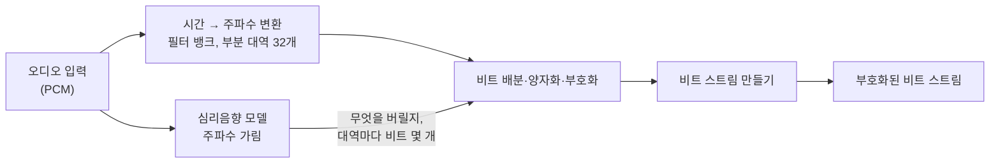



요약

이삿짐을 쌀 때 어차피 아무도 못 볼 물건은 빼고, 눈에 띄는 물건만 꼼꼼히 싸는 것과 같다. MPEG 오디오는 소리를 여러 주파수 대역으로 쪼갠 뒤, 큰 소리에 가려 들리지 않는 성분은 버리고, 들리는 성분에도 잡음이 안 들릴 만큼만 비트를 준다. 그래서 CD 소리 데이터를 10분의 1 안팎으로 줄인다. 대신 버린 정보는 되살릴 수 없고, 비트가 너무 적거나 소리가 갑자기 터지는 곳에서는 잡음이 들리기 시작한다.

## 예시로 보기

CD 오디오는 소리를 그대로 숫자로 적는다. 표본 하나에 16비트, 왼쪽·오른쪽 2채널, 초당 44,100번 뽑는다. 이렇게 표본마다 양자화한 값을 2진수로 그대로 늘어놓은 데이터를 PCM 값이라 부른다([PCM](/Hongs_Blog/studies/computer-communication/pcm/)).

$$
2\ \text{채널} \times 44{,}100\ \text{표본/s} \times 16\ \text{비트} = 1{,}411{,}200\ \text{b/s} \approx 1.41\ \text{Mb/s}
$$

1분이면 $$1{,}411{,}200 \times 60 / 8 \approx 10.6$$ MB다. 4분짜리 노래 한 곡이 약 42 MB다. 디스크에는 여기에 동기 신호와 오류 정정 부호 같은 덧붙임이 더 붙어 실제로 4.32 Mb/s가 기록된다[^s1].

4.32 Mb/s가 나오는 계산

CD는 스테레오 표본 6쌍(오디오 24바이트)을 한 묶음(프레임)으로 기록한다[^s1].

1. *한 묶음의 바이트:* 오디오 24 + 오류 정정 8 + 부가 정보 1 = 33바이트
2. *디스크에 새기는 비트:* 바이트마다 14비트 패턴과 이음 비트 3개를 써서 17비트. $$33 \times 17 = 561$$비트에 동기 패턴 24 + 이음 3 = 27비트를 더해 588비트
3. *초당 묶음 수:* $$44{,}100 / 6 = 7{,}350$$
4. *디스크 비트율:* $$7{,}350 \times 588 = 4{,}321{,}800$$ b/s $$\approx 4.32$$ Mb/s. 오디오 비트 하나에 디스크 비트가 $$588/192 = 3.0625$$개 든다.

음악을 인터넷으로 보내거나 휴대폰에 담기에는 1.41 Mb/s도 크다. 그런데 이 비트를 모두 사람이 듣는 것은 아니다. 1 kHz의 큰 소리가 울리는 동안에는 그 근처의 작은 소리가 들리지 않는다([주파수 가림](/Hongs_Blog/studies/human-interface-media/frequency-masking/)). 들리지 않는 소리를 16비트로 정밀하게 적는 것은 낭비다. 이 낭비를 덜어 내는 것이 MPEG 오디오 부호화다. 흔히 쓰는 128 kb/s MP3는 CD의 $$1{,}411.2 / 128 \approx 11$$분의 1이다[^s2].

## 정의

정의

**MPEG 오디오 부호화**: 입력 소리를 필터 뱅크로 여러 주파수 성분(부분 대역)으로 나누고, 같은 입력에 심리음향 모델을 따로 적용해 들리지 않는 정보를 찾아 버린 뒤, 대역마다 배분한 비트 수로 양자화하고 엔트로피 부호화로 적는 방식이다.

부호화기(인코더)와 복호화기(디코더)는 이렇게 생겼다.

복호화기에는 심리음향 모델이 없다. 무엇을 버리고 비트를 몇 개 줄지는 부호화기가 다 정해서 비트 스트림에 적어 두고, 복호화기는 적힌 대로 되살리기만 한다. 그래서 MPEG 표준은 비트 스트림의 모양과 복호화 방법을 정하고, 부호화기는 회사마다 더 좋은 심리음향 모델을 넣어 개선할 수 있다[^s3].

### 1단계: 필터 뱅크로 주파수 쪼개기

입력을 짧은 구간(창)으로 잘라 구간마다 주파수 변환을 해서, 소리를 주파수 성분으로 나눈다. 여러 주파수 대역으로 나누는 푸리에 변환이라고 보면 된다([스펙트럼과 스펙트로그램](/Hongs_Blog/studies/human-interface-media/spectrum-spectrogram/)). MPEG 오디오는 서로 조금씩 겹치는 같은 폭의 부분 대역(subband) 32개를 쓴다.

44.1 kHz로 표본화한 소리는 0 ~ 22.05 kHz를 담는다([표본화 정리](/Hongs_Blog/studies/human-interface-media/sampling-theorem/)). 이것을 32로 나누면 부분 대역 하나의 폭은 이렇다.

$$
\frac{44{,}100 / 2}{32} = \frac{22{,}050}{32} \approx 689\ \text{Hz}
$$

그런데 귀가 소리를 묶어 듣는 단위인 [임계 대역](/Hongs_Blog/studies/human-interface-media/critical-band-bark/)은 25개이고 폭이 고르지 않다. 500 Hz 아래에서는 약 100 Hz로 좁고, 높은 주파수로 갈수록 넓어져 맨 끝 대역(15.5 ~ 22.05 kHz)은 6,550 Hz다.

위 그림에서 파란 줄이 같은 폭의 부분 대역 32개, 주황 줄이 임계 대역 25개다. 칸을 하나씩 번갈아 칠했다. 전체 그림(위)의 왼쪽 끝을 보면 주황 칸이 아주 좁게 몰려 있고, 오른쪽으로 갈수록 넓어진다. 0 ~ 3 kHz를 확대한 아래 그림에서는 첫 파란 칸(0 ~ 689 Hz) 하나에 주황 칸 1 ~ 6번이 통째로 들어가고 7번(630 ~ 770 Hz)이 걸쳐 있다. 반대로 맨 끝 임계 대역 하나는 부분 대역 10개(23 ~ 32번)에 걸친다[^s5].

이 차이 때문에 낮은 주파수에서는 부분 대역 하나 안에 귀가 따로 듣는 단위가 여러 개 섞인다. 그래서 MP3(MPEG-1 Layer III)는 부분 대역마다 다시 18개로 잘게 나눠, 임계 대역이 좁은 낮은 주파수도 더 세밀하게 본다[^s3].

### 2단계: 심리음향 모델로 버릴 것과 비트 수 정하기

심리음향 모델은 대역마다 "잡음이 이 크기보다 작으면 들리지 않는다"는 경계, 곧 가림 문턱(masking threshold)을 구한다. 겨우 알아챌 수 있는 잡음의 크기다. 부호화기는 이 문턱과 쓸 수 있는 비트 수를 저울질한다. 문턱보다 작아 들리지 않는 주파수 성분은 버린다. 남은 성분은 문턱 위로 얼마나 솟았는지에 맞춰 양자화를 촘촘히 하거나 성기게 한다. 이 모델의 바탕은 [심리음향 모델](/Hongs_Blog/studies/human-interface-media/psychoacoustic-model/)과 [주파수 가림](/Hongs_Blog/studies/human-interface-media/frequency-masking/)에 있다.

"문턱 위로 얼마나 솟았나"를 신호 대 가림 비(SMR, Signal-to-Mask Ratio)라 부른다. 대역의 신호 크기에서 가림 문턱을 뺀 데시벨 값이다. 양자화 잡음이 문턱 아래에 있으려면, 신호와 잡음의 차이(SQNR)가 신호와 문턱의 차이(SMR)보다 커야 한다. [비트 하나가 약 6 dB](/Hongs_Blog/studies/human-interface-media/quantization-noise-sqnr/)이므로 대역마다 필요한 비트 수를 어림할 수 있다[^s6].

$$
\text{SMR} = L_{\text{signal}} - L_{\text{mask}}, \qquad 6.02N \ge \text{SMR} \;\Rightarrow\; N = \left\lceil \frac{\text{SMR}}{6.02} \right\rceil \ (\text{SMR} > 0), \qquad N = 0 \ (\text{SMR} \le 0)
$$

- $$L_{\text{signal}}$$: 그 대역의 신호 크기(dB), $$L_{\text{mask}}$$: 그 대역의 가림 문턱(dB)
- $$N$$: 그 대역의 표본 하나에 줄 비트 수, $$\lceil\ \rceil$$: 올림

부분 대역 8개짜리 장난감 예로 계산하면 이렇다[^s6].

| 부분 대역 | 1 | 2 | 3 | 4 | 5 | 6 | 7 | 8 |
|---|---|---|---|---|---|---|---|---|
| 신호 (dB) | 60 | 75 | 82 | 70 | 45 | 30 | 51 | 20 |
| 가림 문턱 (dB) | 35 | 55 | 60 | 62 | 50 | 35 | 38 | 28 |
| SMR (dB) | 25 | 20 | 22 | 8 | −5 | −5 | 13 | −8 |
| 비트 수 | 5 | 4 | 4 | 2 | 0 | 0 | 3 | 0 |

1번 대역은 $$25/6.02 \approx 4.15$$라 5비트다. 4비트면 $$6.02 \times 4 \approx 24.1$$ dB로 1 dB가 모자라 잡음이 문턱 위로 나온다. 5 ~ 6번과 8번은 신호가 문턱 아래라 아예 적지 않는다. 대역마다 16비트를 주면 128비트인데, 이 배분으로는 18비트면 된다.

왼쪽부터 보면, 파란 막대(신호)가 주황 선(가림 문턱)보다 높이 솟은 대역일수록 막대 위의 비트 수가 크다. 3번 대역은 가장 크지만 문턱도 높아서 4비트다. 1번은 신호가 작아도 문턱이 낮아 5비트다. 오른쪽의 빈 막대 5, 6, 8번은 문턱 아래에 잠겨 0비트다. 비트 수를 정하는 것은 신호와 문턱의 차이다[^s6].

### 3단계: 양자화와 엔트로피 부호화

배분한 비트로 필터 뱅크의 출력을 양자화한다. 이때 [비균일 양자화](/Hongs_Blog/studies/human-interface-media/nonuniform-quantization/)를 써서 큰 값은 넓은 칸에, 작은 값은 좁은 칸에 적는다[^s3].

양자화한 값에는 0과 ±1 같은 작은 값이 아주 많고 큰 값은 드물다. 자주 나오는 값에 짧은 부호를, 드문 값에 긴 부호를 주면 평균 비트 수가 준다. 이것이 엔트로피 부호화이고, MP3는 허프만 부호를 쓴다([부호와 부호화](/Hongs_Blog/studies/data-and-information/code-encoding/))[^s3]. 양자화한 값 다섯 가지의 확률이 아래와 같다고 하자[^s7].

| 값 | 0 | +1 | −1 | +2 | −2 |
|---|---|---|---|---|---|
| 확률 | 0.5 | 0.2 | 0.2 | 0.05 | 0.05 |
| 허프만 부호 길이 | 1 | 2 | 3 | 4 | 4 |

다섯 가지를 고정 길이로 적으면 3비트씩 든다. 허프만 부호의 평균 길이는 $$0.5 \times 1 + 0.2 \times 2 + 0.2 \times 3 + 0.05 \times 4 \times 2 = 1.9$$비트로 약 37% 짧다. 이 분포의 [엔트로피](/Hongs_Blog/studies/probability-statistics/entropy/)는 약 1.86비트이고, 어떤 부호도 평균을 이보다 짧게 만들 수 없다. 엔트로피 부호화는 정보를 하나도 버리지 않는다. 복호화기가 부호를 거꾸로 읽으면 양자화한 값이 그대로 나온다.

데이터 압축은 이 두 가지에 기댄다. 하나는 양자화와 엔트로피 부호화다. 다른 하나는 귀가 임계 대역 하나의 폭 안에서는 소리를 정밀하게 가르지 못한다는 점이다. 한 임계 대역 안에서 소리 크기와 어떤 주파수가 들리는지는 대역 전체의 에너지로 정해진다. 그래서 대역 안에 퍼진 양자화 잡음이 문턱 아래에 있으면, 잡음이 대역 안 어디에 있든 들리지 않는다[^s9].

### 요약의 세 줄과 사람의 청각

| 요약의 줄 | 하는 일 | 기대는 청각 특성 | 정보를 버리나 |
|---|---|---|---|
| 심리음향 모델 (주파수 가림) | 가림 문턱 아래 성분을 버리고 대역마다 비트 수를 정한다 | 큰 소리 옆의 작은 소리는 안 들린다. 임계 대역 안에서는 귀가 세밀하게 가르지 못한다 | 버린다 |
| 비균일 양자화 (소리 크기에 대한 민감도) | 큰 값은 넓은 칸, 작은 값은 좁은 칸에 적는다 | 사람은 소리 크기를 비율(로그)로 느낀다 | 반올림한 만큼 버린다 |
| 엔트로피 부호화 (허프만 부호) | 자주 나오는 값에 짧은 부호를 준다 | 청각과 상관없다. 값이 얼마나 자주 나오는지를 쓴다 | 버리지 않는다 |

MPEG의 핵심은 이 세 줄로 정리된다. 앞의 두 줄은 사람의 귀가 못 듣거나 덜 민감한 부분을 버려서 줄이고(손실 압축), 마지막 줄은 남은 값을 더 짧게 적어서 줄인다(무손실 압축).

검증: CD 1,411,200 b/s와 1분 10.584 MB, 디스크 묶음 588비트와 4,321,800 b/s, MP3 압축비 11.025·7.35·4.41, 부분 대역 폭 689.0625·750·500 Hz, 첫 부분 대역에 임계 대역 1~6번이 들어가고 25번이 부분 대역 23~32번에 걸침, 비트 배분 표(합 18비트, 하나 적으면 문턱을 넘음), 허프만 평균 1.9비트·엔트로피 1.861비트 (계산으로 확인됨) — [65_mpeg-audio_verify.py](/Hongs_Blog/studies/human-interface-media/code/65_mpeg-audio_verify/)

## 보장하는 것과 보장하지 않는 것

비트가 충분하면, 모든 대역에서 양자화 잡음이 가림 문턱 아래에 있어 원래 소리와 구별되지 않는다. 이것이 MPEG 오디오가 노리는 성질이다. 보장하지 않는 것도 분명하다[^s8].

- **파형이 같다는 것.** 버린 성분과 반올림 오차는 되살릴 수 없다. 복호화한 파형을 원래 파형과 빼 보면 0이 아니다. 목표는 같게 들리는 소리다.
- **비트가 적어도 깨끗하다는 것.** 비트율을 낮추면 SMR만큼 비트를 줄 수 없는 대역이 생기고, 그 대역의 잡음이 문턱 위로 올라와 들린다.
- **다시 부호화해도 그대로라는 것.** MP3를 풀어서 다시 MP3로 만들면 매번 새 양자화 잡음이 더해진다.
- **모든 사람에게 똑같이 들린다는 것.** 가림 문턱은 많은 사람의 평균적인 귀로 만든 모델이다.

실패하는 경우와 대처는 이렇다[^s8].

| 상황 | 무엇이 잘못되나 | 대처 |
|---|---|---|
| 비트율이 너무 낮다 | 문턱 위로 올라온 잡음이 물 흐르는 소리나 쇳소리처럼 들린다 | 높은 부분 대역을 통째로 0비트로 두어 남은 대역에 비트를 몰아준다. 또는 비트율을 높인다 |
| 박수나 캐스터네츠처럼 소리가 갑자기 터진다 | 한 묶음(1,152표본, 44.1 kHz에서 약 26 ms) 안에서 양자화 잡음이 시간 전체로 퍼진다. 터지기 전 조용한 구간에는 가려 줄 소리가 없어서, 소리가 나기 직전에 "쉭" 하는 잡음이 들린다(프리에코, pre-echo) | MP3는 이런 곳에서 짧은 창으로 바꿔 잡음이 퍼지는 시간을 줄인다. 소리 뒤보다 앞을 가려 주는 시간이 훨씬 짧다는 점은 [시간 가림](/Hongs_Blog/studies/human-interface-media/temporal-masking/)에 있다 |
| 여러 번 다시 부호화한다 | 잡음이 쌓여 문턱을 넘는다 | 처음 녹음한 PCM에서 한 번만 부호화한다 |

### 스스로 설명해 보기

1. "잡음이 가림 문턱 아래에 있으려면 SQNR ≥ SMR이어야 한다."
   

근거

   잡음의 크기는 신호 크기에서 SQNR을 뺀 값이다($$L_{\text{signal}} - \text{SQNR}$$). 이것이 문턱 $$L_{\text{mask}}$$ 이하이려면 $$\text{SQNR} \ge L_{\text{signal}} - L_{\text{mask}} = \text{SMR}$$이다.
   

2. "SMR이 25 dB인 대역에는 5비트를 준다."
   

근거

   비트 하나가 약 6.02 dB다. 4비트는 24.1 dB로 1 dB 모자라고, 5비트는 30.1 dB로 넉넉하다. 조건을 만족하는 가장 작은 정수가 5다.
   

3. "부분 대역 하나의 폭은 약 689 Hz다."
   

근거

   44.1 kHz로 표본화하면 담을 수 있는 가장 높은 주파수가 그 절반인 22.05 kHz다. 0 ~ 22.05 kHz를 같은 폭 32개로 나누면 $$22{,}050/32 \approx 689$$ Hz다.
   

- 이 방식의 핵심 아이디어는?
  

답

  잡음을 없애려 하지 않고, 사람이 듣지 못하는 곳(가림 문턱 아래)에 숨긴다. 대역마다 숨길 수 있는 만큼만 잡음을 허락하면 비트가 크게 준다.
  

- 이 방법을 쓸 수 있는 다른 상황은?
  

답

  JPEG 같은 이미지 압축. 사람 눈이 잘 못 보는 높은 공간 주파수를 거칠게 양자화한다([해상도와 공간 주파수](/Hongs_Blog/studies/human-interface-media/resolution-spatial-frequency/)). 동영상 압축도 같은 생각을 시간 방향으로 넓힌다.
  

## 예제

**CD와 MP3의 크기.** 4분짜리 노래를 CD 형식과 128 kb/s MP3로 저장하면 각각 몇 MB인가[^s2]?

1. *CD 비트율:* $$2 \times 44{,}100 \times 16 = 1{,}411{,}200$$ b/s
2. *CD 4분:* $$1{,}411{,}200 \times 240 / 8 = 42{,}336{,}000$$ 바이트 $$\approx 42.3$$ MB
3. *MP3 4분:* $$128{,}000 \times 240 / 8 = 3{,}840{,}000$$ 바이트 $$= 3.84$$ MB
4. *압축비:* $$1{,}411.2 / 128 \approx 11.0$$, 곧 약 11 : 1. 192 kb/s면 7.35 : 1, 320 kb/s면 4.41 : 1이다.

**표본화율에 따른 부분 대역 폭.** 같은 32개라도 표본화율이 바뀌면 폭이 바뀐다. 48 kHz면 $$24{,}000/32 = 750$$ Hz, 32 kHz면 $$16{,}000/32 = 500$$ Hz다.

## 활용

- MP3(MPEG-1 Audio Layer III)는 이 구조 위에 부분 대역을 더 잘게 나누는 변환, 비균일 양자화, 허프만 부호를 얹은 방식이다. Layer I과 II는 허프만 부호 없이 대역마다 정한 비트로 바로 적는다[^s3].
- 방송·스트리밍·휴대폰 음악은 모두 같은 생각(들리지 않는 것을 버린다)을 쓴다. 이런 방식을 지각 부호화(perceptual coding)라 부른다[^s3].
- 계산 연습: [디지털 오디오 계산 연습](/Hongs_Blog/studies/human-interface-media/digital-audio-practice/)
- 흔한 실수: 부분 대역 폭을 $$44{,}100/32$$로 계산하는 것. 담을 수 있는 주파수는 표본화율의 절반까지이므로 $$22{,}050/32$$다.

## 연결

- 선수: [주파수 가림](/Hongs_Blog/studies/human-interface-media/frequency-masking/), [임계 대역과 바크 스케일](/Hongs_Blog/studies/human-interface-media/critical-band-bark/), [심리음향 모델](/Hongs_Blog/studies/human-interface-media/psychoacoustic-model/), [표본화 정리](/Hongs_Blog/studies/human-interface-media/sampling-theorem/), [양자화 잡음과 SQNR](/Hongs_Blog/studies/human-interface-media/quantization-noise-sqnr/), [비균일 양자화](/Hongs_Blog/studies/human-interface-media/nonuniform-quantization/)
- 가림 문턱의 바닥이 되는 "아무 소리도 없을 때 들리는 최소 크기": [등청감 곡선](/Hongs_Blog/studies/human-interface-media/equal-loudness-contours/)
- 갑자기 터지는 소리의 문제: [시간 가림](/Hongs_Blog/studies/human-interface-media/temporal-masking/)
- 엔트로피 부호화의 바탕: [엔트로피](/Hongs_Blog/studies/probability-statistics/entropy/), [부호와 부호화](/Hongs_Blog/studies/data-and-information/code-encoding/)

## 자주 하는 오해

"MP3도 zip 파일처럼 풀면 원래 소리 데이터가 그대로 돌아온다"

틀렸다. MPEG 오디오의 마지막 단계가 허프만 부호라서 zip 같은 무손실 압축으로 보이기 쉽다. 실제로는 그 앞의 심리음향 모델과 양자화가 가림 문턱 아래 성분과 반올림 오차를 이미 버렸다. 허프만 부호가 되돌리는 것은 양자화한 값까지다. 확인 방법: MP3를 풀어 만든 파형을 원래 CD 파형에서 빼면 0이 아닌 차이가 남는다. 그 차이가 문턱 아래에 있어서 들리지 않을 뿐이다.

## 확인 문제

<b>C1</b> MPEG 오디오 부호화기의 블록을 입력부터 순서대로 쓰고, 심리음향 모델이 어느 블록에 무엇을 알려 주는지 쓰라.

**답:** 오디오(PCM) 입력 → 시간 → 주파수 변환(필터 뱅크) → 비트 배분·양자화·부호화 → 비트 스트림 만들기 → 부호화된 비트 스트림. 심리음향 모델은 입력을 따로 받아, 비트 배분·양자화·부호화 블록에 무엇을 버릴지와 대역마다 비트를 몇 개 줄지를 알려 준다. 
**흔한 오답:** 심리음향 모델을 복호화기에도 넣는 것. 복호화기는 비트 스트림에 적힌 대로 되살리기만 한다.

<b>C2</b> CD 오디오의 비트율을 계산식과 함께 쓰고, 128 kb/s MP3의 압축비를 구하라. 디스크에 실제로 기록되는 4.32 Mb/s와 1.41 Mb/s가 다른 이유는?

**답:** $$2 \times 44{,}100 \times 16 = 1{,}411{,}200$$ b/s ≈ 1.41 Mb/s. 압축비는 $$1{,}411.2/128 \approx 11$$, 약 11 : 1. 4.32 Mb/s는 동기 신호, 오류 정정 부호 같은 덧붙임을 더한 값이다(오디오 비트 하나에 디스크 비트 약 3개).

<b>C3</b> 어떤 부분 대역의 신호가 65 dB, 가림 문턱이 50 dB다. 다른 대역은 신호 40 dB, 문턱 45 dB다. 각 대역에 비트를 몇 개 주어야 하는가? (비트 하나 = 6.02 dB)

**답:** 첫 대역: SMR = 15 dB. $$15/6.02 \approx 2.49$$라 3비트(18.1 dB ≥ 15). 둘째 대역: SMR = −5 dB로 신호가 문턱 아래라 0비트, 곧 버린다. 
**흔한 오답:** 반올림해서 2비트를 주는 것. 2비트는 12.0 dB라 잡음이 문턱 위로 3 dB 솟아 들린다. 올림을 해야 한다.

<b>C4</b> MPEG 요약의 세 줄(심리음향 모델, 비균일 양자화, 엔트로피 부호화) 가운데 정보를 버리지 않는 것은 무엇인가? 나머지 둘은 각각 사람 청각의 어떤 특성에 기대는가?

**답:** 엔트로피 부호화(허프만)는 버리지 않는다. 값이 얼마나 자주 나오는지만 써서 짧게 적고, 되읽으면 그대로 돌아온다. 심리음향 모델은 주파수 가림(큰 소리 옆 작은 소리는 안 들림)과 임계 대역 안에서 귀가 세밀하게 가르지 못하는 성질에 기댄다. 비균일 양자화는 사람이 소리 크기를 비율(로그)로 느끼는 성질에 기댄다.

<b>C5</b> 부분 대역 32개는 폭이 모두 약 689 Hz인데 임계 대역 25개는 폭이 다르다. 이 차이가 낮은 주파수에서 어떤 문제를 만드는지 쓰라.

**답:** 낮은 주파수의 임계 대역은 약 100 Hz로 좁아서, 첫 부분 대역(0 ~ 689 Hz) 하나에 임계 대역 6개 넘게 들어간다. 귀는 이 안에서 소리를 여러 단위로 따로 듣는데, 부호화기는 그 구간을 대역 하나로 묶어 비트를 한꺼번에 정한다. 그래서 가림을 세밀하게 활용하지 못한다. MP3가 부분 대역을 다시 잘게 나누는 이유다.

[^s1]: 1분·4분 크기도 검증 코드로 계산했다.
[^s2]: 128 kb/s는 흔히 쓰는 MP3 비트율의 예로 골랐다.
[^s3]: 복호화기에 심리음향 모델이 없다는 것, 표준이 비트 스트림과 복호화만 정한다는 것, Layer III의 부분 대역 18분할·3/4제곱 비균일 양자화·허프만 부호·짧은 창 전환, Layer I·II에는 허프만 부호가 없다는 것, 지각 부호화라는 이름은 MPEG-1 오디오 표준(ISO/IEC 11172-3)과 D. Pan, "A Tutorial on MPEG/Audio Compression"(IEEE MultiMedia, 1995)의 내용이다.
[^s5]: 표에 비어 있는 첫 대역의 아래 경계는 0으로 두었다. [65_mpeg-audio_plot.py](/Hongs_Blog/studies/human-interface-media/code/65_mpeg-audio_plot/)로 그렸고, 첫 부분 대역에 1~6번이 들어가고 7번이 걸치는지를 같은 코드로, 25번이 부분 대역 23~32번에 걸치는지를 검증 코드로 확인했다.
[^s6]: 실제 MPEG 부호화기는 비트 수 대신 양자화 단계 수 표와 전체 비트 예산을 함께 따져 반복해서 배분한다. 수치는 검증 코드와 [65_mpeg-audio_plot.py](/Hongs_Blog/studies/human-interface-media/code/65_mpeg-audio_plot/)로 확인했다.
[^s7]: 다섯 값의 확률은 설명용 가상 수치다. 허프만 부호 길이, 평균 1.9비트, 엔트로피 1.861비트, 크래프트 부등식은 검증 코드로 확인했다.
[^s8]: 지각 부호화 교재와 위 Pan(1995)의 표준 설명이다. 1,152표본이 44.1 kHz에서 약 26 ms라는 계산은 검증 코드로 확인했다.
[^s9]: 임계 대역보다 좁은 범위 안에서는 전체 세기가 같으면 소리 크기가 같게 들린다는 것은 심리음향 교재의 표준 내용이다(Zwicker, Flottorp, Stevens 1957의 크기 합산 실험).

