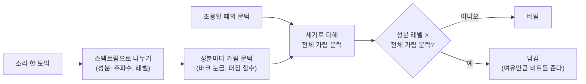



요약

심리음향 모델은 "이 소리에서 사람이 실제로 듣는 성분은 무엇인가"를 계산하는 규칙이다. 조용할 때 들리기 시작하는 선 위에, 큰 성분들이 주변을 가리며 끌어올린 선을 겹쳐 주파수마다 넘어야 할 선 하나를 긋고, 그 아래 성분은 버린다. 그래서 들리는 차이 없이 데이터를 크게 줄일 수 있다. 다만 보통의 귀와 정해 둔 음량을 가정한 계산이라, 음량을 크게 올리거나 듣는 사람이 다르면 버린 소리가 들릴 수 있다.

## 예시로 보기

CD 음질의 소리는 1초에 44,100번, 한 번에 16비트, 두 채널로 적어서 1초에 1,411.2 kbit다. 흔한 MP3는 1초에 128 kbit로, 약 11분의 1이다[^s1]. 이만큼 줄이고도 차이를 잘 못 느끼는 것은, 원래 소리에 사람이 듣지 못하는 성분이 많기 때문이다. 어떤 성분이 안 들리는지를 계산하는 규칙이 필요하다.

그 계산은 네 그림을 차례로 쌓는 것과 같다.

1. **조용할 때의 문턱.** 아무 소리도 없을 때 주파수마다 들리기 시작하는 선이다. 이 선 아래는 들리지 않는다([등청감 곡선](/Hongs_Blog/studies/human-interface-media/equal-loudness-contours/)).
2. **큰 성분 하나의 가림.** 1 kHz 근처에 80 dB짜리 성분이 있으면 그 둘레의 선이 끌어올려진다. 바로 옆(1.2 kHz쯤)의 64 dB 성분은 끌어올린 선 아래로 묻히고, 조금 더 떨어진 2 kHz쯤의 64 dB 성분은 선 위로 나온다([주파수 가림](/Hongs_Blog/studies/human-interface-media/frequency-masking/)).
3. **실제 소리의 여러 성분과 전체 가림 문턱.** 실제 소리에는 크고 작은 성분이 여럿 있다. 성분마다 만든 가림을 조용할 때의 문턱과 합쳐 선 하나로 만든다. 이것이 전체 가림 문턱이다.
4. **남길 성분.** 전체 가림 문턱 위로 나온 성분만 부호화한다. 원래 열 개쯤 있던 막대 가운데 다섯 개만 남는다.

같은 일을 이 문서의 모형 식으로 직접 계산한 결과다[^s2].

위 그림에서 왼쪽부터 보면, 60 Hz 막대는 파란 점선(조용할 때의 문턱) 위로 나와 남는다. 150 Hz 막대는 점선보다도 작아 버린다. 1 kHz 80 dB와 2 kHz 50 dB 막대가 주황 선(전체 가림 문턱)을 끌어올려, 그 오른쪽의 1.2, 1.6, 2.5 kHz 막대가 선 아래로 묻힌다. 2 kHz 막대는 크기가 50 dB라 선 위로 나온다. 오른쪽 끝 15 kHz 막대는 점선이 치솟은 곳이라 버린다. 아래 그림은 남긴 다섯 개다.

## 정의

정의

**심리음향 모델**은 소리의 짧은 한 토막을 주파수 성분으로 나눈 뒤, 주파수마다 "이보다 작으면 사람에게 안 들리는 선"(전체 가림 문턱)을 계산하는 규칙이다. 전체 가림 문턱은 조용할 때의 문턱과, 각 성분이 만든 가림 문턱을 합친 것이다. 이 선 아래의 성분은 버려도 들리는 차이가 없고, 선 위의 성분은 선 위로 나온 만큼만 정밀하게 적으면 된다[^s3].

**기호로 쓰면.**
- 성분 $$i$$: 주파수 $$f_i$$(Hz), 레벨 $$L_i$$(dB SPL). $$T_q(f)$$: 조용할 때의 문턱. $$T_i(f)$$: 성분 $$i$$ 하나가 만든 가림 문턱([주파수 가림](/Hongs_Blog/studies/human-interface-media/frequency-masking/)의 모형 식).
- 전체 가림 문턱은 세기(dB를 $$10^{\text{dB}/10}$$로 바꾼 값)로 더한다.

$$ T_g(f) = 10\log_{10}\!\left(10^{T_q(f)/10} + \sum_{i} 10^{T_i(f)/10}\right) $$

- 성분 $$j$$를 판정할 때는 자기 자신을 뺀 $$T_g$$와 비교한다. $$L_j > T_g(f_j)$$이면 남기고, 아니면 버린다.
- 남긴 성분이 선 위로 나온 여유 $$\text{SMR}_j = L_j - T_g(f_j)$$(신호 대 가림 비, dB)만큼만 정밀하게 적는다.

$$T_g$$를 dB끼리 그냥 더하지 않고 세기로 바꿔 더하는 이유는, 두 소리가 함께 있으면 압력의 제곱(세기)이 더해지기 때문이다. 같은 60 dB 둘을 더하면 세기가 2배라서 $$10\log_{10}2 \approx 3$$ dB 오른 약 63 dB다.

왼쪽에서 오른쪽으로 한 토막을 처리하는 순서다. 소리는 시간에 따라 바뀌므로, 토막을 옮겨 가며 이 일을 계속 되풀이한다[^s3].

## 예제

**문제.** 소리 한 토막에 성분이 열 개 있다. 이 문서의 모형 식으로 남길 성분을 고르라[^s2].

1. **조용할 때의 문턱 구하기.** 성분 주파수마다 $$T_q$$를 계산한다.
2. **전체 가림 문턱 구하기.** 성분마다 자기 자신을 뺀 나머지 아홉 성분의 가림과 $$T_q$$를 세기로 더한다.
3. **비교하기.** 레벨이 전체 가림 문턱보다 크면 남긴다. 작으면 버리고, $$T_q$$보다도 작은지 따로 본다.

| 성분 | 레벨 | $$T_q$$ | 전체 가림 문턱 | 판정 | 여유 |
|---|---|---|---|---|---|
| 60 Hz | 45 dB | 34.5 | 34.5 | 남김 | +10.5 |
| 150 Hz | 15 dB | 16.6 | 31.6 | 버림 (혼자여도 작음) | −16.6 |
| 500 Hz | 40 dB | 6.3 | 8.6 | 남김 | +31.4 |
| 1,000 Hz | 80 dB | 3.4 | 38.9 | 남김 | +41.1 |
| 1,200 Hz | 60 dB | 2.7 | 64.3 | 버림 (가려짐) | −4.3 |
| 1,600 Hz | 40 dB | 1.4 | 48.0 | 버림 (가려짐) | −8.0 |
| 2,000 Hz | 50 dB | −0.3 | 34.3 | 남김 | +15.7 |
| 2,500 Hz | 25 dB | −2.6 | 32.9 | 버림 (가려짐) | −7.9 |
| 8,000 Hz | 15 dB | 4.8 | 4.9 | 남김 | +10.1 |
| 15,000 Hz | 40 dB | 51.0 | 51.0 | 버림 (혼자여도 작음) | −11.0 |

{: start="4"}
4. **결과 읽기.** 열 개 중 다섯 개를 남긴다. 1.2 kHz 60 dB처럼 꽤 큰 성분도 가려져 버리고, 8 kHz 15 dB처럼 작은 성분도 주변에 큰 소리가 없으면 남는다. 1 kHz 성분은 여유가 41.1 dB라 가장 정밀하게 적어야 한다. 1비트를 더 쓸 때마다 잡음이 약 6.02 dB 줄어드므로([양자화 잡음과 SQNR](/Hongs_Blog/studies/human-interface-media/quantization-noise-sqnr/)), 이 성분에는 약 7비트 정밀도가 필요하다($$41.1 / 6.02 \approx 6.8$$)[^s4].

검증: 세기 더하기(60 dB + 60 dB ≈ 63.0 dB), 예제 열 성분의 문턱과 판정(여유가 모두 3 dB 넘게 떨어져 경계에 걸치지 않음), 음량 +20 dB 시나리오, 카드 C2의 값 (모형 계산으로 확인됨) — [55_psychoacoustic-model_impl.py](/Hongs_Blog/studies/human-interface-media/code/55_psychoacoustic-model_impl/)

## 보장하는 것과 보장하지 않는 것

**보장하는 것.** 듣는 사람의 귀가 모형이 가정한 보통의 귀와 같고, 재생 음량이 모형이 가정한 음량과 같으면, 전체 가림 문턱 아래 성분을 버린 소리는 원래 소리와 구별되지 않는다[^s3].

**보장하지 않는 것.**

| 상황 | 무엇이 깨지나 |
|---|---|
| 재생 음량을 크게 올린다 | 조용할 때의 문턱은 음량을 따라 올라가지 않는다. 예제에서 모두 20 dB 올리면 15 kHz 성분(40 → 60 dB)이 문턱 51 dB 위로 나와 들린다. 가려서 버린 1.2 kHz는 가리는 1 kHz도 같이 커져 계속 가려진다 |
| 듣는 사람의 귀가 다르다 | 문턱은 많은 사람의 평균이다. 귀가 더 예민한 사람에게는 버린 성분이 들릴 수 있다 |
| 디코딩 뒤에 고음만 크게 키운다(이퀄라이저) | 가리던 성분과 가려지던 성분의 크기 관계가 바뀌어, 가려지던 압축 잡음이 드러날 수 있다 |
| 여러 번 압축했다 풀었다 한다 | 매번 생긴 잡음이 쌓여 문턱 위로 올라올 수 있다 |
| 토막 안에서 소리가 갑자기 커진다 | 주파수 가림만으로는 부족하다. 잡음이 큰 소리 앞에 퍼지는 프리에코가 생긴다([시간 가림](/Hongs_Blog/studies/human-interface-media/temporal-masking/)) |

## 활용

- **MP3, AAC 같은 지각 부호화.** 실제 부호기는 성분을 하나씩 지우지 않는다. 소리를 여러 주파수 대역으로 나누고, 대역마다 여유(SMR)를 보고 비트를 나눠 준다. 양자화 잡음이 대역마다 전체 가림 문턱 아래에 머물게 하는 것이 목표다: [MPEG 오디오 부호화](/Hongs_Blog/studies/human-interface-media/mpeg-audio/)[^s3].
- **흔한 실수.** 판정할 때 조용할 때의 문턱과 가림 문턱 가운데 "높은 쪽"과 비교해야 한다. 큰 성분에서 멀리 떨어진 곳에서는 조용할 때의 문턱이 기준이 된다.

## 연결

- 선수: [등청감 곡선](/Hongs_Blog/studies/human-interface-media/equal-loudness-contours/) (조용할 때의 문턱), [주파수 가림](/Hongs_Blog/studies/human-interface-media/frequency-masking/) (성분 하나의 가림 문턱), [임계 대역과 바크 스케일](/Hongs_Blog/studies/human-interface-media/critical-band-bark/) (가림을 계산하는 눈금)
- 함께 쓰는 것: [시간 가림](/Hongs_Blog/studies/human-interface-media/temporal-masking/)
- 소리를 성분으로 나누는 방법: [스펙트럼과 스펙트로그램](/Hongs_Blog/studies/human-interface-media/spectrum-spectrogram/)
- 다음: [MPEG 오디오 부호화](/Hongs_Blog/studies/human-interface-media/mpeg-audio/)

## 자주 하는 오해

"심리음향 모델은 작은 성분을 지우는 규칙이다"

틀렸다. 안 들리는 것은 대개 작은 소리라서 "작으면 지운다"로 기억하기 쉽다. 실제 기준은 그 주파수의 전체 가림 문턱과 견준 결과다. 예제에서 1.2 kHz 60 dB는 꽤 크지만 1 kHz 80 dB 바로 옆이라 버리고, 8 kHz 15 dB는 작지만 주변에 큰 소리가 없어 남긴다. 확인 방법: 표의 "레벨"과 "전체 가림 문턱" 두 열을 같이 본다.

## 확인 문제

<b>C1</b> 심리음향 모델이 남길 성분을 고르는 과정을 네 단계로 순서대로 쓰라.

**답:** (1) 조용할 때의 문턱을 둔다. (2) 소리 토막을 주파수 성분으로 나누고 큰 성분마다 가림 문턱을 구한다. (3) 이것들을 조용할 때의 문턱과 합쳐 전체 가림 문턱을 만든다. (4) 전체 가림 문턱 위로 나온 성분만 남기고(부호화하고) 나머지는 버린다.

<b>C2</b> 한 토막의 성분 넷과 그 자리의 (조용할 때의 문턱, 자기를 뺀 전체 가림 문턱)이 다음과 같다. 남길 성분을 고르고, 버리는 성분은 "가려서"인지 "혼자여도 작아서"인지 쓰라. 가. 500 Hz 70 dB (6.3, 29.3) / 나. 600 Hz 45 dB (5.4, 56.7) / 다. 4 kHz 12 dB (−3.4, −3.4) / 라. 16 kHz 50 dB (65.9, 65.9)

**답:** 남김: 가(70 > 29.3), 다(12 > −3.4). 버림: 나는 가려서(45 < 56.7, 혼자라면 5.4 dB보다 커서 들림), 라는 혼자여도 작아서(50 < 65.9). 
**흔한 오답:** 다(12 dB)를 작다고 버리는 것. 4 kHz는 귀가 가장 예민한 곳이고 주변에 가리는 소리도 없다.

<b>C3</b> 모형으로 압축한 소리를 재생 음량만 20 dB 올려 들었다. "가려서" 버린 성분과 "혼자여도 작아서" 버린 성분 가운데 어느 쪽이 들릴 위험이 큰가? 이유를 쓰라.

**답:** "혼자여도 작아서" 버린 성분이다. 음량을 올리면 모든 성분과 가림 문턱이 함께 20 dB 오르므로, 가려진 성분은 여전히 가리는 성분의 문턱 아래에 있다. 그러나 조용할 때의 문턱은 귀에 정해진 값이라 따라 오르지 않는다. 그래서 문턱 바로 아래에서 버린 성분이 문턱 위로 올라와 들릴 수 있다. 예제의 15 kHz 40 dB는 60 dB가 되어 문턱 51 dB를 넘는다.

[^s1]: 디지털 오디오의 표준 값이다.
[^s2]: 그림은 [55_psychoacoustic-model_plot.py](/Hongs_Blog/studies/human-interface-media/code/55_psychoacoustic-model_plot/)로 그렸고, 그림의 위 판의 주황 선은 자기 자신까지 포함한 전체 가림 문턱이라 남긴 막대 자리에서 조금 솟아 있다. 판정은 자기 자신을 뺀 문턱으로 했다.
[^s3]: 세기로 더하는 전체 가림 문턱, 신호 대 가림 비(SMR), 대역별 비트 배분, 짧은 토막(프레임)마다 계산을 되풀이하는 것은 MPEG-1 오디오 심리음향 모델을 설명한 T. Painter & A. Spanias, "Perceptual coding of digital audio," Proc. IEEE 88(4), 2000의 표준 내용이다. 실제 모델 1은 순음 성분과 잡음 성분을 나눠 다른 간격을 쓰고, 0.5 Bark 안의 약한 가리는 성분을 지우는 단계도 있다. 이 문서는 그 단계를 줄였다. "보장하지 않는 것" 표는 이 모델이 평균 청각과 정해 둔 재생 음량을 가정한다는 것에서 이끈 설명이다.
[^s4]: 1비트에 약 6.02 dB($$20\log_{10}2$$)는 균일 양자화의 표준 결과다. 여유를 비트 수로 바로 바꾼 것은 어림 계산이다.

