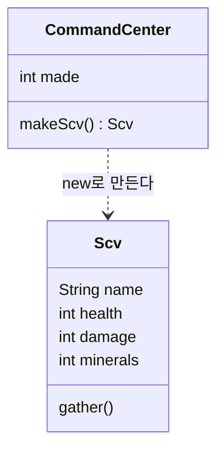


<div class="callout callout-summary" markdown="1">
<div class="callout-title callout-title--default" markdown="span">요약</div>

클래스는 쿠키 틀이고, 객체는 그 틀로 찍어 낸 쿠키다. 틀 하나로 쿠키를 몇 개든 찍을 수 있고, 찍힌 쿠키는 저마다 따로 논다. 하나를 베어 먹어도 다른 쿠키는 멀쩡하다. 틀만 있어서는 먹을 것이 없듯이, 클래스만 써 놓고 객체를 찍어 내지 않으면 프로그램에서 쓸 것이 없다. 쿠키와 다른 점도 있다. 객체는 값만 담지 않고 자기가 할 수 있는 동작도 함께 가진다.

</div>


## 예시로 보기

스타크래프트에서 일꾼인 건설로봇(SCV) 다섯 대를 다룬다고 하자. 지금까지 배운 변수만 쓰면 로봇마다 변수를 따로 만들어야 한다.

```java
int scv1Health = 45, scv1Minerals = 0;
int scv2Health = 45, scv2Minerals = 0;
// ... 다섯 대면 변수 열 개, 유닛 종류가 늘면 끝이 없다
```

변수가 늘어나는 것만 문제가 아니다. 어느 체력이 어느 로봇 것인지를 이름으로만 구별하므로, "이 로봇이 광물을 캔다" 같은 동작을 로봇에 묶어 둘 곳이 없다.

슬라이드는 게임 화면에서 답을 찾는다[^1]. 건설로봇에게는 정해진 속성(생명력 45, 공격력 5)과 정해진 동작(채취, 건물 건설, 수리)이 있다. 이 둘을 한 덩어리로 적어 둔 것이 건설로봇의 설계도이고, 사령부가 그 설계도대로 로봇을 한 대씩 찍어 낸다. 설계도가 클래스, 찍혀 나온 로봇 한 대 한 대가 객체다.

```java
class Scv {                 // 클래스: 건설로봇의 설계도
    String name;
    int health = 45;        // 속성은 변수로 적는다
    int damage = 5;
    int minerals = 0;

    void gather() {         // 동작은 메서드로 적는다
        minerals += 8;
    }
}

class CommandCenter {
    int made = 0;

    Scv makeScv() {         // 사령부 객체가 건설로봇 객체를 만든다
        made++;
        Scv s = new Scv();
        s.name = "SCV" + made;
        return s;
    }
}
```

```java
CommandCenter cc = new CommandCenter();
Scv a = cc.makeScv();
Scv b = cc.makeScv();
a.gather();
a.gather();
System.out.println(a.name + " " + a.minerals);   // SCV1 16
System.out.println(b.name + " " + b.minerals);   // SCV2 0
Scv c = a;
c.gather();
System.out.println(a.minerals);                  // 24
System.out.println(a == c);                      // true
System.out.println(a == b);                      // false
```

`a`가 두 번 캐도 `b`의 광물은 0이다. 같은 틀에서 나왔어도 객체마다 값을 따로 가진다. 반대로 `Scv c = a;`는 로봇을 한 대 더 만들지 않는다. 변수 `c`가 `a`와 같은 로봇을 가리킬 뿐이라, `c`로 캐면 `a`의 광물이 늘어난다. 객체를 새로 만드는 것은 `new`뿐이다.

```
스택 (변수)            힙 (객체)
┌─────┐
│  a  │──────┐
├─────┤      ├───▶ ┌ Scv ─────────────────┐
│  c  │──────┘     │ name "SCV1"          │
├─────┤            │ health 45  damage 5  │
│  b  │─────┐      │ minerals 24          │
└─────┘     │      └──────────────────────┘
            └────▶ ┌ Scv ─────────────────┐
                   │ name "SCV2"          │
                   │ health 45  damage 5  │
                   │ minerals 0           │
                   └──────────────────────┘
```

변수에는 객체가 들어 있지 않고 객체가 있는 곳의 주소가 들어 있다. 이 그림은 [참조 타입과 메모리 영역](/Hongs_Blog/studies/java/java-reference-types/)에서 본 배열·문자열의 그림과 같은 모양이다[^s2].

<div class="callout callout-check" markdown="1">
<div class="callout-title" markdown="span">검증: 위 출력 여섯 줄(사령부가 만든 수 2 포함)과 카드 C3의 답을 JDK 21에서 실행해 비교 — [11_class-and-object_impl.java](/Hongs_Blog/studies/java/code/11_class-and-object_impl/)</div>

</div>


## 정의

- **객체(object)**는 현실의 사물이나 개념을 본뜬 것으로, 자료와 동작을 함께 가진다. 자료는 속성(멤버 변수)에, 동작은 메서드(멤버 함수)에 담는다[^2].
- **클래스(class)**는 객체를 만드는 틀이다. 그 클래스로 만든 모든 객체가 가질 속성과 메서드를 정해 둔다[^3].
- 클래스로 만든 객체를 그 클래스의 **인스턴스(instance)**라고 부른다. "객체는 클래스의 인스턴스다."[^4] 위 예에서 `a`와 `b`가 가리키는 두 로봇은 모두 `Scv` 클래스의 인스턴스다.



상자 하나가 클래스 하나다. 위 칸에 속성, 아래 칸에 동작을 적는다. 점선 화살표는 사령부가 건설로봇을 만들어 쓴다는 뜻이다[^s2].

### 객체 모델링

현실의 사물에서 대표가 되는 속성과 동작을 뽑아, 소프트웨어 객체의 필드(속성을 담는 변수)와 메서드로 정하는 일을 객체 모델링이라고 한다[^5].

| 현실의 게임 설계 | 뽑은 속성 → 필드 | 뽑은 동작 → 메서드 |
|---|---|---|
| 건물(사령부) | 이름, 생명력 | 건설로봇 만들기, 띄우기 |
| 건설로봇 | 생명력, 공격력 | 광물 캐기, 건물 짓기 |

모든 속성을 옮기지 않는다. 프로그램에 필요한 것만 고른다. 건설로봇의 색깔이 게임 규칙에 쓰이지 않으면 필드로 만들 이유가 없다[^s1].

### 객체 지향 프로그래밍

객체 지향 프로그래밍(OOP)은 객체를 먼저 설계해서 만들고, 그 객체들을 조립해 프로그램 전체를 만드는 방법이다[^6]. 스타크래프트로 치면 종족 아래에 건물이 있고, 건물이 유닛을 만들고, 같은 유닛이 여러 대 돌아다닌다. 복잡한 세계를 이렇게 층층이 나눠 짤 수 있다[^7].

## 활용

- 클래스 이름은 타입 이름으로 쓴다. `Scv a`는 "`Scv` 객체를 가리킬 변수 `a`"다. `int`, `double` 같은 기본 타입과 달리 변수에는 주소가 들어간다.
- 흔한 실수: `Scv c = a;`를 복사라고 생각하는 것. 객체는 그대로 하나이고 가리키는 변수만 둘이 된다. 같은 객체인지는 `==`로 확인한다([참조 비교와 null](/Hongs_Blog/studies/java/java-reference-equality/)).
- 클래스 안에 무엇을 쓸 수 있는지는 [필드와 메서드](/Hongs_Blog/studies/java/java-fields-methods/), `new` 뒤의 괄호가 하는 일은 [생성자](/Hongs_Blog/studies/java/java-constructor/)에서 다룬다.

## 연결

- 선수: [참조 타입과 메모리 영역](/Hongs_Blog/studies/java/java-reference-types/), [변수와 기본 타입](/Hongs_Blog/studies/java/java-primitive-types/)
- 객체를 잘 쓰기 위한 세 가지 약속: [객체 지향의 세 원칙](/Hongs_Blog/studies/java/oop-principles/)
- 객체 없이 순서대로 짜는 방식과 견주기: [절차 지향과 객체 지향 비교](/Hongs_Blog/studies/java/procedural-vs-oop/)

## 확인 문제

<details class="callout callout-question" markdown="1">
<summary class="callout-title" markdown="span">**C1** 클래스, 객체, 인스턴스를 각각 한 문장으로 쓰라.</summary>

**답:** 클래스는 객체를 만드는 틀로, 그 객체들이 가질 속성과 메서드를 정한다. 객체는 자료(속성)와 동작(메서드)을 함께 가진 것이다. 인스턴스는 어떤 클래스로 만든 객체를 그 클래스와 묶어 부르는 이름이다("`a`는 `Scv`의 인스턴스").<br>
**이유:** 흔한 오답은 "클래스가 자료, 객체가 동작"처럼 둘을 내용으로 가르는 것이다. 둘 다 속성과 동작을 다룬다. 다른 점은 틀이냐, 틀로 찍어 낸 실물이냐다.

</details>


<details class="callout callout-question" markdown="1">
<summary class="callout-title" markdown="span">**C2** 병영(Barracks)이 해병(Marine)을 만든다. 해병은 생명력과 공격력이 있고, 움직이고 공격한다. 이 설명을 클래스 두 개의 필드와 메서드로 옮겨 적어라.</summary>

**답:** `Marine` — 필드 `int health`, `int damage` / 메서드 `move()`, `attack()`. `Barracks` — 메서드 `Marine makeMarine()`(안에서 `new Marine()`을 한다). 필요하면 지금까지 만든 수를 세는 필드를 둔다.<br>
**이유:** 속성(가지고 있는 값)은 필드로, 동작(할 수 있는 일)은 메서드로 간다. "만든다"는 병영의 동작이므로 병영의 메서드다[^s1].

</details>


<details class="callout callout-question" markdown="1">
<summary class="callout-title" markdown="span">**C3** 예시의 `Scv` 클래스로 `Scv x = new Scv(); Scv y = new Scv(); Scv z = y; x.health = 10; z.health = 20;`을 실행했다. `x.health + " " + y.health + " " + z.health`의 출력은?</summary>

**답:** `10 20 20`<br>
**이유:** `new`를 두 번 했으니 객체는 둘이다. `z`는 `y`와 같은 객체를 가리키므로 `z.health = 20`이 `y.health`도 바꾼다. 흔한 오답 `10 45 20`은 `z = y`를 복사로 본 것이다[^s1].

</details>


[^1]: 소프트웨어 프로젝트 5회 강의 자료 「Software Project 05. Object-Oriented Programming」, p.6~13 (스타크래프트 예: 사령부의 속성과 동작, 건설로봇의 속성 표와 특수 능력, 건물이 유닛을 만드는 계층도). 슬라이드 p.9~11의 제목과 p.17~18의 그림은 "CSV"라고 적었는데, 그림과 문맥으로 보아 SCV의 오타다.
[^2]: 같은 자료, p.3 (What is Object?)
[^3]: 같은 자료, p.4 (What is Class?)
[^4]: 같은 자료, p.5 (쿠키 틀과 쿠키 사진, "Object is an instance of a class")
[^5]: 같은 자료, p.16~18 (Object Modeling)
[^6]: 같은 자료, p.15 (개발자 → 클래스(설계도) → 인스턴스(객체))
[^7]: 같은 자료, p.12~14 ("A complex world can be implemented structurally")
[^s1]: <span class="fn-tag" title="수업 자료에 없고 따로 보탠 내용">보충</span> 변수만으로 짠 코드, `Scv`·`CommandCenter` 코드와 출력, "필요한 속성만 고른다"는 설명, 카드 C2·C3은 원본에 없다. 슬라이드의 스타크래프트 그림(p.8~13)을 코드로 옮겼고, 생명력 45와 공격력 5는 p.10의 표에서 가져왔다. 광물 8은 예제를 위해 정한 값이다. 출력은 JDK 21에서 실행해 확인했다.
[^s2]: <span class="fn-tag" title="수업 자료에 없고 따로 보탠 내용">보충</span> 메모리 그림과 클래스 그림은 원본에 없다. 위 코드의 실행 결과(`a == c`가 true, `a == b`가 false)를 근거로 그렸다.

