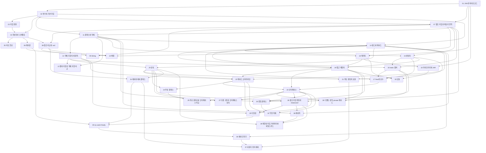


## 먼저 알아야 할 것
- 이 과목 안에서는 [JVM과 바이트코드](/Hongs_Blog/studies/java/jvm-bytecode/)가 시작점이다.
- [진법과 자릿수](/Hongs_Blog/studies/college-math/positional-notation/) (공학수학 대학수학): 2~3회의 타입 범위, 비트 연산
- [정수의 2진 표현과 2의 보수](/Hongs_Blog/studies/data-and-information/twos-complement/), [부동소수점](/Hongs_Blog/studies/data-and-information/floating-point/) (2-1학기 자료와 정보): 3회의 오버플로, NaN, 실수 오차

> 자료 출처: 2024년 봄학기 강의 슬라이드(Java). 9~10회 슬라이드는 자료에 없다. 슬라이드 표지의 강의 번호는 파일 번호와 다를 수 있어(11·12번 파일 표지는 09, 13번은 10, 14~17번은 11~14) 출처는 파일 번호로 적었다. 예제 코드는 JDK 21에서 실행해 확인했다.

## 2회 · Java 기초 (1): 실행 과정, 변수, 타입 변환

읽기 전에

1. 윈도우에서 번역한 자바 프로그램 파일을 맥에 복사하면 다시 번역하지 않고 돌아갈까? → [JVM과 바이트코드](/Hongs_Blog/studies/java/jvm-bytecode/)
2. `byte` 변수에는 왜 128을 넣을 수 없고, 음수 쪽은 왜 −128까지 될까? → [변수와 기본 타입](/Hongs_Blog/studies/java/java-primitive-types/)
3. `1 + 2 + "3"`과 `"1" + 2 + 3`은 각각 무엇이 될까? → [타입 변환](/Hongs_Blog/studies/java/java-type-conversion/)

| 번호 | 개념 | 한 줄 | 개념 코드 | 연습 |
|---|---|---|---|---|
| 01 | [JVM과 바이트코드](/Hongs_Blog/studies/java/jvm-bytecode/) | 소스를 중간 말(바이트코드)로 한 번 번역해 두고, 운영체제마다 있는 JVM이 그것을 돌린다 | [impl](/Hongs_Blog/studies/java/code/01_jvm-bytecode_impl/) | — |
| 02 | [변수와 기본 타입](/Hongs_Blog/studies/java/java-primitive-types/) | 변수는 이름 붙은 칸이고, 타입이 칸의 크기와 담을 값의 범위($$-2^{n-1}$$ ~ $$2^{n-1}-1$$)를 정한다 | [impl](/Hongs_Blog/studies/java/code/02_java-primitive-types_impl/) | — |
| 03 | [타입 변환](/Hongs_Blog/studies/java/java-type-conversion/) | 작은 타입에서 큰 타입으로는 자동, 반대는 괄호로 직접 적어야 하고 값이 잘릴 수 있다 | [impl](/Hongs_Blog/studies/java/code/03_java-type-conversion_impl/) | — |

자료: Software Project 02. Java Language Basics (1)
필기: 아직 없다.
떠올려 보기: 노트를 닫고 `.java` 파일이 화면 출력이 되기까지의 단계, 기본 타입 여덟 개의 크기, 자동 변환과 강제 변환이 갈리는 기준을 써 본다.

## 3회 · Java 기초 (2): 연산자와 제어문

읽기 전에

1. `int`의 가장 큰 값에 1을 더하면 오류가 날까, 어떤 값이 될까? → [연산자와 오버플로](/Hongs_Blog/studies/java/java-operators/)
2. `45 & 25`는 얼마일까? 음수를 오른쪽으로 미는 연산은 왜 두 가지일까? → [비트 연산](/Hongs_Blog/studies/java/java-bitwise/)
3. `switch`에서 `break`를 빼면 무슨 일이 생길까? → [제어문](/Hongs_Blog/studies/java/java-control-flow/)

| 번호 | 개념 | 한 줄 | 개념 코드 | 연습 |
|---|---|---|---|---|
| 04 | [연산자와 오버플로](/Hongs_Blog/studies/java/java-operators/) | 연산 기호의 뜻과 계산 순서, 정수는 범위를 넘으면 오류 없이 반대쪽 끝으로 돈다 | [impl](/Hongs_Blog/studies/java/code/04_java-operators_impl/) | — |
| 05 | [비트 연산](/Hongs_Blog/studies/java/java-bitwise/) | 정수를 비트 줄로 보고 같은 자리끼리 계산하거나 옆으로 민다 | [impl](/Hongs_Blog/studies/java/code/05_java-bitwise_impl/) | — |
| 06 | [제어문](/Hongs_Blog/studies/java/java-control-flow/) | 조건에 따라 건너뛰고(if, switch) 되풀이하는(for) 문장, break와 continue | [impl](/Hongs_Blog/studies/java/code/06_java-control-flow_impl/) | — |

자료: Software Project 03. Java Language Basics (2)
필기: 아직 없다.
떠올려 보기: 노트를 닫고 수학과 다르게 나오는 계산 세 가지(넘침, 정수 나눗셈, 0.1 계산)와 `for`의 네 단계 실행 순서, `break`와 `continue`의 차이를 써 본다.

## 4회 · 참조 타입

읽기 전에

1. `int[] q = p;` 뒤에 `q[0]`을 고치면 `p[0]`도 바뀔까? → [참조 타입과 메모리 영역](/Hongs_Blog/studies/java/java-reference-types/)
2. 내용이 똑같은 두 배열을 `==`로 비교하면 `true`일까? → [참조 비교와 null](/Hongs_Blog/studies/java/java-reference-equality/)
3. `"KIA" == "KIA"`와 `new String("KIA") == new String("KIA")`의 답은 같을까? → [String](/Hongs_Blog/studies/java/java-string/)

| 번호 | 개념 | 한 줄 | 개념 코드 | 연습 |
|---|---|---|---|---|
| 07 | [참조 타입과 메모리 영역](/Hongs_Blog/studies/java/java-reference-types/) | 참조 변수에는 객체의 주소가 들어 있고, JVM은 메모리를 메서드·힙·스택 영역으로 나눠 쓴다 | [impl](/Hongs_Blog/studies/java/code/07_java-reference-types_impl/) | — |
| 08 | [참조 비교와 null](/Hongs_Blog/studies/java/java-reference-equality/) | 참조 변수의 ==는 주소를 비교하고, null을 따라가려 하면 NullPointerException으로 멈춘다 | [impl](/Hongs_Blog/studies/java/code/08_java-reference-equality_impl/) | — |
| 09 | [String](/Hongs_Blog/studies/java/java-string/) | 같은 리터럴은 String 객체 하나를 같이 쓰고 new는 늘 새로 만든다, 그래서 비교는 equals로 | [impl](/Hongs_Blog/studies/java/code/09_java-string_impl/) | — |
| 10 | [배열](/Hongs_Blog/studies/java/java-array/) | 같은 타입의 값을 번호(0부터) 붙은 칸에 줄지어 둔 것, 길이는 만들 때 정해진다 | [impl](/Hongs_Blog/studies/java/code/10_java-array_impl/) | — |

자료: Software Project 04. Reference Types
필기: 아직 없다.
떠올려 보기: 노트를 닫고 스택·힙·메서드 영역에 각각 무엇이 놓이는지 그림으로 그리고, `==`와 `equals`의 차이, `new String[3]` 직후 칸에 든 값을 써 본다.

## 5회 · 객체 지향 프로그래밍

읽기 전에

1. `Scv c = a;`를 하고 `c`로 광물을 캐면 `a`의 광물은 어떻게 될까? → [클래스와 객체](/Hongs_Blog/studies/java/class-and-object/)
2. `Animal x = new Dog();`일 때 `x.makeSound()`는 동물 소리일까 개 소리일까? → [객체 지향의 세 원칙](/Hongs_Blog/studies/java/oop-principles/)
3. 자바 코드는 모두 `class` 안에 쓴다. 그러면 자바로 쓴 코드는 모두 객체 지향일까? → [절차 지향과 객체 지향 비교](/Hongs_Blog/studies/java/procedural-vs-oop/)

| 번호 | 개념 | 한 줄 | 개념 코드 | 연습 |
|---|---|---|---|---|
| 11 | [클래스와 객체](/Hongs_Blog/studies/java/class-and-object/) | 클래스는 틀, 객체는 그 틀로 찍어 낸 실물 | [impl](/Hongs_Blog/studies/java/code/11_class-and-object_impl/) | — |
| 12 | [객체 지향의 세 원칙](/Hongs_Blog/studies/java/oop-principles/) | 감추기(캡슐화)·물려받기(상속)·같은 이름 다른 동작(다형성) (강조)[^강조] | [impl](/Hongs_Blog/studies/java/code/12_oop-principles_impl/) | — |
| 13 | [절차 지향과 객체 지향 비교](/Hongs_Blog/studies/java/procedural-vs-oop/) | 자료와 그 자료를 다루는 코드를 한 객체에 묶느냐로 갈린다 | [impl](/Hongs_Blog/studies/java/code/13_procedural-vs-oop_impl/) | — |

자료: Software Project 05. Object-Oriented Programming
필기: 아직 없다.
떠올려 보기: 노트를 닫고 세 원칙의 이름, 각각이 막아 주는 곤란함, 오버로딩과 오버라이딩이 정해지는 때를 써 본다.

## 6회 · 클래스

읽기 전에

1. 메서드 안에서 만든 변수와 클래스에 바로 적은 변수는 언제 사라질까? → [필드와 메서드](/Hongs_Blog/studies/java/java-fields-methods/)
2. 생성자를 하나도 안 쓴 클래스는 어떻게 `new Student()`가 될까? → [생성자](/Hongs_Blog/studies/java/java-constructor/)
3. 생성자에서 `name = name;`이라고 쓰면 필드에 값이 들어갈까? → [생성자](/Hongs_Blog/studies/java/java-constructor/)

| 번호 | 개념 | 한 줄 | 개념 코드 | 연습 |
|---|---|---|---|---|
| 14 | [필드와 메서드](/Hongs_Blog/studies/java/java-fields-methods/) | 객체에 남는 칸(필드)과 동작(메서드), 메서드 안에서만 사는 지역 변수 | [impl](/Hongs_Blog/studies/java/code/14_java-fields-methods_impl/) | — |
| 15 | [생성자](/Hongs_Blog/studies/java/java-constructor/) | `new` 할 때 객체를 처음 값으로 채우는 코드. 하나라도 쓰면 기본 생성자는 사라진다 | [impl](/Hongs_Blog/studies/java/code/15_java-constructor_impl/) | — |

자료: Software Project 06. Class
필기: 아직 없다.
떠올려 보기: 클래스의 멤버 세 가지와 필드·지역 변수의 차이 세 줄, 기본 생성자가 사라지는 조건을 써 본다.

## 7회 · 클래스 (2)

읽기 전에

1. 객체를 세 개 만들면 `static` 필드는 몇 개 생길까? → [static 멤버](/Hongs_Blog/studies/java/java-static/)
2. `final int[] a`의 칸에 다른 값을 넣을 수 있을까? → [final과 상수](/Hongs_Blog/studies/java/java-final/)
3. 클래스 앞에 `public`을 안 쓰면 누구나 쓸 수 있을까, 아무도 못 쓸까? → [접근 제한자](/Hongs_Blog/studies/java/java-access-modifier/)

| 번호 | 개념 | 한 줄 | 개념 코드 | 연습 |
|---|---|---|---|---|
| 16 | [static 멤버](/Hongs_Blog/studies/java/java-static/) | 객체가 아니라 클래스에 하나만 있는 멤버. 객체 없이 쓰고, `this`가 없다 | [impl](/Hongs_Blog/studies/java/code/16_java-static_impl/) | — |
| 17 | [final과 상수](/Hongs_Blog/studies/java/java-final/) | 한 번 넣으면 못 바꾸는 필드. `static final`이면 상수 | [impl](/Hongs_Blog/studies/java/code/17_java-final_impl/) | — |
| 18 | [패키지](/Hongs_Blog/studies/java/java-package/) | 클래스에 붙이는 성. 폴더 구조와 짝이 맞아야 하고 `import`로 줄여 부른다 | [impl](/Hongs_Blog/studies/java/code/18_java-package_impl/) | — |
| 19 | [접근 제한자](/Hongs_Blog/studies/java/java-access-modifier/) | public > protected > default > private. 감춘 필드는 getter·setter로 다룬다 | [impl](/Hongs_Blog/studies/java/code/19_java-access-modifier_impl/) | — |

자료: Software Project 07. Class (2)
필기: 아직 없다.
떠올려 보기: 접근 단계 넷을 넓은 순서로 쓰고, `static`·`final`·`static final`이 각각 무엇을 정하는지 한 줄씩 써 본다.

## 8회 · 상속

읽기 전에

1. 부모의 `private` 필드를 자식 메서드에서 이름으로 쓸 수 있을까? → [상속](/Hongs_Blog/studies/java/java-inheritance/)
2. `new Marine()`을 하면 `Marine` 생성자와 `Unit` 생성자 중 어느 본문이 먼저 돌까? → [부모 생성자 호출](/Hongs_Blog/studies/java/java-super-constructor/)
3. 자식에서 `makeSound(int n)`을 만들면 부모의 `makeSound()`가 가려질까? → [메서드 오버라이딩](/Hongs_Blog/studies/java/java-overriding/)

| 번호 | 개념 | 한 줄 | 개념 코드 | 연습 |
|---|---|---|---|---|
| 20 | [상속](/Hongs_Blog/studies/java/java-inheritance/) | `extends`로 부모의 필드·메서드를 물려받는다. 부모는 하나만 | [impl](/Hongs_Blog/studies/java/code/20_java-inheritance_impl/) | — |
| 21 | [부모 생성자 호출](/Hongs_Blog/studies/java/java-super-constructor/) | 자식 생성자 첫 줄의 숨은 `super()`가 부모 생성자를 먼저 돌린다 | [impl](/Hongs_Blog/studies/java/code/21_java-super-constructor_impl/) | — |
| 22 | [메서드 오버라이딩](/Hongs_Blog/studies/java/java-overriding/) | 물려받은 메서드를 같은 모양으로 다시 쓴다. 실행 중 실제 객체의 것이 돈다 | [impl](/Hongs_Blog/studies/java/code/22_java-overriding_impl/) | — |

자료: Software Project 08. Inheritance
필기: 아직 없다.
떠올려 보기: `extends`·`super()`·`super.method()`·`@Override`가 각각 하는 일과 오버라이딩의 두 가지 규칙을 써 본다.

## 11회 · 인터페이스 (1)

읽기 전에

1. `main`이 TV를 켜다가 조명을 켜도록 바꿀 때, `main` 코드를 거의 고치지 않으려면 변수의 타입을 무엇으로 두면 될까? → [인터페이스](/Hongs_Blog/studies/java/java-interface/)
2. "동물" 클래스는 `new`로 만들지 못하게 막고 싶다. 그러면서 개와 고양이가 이름 필드와 숨 쉬는 메서드를 함께 쓰게 하려면? → [추상 클래스](/Hongs_Blog/studies/java/java-abstract-class/)
3. 둘 다 `new`가 안 되고 몸통 없는 메서드를 둔다. 그러면 무엇을 보고 둘 중 하나를 고를까? → [추상 클래스와 인터페이스 비교](/Hongs_Blog/studies/java/abstract-class-vs-interface/)

| 번호 | 개념 | 한 줄 | 개념 코드 | 연습 |
|---|---|---|---|---|
| 23 | [인터페이스](/Hongs_Blog/studies/java/java-interface/) | 쓰는 쪽은 메서드 목록만 알고, 실제 일은 그 목록을 채운 구현 객체가 한다 (필드는 상수, 메서드는 public abstract) | [impl](/Hongs_Blog/studies/java/code/23_java-interface_impl/) | — |
| 24 | [추상 클래스](/Hongs_Blog/studies/java/java-abstract-class/) | 공통 필드·메서드를 모아 두고 new는 막은 부모 클래스, 자식마다 다른 몸통은 추상 메서드로 강제한다 | [impl](/Hongs_Blog/studies/java/code/24_java-abstract-class_impl/) | — |
| 25 | [추상 클래스와 인터페이스 비교](/Hongs_Blog/studies/java/abstract-class-vs-interface/) | 객체마다 다른 값을 물려줘야 하면 추상 클래스, 여러 개를 함께 맡겨야 하면 인터페이스 | [impl](/Hongs_Blog/studies/java/code/25_abstract-class-vs-interface_impl/) | — |

자료: Software Project 11. Interface (1)
필기: 아직 없다.
떠올려 보기: 노트를 닫고 인터페이스에 넣을 수 있는 것, 컴파일러가 자동으로 붙이는 키워드, 구현 클래스가 지켜야 할 두 가지를 쓰고, 추상 클래스와 다른 점을 두 줄로 적어 본다.

## 12회 · 인터페이스 (2)

읽기 전에

1. 구현 클래스가 열 개 있는 인터페이스에 메서드를 하나 더하면 무슨 일이 생길까? → [디폴트·정적·private 메서드](/Hongs_Blog/studies/java/java-interface-methods/)
2. `Vehicle vehicle = new Bus();` 뒤에 Bus에만 있는 `checkFare()`를 부를 수 있을까? → [참조 타입 변환과 instanceof](/Hongs_Blog/studies/java/java-casting/)
3. `tire.roll();`이라는 똑같은 한 줄이 한 번은 "Hankook Tire", 한 번은 "Kumho Tire"를 찍었다. 무엇이 달라졌을까? → [다형성](/Hongs_Blog/studies/java/java-polymorphism/)

| 번호 | 개념 | 한 줄 | 개념 코드 | 연습 |
|---|---|---|---|---|
| 26 | [디폴트·정적·private 메서드](/Hongs_Blog/studies/java/java-interface-methods/) | 인터페이스에 몸통을 미리 써 두는 디폴트, 객체 없이 부르는 정적, 그 둘의 겹치는 코드를 숨기는 private 메서드 | [impl](/Hongs_Blog/studies/java/code/26_java-interface-methods_impl/) | — |
| 27 | [다중 구현과 인터페이스 상속](/Hongs_Blog/studies/java/java-interface-inheritance/) | 클래스 하나가 인터페이스 여러 개를 구현하고, 인터페이스끼리는 부모를 여럿 둘 수 있다 | [impl](/Hongs_Blog/studies/java/code/27_java-interface-inheritance_impl/) | — |
| 28 | [참조 타입 변환과 instanceof](/Hongs_Blog/studies/java/java-casting/) | 넓은 타입으로는 그냥 바뀌고, 좁은 타입으로는 (타입)을 쓰고 실행 중에 확인한다. 바꾸기 전에 instanceof로 묻는다 | [impl](/Hongs_Blog/studies/java/code/28_java-casting_impl/) | — |
| 29 | [다형성](/Hongs_Blog/studies/java/java-polymorphism/) | 부를 수 있는지는 변수의 타입이, 어느 몸통이 도는지는 변수에 든 객체가 정한다 (필드 다형성, 매개변수 다형성) | [impl](/Hongs_Blog/studies/java/code/29_java-polymorphism_impl/) | — |

자료: Software Project 12. Interface (2)
필기: 아직 없다.
떠올려 보기: 노트를 닫고 인터페이스의 메서드 다섯 종류가 서로 무엇을 부를 수 있는지 그리고, "호출 한 줄은 두 번 정해진다"를 `Driver`와 `Vehicle`로 설명해 본다.

## 13회 · 중첩 선언과 익명 객체

읽기 전에

1. 클래스 A 안에 선언한 클래스 B의 객체는 A 객체가 없어도 만들 수 있을까? → [중첩 클래스](/Hongs_Blog/studies/java/java-nested-class/)
2. 중첩 클래스 안에서 `this.name`과 바깥 객체의 `name`을 어떻게 구별해 쓸까? → [중첩 클래스](/Hongs_Blog/studies/java/java-nested-class/)
3. 인터페이스는 `new`로 만들 수 없는데 `new ClickListener() { … }`는 왜 되는가? → [익명 객체](/Hongs_Blog/studies/java/java-anonymous-object/)

| 번호 | 개념 | 한 줄 | 개념 코드 | 연습 |
|---|---|---|---|---|
| 30 | [중첩 클래스](/Hongs_Blog/studies/java/java-nested-class/) | 클래스 안에 넣은 클래스 세 종류(인스턴스 멤버, 정적 멤버, 로컬)와 바깥 멤버 접근, 중첩 인터페이스 | [impl](/Hongs_Blog/studies/java/code/30_java-nested-class_impl/) | — |
| 31 | [익명 객체](/Hongs_Blog/studies/java/java-anonymous-object/) | 이름 없는 자식·구현 클래스를 쓰는 자리에서 선언하고 곧바로 객체 하나를 만든다 | [impl](/Hongs_Blog/studies/java/code/31_java-anonymous-object_impl/) | — |

자료: Software Project 13. Nested Declarations and Anonymous Objects
필기: 아직 없다.
떠올려 보기: 노트를 닫고 중첩 클래스 세 종류를 "선언 자리, 만들 수 있는 때, 쓸 수 있는 바깥 멤버"로 표를 그리고, 익명 객체가 이름이 없어서 못 하는 일을 적어 본다.

## 14회 · 라이브러리와 모듈

읽기 전에

1. 남이 만든 클래스 묶음을 번역할 때는 잘 찾았는데 실행하니 못 찾는다. 무엇을 빠뜨렸을까? → [라이브러리와 JAR](/Hongs_Blog/studies/java/java-library-jar/)
2. `public` 클래스인데도 다른 프로그램에서 `import`가 막힐 수 있을까? → [모듈](/Hongs_Blog/studies/java/java-module/)
3. 내가 쓰는 모듈 A가 모듈 B의 객체를 돌려준다. 나는 A만 필요하다고 적었다. 번역될까? → [모듈](/Hongs_Blog/studies/java/java-module/)

| 번호 | 개념 | 한 줄 | 개념 코드 | 연습 |
|---|---|---|---|---|
| 32 | [라이브러리와 JAR](/Hongs_Blog/studies/java/java-library-jar/) | 번역된 클래스 묶음(JAR)을 클래스패스에 넣어 여러 프로그램이 함께 쓴다 | — | — |
| 33 | [모듈](/Hongs_Blog/studies/java/java-module/) | 안내문(module-info)에 내보낼 패키지와 필요한 모듈을 적고, 안 적은 패키지는 숨는다 | — | — |

자료: Software Project 14. Libraries and Modules
필기: 아직 없다.
떠올려 보기: 노트를 닫고 module-info.java에 쓰는 낱말(requires, exports, transitive, opens)이 각각 무엇을 허락하는지와 서로의 관계를 써 본다.

## 15회 · 예외 처리

읽기 전에

1. 실행하면 반드시 터지는 코드는 번역되는데, 터질 리 없는 코드가 번역이 안 될 수 있다. 어떤 경우일까? → [예외와 예외 클래스](/Hongs_Blog/studies/java/java-exception/)
2. `try`에서 예외가 나서 `catch`가 처리했다. 그다음 실행은 `try`의 멈춘 자리로 돌아갈까? → [try-catch-finally](/Hongs_Blog/studies/java/java-try-catch/)
3. 메서드 안에서 난 사고를 그 메서드가 직접 처리하지 않는 편이 나을 때는 언제일까? → [예외 던지기](/Hongs_Blog/studies/java/java-throw/)

| 번호 | 개념 | 한 줄 | 개념 코드 | 연습 |
|---|---|---|---|---|
| 34 | [예외와 예외 클래스](/Hongs_Blog/studies/java/java-exception/) | 수습 못 하는 에러와 수습할 수 있는 예외, 번역기가 대비를 검사하는 일반 예외와 안 하는 실행 예외 | [impl](/Hongs_Blog/studies/java/code/34_java-exception_impl/) | — |
| 35 | [try-catch-finally](/Hongs_Blog/studies/java/java-try-catch/) | 사고 날 줄을 try에 넣고 catch 하나만 돌며 finally는 늘 돈다, 자식 catch가 먼저 | [impl](/Hongs_Blog/studies/java/code/35_java-try-catch_impl/) | — |
| 36 | [예외 던지기](/Hongs_Blog/studies/java/java-throw/) | throws로 부른 쪽에 넘기고 throw로 직접 일으킨다 | [impl](/Hongs_Blog/studies/java/code/36_java-throw_impl/) | — |
| 37 | [사용자 정의 예외](/Hongs_Blog/studies/java/java-custom-exception/) | Exception이나 RuntimeException을 상속해 내 프로그램만의 예외를 만든다 | [impl](/Hongs_Blog/studies/java/code/37_java-custom-exception_impl/) | — |

자료: Software Project 15. Exception handling
필기: 아직 없다.
떠올려 보기: 노트를 닫고 Throwable 아래의 클래스 가지를 그리고, 어느 가지가 번역기 검사를 받는지와 try-catch-finally의 세 가지 실행 순서를 써 본다.

## 16회 · java.base 모듈
이 회차의 java.base, java.lang, API 문서, AWT·Swing 소개는 [모듈](/Hongs_Blog/studies/java/java-module/) 문서의 "java.base와 API 문서"에 있다. ChessGame 활동(p.9~12)은 과제 조건이 없어 연습 문서를 만들지 않았다.
자료: Software Project 16. java.base Module
필기: 아직 없다.
떠올려 보기: `requires` 없이 쓸 수 있는 모듈 하나와, `import` 없이 쓸 수 있는 패키지 하나를 대고 그 안의 클래스 네 개를 써 본다.

## 17회 · 제네릭

읽기 전에

1. 무엇이든 담는 상자를 `Object` 필드로 만들면 무엇이 불편하고 무엇이 위험할까? → [제네릭](/Hongs_Blog/studies/java/java-generics/)
2. `<T>`로 받은 값에 `doubleValue()`를 부르면 왜 번역이 안 될까? → [제한된 타입 파라미터와 와일드카드](/Hongs_Blog/studies/java/java-bounded-wildcard/)
3. `Student`가 `Person`의 자식이면 `Applicant<Student>`를 `Applicant<Person>` 변수에 넣을 수 있을까? → [제한된 타입 파라미터와 와일드카드](/Hongs_Blog/studies/java/java-bounded-wildcard/)

| 번호 | 개념 | 한 줄 | 개념 코드 | 연습 |
|---|---|---|---|---|
| 38 | [제네릭](/Hongs_Blog/studies/java/java-generics/) | 타입을 빈칸으로 둔 클래스와 메서드, 쓸 때 채우고 번역 때 검사한다 | [impl](/Hongs_Blog/studies/java/code/38_java-generics_impl/) | — |
| 39 | [제한된 타입 파라미터와 와일드카드](/Hongs_Blog/studies/java/java-bounded-wildcard/) | 빈칸에 올 타입을 extends로 좁히고, 상자는 ? extends·? super·?의 범위로 받는다 | [impl](/Hongs_Blog/studies/java/code/39_java-bounded-wildcard_impl/) | — |

자료: Software Project 17. Generics
필기: 아직 없다.
떠올려 보기: 노트를 닫고 Person–Worker–Student–HighStudent–MiddleStudent 그림을 그린 뒤 `? extends Student`, `? super Worker`, `?`가 받는 범위를 표시해 본다.

## 다른 과목과의 연결
- [참조 타입과 메모리 영역](/Hongs_Blog/studies/java/java-reference-types/) ↔ [프로세스](/Hongs_Blog/studies/operating-systems/process/), [스레드](/Hongs_Blog/studies/operating-systems/thread/) (3-1학기 운영체제): JVM의 스택·힙과 프로세스의 스택·힙
- [연산자와 오버플로](/Hongs_Blog/studies/java/java-operators/) ↔ [정수의 2진 표현과 2의 보수](/Hongs_Blog/studies/data-and-information/twos-complement/) (2-1학기 자료와 정보): 범위를 넘으면 반대쪽 끝으로 도는 까닭
- [비트 연산](/Hongs_Blog/studies/java/java-bitwise/) ↔ [불 대수와 논리 회로](/Hongs_Blog/studies/discrete-math/boolean-algebra/) (공학수학 이산수학): 자리마다 하는 AND·OR·XOR

## 흐름

[^강조]: 원본에서 강조된 개념. 객체 지향의 세 원칙: 5회 슬라이드 p.19~32(14쪽).

