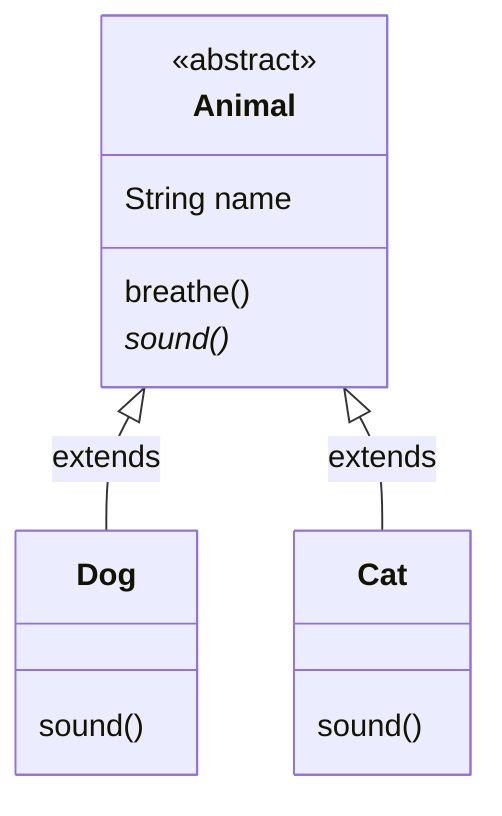


<div class="callout callout-summary" markdown="1">
<div class="callout-title callout-title--default" markdown="span">요약</div>

"동물"은 개와 고양이를 묶어 부르는 말일 뿐, 그냥 동물 한 마리는 세상에 없다. 이처럼 자식들이 함께 쓰는 것만 모아 두고, 그 자체로는 객체를 만들지 못하게 막아 둔 부모 클래스다. 자식마다 달라야 하는 동작은 이름만 적어 두고 내용은 자식이 채우게 강제할 수 있다. 자식이 내용을 빠뜨리면 실행하기 전에 걸러진다. 다만 부모는 하나만 둘 수 있다는 상속의 제약은 그대로다.

</div>


## 예시로 보기

개와 고양이는 둘 다 이름이 있고 숨을 쉰다. 이 공통 부분을 `Animal`에 모으면 두 번 쓰지 않아도 된다. 그런데 `Animal`을 보통 클래스로 두면 두 가지가 곤란하다. 누군가 `new Animal()`로 "그냥 동물"을 만들 수 있고, 소리 내는 메서드에 무엇을 써야 할지 알 수 없다. 구체적인 소리는 아직 모르기 때문이다[^1].

```java
abstract class Animal {
    String name;                       // 공통 필드

    Animal(String name) {              // 생성자
        this.name = name;
    }

    void breathe() {                   // 몸통이 있는 보통 메서드
        System.out.println(name + ": 숨을 쉰다");
    }

    abstract void sound();             // 선언만 있고 몸통이 없다
}

class Dog extends Animal {
    Dog(String name) { super(name); }
    @Override
    void sound() { System.out.println("멍멍"); }
}

class Cat extends Animal {
    Cat(String name) { super(name); }
    @Override
    void sound() { System.out.println("야옹"); }
}
```

```java
Animal a = new Dog("바둑이");
a.breathe();
a.sound();
a = new Cat("나비");
a.breathe();
a.sound();
```

```
바둑이: 숨을 쉰다
멍멍
나비: 숨을 쉰다
야옹
```

`breathe`는 `Animal`에 한 번만 썼는데 두 자식이 함께 쓴다. `sound`는 자식마다 다르게 채웠다[^s1].

`Animal`처럼 `abstract`를 붙여 객체를 만들지 못하게 한 클래스를 추상 클래스라고 부른다. `Dog`, `Cat`처럼 실제로 객체를 만드는 자식은 실체 클래스다. `sound()`처럼 몸통이 없는 메서드는 추상 메서드다[^2].



별표가 붙은 `sound()`가 추상 메서드다. 두 자식이 각자 채운다[^s2].

<div class="callout callout-check" markdown="1">
<div class="callout-title" markdown="span">검증: 위 출력, 추상 클래스의 생성자가 자식 생성자보다 먼저 실행되는 순서(카드 C3) — [24_java-abstract-class_impl.java](/Hongs_Blog/studies/java/code/24_java-abstract-class_impl/)</div>

</div>


## 정의

추상 클래스는 실체 클래스들이 함께 가진 필드와 메서드를 뽑아 선언한 클래스다. 실체 클래스의 부모가 되어 공통 필드와 메서드를 물려준다[^2].

### 선언

클래스 선언에 `abstract`를 붙인다. 안에는 보통 클래스처럼 필드, 생성자, 메서드를 둔다[^3].

```java
public abstract class Sound {
    // 필드
    // 생성자
    // 메서드
}
```

`new`로 직접 객체를 만들 수 없다. 자식 클래스를 만들어 상속으로만 쓴다[^3]. `new Animal("x")`를 쓰면 `Animal is abstract; cannot be instantiated`라는 컴파일 오류가 난다[^s3].

### 추상 메서드

자식들이 함께 가진 메서드를 부모로 뽑아 올릴 때, 선언은 같은데 하는 일이 자식마다 다르면 추상 메서드로 선언한다. 보통 메서드와 다른 점은 `abstract`가 붙고 몸통 `{ }`이 없다는 것이다[^1].

```java
abstract 리턴타입 메서드이름(매개변수, …);
```

규칙은 세 가지다[^s3].

- 추상 메서드에 몸통을 쓰면 `abstract methods cannot have a body` 오류다.
- 추상 메서드는 추상 클래스 안에만 둘 수 있다. 보통 클래스에 두면 그 클래스가 `is not abstract and does not override abstract method` 오류를 낸다.
- 실체 클래스인 자식은 부모의 추상 메서드를 모두 다시 정의해야 한다. `class Dog extends Animal { }`처럼 비워 두면 `Dog is not abstract and does not override abstract method sound() in Animal` 오류다.

### 생성자는 있다

객체를 직접 만들 수는 없지만 생성자는 둘 수 있다. 자식 객체를 만들 때 자식 생성자가 `super(...)`로 부모 생성자를 먼저 부르기 때문이다([부모 생성자 호출](/Hongs_Blog/studies/java/java-super-constructor/)). 위 예에서 `Dog("바둑이")`는 `super(name)`으로 `Animal`의 생성자를 불러 `name`을 채운다[^s1].

## 활용

- 구현: [24_java-abstract-class_impl.java](/Hongs_Blog/studies/java/code/24_java-abstract-class_impl/)
- 변수 타입을 추상 클래스로 두면 자식 객체를 모두 담을 수 있다. `Animal a = new Dog("바둑이");`에서 `a.sound()`는 Dog의 `sound`를 실행한다([다형성](/Hongs_Blog/studies/java/java-polymorphism/)).
- 흔한 실수: 추상 메서드가 하나도 없으면 추상 클래스가 아니라고 생각하는 것. `abstract`만 붙이면 추상 메서드가 없어도 추상 클래스이고 `new`가 막힌다. 슬라이드의 `Sound` 선언에도 추상 메서드는 보이지 않는다[^3].

## 연결

- 선수: [상속](/Hongs_Blog/studies/java/java-inheritance/), [메서드 오버라이딩](/Hongs_Blog/studies/java/java-overriding/)
- 몸통 없는 메서드만 모은 것: [인터페이스](/Hongs_Blog/studies/java/java-interface/). 둘을 가르는 법은 [추상 클래스와 인터페이스 비교](/Hongs_Blog/studies/java/abstract-class-vs-interface/)

## 확인 문제

<details class="callout callout-question" markdown="1">
<summary class="callout-title" markdown="span">**C1** `Animal`의 `sound()`를 빈 몸통 `void sound() { }`로 두지 않고 추상 메서드로 두면 무엇이 좋은가?</summary>

**답:** 자식이 `sound`를 채우지 않으면 컴파일 오류가 난다. 빈 몸통으로 두면 자식이 깜빡해도 컴파일이 통과하고, 실행했을 때 아무 소리도 안 나는 동물이 조용히 생긴다.<br>
**이유:** 추상 메서드는 "자식이 반드시 채운다"를 컴파일러가 확인하게 하는 장치다. 실수를 실행 전에 잡는다.

</details>


<details class="callout callout-question" markdown="1">
<summary class="callout-title" markdown="span">**C2** (가)~(마) 가운데 컴파일 오류가 나는 줄을 모두 고르고 이유를 쓰라.</summary>

```java
abstract class Animal {
    abstract void sound();
    abstract void eat() { }          // (가)
    void breathe() { }               // (나)
}
class Dog extends Animal { }         // (다)
class Cat extends Animal {
    void sound() { }
    void eat() { }
}
class Main {
    public static void main(String[] args) {
        Animal a = new Animal();     // (라)
        Animal b = new Cat();        // (마)
    }
}
```
**답:** (가), (다), (라).<br>
**이유:** (가) 추상 메서드에는 몸통을 쓸 수 없다. (다) Dog는 실체 클래스인데 부모의 추상 메서드를 채우지 않았다. (라) 추상 클래스는 `new`로 만들 수 없다. (나)는 추상 클래스 안의 보통 메서드라 괜찮고, (마)는 자식 객체를 부모 타입 변수에 넣는 보통 쓰임이다. 흔한 오답은 (마)를 "Animal은 추상이라 변수도 못 만든다"며 오류로 고르는 것이다[^s3].

</details>


<details class="callout callout-question" markdown="1">
<summary class="callout-title" markdown="span">**C3** 이 코드의 출력은?</summary>

```java
abstract class Shape {
    Shape() { System.out.println("Shape 생성자"); }
    abstract String name();
    void describe() { System.out.println("넓이를 잴 수 있는 도형: " + name()); }
}
class Circle extends Shape {
    Circle() { System.out.println("Circle 생성자"); }
    @Override
    String name() { return "원"; }
}
// main 안에서
Shape s = new Circle();
s.describe();
```
**답:**
```
Shape 생성자
Circle 생성자
넓이를 잴 수 있는 도형: 원
```
**이유:** `new Circle()`은 Circle 생성자의 첫 줄에 숨어 있는 `super()`로 Shape 생성자를 먼저 실행한다. `describe`는 Shape에 있지만 그 안의 `name()`은 실제 객체인 Circle의 것이 실행된다. 흔한 오답은 "추상 클래스는 객체를 못 만드니 생성자도 실행되지 않는다"이다[^s3].

</details>


[^1]: 소프트웨어 프로젝트 11회 강의 자료 「Software Project 11. Interface (1)」, p.11 (추상 메서드와 오버라이딩, `abstract 리턴타입 메서드명(매개변수, …);`, Animal·Dog·Cat 그림의 "소리 낸다: 구체적인 소리는 아직 모름", "멍멍", "야옹")
[^2]: 같은 자료, p.9 (추상 클래스와 실체 클래스, Animal·Bird·Insect·Fish 그림)
[^3]: 같은 자료, p.10 (`public abstract class Sound`, `new`로 직접 만들 수 없다)
[^s1]: <span class="fn-tag" title="수업 자료에 없고 따로 보탠 내용">보충</span> `name` 필드, 생성자, `breathe` 메서드와 실행 출력, 추상 클래스의 생성자 설명은 원본에 없다. 슬라이드 p.10의 "field, Constructor, method" 주석과 p.11의 Animal·Dog·Cat 그림을 실행할 수 있는 코드로 채웠고, 구현 코드로 출력을 확인했다.
[^s2]: <span class="fn-tag" title="수업 자료에 없고 따로 보탠 내용">보충</span> 클래스 관계 그림은 슬라이드 p.11의 그림을 Mermaid로 옮긴 것이다.
[^s3]: <span class="fn-tag" title="수업 자료에 없고 따로 보탠 내용">보충</span> 오류 메시지, 추상 메서드의 세 규칙, 카드 C1~C3은 원본에 없다. JDK 21에서 직접 컴파일하고 실행해 확인했다(Java Language Specification §8.1.1.1, §8.4.3.1).

