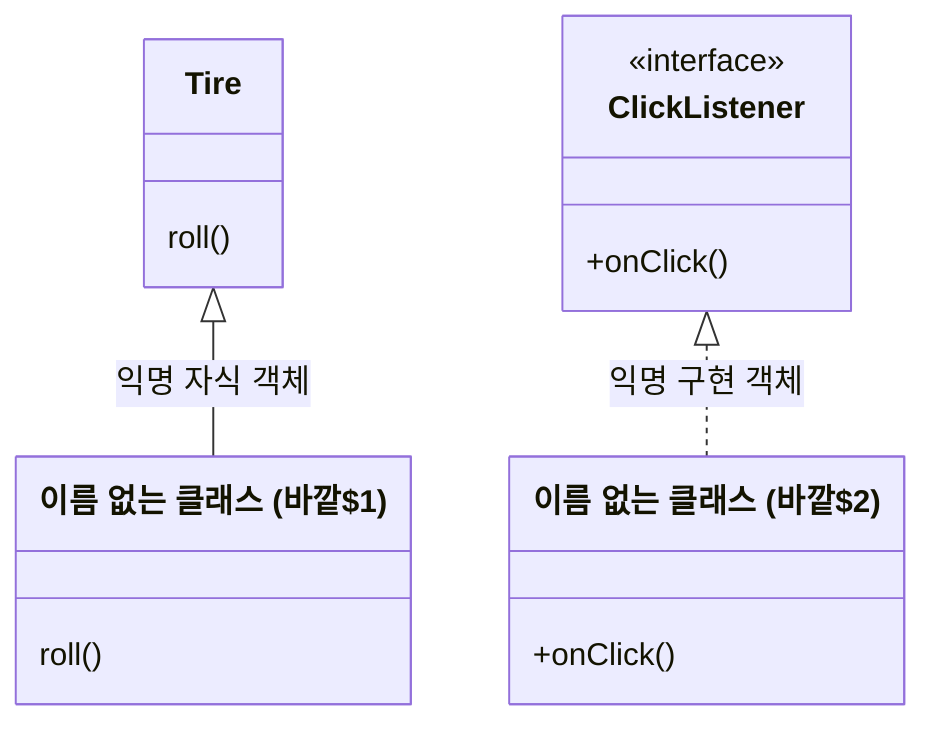


<div class="callout callout-summary" markdown="1">
<div class="callout-title callout-title--default" markdown="span">요약</div>

한 번 쓰고 말 클래스를, 이름도 짓지 않고 쓰는 그 자리에서 만들어 곧바로 객체 하나를 뽑는 방법이다. 일회용 메모지처럼 따로 파일을 만들고 이름을 붙이는 수고가 없다. 버튼을 눌렀을 때 할 일처럼 딱 한 곳에서만 쓰는 동작을 넘길 때 편하다. 대신 이름이 없어서 같은 것을 다른 곳에서 또 만들 수 없고, 부모나 인터페이스에 없는 메서드를 새로 넣어도 밖에서는 부를 수 없다.

</div>


## 예시로 보기

[중첩 클래스](/Hongs_Blog/studies/java/java-nested-class/)의 `Button`에 할 일을 넣으려면 `Button.ClickListener`를 구현한 클래스가 있어야 했다. 버튼이 스무 개면 `OkListener`, `CancelListener`, … 같은 클래스 스무 개를 따로 선언하고 이름을 지어야 한다. 그 클래스들은 각자 한 번씩만 쓰인다.

이름 붙인 클래스로 쓰면 이렇다.

```java
class OkListener implements Button.ClickListener {
    @Override
    public void onClick() { System.out.println("OK 버튼을 눌렀다"); }
}

btnOk.setClickListener(new OkListener());
```

클래스 선언을 건너뛰고 쓰는 자리에서 바로 몸통을 적으면 이렇다.

```java
Button btnOk = new Button();
btnOk.setClickListener(new Button.ClickListener() {
    @Override
    public void onClick() {
        System.out.println("OK 버튼을 눌렀다");
    }
});
btnOk.click();
```

```
OK 버튼을 눌렀다
```

`new Button.ClickListener() { … }`는 두 가지 일을 한 번에 한다. `ClickListener`를 구현한 이름 없는 클래스를 선언하고, 그 클래스의 객체를 하나 만든다. 인터페이스는 `new`로 만들 수 없지만 여기서 만들어진 것은 인터페이스의 객체가 아니다. 중괄호 안에 몸통을 채운 이름 없는 구현 클래스의 객체다[^s1].

이렇게 만든 객체를 익명 객체라고 부른다[^1].

<div class="callout callout-check" markdown="1">
<div class="callout-title" markdown="span">검증: 위 출력, 익명 자식 객체를 필드·지역 변수·매개변수 세 자리에 쓴 출력, 익명 객체의 클래스가 `Tire`의 자식이고 이름이 `바깥$숫자` 꼴인 것, 지역 변수 읽기, 카드 C3 — [31_java-anonymous-object_impl.java](/Hongs_Blog/studies/java/code/31_java-anonymous-object_impl/)</div>

</div>


## 정의

익명 객체는 이름이 없는 객체다. 클래스를 따로 선언하지 않아도 되어 쉽게 만든다[^1]. 만드는 바탕이 클래스냐 인터페이스냐에 따라 둘로 나뉜다.

| | 익명 자식 객체 | 익명 구현 객체 |
|---|---|---|
| 바탕 | 부모 클래스를 물려받는다 | 인터페이스를 구현한다 |
| 쓰는 꼴 | `new 부모생성자(매개값, …) { 필드, 메서드 }` | `new 인터페이스() { 필드, 메서드 }` |
| 넣을 수 있는 곳 | 부모 타입의 필드, 지역 변수, 매개변수 | 인터페이스 타입의 필드, 지역 변수, 매개변수 |

표는 슬라이드 두 쪽을 나란히 놓은 것이다[^2].

### 익명 자식 객체

부모 클래스를 물려받아 만든 객체다. 부모 타입의 필드, 지역 변수, 매개변수에 넣을 수 있다[^1].

```java
new 부모생성자(매개값, …) {
    // 필드
    // 메서드
}
```

중괄호 안에는 보통 부모의 메서드를 다시 정의한 것을 적는다. 세 자리에 하나씩 넣어 본다[^s2].

```java
class Tire {
    void roll() { System.out.println("일반 타이어가 굴러간다"); }
}

class Car {
    // 필드에 넣는다
    private Tire tire1 = new Tire() {
        @Override
        void roll() { System.out.println("익명 자식 객체 1이 굴러간다"); }
    };

    void run1() { tire1.roll(); }

    void run2() {
        // 지역 변수에 넣는다
        Tire tire2 = new Tire() {
            @Override
            void roll() { System.out.println("익명 자식 객체 2가 굴러간다"); }
        };
        tire2.roll();
    }

    // 매개변수로 받는다
    void run3(Tire tire) { tire.roll(); }
}
```

```java
Car car = new Car();
car.run1();
car.run2();
car.run3(new Tire() {
    @Override
    void roll() { System.out.println("익명 자식 객체 3이 굴러간다"); }
});
```

```
익명 자식 객체 1이 굴러간다
익명 자식 객체 2가 굴러간다
익명 자식 객체 3이 굴러간다
```

세 번 모두 변수의 타입은 `Tire`인데 `Tire`의 "일반 타이어가 굴러간다"는 한 번도 찍히지 않았다. 변수에 든 객체가 `roll`을 다시 정의한 이름 없는 자식 클래스의 객체이기 때문이다([다형성](/Hongs_Blog/studies/java/java-polymorphism/)).

필드와 지역 변수에 넣을 때는 닫는 중괄호 뒤에 세미콜론을 붙인다. `Tire tire2 = new Tire() { … };` 전체가 대입문 하나이기 때문이다. 빼면 `';' expected` 오류다[^s3].

### 익명 구현 객체

인터페이스를 구현해 만든 객체다. 인터페이스 타입의 필드, 지역 변수, 매개변수에 넣을 수 있다. 안드로이드 같은 화면 프로그램에서 이벤트를 처리할 때 널리 쓴다[^3].

```java
new 인터페이스() {
    // 필드
    // 메서드
}
```

중괄호 안에서 인터페이스의 추상 메서드를 모두 다시 정의해야 한다. 하나라도 빠뜨리면 `<anonymous Main$1> is not abstract and does not override abstract method` 오류가 난다. `예시로 보기`의 `Button.ClickListener`가 익명 구현 객체다[^s3].

### 이름은 없지만 클래스는 있다

익명 객체도 클래스에서 만들어진다. 그 클래스에 프로그래머가 붙인 이름이 없을 뿐이다. 컴파일러는 `바깥클래스이름$1`, `바깥클래스이름$2`처럼 번호를 붙인 클래스 파일을 만든다[^s1].



익명 자식 객체의 클래스는 부모 클래스의 자식이고, 익명 구현 객체의 클래스는 인터페이스의 구현 클래스다. 이름이 없다는 점만 빼면 보통의 상속, 구현과 같다[^s1].

### 이름이 없어서 생기는 제약

네 가지다[^s3].

- **새로 넣은 메서드는 밖에서 못 부른다.** 중괄호 안에 부모에 없는 `spin()`을 넣어도 `Tire t = new Tire() { … };` 뒤에 `t.spin()`은 `cannot find symbol` 오류다. 변수의 타입 `Tire`에 `spin`이 없고, 강제 변환하려 해도 적을 클래스 이름이 없다. 중괄호 안의 다른 메서드에서는 부를 수 있다.
- **생성자를 직접 쓸 수 없다.** 생성자는 클래스 이름과 같아야 하는데 이름이 없다.
- **한 곳에서 객체 하나만 만든다.** 같은 몸통으로 객체를 여러 곳에서 만들려면 이름 있는 클래스로 선언한다.
- **바깥 메서드의 지역 변수는 읽기만 한다.** 익명 객체 안에서 읽는 지역 변수는 값을 한 번 넣은 뒤 바꾸지 않은 것이어야 한다. `count++`처럼 바꾸면 `local variables referenced from an inner class must be final or effectively final` 오류다. 로컬 클래스와 같은 규칙이다.

## 활용

- 구현: [31_java-anonymous-object_impl.java](/Hongs_Blog/studies/java/code/31_java-anonymous-object_impl/)
- 고르는 기준: 그 몸통을 한 곳에서 한 번만 쓰면 익명 객체, 여러 곳에서 쓰거나 몸통이 길면 이름 있는 클래스로 선언한다[^s3].
- 익명 객체는 만들어진 자리의 지역 변수를 읽을 수 있어서, 값을 넘겨받을 생성자가 없어도 필요한 값을 쓴다. `String who = "철수";` 뒤에 만든 익명 객체의 `onClick` 안에서 `who + "가 눌렀다"`를 찍으면 `철수가 눌렀다`가 나온다[^s3].

## 연결

- 선수: [중첩 클래스](/Hongs_Blog/studies/java/java-nested-class/)(익명 객체의 클래스도 다른 클래스 안에 선언된 클래스다), [인터페이스](/Hongs_Blog/studies/java/java-interface/), [메서드 오버라이딩](/Hongs_Blog/studies/java/java-overriding/)
- 변수의 타입은 부모인데 익명 객체의 몸통이 실행되는 까닭: [다형성](/Hongs_Blog/studies/java/java-polymorphism/)
- 익명 자식 객체가 물려받는 것: [상속](/Hongs_Blog/studies/java/java-inheritance/). `new 부모생성자(매개값, …)`의 매개값이 넘어가는 곳: [생성자](/Hongs_Blog/studies/java/java-constructor/)

## 확인 문제

<details class="callout callout-question" markdown="1">
<summary class="callout-title" markdown="span">**C1** (가)~(마) 가운데 컴파일 오류가 나는 줄을 모두 고르고 이유를 쓰라.</summary>

```java
interface Greeter { void hello(); }
class Main {
    public static void main(String[] args) {
        int count = 0;
        Greeter g = new Greeter() {
            public void hello() { System.out.println("hi"); }
            void bye() { System.out.println("bye"); }   // (가)
        };
        g.hello();                                      // (나)
        g.bye();                                        // (다)
        Greeter h = new Greeter() {
            public void hello() { count++; }            // (라)
        };
        Greeter k = new Greeter() { };                  // (마)
    }
}
```
**답:** (다), (라), (마).<br>
**이유:** (다) `bye`는 `Greeter`에 없어서 `g`로 부를 수 없다. (라) 익명 객체 안에서 바깥 지역 변수 `count`의 값을 바꿀 수 없다. (마) 추상 메서드 `hello`를 채우지 않았다. (가)처럼 새 메서드를 선언하는 것 자체는 오류가 아니다. 밖에서 부를 길이 없을 뿐이다. 흔한 오답은 (가)를 오류로 고르고 (다)를 놓치는 것이다[^s3].

</details>


<details class="callout callout-question" markdown="1">
<summary class="callout-title" markdown="span">**C2** `new Button.ClickListener() { … }`는 인터페이스에 `new`를 썼는데 왜 오류가 아닌가?</summary>

**답:** 만들어지는 것이 인터페이스의 객체가 아니기 때문이다. 뒤따르는 중괄호가 `ClickListener`를 구현한 이름 없는 클래스의 몸통이고, `new`는 그 클래스의 객체를 만든다.<br>
**이유:** 중괄호 없이 `new Button.ClickListener()`만 쓰면 `is abstract; cannot be instantiated` 오류가 난다. 몸통을 채운 클래스가 있어야 객체를 만들 수 있다.

</details>


<details class="callout callout-question" markdown="1">
<summary class="callout-title" markdown="span">**C3** 본문의 `Tire`가 있을 때 이 코드의 출력은?</summary>

```java
Tire t1 = new Tire();
Tire t2 = new Tire() {
    @Override
    void roll() {
        System.out.println("특수 타이어");
        super.roll();
    }
};
t1.roll();
t2.roll();
System.out.println(t1.getClass() == t2.getClass());
```
**답:**
```
일반 타이어가 굴러간다
특수 타이어
일반 타이어가 굴러간다
false
```
**이유:** `t2`는 `Tire`의 이름 없는 자식 클래스의 객체다. 다시 정의한 `roll`이 "특수 타이어"를 찍고 `super.roll()`로 부모의 `roll`을 부른다. 두 객체의 클래스는 다르므로 마지막은 `false`다. 흔한 오답은 "둘 다 `new Tire`이니 `true`"다[^s2].

</details>


[^1]: 소프트웨어 프로젝트 13회 강의 자료 「Software Project 13. Nested Declarations and Anonymous Objects」, p.12 (익명 객체의 뜻, 익명 자식 객체, `new 부모생성자(매개값, …) { //필드 //메소드 }`)
[^2]: 같은 자료, p.12~13
[^3]: 같은 자료, p.13 (익명 구현 객체, `new 인터페이스() { //필드 //메소드 }`, 이벤트 처리에 널리 쓴다)
[^s1]: <span class="fn-tag" title="수업 자료에 없고 따로 보탠 내용">보충</span> `Button.ClickListener`로 만든 예와 출력, `new 인터페이스() { … }`가 하는 두 가지 일, 컴파일러가 붙이는 클래스 이름, 클래스 그림은 원본에 없다. 슬라이드에는 쓰는 꼴만 있다. 구현 코드에서 익명 객체의 클래스가 `Tire`와 다르고 부모가 `Tire`이며 이름이 `AnonymousCheck$3`인 것, 익명 구현 객체의 클래스가 `ClickListener`를 구현한 것을 확인했다(Java Language Specification §15.9.5).
[^s2]: <span class="fn-tag" title="수업 자료에 없고 따로 보탠 내용">보충</span> `Tire`·`Car`로 세 자리에 넣는 예와 출력, 카드 C3은 원본에 없다. 슬라이드 p.12의 "필드, 지역 변수, 매개변수에 넣을 수 있다"를 코드로 옮겼고 구현 코드로 출력을 확인했다.
[^s3]: <span class="fn-tag" title="수업 자료에 없고 따로 보탠 내용">보충</span> 세미콜론, 추상 메서드를 빠뜨렸을 때의 오류, 네 가지 제약, 고르는 기준, 지역 변수 읽기, 카드 C1·C2는 원본에 없다. JDK 21에서 직접 컴파일하고 실행해 확인했다. 카드 C1의 (라)는 다른 오류를 지운 코드에서 따로 확인했다.

