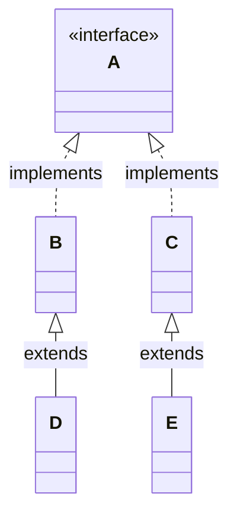


<div class="callout callout-summary" markdown="1">
<div class="callout-title callout-title--default" markdown="span">요약</div>

버스 한 대를 "탈것"이라고만 적힌 이름표로 부르면, 탈것이라면 누구나 하는 일만 시킬 수 있다. 좁은 이름표에서 넓은 이름표로 바꾸는 것은 늘 안전해서 아무것도 안 써도 된다. 반대로 "탈것" 이름표를 "버스"로 바꾸려면 바꾸겠다고 직접 써야 하고, 알고 보니 택시였다면 프로그램이 실행 도중에 멈춘다. 그래서 바꾸기 전에 진짜 버스인지 먼저 물어본다. 어느 쪽이든 바뀌는 것은 이름표뿐이고 버스 자체는 그대로다.

</div>


## 예시로 보기

`Vehicle vehicle = new Bus();`로 버스를 탈것 변수에 넣으면 `vehicle.run()`은 부를 수 있다. 그런데 버스에만 있는 요금 확인 `checkFare()`는 부를 수 없다. 객체에 그 메서드가 분명히 있는데도 그렇다. 버스만 하는 일을 다시 시키려면 변수의 타입을 `Bus`로 되돌려야 한다[^1].

```java
interface Vehicle {
    void run();
}

class Bus implements Vehicle {
    @Override
    public void run() { System.out.println("Bus is running"); }
    public void checkFare() { System.out.println("Check fare"); }
}

class Taxi implements Vehicle {
    @Override
    public void run() { System.out.println("Taxi is running"); }
}
```

```java
Vehicle vehicle = new Bus();   // Bus → Vehicle: 그냥 된다
vehicle.run();
// vehicle.checkFare();        // 컴파일 오류: cannot find symbol

Bus bus = (Bus) vehicle;       // Vehicle → Bus: (Bus)를 써야 한다
bus.run();
bus.checkFare();
System.out.println(bus == vehicle);
```

```
Bus is running
Bus is running
Check fare
true
```

마지막 줄이 `true`다. `bus`와 `vehicle`은 같은 객체 하나를 가리킨다. 타입을 바꿔도 객체는 새로 생기지 않고 달라지지도 않는다[^s1].

```
        스택                         힙
   ┌───────────────┐
   │ vehicle  ─────┼──────┐     ┌──────────────────┐
   │ (Vehicle 타입) │      ├────▶│   Bus 객체        │
   ├───────────────┤      │     │   run()          │
   │ bus      ─────┼──────┘     │   checkFare()    │
   │ (Bus 타입)     │            └──────────────────┘
   └───────────────┘
   vehicle로는 run()만 보인다. bus로는 run()과 checkFare()가 보인다.
```

`Bus → Vehicle`처럼 쓰지 않아도 되는 변환을 자동 변환, `(Bus)`처럼 괄호에 타입을 써서 하는 변환을 강제 변환이라고 부른다[^2].

<div class="callout callout-check" markdown="1">
<div class="callout-title" markdown="span">검증: 위 출력, A·B·C·D·E 다섯 타입의 자동 변환, Taxi를 Bus로 바꿀 때의 `ClassCastException`, `instanceof` 결과 네 가지, 카드 C2·C3 — [28_java-casting_impl.java](/Hongs_Blog/studies/java/code/28_java-casting_impl/)</div>

</div>


## 정의

### 자동 변환

구현 객체를 인터페이스 변수에 넣으면 구현 객체가 인터페이스 타입으로 자동으로 바뀐다. 부모 클래스가 인터페이스를 구현했다면 자식 클래스의 객체도 그 인터페이스 타입으로 자동으로 바뀐다[^2].



```java
B b = new B();
C c = new C();
D d = new D();
E e = new E();

A a;
a = b;   // 된다
a = c;   // 된다
a = d;   // 된다. D의 부모 B가 A를 구현했다
a = e;   // 된다. E의 부모 C가 A를 구현했다
```

그림에서 화살표를 따라 위로 올라가는 방향은 모두 자동 변환이다. D 객체는 B의 메서드를 다 물려받았고, B는 A의 메서드를 다 채웠으니, D 객체도 A의 메서드를 다 가졌다. 그래서 확인할 것이 없다[^s2].

슬라이드는 인터페이스와 구현 클래스 사이의 변환만 적었다. 부모 클래스와 자식 클래스 사이에도 같은 규칙이 통한다. 자식 객체는 부모 타입 변수에 그냥 들어간다([상속](/Hongs_Blog/studies/java/java-inheritance/))[^s2].

자동 변환을 하고 나면 인터페이스에 선언된 메서드만 쓸 수 있다[^3].

### 강제 변환

인터페이스 타입을 구현 클래스 타입으로 되돌리는 변환이다. 변수 앞에 괄호를 치고 바꿀 타입을 쓴다(캐스팅 연산자). 구현 클래스에만 있는 다른 메서드를 부르고 싶을 때 쓴다[^3].

```java
InterfaceA ia = new ClassImpl();
ClassImpl var = (ClassImpl) ia;
```

괄호 없이 `Bus bus = vehicle;`이라고 쓰면 `incompatible types: Vehicle cannot be converted to Bus` 오류다. 탈것이 모두 버스는 아니어서 컴파일러가 그냥 넘겨주지 않는다[^s1].

`(Bus)`를 쓰면 컴파일러는 믿고 통과시킨다. 진짜 확인은 실행할 때 한다. 들어 있는 객체가 Bus가 아니면 그 줄에서 `ClassCastException`이 나고 프로그램이 멈춘다[^s3].

```java
Vehicle vehicle = new Taxi();
Bus bus = (Bus) vehicle;   // 컴파일은 통과. 실행하면 ClassCastException
```

```
java.lang.ClassCastException: class Taxi cannot be cast to class Bus
```

| | 누가 확인하나 | 무엇을 보나 | 틀리면 |
|---|---|---|---|
| 자동 변환 `Vehicle v = bus;` | 컴파일러 | 변수의 타입끼리의 관계 | 컴파일 오류 |
| 강제 변환 `(Bus) v`를 써도 되는가 | 컴파일러 | 두 타입이 이어질 가능성이 있는가 | 컴파일 오류 |
| 강제 변환이 실제로 되는가 | 실행 중의 자바 가상 기계 | 변수에 들어 있는 객체의 클래스 | `ClassCastException` |

둘째 줄의 예: 서로 부모·자식이 아닌 두 클래스 `Bus`와 `Taxi` 사이에서 `(Taxi) busVariable`을 쓰면 실행해 볼 것도 없이 `incompatible types: Bus cannot be converted to Taxi`로 막힌다[^s3].

### instanceof

강제 변환을 하기 전에, 변수에 든 객체가 그 타입이 맞는지 물어보는 연산자다. `변수 instanceof 타입`은 맞으면 `true`, 아니면 `false`다[^s3].

```java
Vehicle v1 = new Bus();
Vehicle v2 = new Taxi();
Vehicle v3 = null;
```

| 식 | 값 | 까닭 |
|---|---|---|
| `v1 instanceof Bus` | `true` | 든 객체가 Bus다 |
| `v1 instanceof Vehicle` | `true` | Bus는 Vehicle을 구현했다 |
| `v2 instanceof Bus` | `false` | 든 객체가 Taxi다 |
| `v3 instanceof Bus` | `false` | 든 객체가 없다. `null`은 늘 `false` |

먼저 묻고 맞을 때만 바꾸면 `ClassCastException`이 날 일이 없다.

```java
static void ride(Vehicle vehicle) {
    vehicle.run();
    if (vehicle instanceof Bus) {
        Bus bus = (Bus) vehicle;
        bus.checkFare();
    }
}
```

`ride(new Bus())`는 `Bus is running`, `Check fare`를 찍고, `ride(new Taxi())`는 `Taxi is running`만 찍는다.

Java 16부터는 묻기와 바꾸기를 한 줄에 쓸 수 있다. `instanceof` 뒤에 타입과 새 변수 이름을 함께 적는다. 맞으면 그 변수에 이미 변환된 객체가 들어 있다[^s3].

```java
if (vehicle instanceof Bus bus) {
    bus.checkFare();
}
```

## 활용

- 구현: [28_java-casting_impl.java](/Hongs_Blog/studies/java/code/28_java-casting_impl/)
- 강제 변환이 자주 필요하다면 설계를 다시 본다. 탈것마다 다르게 해야 하는 일이면 인터페이스에 메서드를 올리고 각자 다시 정의하게 하는 쪽이 `instanceof`로 갈라 쓰는 것보다 낫다. 새 탈것이 생겨도 쓰는 쪽을 고치지 않기 때문이다([다형성](/Hongs_Blog/studies/java/java-polymorphism/))[^s3].
- 숫자의 타입 변환과 헷갈리지 않는다. `(int) 3.7`은 값이 3으로 바뀐다([타입 변환](/Hongs_Blog/studies/java/java-type-conversion/)). `(Bus) vehicle`은 값도 객체도 바뀌지 않고, 변수로 부를 수 있는 메서드의 범위만 바뀐다.

## 연결

- 선수: [인터페이스](/Hongs_Blog/studies/java/java-interface/), [상속](/Hongs_Blog/studies/java/java-inheritance/), [참조 타입과 메모리 영역](/Hongs_Blog/studies/java/java-reference-types/)
- 부모·자식 인터페이스 변수 사이의 대입: [다중 구현과 인터페이스 상속](/Hongs_Blog/studies/java/java-interface-inheritance/)
- 자동 변환 위에서 돌아가는 것: [다형성](/Hongs_Blog/studies/java/java-polymorphism/)
- 실행 중에 나는 오류를 다루는 법: [예외와 예외 클래스](/Hongs_Blog/studies/java/java-exception/)

## 자주 하는 오해

<div class="callout callout-misconception" markdown="1">
<div class="callout-title" markdown="span">"`(Bus) vehicle`은 객체를 Bus로 바꿔 준다"</div>

틀렸다. 강제 변환은 객체를 건드리지 않는다. 그럴듯해 보이는 이유는 `(int) 3.7`이 값을 3으로 바꾸는 것을 먼저 배웠기 때문이다. 참조 타입에서는 다르다. 객체의 클래스는 `new`로 만들 때 정해지고 끝까지 바뀌지 않는다. `(Bus)`는 "이 변수에 든 것은 Bus가 맞으니 Bus로 다루겠다"고 주장하는 것이고, 자바는 실행할 때 그 주장이 맞는지 확인만 한다. 그래서 Taxi 객체에 `(Bus)`를 써도 Taxi가 Bus가 되지 않고 `ClassCastException`이 난다. 확인하는 법: 변환 전후의 변수를 `==`로 비교하면 `true`다. 같은 객체다.

</div>


## 확인 문제

<details class="callout callout-question" markdown="1">
<summary class="callout-title" markdown="span">**C1** `예시로 보기`의 `Vehicle`, `Bus`, `Taxi`가 있다. (가)~(라)를 "문제없다 / 컴파일 오류 / 컴파일은 되지만 실행 중 오류"로 나누고 이유를 쓰라.</summary>

```java
Vehicle v = new Taxi();
v.run();              // (가)
v.checkFare();        // (나)
Bus b1 = v;           // (다)
Bus b2 = (Bus) v;     // (라)
```
**답:** (가) 문제없다. (나) 컴파일 오류. (다) 컴파일 오류. (라) 컴파일은 되지만 실행 중 `ClassCastException`.<br>
**이유:** (나) `Vehicle`에는 `checkFare`가 없다. (다) 넓은 타입을 좁은 타입 변수에 괄호 없이 넣을 수 없다. (라) 컴파일러는 `(Bus)`를 믿고 통과시키지만 실행할 때 든 객체가 Taxi라서 멈춘다. 흔한 오답은 (라)를 컴파일 오류로 고르는 것이다. 컴파일러는 변수에 실제로 무엇이 들어갈지 모른다[^s1].

</details>


<details class="callout callout-question" markdown="1">
<summary class="callout-title" markdown="span">**C2** 이 코드의 출력은?</summary>

```java
Vehicle[] list = { new Taxi(), new Bus(), new Taxi() };
int count = 0;
for (Vehicle x : list) {
    if (x instanceof Bus) {
        ((Bus) x).checkFare();
        count++;
    }
}
System.out.println(count);
```
**답:**
```
Check fare
1
```
**이유:** 세 칸 가운데 둘째 칸만 Bus 객체다. `instanceof`가 `true`인 그 칸에서만 강제 변환과 `checkFare()`가 실행된다[^s3].

</details>


<details class="callout callout-question" markdown="1">
<summary class="callout-title" markdown="span">**C3** 본문의 A, B, C, D, E에서 `A x = new D();` 뒤에 `B p = (B) x;`는 문제없고 `C q = (C) x;`는 실행 중 오류다. 둘 다 컴파일은 통과한다. 이유를 쓰라.</summary>

**답:** `x`에 든 객체는 D다. D는 B의 자식이라 B로 다룰 수 있다. D는 C와 아무 관계가 없어서 C로 다룰 수 없고 `ClassCastException`이 난다.<br>
**이유:** 컴파일러는 변수의 타입 `A`만 본다. A를 구현한 객체 가운데는 B도 C도 있을 수 있으니 두 줄 다 통과시킨다. 실제로 든 객체가 무엇인지는 실행할 때 확인한다[^s3].

</details>


[^1]: 소프트웨어 프로젝트 12회 강의 자료 「Software Project 12. Interface (2)」, p.15 (`Vehicle`, `Bus`, `vehicle.checkFare(); // error`, `Bus bus = (Bus) vehicle;`)
[^2]: 같은 자료, p.13 (자동 변환, 인터페이스 A와 클래스 B·C·D·E 그림, `a = b; (possible)` 네 줄)
[^3]: 같은 자료, p.14 (강제 변환, `ClassImpl var = (ClassImpl) ia;`, 자동 변환 뒤에는 인터페이스의 메서드만 쓸 수 있다)
[^s1]: <span class="fn-tag" title="수업 자료에 없고 따로 보탠 내용">보충</span> `Taxi` 클래스, 실행 출력, `bus == vehicle`, 메모리 그림, 오류 메시지, 카드 C1은 원본에 없다. 슬라이드 p.15의 코드를 실행할 수 있게 채웠고 구현 코드와 JDK 21 컴파일로 확인했다. `Taxi`는 같은 자료 p.17의 클래스를 가져왔다.
[^s2]: <span class="fn-tag" title="수업 자료에 없고 따로 보탠 내용">보충</span> 자동 변환이 늘 안전한 까닭과 클래스 상속에도 같은 규칙이 통한다는 설명은 원본에 없다. 클래스 그림은 슬라이드 p.13의 그림을 Mermaid로 옮긴 것이다(Java Language Specification §5.1.5).
[^s3]: <span class="fn-tag" title="수업 자료에 없고 따로 보탠 내용">보충</span> `ClassCastException`, 확인 시점 표, `instanceof`와 Java 16의 패턴 매칭, `ride` 메서드, 활용의 설계 조언, 오해 항목, 카드 C2·C3은 원본에 없다. 슬라이드에는 `instanceof`가 나오지 않는다. JDK 21에서 직접 실행해 확인했다(Java Language Specification §5.5, §15.20.2).

