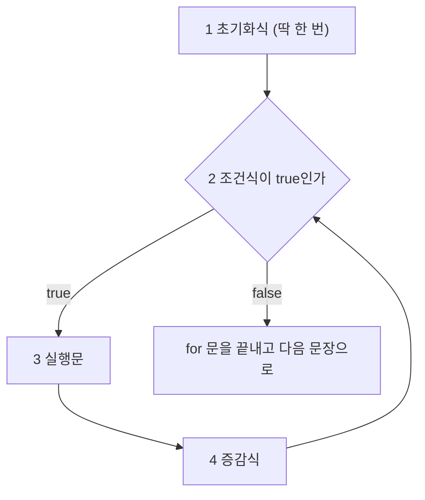


<div class="callout callout-summary" markdown="1">
<div class="callout-title callout-title--default" markdown="span">요약</div>

프로그램은 책처럼 위에서 아래로 한 줄씩 읽힌다. 제어문은 그 길에 놓는 갈림길과 되돌아가는 길이다. 조건에 따라 한 덩어리를 건너뛰거나 둘 중 하나를 고르고, 같은 덩어리를 여러 번 되풀이한다. 덕분에 같은 코드를 백 번 적지 않아도 된다. 대신 여러 갈래 중 하나를 고르는 문에서 "여기서 나가라"는 표시를 빼먹으면 아래 갈래까지 줄줄이 실행되고, 소수로 횟수를 세면 한 번이 모자라거나 남는다.

</div>


## 예시로 보기

1부터 100까지 더하는 프로그램을 제어문 없이 쓰면 `sum = sum + 1;`부터 `sum = sum + 100;`까지 백 줄이다. 더할 수가 실행 중에 정해진다면 아예 쓸 수 없다. 반복문 하나면 세 줄이다.

```java
int sum = 0;
for (int i = 1; i <= 100; i++) {
    sum += i;
}
// sum = 5050
```

실행은 `main()` 메서드의 여는 중괄호 `{`에서 닫는 중괄호 `}`까지 위에서 아래로 흐른다. 이 흐름을 원하는 쪽으로 바꾸는 문장이 제어문이다. 조건이 맞을 때만 실행하는 것(조건문)과, 끝까지 간 뒤 처음으로 되돌아가 다시 실행하는 것(반복문)이 있다[^1].

<div class="callout callout-check" markdown="1">
<div class="callout-title" markdown="span">검증: 등급 예와 경계 점수, `break`가 있는 `switch`와 없는 `switch`의 출력, `for` 추적 표, 1 ~ 100의 합 5050, `float`로 센 횟수 9번, `do-while` 1번, 안쪽 `break`의 출력, `continue`의 출력, 카드 C1·C3 — [06_java-control-flow_impl.java](/Hongs_Blog/studies/java/code/06_java-control-flow_impl/)</div>

</div>


## 조건문

### if

`if`는 조건의 결과를 보고 블록을 실행할지 정한다. 조건 자리에는 `true`나 `false`가 되는 식(또는 `boolean` 변수)이 온다. `true`면 블록을 실행하고 `false`면 건너뛴다. `else`를 붙이면 `false`일 때 대신 실행할 블록을 둘 수 있다[^2].

```java
if (score >= 90) {
    grade = "A";
} else if (score >= 80) {
    grade = "B";
} else {
    grade = "C";
}
```

조건은 위에서부터 차례로 본다. 처음 맞는 블록 하나만 실행하고 나머지는 보지 않는다. 85점이면 첫 조건이 `false`, 둘째가 `true`라 `"B"`다. 95점은 둘째 조건에도 맞지만 첫 블록에서 이미 끝났으므로 `"A"`다[^s1].

### switch

`switch`는 괄호 안 변수의 값과 같은 `case`를 찾아 그 아래 문장을 실행한다. 맞는 `case`가 없으면 `default`로 간다. `default`는 없어도 된다[^3].

```java
switch (n) {
    case 1:
        System.out.print("one ");
        break;
    case 2:
        System.out.print("two ");
        break;
    default:
        System.out.print("other ");
}
```

`break`는 `switch`를 빠져나가라는 표시다. `break`를 빼면 다음 `case`의 문장까지 이어서 실행한다[^3]. `case`는 "여기서부터 시작하라"는 입구일 뿐 칸막이가 아니다. 위 코드에서 `break` 둘을 지우면 출력이 이렇게 달라진다[^s1].

| `n` | `break`가 있을 때 | `break`를 지웠을 때 |
|---|---|---|
| 1 | `one` | `one two other` |
| 2 | `two` | `two other` |
| 9 | `other` | `other` |

## 반복문

### for

`for`는 문장을 여러 번 되풀이한다. 괄호 안에 세 가지를 적는다[^4].

```java
for (①초기화식; ②조건식; ④증감식) {
    ③실행문;
}
```



1. 초기화식을 먼저 한 번 실행한다.
2. 조건식을 본다. `false`면 `for`를 끝내고 블록을 건너뛴다.
3. `true`면 실행문을 실행한다.
4. 증감식을 실행하고 2로 돌아간다. 2 → 3 → 4가 조건이 `false`가 될 때까지 되풀이된다.

`for (int i = 1; i <= 3; i++) { sum += i; }`를 `sum = 0`에서 따라가 본다[^s1].

| 바퀴 | 조건을 볼 때의 `i` | `i <= 3` | 실행문 뒤 `sum` | 증감식 뒤 `i` |
|---|---|---|---|---|
| 1 | 1 | `true` | 1 | 2 |
| 2 | 2 | `true` | 3 | 3 |
| 3 | 3 | `true` | 6 | 4 |
| 4 | 4 | `false` | 실행 안 함 | — |

조건식은 네 번, 실행문은 세 번 실행된다. 조건이 처음부터 `false`면 실행문은 한 번도 실행되지 않는다.

**초기화식에 `float`를 쓰지 않는다**[^4]. 0.1부터 1.0까지 0.1씩 올리면 열 번 돌 것 같지만 아홉 번 돈다[^s1].

```java
int count = 0;
for (float x = 0.1f; x <= 1.0f; x += 0.1f) {
    count++;
}
// count = 9
```

`0.1f`는 정확한 0.1이 아니다. 열 번 더한 값이 `1.0000001`이 되어 마지막 바퀴의 조건 `x <= 1.0f`가 `false`가 된다([부동소수점](/Hongs_Blog/studies/data-and-information/floating-point/)). 횟수는 정수로 센다.

### while과 do-while

슬라이드는 `while`과 `do-while`을 `break`와 `continue`의 대상으로만 든다[^5]. 모양은 다음과 같다[^s2].

| 반복문 | 모양 | 조건을 보는 때 | 최소 실행 횟수 |
|---|---|---|---|
| `while` | `while (조건) { ... }` | 블록 앞 | 0번 |
| `do-while` | `do { ... } while (조건);` | 블록 뒤 | 1번 |

횟수가 정해져 있으면 `for`, 조건만 있으면 `while`이 읽기 쉽다.

## break와 continue

| 문장 | 하는 일 | 쓸 수 있는 곳 |
|---|---|---|
| `break` | 반복문이나 `switch`를 그 자리에서 끝낸다 | `for`, `while`, `do-while`, `switch`[^5] |
| `continue` | 이번 바퀴의 남은 문장을 건너뛰고 다음 바퀴로 간다. `for`에서는 증감식으로, `while`과 `do-while`에서는 조건식으로 간다 | `for`, `while`, `do-while`만[^6] |

`continue`는 `break`와 달리 반복문을 끝내지 않는다[^6].

```java
for (int j = 1; j <= 7; j++) {
    if (j % 2 == 0) continue;    // 짝수면 아래를 건너뛰고 j++로 간다
    System.out.print(j + " ");
}
// 1 3 5 7
```

반복문이 겹쳐 있을 때 `break`는 자기를 감싼 가장 안쪽 반복문 하나만 끝낸다[^s1].

```java
for (int a = 1; a <= 3; a++) {
    for (int b = 1; b <= 3; b++) {
        if (b == 2) break;       // 안쪽 for만 끝난다
        System.out.print(a + "" + b + " ");
    }
}
// 11 21 31
```

## 활용

- 값 하나를 여러 정해진 값과 견줄 때는 `switch`, 범위나 여러 변수가 얽힌 조건은 `if`가 맞다. `switch`의 괄호에는 정수, 글자, 문자열을 넣을 수 있다[^s2].
- 흔한 실수: `switch`에서 `break`를 빼먹는다. 일부러 뺀 것이면 주석으로 남긴다. 같은 일을 하는 `case` 여럿을 `case "토": case "일":`처럼 붙여 쓰는 것은 이 성질을 일부러 쓰는 예다.
- 흔한 실수: 중괄호 없이 `if` 아래에 두 줄을 들여 쓴다. 중괄호가 없으면 `if`는 바로 다음 한 문장만 잡는다. 둘째 줄은 들여쓰기와 상관없이 늘 실행된다[^s1].
- 흔한 실수: `while` 안에서 `continue`보다 뒤에 증가 문장을 둔다. `continue`가 증가를 건너뛰어 같은 값으로 끝없이 돈다. `for`는 증감식이 따로 있어 이 문제가 없다.
- 흔한 실수: `i <= 길이`로 배열을 돈다. 마지막 번호는 길이보다 1 작다([배열](/Hongs_Blog/studies/java/java-array/)).

## 연결

- 선수: [연산자와 오버플로](/Hongs_Blog/studies/java/java-operators/) (조건식을 만드는 비교·논리 연산자)
- 블록 안에서 만든 변수가 블록 밖에서 안 보이는 이유: [변수와 기본 타입](/Hongs_Blog/studies/java/java-primitive-types/)
- 번호 없이 배열을 처음부터 끝까지 도는 `for`: [배열](/Hongs_Blog/studies/java/java-array/)

## 확인 문제

<details class="callout callout-question" markdown="1">
<summary class="callout-title" markdown="span">**C1** 다음 코드의 출력은?</summary>

```java
for (int j = 0; j < 6; j++) {
    if (j == 1) continue;
    if (j == 4) break;
    System.out.print(j);
}
```
**답:** `023`<br>
**이유:** 0을 찍는다. 1에서 `continue`라 찍지 않고 다음 바퀴로 간다. 2, 3을 찍는다. 4에서 `break`라 반복문이 끝난다. 5는 가 보지도 않는다. `0235`는 `break`를 `continue`처럼 읽은 오답이다.

</details>


<details class="callout callout-question" markdown="1">
<summary class="callout-title" markdown="span">**C2** 반복문 안에서 ① 찾던 값을 발견해 더 볼 필요가 없다 ② 이번 값만 처리하지 않고 넘어가고 싶다. 각각 `break`와 `continue` 중 무엇을 쓰는가? 다른 쪽을 쓰면 어떻게 되는가?</summary>

**답:** ①은 `break`, ②는 `continue`.<br>
**이유:** ①에 `continue`를 쓰면 답을 찾고도 끝까지 헛돈다. ②에 `break`를 쓰면 그 뒤의 값들을 하나도 처리하지 못한다. `break`는 반복문 전체를, `continue`는 이번 바퀴만 끝낸다.

</details>


<details class="callout callout-question" markdown="1">
<summary class="callout-title" markdown="span">**C3** 아래 `switch`에서 `n`이 1일 때와 2일 때의 출력을 쓰라.</summary>

```java
switch (n) {
    case 1: System.out.print("one ");
    case 2: System.out.print("two ");
    default: System.out.print("other ");
}
```
**답:** 1일 때 `one two other`, 2일 때 `two other`.<br>
**이유:** `break`가 없어서 맞는 `case`부터 아래로 끝까지 실행한다. `case`는 들어가는 곳만 정한다.

</details>


<details class="callout callout-question" markdown="1">
<summary class="callout-title" markdown="span">**C4** `for (float x = 0.1f; x <= 1.0f; x += 0.1f)`는 왜 열 번이 아니라 아홉 번 도는가? 열 번 돌게 하려면 어떻게 쓰는가?</summary>

**답:** `0.1f`가 정확한 0.1이 아니라서 열 번째 바퀴에 들어갈 때 `x`가 `1.0000001`이 되고, `x <= 1.0f`가 `false`다. `for (int i = 1; i <= 10; i++)`로 정수로 세고, 필요하면 블록 안에서 `float x = i * 0.1f;`로 만든다.<br>
**이유:** 정수 덧셈에는 오차가 없다. 소수는 더할 때마다 오차가 쌓여 경계에서 한 번이 어긋난다.

</details>


[^1]: 소프트웨어 프로젝트 3회 강의 자료 「Software Project 03. Java Language Basics (2)」, p.17 (실행 흐름과 제어문)
[^2]: 같은 자료, p.18 (if, if-else)
[^3]: 같은 자료, p.19 (switch, default, break)
[^4]: 같은 자료, p.20 (for의 실행 순서, float 주의)
[^5]: 같은 자료, p.21 (break)
[^6]: 같은 자료, p.22 (continue)
[^s1]: <span class="fn-tag" title="수업 자료에 없고 따로 보탠 내용">보충</span> 1 ~ 100의 합, 등급 예, `break`를 지운 `switch`의 출력 표, `for` 추적 표, `float` 반복의 횟수와 `1.0000001`, 겹친 반복문의 `break`, 중괄호 없는 `if`, 카드 C1~C4는 원본에 없다. 출력과 값은 구현 코드로 확인했다. `for`의 흐름 다이어그램은 원본 p.20의 그림과 번호를 근거로 그렸다.
[^s2]: <span class="fn-tag" title="수업 자료에 없고 따로 보탠 내용">보충</span> `while`과 `do-while`의 모양, `switch`에 넣을 수 있는 타입은 원본에 없다. Java Language Specification §14.11(switch), §14.12(while), §14.13(do)에 있고, 구현 코드로 확인했다.

