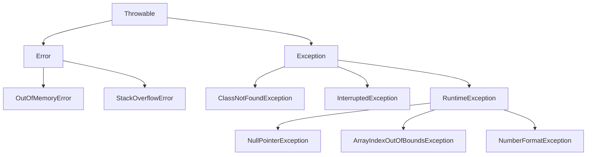


<div class="callout callout-summary" markdown="1">
<div class="callout-title callout-title--default" markdown="span">요약</div>

프로그램이 돌다가 만나는 사고는 두 가지다. 하나는 기계의 기억 공간이 바닥나는 것처럼 프로그램이 손쓸 수 없는 사고이고, 다른 하나는 잘못 쓰거나 잘못 짜서 생기는, 미리 대비해 두면 수습하고 계속 갈 수 있는 사고다. 수습할 수 있는 사고는 다시 둘로 나뉜다. 대비하는 코드가 없으면 번역 자체를 안 해 주는 것과, 대비하지 않아도 번역은 해 주는 것이다. 대비하지 않은 사고가 실제로 터지면 프로그램은 그 자리에서 끝난다.

</div>


## 예시로 보기

사고에 대비하지 않으면 어떻게 되는지부터 본다. 문자열의 길이를 찍는 메서드에 문자열 대신 `null`을 넘긴다.

```java
public static void printLength(String data) {
    int result = data.length();
    System.out.println("length: " + result);
}

public static void main(String[] args) {
    System.out.println("[Program start]");
    printLength("Hello World");
    printLength(null);
    System.out.println("[Program end]");
}
```

```text
[Program start]
length: 11
Exception in thread "main" java.lang.NullPointerException: Cannot invoke "String.length()" because "<parameter1>" is null
	at E7.printLength(E7.java:3)
	at E7.main(E7.java:9)
```

`[Program end]`가 찍히지 않았다. 두 번째 `printLength`에서 사고가 나자 프로그램이 거기서 끝났다. 그런데 이 코드는 번역이 됐다. 번역기는 이 사고에 대비했는지 따지지 않았다[^s1].

이번에는 이름으로 클래스를 찾는 `Class.forName`을 그냥 불러 본다.

```java
public static void main(String[] args) {
    Class.forName("java.lang.String");
}
```

```text
error: unreported exception ClassNotFoundException; must be caught or declared to be thrown
```

이번에는 번역부터 막혔다. `"java.lang.String"`은 실제로 있는 클래스라서 사고가 날 리 없는데도 그렇다. 번역기는 "사고가 날 수 있는 메서드를 불렀는데 대비가 없다"는 것만 본다[^s1]. 두 사고의 종류가 다르다.

## 정의

**예외**(exception)는 잘못 쓰거나 잘못 짜서 생기는 오류다. **에러**(error)는 기계의 자원이 바닥나는 것 같은 심각한 문제로 프로그램이 정상으로 계속 돌 수 없는 상황이다. `OutOfMemoryError`(기억 공간이 모자람), `StackOverflowError`(메서드 호출이 너무 깊이 쌓임)가 에러다. 에러와 달리 예외는 처리해서 프로그램을 계속 돌게 할 수 있다.

예외는 다시 둘로 나뉜다.

| 종류 | 번역기가 처리 코드를 검사하는가 | 예 |
|---|---|---|
| 일반 예외(checked exception) | 검사한다. 없으면 번역하지 않는다 | `ClassNotFoundException`, `InterruptedException` |
| 실행 예외(runtime exception) | 검사하지 않는다 | `NullPointerException`, `ArrayIndexOutOfBoundsException`, `NumberFormatException` |

자바는 사고 하나하나를 객체로 만든다. 그 객체의 클래스들이 [상속](/Hongs_Blog/studies/java/java-inheritance/) 관계로 이어져 있고, 어느 가지에 달렸는지가 종류를 정한다.



화살표는 부모에서 자식으로 간다. 읽는 법은 하나다.

- `RuntimeException`과 그 자손이면 실행 예외다.
- `Exception`의 자손인데 `RuntimeException` 가지에 달리지 않았으면 일반 예외다.
- `Error` 가지는 예외가 아니다.

`RuntimeException`도 `Exception`의 자식이다. 그러니 "`Exception`의 자손"만으로는 일반 예외인지 알 수 없다. `RuntimeException` 가지인지를 꼭 따로 본다.

<div class="callout callout-check" markdown="1">
<div class="callout-title" markdown="span">검증: 그림의 부모·자식 관계 14개, 위 `null` 예제에서 `[Program end]`가 찍히지 않는 것, `StackOverflowError`가 `catch (Exception e)`에 걸리지 않는 것, 아래 `Class.forName` 예제의 출력 — [34_java-exception_impl.java](/Hongs_Blog/studies/java/code/34_java-exception_impl/)</div>

</div>


일반 예외를 처리한 예다. 앞의 것은 있는 클래스, 뒤의 것은 없는 클래스를 찾는다.

```java
try {
    Class.forName("java.lang.String");
    System.out.println("There is a String class.");
} catch (ClassNotFoundException e) {
    System.out.println("There is no String class.");
}

System.out.println();

try {
    Class.forName("java.lang.String2");
    System.out.println("There is a String2 class.");
} catch (ClassNotFoundException e) {
    System.out.println("There is no String2 class.");
}
```

```text
There is a String class.

There is no String2 class.
```

`try`와 `catch`가 어떻게 도는지는 [try-catch-finally](/Hongs_Blog/studies/java/java-try-catch/)에서 다룬다.


## 활용

- 흔히 만나는 실행 예외와 원인[^s3].

| 실행 예외 | 이럴 때 난다 | 관련 문서 |
|---|---|---|
| `NullPointerException` | `null`이 든 변수로 메서드나 필드를 쓸 때 | [참조 비교와 null](/Hongs_Blog/studies/java/java-reference-equality/) |
| `ArrayIndexOutOfBoundsException` | 배열에 없는 칸 번호를 쓸 때 | [배열](/Hongs_Blog/studies/java/java-array/) |
| `NumberFormatException` | `Integer.parseInt("1oo")`처럼 숫자가 아닌 글자를 숫자로 바꿀 때 | [타입 변환](/Hongs_Blog/studies/java/java-type-conversion/) |
| `ClassCastException` | 실제 객체와 맞지 않는 타입으로 강제 변환할 때 | [참조 타입 변환과 instanceof](/Hongs_Blog/studies/java/java-casting/) |

- 오류 화면의 첫 줄은 "예외 클래스 이름: 메시지"이고, 그 아래 `at …` 줄들은 사고가 난 자리에서 `main`까지 거슬러 올라가는 호출 순서다. 맨 위 `at` 줄이 사고가 난 줄이다.
- 에러는 잡으려고 하지 않는다. `catch (Exception e)`로는 `StackOverflowError`가 잡히지도 않는다. `Error`는 `Exception`의 자손이 아니기 때문이다.

## 연결

- 선수: [상속](/Hongs_Blog/studies/java/java-inheritance/). 예외의 종류는 클래스의 부모·자식 관계로 정해진다.
- 처리하는 법: [try-catch-finally](/Hongs_Blog/studies/java/java-try-catch/). 부른 쪽에 넘기는 법: [예외 던지기](/Hongs_Blog/studies/java/java-throw/). 새 예외를 만드는 법: [사용자 정의 예외](/Hongs_Blog/studies/java/java-custom-exception/)

## 확인 문제

<details class="callout callout-question" markdown="1">
<summary class="callout-title" markdown="span">**C1** 에러와 예외의 차이, 일반 예외와 실행 예외의 차이를 각각 한 문장으로 쓰라.</summary>

**답:** 에러는 자원 고갈처럼 프로그램이 수습할 수 없는 심각한 문제이고, 예외는 잘못 쓰거나 잘못 짜서 생기며 처리하면 계속 돌 수 있다. 일반 예외는 번역기가 처리 코드가 있는지 검사하고, 실행 예외는 검사하지 않는다.<br>
**이유:** "실행 예외는 실행 중에 나고 일반 예외는 번역 중에 난다"고 쓰면 틀린다. 둘 다 실행 중에 난다. 번역 때 달라지는 것은 처리 코드를 검사하느냐뿐이다.

</details>


<details class="callout callout-question" markdown="1">
<summary class="callout-title" markdown="span">**C2** `main` 안에 `try`도 `throws`도 없이 아래 네 줄을 쓴다. 번역 오류가 나는 줄을 모두 고르라. ① `int a = Integer.parseInt("12");` ② `int[] arr = new int[2]; arr[5] = 1;` ③ `Thread.sleep(10);` ④ `Class.forName("java.lang.String");`</summary>

**답:** ③과 ④다.<br>
**이유:** ③은 `InterruptedException`, ④는 `ClassNotFoundException`을 낼 수 있고 둘 다 일반 예외라서 처리 코드가 없으면 번역하지 않는다. ①이 낼 수 있는 `NumberFormatException`과 ②의 `ArrayIndexOutOfBoundsException`은 실행 예외라 번역된다. ②는 실행하면 반드시 터지는데도 번역은 된다. ④는 실행하면 터질 리 없는데도 번역이 안 된다.

</details>


<details class="callout callout-question" markdown="1">
<summary class="callout-title" markdown="span">**C3** `NumberFormatException`의 부모를 따라 올라가면 `IllegalArgumentException` → `RuntimeException` → `Exception` → `Throwable`이다. 이것은 일반 예외인가 실행 예외인가? `Exception`의 자손인데 왜 그렇게 답하는가?</summary>

**답:** 실행 예외다. 조상 가운데 `RuntimeException`이 있기 때문이다.<br>
**이유:** 일반 예외는 "`Exception`의 자손 가운데 `RuntimeException` 가지에 달리지 않은 것"이다. `RuntimeException` 자신이 `Exception`의 자식이므로 실행 예외도 모두 `Exception`의 자손이다. `Exception`의 자손인지만 보면 둘을 가를 수 없다.

</details>


[^s1]: JDK 21에서 직접 실행해 확인했다. 오류 화면의 `E7`은 실험에 쓴 클래스 이름이다. 메시지의 `"<parameter1>"` 자리는 `javac -g`로 번역하면 변수 이름 `"data"`로 나온다(직접 확인).
[^s3]: 클래스 계층은 검증 코드로, C2의 번역 오류 두 건은 JDK 21 javac로 확인했다.

