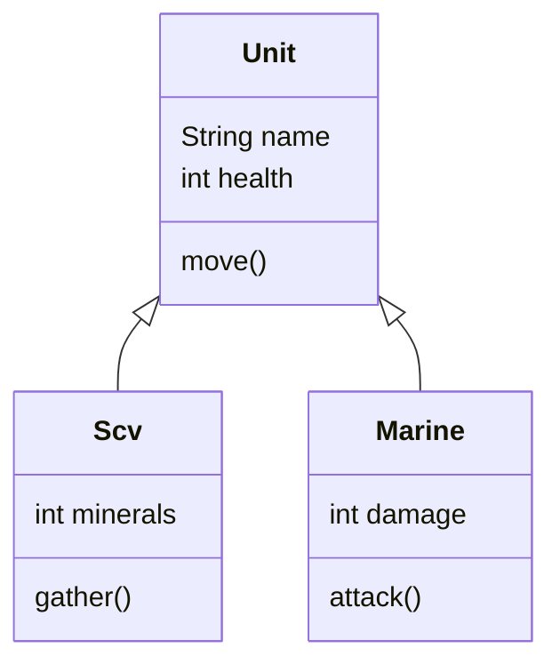


<div class="callout callout-summary" markdown="1">
<div class="callout-title callout-title--default" markdown="span">요약</div>

새 요리책을 쓸 때 기본 반죽 만드는 법을 책마다 다시 적지 않고 "기본 반죽은 1권을 본다"라고 한 줄만 적는 것과 같다. 이미 만든 틀의 내용을 새 틀이 통째로 받아 쓰고, 다른 점만 보탠다. 같은 코드를 두 번 쓰지 않고, 물려준 쪽을 한 번 고치면 물려받은 쪽 전부에 한꺼번에 반영된다. 다만 자바에서는 물려줄 쪽을 딱 하나만 고를 수 있고, 물려준 쪽이 금고에 넣어 둔 것은 물려받은 쪽도 직접 꺼내지 못한다.

</div>


## 예시로 보기

건설로봇과 해병은 둘 다 이름과 체력이 있고 움직인다. 클래스를 따로 쓰면 이 부분이 두 번 나온다.

```java
class Scv    { String name; int health; void move() { ... }  int minerals; void gather() { ... } }
class Marine { String name; int health; void move() { ... }  int damage;   void attack() { ... } }
```

유닛이 스무 종이면 `move`가 스무 번 나온다. 움직이는 방식을 고치려면 스무 군데를 똑같이 고쳐야 하고, 한 군데라도 빠뜨리면 그 유닛만 다르게 움직인다. 겹치는 부분을 한 클래스에 모으고 나머지가 물려받게 한다.

```java
class Unit {                        // 부모: 겹치는 것
    String name;
    int health;

    void move() {
        System.out.println(name + " moves");
    }
}

class Scv extends Unit {            // 자식: 물려받고, 자기 것을 보탠다
    int minerals;

    void gather() {
        minerals += 8;
        System.out.println(name + " gathers");
    }
}

class Marine extends Unit {
    int damage = 6;

    void attack() {
        System.out.println(name + " attacks with " + damage);
    }
}
```

```java
Scv s = new Scv();
s.name = "SCV";         // Scv에는 name을 쓰지 않았다
s.health = 45;
s.move();               // SCV moves
s.gather();             // SCV gathers
System.out.println(s.minerals);   // 8

Marine m = new Marine();
m.name = "Marine";
m.move();               // Marine moves
m.attack();             // Marine attacks with 6
```

`Scv`와 `Marine`에는 `name`, `health`, `move`를 쓰지 않았지만 자기 것처럼 쓴다. `Unit`의 `move`를 고치면 두 유닛의 움직임이 함께 바뀐다[^s1].



빈 세모 화살표는 자식에서 부모를 가리킨다. 자식 상자에는 보탠 것만 적는다. 물려받은 것은 부모 상자에 있다[^s2].

<div class="callout callout-check" markdown="1">
<div class="callout-title" markdown="span">검증: 위 출력, `s instanceof Unit`이 true인 것, `Scv`의 부모가 `Unit`이고 `Unit`의 부모가 `java.lang.Object`인 것, 카드 C3의 답을 JDK 21에서 실행해 비교. 부모 둘을 적은 코드와 부모의 private 필드를 쓰는 코드의 오류 문구는 따로 컴파일해 확인 — [20_java-inheritance_impl.java](/Hongs_Blog/studies/java/code/20_java-inheritance_impl/)</div>

</div>


## 정의

**상속**은 한 클래스가 다른 클래스의 필드와 메서드를 얻어 쓰게 하는 장치다. 얻어 쓰는 쪽을 자식 클래스(subclass), 내주는 쪽을 부모 클래스(superclass)라고 한다[^1].

```
부모 클래스 = 필드 1 + 메서드 1
                 │ 물려받음 │
자식 클래스 = 필드 1 + 메서드 1 + 필드 2 + 메서드 2
                                  └ 자식이 보탠 자료와 기능 ┘
```

자식 클래스를 선언할 때 어느 부모를 물려받을지 정하고, `extends` 뒤에 부모 클래스를 적는다. extend는 "늘린다, 넓힌다"는 뜻이다. 부모에 무언가를 보태 넓힌 것이 자식이다[^2].

```java
public class 자식클래스 extends 부모클래스 {
}
```

**부모는 하나만.** 자바는 여러 부모를 물려받는 것(다중 상속)을 허락하지 않는다[^2].

```java
class C extends A, B { }     // error: '{' expected
```

`extends` 뒤에는 클래스 이름이 하나만 올 수 있어서, 번역기는 `A` 다음에 `{`가 오기를 기다리다가 쉼표를 만나 오류를 낸다[^s1].

### 상속으로 얻는 것

- 이미 만든 클래스를 다시 써서 겹치는 코드가 준다[^3].
- 클래스를 고칠 곳이 준다. 부모 클래스를 고치면 그 변화가 모든 자식 클래스에 반영된다[^3].

### 물려받아도 못 쓰는 것

부모가 `private`로 감춘 필드와 메서드는 자식 클래스 안에서도 이름으로 쓸 수 없다. `private`의 경계가 클래스이기 때문이다([접근 제한자](/Hongs_Blog/studies/java/java-access-modifier/))[^s1].

```java
class Unit { private int health; int armor; }
class Marine extends Unit {
    void m() {
        armor = 1;       // 된다
        health = 40;     // error: health has private access in Unit
    }
}
```

자식 객체 안에 `health` 칸이 없는 것은 아니다. 칸은 있고, 부모가 내놓은 메서드로만 닿을 수 있다. 자식에게는 열어 주고 남에게는 막고 싶을 때 `protected`를 쓴다.

## 활용

- "자식은 부모의 한 종류다"라고 말이 될 때 쓴다. 해병은 유닛의 한 종류다. `s instanceof Unit`은 `true`다. 자식 객체는 부모 타입이기도 해서 부모 타입 변수에 담을 수 있다([참조 타입 변환과 instanceof](/Hongs_Blog/studies/java/java-casting/))[^s1].
- `extends`를 쓰지 않은 클래스도 부모가 있다. 자바의 모든 클래스는 `java.lang.Object`를 물려받는다. 그래서 어느 객체에나 `toString()`이 있다[^s1].
- 흔한 실수: 코드가 조금 겹친다는 이유만으로 상속하는 것. "사령부는 건설로봇의 한 종류"가 말이 안 되면, 물려받지 말고 필드로 가지고 있게 한다[^s1].
- 부모를 하나만 둘 수 있어서 생기는 아쉬움은 [다중 구현과 인터페이스 상속](/Hongs_Blog/studies/java/java-interface-inheritance/)이 메운다.

## 연결

- 선수: [객체 지향의 세 원칙](/Hongs_Blog/studies/java/oop-principles/), [필드와 메서드](/Hongs_Blog/studies/java/java-fields-methods/)
- 자식 객체를 만들 때 부모 쪽은 누가 채우나: [부모 생성자 호출](/Hongs_Blog/studies/java/java-super-constructor/)
- 물려받은 메서드를 자식에 맞게 고쳐 쓰기: [메서드 오버라이딩](/Hongs_Blog/studies/java/java-overriding/)
- 물려주려고만 만드는 클래스: [추상 클래스](/Hongs_Blog/studies/java/java-abstract-class/)

## 확인 문제

<details class="callout callout-question" markdown="1">
<summary class="callout-title" markdown="span">**C1** 상속이 무엇인지, 어떤 키워드로 쓰는지, 상속으로 얻는 것 두 가지를 쓰라.</summary>

**답:** 자식 클래스가 부모 클래스의 필드와 메서드를 얻어 쓰는 장치다. `class 자식 extends 부모`로 쓴다. 이미 만든 클래스를 다시 써서 겹치는 코드가 줄고, 부모를 고치면 모든 자식에 반영되어 고칠 곳이 준다.

</details>


<details class="callout callout-question" markdown="1">
<summary class="callout-title" markdown="span">**C2** 번역 단계에서 오류가 나는 것을 모두 고르라. (가) `class Scv extends Unit { }` (나) `class Hero extends Unit, Marine { }` (다) 부모 `Unit`에 `private int health;`가 있을 때 자식 메서드 안의 `health = 40;` (라) 부모 `Unit`에 `int armor;`가 있을 때 자식 메서드 안의 `armor = 1;`</summary>

**답:** (나)와 (다).<br>
**이유:** (나) 자바는 부모를 하나만 둘 수 있다. (다) 부모의 `private` 필드는 자식 클래스에서도 이름으로 쓸 수 없다(`health has private access in Unit`). (다)를 "물려받았으니 된다"로 답하는 것이 흔한 오답이다.

</details>


<details class="callout callout-question" markdown="1">
<summary class="callout-title" markdown="span">**C3** 예시의 `Marine`으로 `Marine m = new Marine(); m.health = 40; m.health -= 15; m.damage += 1;`을 실행했다. `m.health + " " + m.damage`의 출력은?</summary>

**답:** `25 7`<br>
**이유:** `health`는 `Marine`에 쓰지 않았지만 `Unit`에서 물려받아 `Marine` 객체 안에 칸이 있다. 40에서 15를 빼 25다. `damage`는 `Marine`이 보탠 필드로 처음 값 6에 1을 더해 7이다[^s1].

</details>


<details class="callout callout-question" markdown="1">
<summary class="callout-title" markdown="span">**C4** 유닛 스무 종이 모두 `move`를 가진다. `move`를 클래스마다 쓰는 것보다 `Unit`에 한 번 쓰고 물려받는 쪽이 나은 이유를, 움직이는 방식을 고칠 때를 들어 설명하라.</summary>

**답:** 클래스마다 쓰면 스무 군데를 똑같이 고쳐야 하고, 한 군데를 빠뜨리면 그 유닛만 옛 방식으로 움직인다. `Unit`에 한 번 쓰면 그 한 곳만 고치면 되고, 변화가 모든 자식에 반영된다.

</details>


[^1]: 소프트웨어 프로젝트 8회 강의 자료 「Software Project 08. Inheritance」, p.3 (Inheritance, 부모의 Field 1 + Method 1을 물려받고 Field 2 + Method 2를 보태는 그림). 같은 그림이 05.Software Project 05. Object-Oriented Programming.pdf, p.24~27에도 있다.
[^2]: 같은 자료, p.5 (Class Inheritance, `extends`, 부모 둘을 적은 코드에 X 표시)
[^3]: 같은 자료, p.4 (Benefits of Inheritance)
[^s1]: <span class="fn-tag" title="수업 자료에 없고 따로 보탠 내용">보충</span> 슬라이드에는 `extends` 선언 형식만 있고 실행할 수 있는 예가 없다. `Unit`·`Scv`·`Marine` 코드와 출력, 겹치는 코드의 문제, 오류 문구, 부모의 private 멤버, "한 종류다" 기준, `Object`, 카드 C2~C4는 원본에 없다. 5회 슬라이드의 스타크래프트 유닛을 예로 삼았다. 모두 JDK 21에서 직접 실행·컴파일해 확인했다.
[^s2]: <span class="fn-tag" title="수업 자료에 없고 따로 보탠 내용">보충</span> 클래스 그림은 원본에 없다. 위 코드를 근거로 그렸다. 글자 그림은 슬라이드 p.3의 그림을 옮긴 것이다.

