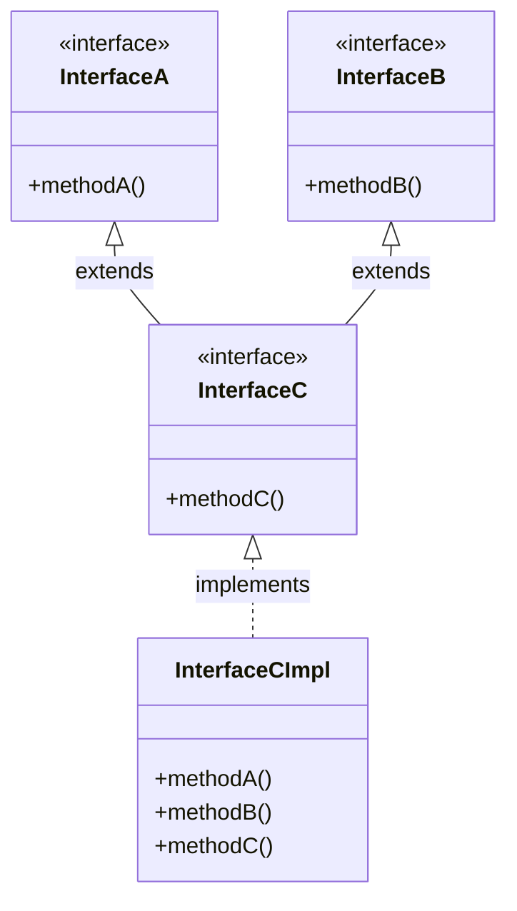


<div class="callout callout-summary" markdown="1">
<div class="callout-title callout-title--default" markdown="span">요약</div>

한 사람이 운전면허와 요리사 자격증을 함께 가질 수 있듯, 클래스 하나가 메서드 목록 여러 개를 한꺼번에 맡을 수 있다. 목록끼리도 물려받을 수 있어서, 작은 목록 둘을 합친 큰 목록을 만들 수 있다. 대신 맡은 목록에 적힌 것은 물려받은 것까지 하나도 빠짐없이 만들어야 한다. 그리고 같은 객체라도 어느 목록의 이름으로 부르느냐에 따라 시킬 수 있는 일이 그 목록에 적힌 것으로 줄어든다.

</div>


## 예시로 보기

클래스는 부모를 하나만 둘 수 있다([상속](/Hongs_Blog/studies/java/java-inheritance/)). 그러면 스마트 TV처럼 "리모컨으로 켠다"와 "검색한다"를 둘 다 해야 하는 물건을 만들 때 곤란하다. 두 기능을 한 부모에 억지로 몰아넣으면, 검색 기능이 없는 조명까지 검색 메서드를 떠안는다.

인터페이스는 여러 개를 한꺼번에 맡을 수 있다.

```java
interface RemoteControl { void turnOn(); }
interface Searchable { void search(String url); }

class SmartTelevision implements RemoteControl, Searchable {
    @Override
    public void turnOn() { System.out.println("Turn on TV"); }
    @Override
    public void search(String url) { System.out.println("Search: " + url); }
}
```

```java
SmartTelevision tv = new SmartTelevision();
RemoteControl rc = tv;
Searchable sc = tv;
rc.turnOn();
sc.search("java");
System.out.println(rc == sc);
```

```
Turn on TV
Search: java
true
```

객체는 하나다. `rc == sc`가 `true`인 것이 그 증거다. 같은 객체를 `rc`로 보면 켜는 버튼만 보이고, `sc`로 보면 검색 버튼만 보인다. `rc.search("java")`는 컴파일 오류다.

<div class="callout callout-check" markdown="1">
<div class="callout-title" markdown="span">검증: 위 출력, `InterfaceA`·`B`·`C` 예제 출력, 디폴트 메서드 충돌을 푼 `Robot`의 출력, 카드 C3 — [27_java-interface-inheritance_impl.java](/Hongs_Blog/studies/java/code/27_java-interface-inheritance_impl/)</div>

</div>


## 정의

### 다중 구현

구현 클래스는 인터페이스를 여러 개 구현할 수 있다. `implements` 뒤에 쉼표로 이어 적는다. 구현 클래스는 각 인터페이스의 추상 메서드를 모두 다시 정의해야 한다.

```java
public class ImplementingClass implements InterfaceA, InterfaceB {
}
```

부모 클래스도 함께 둘 때는 `extends`를 먼저, `implements`를 나중에 쓴다. `class X implements I extends P`처럼 순서를 바꾸면 `'{' expected` 오류다[^s2].

```java
class Duck extends Bird implements Flyable, Swimmable { ... }
```

### 인터페이스 상속

인터페이스도 다른 인터페이스를 물려받을 수 있다. 클래스와 달리 부모를 여러 개 둘 수 있다. `extends` 뒤에 물려받을 인터페이스를 쉼표로 이어 적는다.

```java
public interface ChildInterface extends ParentInterface1, ParentInterface2 { ... }
```

- 자식 인터페이스의 구현 클래스는 자식 인터페이스의 메서드뿐 아니라 부모 인터페이스들의 추상 메서드까지 모두 다시 정의해야 한다.
- 구현 객체는 자식 인터페이스 변수에도, 부모 인터페이스 변수에도 넣을 수 있다.


### 변수 타입이 부를 수 있는 메서드를 정한다

인터페이스 셋으로 확인해 본다.

```java
interface InterfaceA { void methodA(); }
interface InterfaceB { void methodB(); }
interface InterfaceC extends InterfaceA, InterfaceB {
    void methodC();
}

class InterfaceCImpl implements InterfaceC {
    public void methodA() { System.out.println("methodA"); }
    public void methodB() { System.out.println("methodB"); }
    public void methodC() { System.out.println("methodC"); }
}
```



`InterfaceC`는 자기 메서드 하나에 물려받은 둘을 더해 세 메서드를 가진다. 그래서 `InterfaceCImpl`은 셋을 다 채운다.

`InterfaceCImpl impl = new InterfaceCImpl();`로 만든 객체 하나를 세 가지 변수에 넣어 본다.

| 변수 | `methodA()` | `methodB()` | `methodC()` |
|---|---|---|---|
| `InterfaceA ia = impl;` | 된다 | 컴파일 오류 | 컴파일 오류 |
| `InterfaceB ib = impl;` | 컴파일 오류 | 된다 | 컴파일 오류 |
| `InterfaceC ic = impl;` | 된다 | 된다 | 된다 |

`ia.methodB()`가 오류인 까닭은 객체에 `methodB`가 없어서가 아니다. 객체에는 있다. 컴파일러가 변수의 타입 `InterfaceA`에 적힌 목록만 보기 때문이다. 오류 메시지는 `cannot find symbol`이다.

### 디폴트 메서드가 겹칠 때

두 인터페이스가 이름과 매개변수가 같은 [디폴트 메서드](/Hongs_Blog/studies/java/java-interface-methods/)를 가지면, 둘을 함께 구현한 클래스는 어느 몸통을 쓸지 정할 수 없다. 컴파일러는 `types Walker and Talker are incompatible` 오류를 낸다. 구현 클래스가 그 메서드를 직접 다시 정의하면 풀린다. 원래 몸통은 `인터페이스이름.super.메서드()`로 부른다[^s2].

```java
interface Walker { default void hello() { System.out.println("Walker hello"); } }
interface Talker { default void hello() { System.out.println("Talker hello"); } }

class Robot implements Walker, Talker {
    @Override
    public void hello() {
        Walker.super.hello();
        Talker.super.hello();
        System.out.println("Robot hello");
    }
}
```

`new Robot().hello()`는 `Walker hello`, `Talker hello`, `Robot hello`를 차례로 찍는다.

## 활용

- 구현: [27_java-interface-inheritance_impl.java](/Hongs_Blog/studies/java/code/27_java-interface-inheritance_impl/)
- 흔한 실수: 부모 인터페이스의 메서드를 빠뜨리는 것. `InterfaceC`만 보고 `methodC`만 채우면 `is not abstract and does not override abstract method methodA() in InterfaceA` 오류가 난다. 오류 메시지 끝의 `in InterfaceA`가 어느 목록의 메서드인지 알려 준다[^s2].
- 클래스에는 부모를 여럿 두지 못하게 하고 인터페이스에는 허락한 까닭: 두 부모가 같은 이름의 필드나 몸통 있는 메서드를 물려주면 어느 것을 쓸지 정할 수 없다. 인터페이스는 객체마다 다른 값을 담는 필드가 없고 추상 메서드에는 몸통이 없어서 이런 충돌이 거의 없다. 남는 충돌이 위의 디폴트 메서드이고, 그때는 컴파일러가 직접 고르라고 시킨다[^s2].

## 연결

- 선수: [인터페이스](/Hongs_Blog/studies/java/java-interface/), [상속](/Hongs_Blog/studies/java/java-inheritance/)
- 구현 객체를 인터페이스 변수에 넣을 때 일어나는 일: [참조 타입 변환과 instanceof](/Hongs_Blog/studies/java/java-casting/)
- 부모 하나 + 인터페이스 여럿을 고르는 기준: [추상 클래스와 인터페이스 비교](/Hongs_Blog/studies/java/abstract-class-vs-interface/)

## 확인 문제

<details class="callout callout-question" markdown="1">
<summary class="callout-title" markdown="span">**C1** 본문의 `InterfaceA`, `InterfaceB`, `InterfaceC`가 있고 구현 클래스에 `extra()`가 하나 더 있다. (가)~(바) 가운데 컴파일 오류가 나는 줄을 모두 고르고 이유를 쓰라.</summary>

```java
class Impl implements InterfaceC {
    public void methodA() { }
    public void methodB() { }
    public void methodC() { }
    public void extra() { }
}
// main 안에서
Impl impl = new Impl();
InterfaceA ia = impl;      // (가)
ia.methodB();              // (나)
InterfaceC ic = impl;
ic.methodA();              // (다)
ic.extra();                // (라)
InterfaceB ib = ic;        // (마)
InterfaceC ic2 = ia;       // (바)
```
**답:** (나), (라), (바).<br>
**이유:** (나) `InterfaceA`에는 `methodB`가 없다. (라) `extra`는 `Impl`에만 있고 `InterfaceC`의 목록에 없다. (바) 부모 인터페이스 타입을 자식 인터페이스 변수에 그냥 넣을 수 없다. `InterfaceA`를 구현한 객체가 모두 `InterfaceC`를 구현한 것은 아니기 때문이다. (다)는 `InterfaceC`가 `methodA`를 물려받아서 되고, (마)는 자식 인터페이스를 부모 인터페이스 변수에 넣는 것이라 된다.

</details>


<details class="callout callout-question" markdown="1">
<summary class="callout-title" markdown="span">**C2** `InterfaceC`를 구현하는 클래스가 `methodC`뿐 아니라 `methodA`, `methodB`까지 채워야 하는 이유를 쓰라.</summary>

**답:** `InterfaceC`는 `InterfaceA`, `InterfaceB`를 물려받아 세 메서드를 모두 가진 목록이다. `InterfaceC ic = impl;` 뒤에 `ic.methodA()`를 부를 수 있어야 하므로 객체에 그 몸통이 꼭 있어야 한다.<br>
**이유:** 구현 객체는 부모 인터페이스 변수에도 들어간다. `InterfaceA ia = impl;`로 넣고 `ia.methodA()`를 불렀는데 몸통이 없으면 실행할 것이 없다.

</details>


<details class="callout callout-question" markdown="1">
<summary class="callout-title" markdown="span">**C3** 본문의 `InterfaceCImpl`이 있을 때 이 코드의 출력은?</summary>

```java
InterfaceC ic = new InterfaceCImpl();
InterfaceA ia = ic;
ia.methodA();
ic.methodC();
System.out.println(ia instanceof InterfaceB);
```
**답:**
```
methodA
methodC
true
```
**이유:** `ia`와 `ic`는 같은 객체를 가리킨다. `instanceof`는 변수의 타입이 아니라 들어 있는 객체를 본다. 그 객체는 `InterfaceCImpl`이고 `InterfaceB`도 구현했으므로 `true`다. 흔한 오답은 "`ia`는 `InterfaceA` 타입이니 `false`"다.

</details>


[^s2]: JDK 21에서 직접 컴파일하고 실행해 확인했다(Java Language Specification §8.1.5, §8.4.8.4, §15.12.3).

