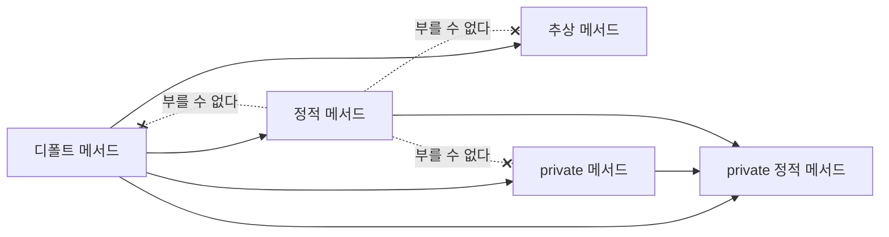


<div class="callout callout-summary" markdown="1">
<div class="callout-title callout-title--default" markdown="span">요약</div>

리모컨의 버튼 목록에 "기본 동작이 이미 들어 있는 버튼"을 넣을 수 있다. 기기가 따로 만들지 않아도 그 버튼은 돌아가고, 마음에 안 들면 기기가 자기 것으로 바꿔 끼운다. 건전지 갈기처럼 기기 없이 리모컨만으로 하는 일도 넣을 수 있고, 이런 버튼들이 속에서 함께 쓰는 부품은 밖에서 못 누르게 숨길 수 있다. 다만 기기 없이 하는 일 안에서는 기기가 있어야 돌아가는 버튼을 부를 수 없다.

</div>


## 예시로 보기

[인터페이스](/Hongs_Blog/studies/java/java-interface/)에는 몸통 없는 메서드만 있었다. 그러면 곤란한 일이 생긴다. `RemoteControl`에 "음소거" 버튼을 하나 더 적는 순간, 이미 만들어 둔 구현 클래스가 전부 `does not override abstract method` 오류를 낸다. 구현 클래스가 열 개면 열 군데를 고쳐야 한다[^s1].

몸통을 인터페이스 쪽에 미리 써 두면 구현 클래스는 손대지 않아도 된다.

```java
interface RemoteControl {
    int MAX_VOLUME = 10;
    int MIN_VOLUME = 0;

    void setVolume(int volume);                 // 몸통 없는 메서드

    default void setMute(boolean mute) {        // 몸통을 미리 써 둔 메서드
        if (mute) {
            System.out.println("Mute on");
            setVolume(MIN_VOLUME);
        } else {
            System.out.println("Mute off");
            setVolume(MAX_VOLUME / 2);
        }
    }

    static void changeBattery() {               // 객체 없이 부르는 메서드
        System.out.println("Change battery");
    }
}

class Television implements RemoteControl {
    @Override
    public void setVolume(int volume) { System.out.println("Volume " + volume); }
}
```

`Television`에는 `setMute`가 없는데도 부를 수 있다.

```java
RemoteControl rc = new Television();
rc.setMute(true);
rc.setMute(false);
RemoteControl.changeBattery();
```

```
Mute on
Volume 0
Mute off
Volume 5
Change battery
```

`setMute` 안의 `setVolume(MIN_VOLUME)`은 몸통 없는 메서드를 부른다. 실행할 때는 `rc`에 든 Television 객체의 `setVolume`이 돌아서 `Volume 0`이 찍힌다. `changeBattery`는 객체 없이 인터페이스 이름으로 불렀다[^s2].

`default`를 붙여 몸통을 미리 써 둔 메서드가 디폴트 메서드, `static`을 붙여 객체 없이 부르는 메서드가 정적 메서드다.

<div class="callout callout-check" markdown="1">
<div class="callout-title" markdown="span">검증: 위 출력, 디폴트 메서드를 다시 정의했을 때의 출력, `Service` 예제의 네 메서드 출력, 카드 C3 — [26_java-interface-methods_impl.java](/Hongs_Blog/studies/java/code/26_java-interface-methods_impl/)</div>

</div>


## 정의

### 디폴트 메서드

인터페이스 안에 실행할 수 있는 몸통을 다 갖춘 메서드다. 메서드 앞에 `default`를 쓴다. `public`은 생략해도 자동으로 붙는다.

```java
[public] default void setMute(boolean mute) { ... }
```

- 몸통 안에서 상수 필드를 읽거나 추상 메서드를 부를 수 있다.
- 구현 객체가 있어야 부를 수 있다. `rc.setMute(true)`처럼 객체를 가리키는 변수로 부른다.
- 구현 클래스가 자기에게 맞게 다시 정의해도 된다. 이때는 `default`를 빼고 `public`을 붙인다. 클래스 안에 `default`를 쓰면 `modifier default not allowed here` 오류다[^s3].

```java
class Audio implements RemoteControl {
    @Override
    public void setVolume(int volume) { System.out.println("Audio volume " + volume); }
    @Override
    public void setMute(boolean mute) { System.out.println(mute ? "Audio mute on" : "Audio mute off"); }
}
```

`RemoteControl rc = new Audio(); rc.setMute(true);`는 `Audio mute on`만 찍는다. 인터페이스에 써 둔 몸통 대신 Audio의 몸통이 실행된다[^s2].

### 정적 메서드

`static`을 붙인 메서드다. 추상 메서드와 디폴트 메서드는 구현 객체가 있어야 부를 수 있지만, 정적 메서드는 구현 객체 없이 인터페이스 이름만으로 부른다.

```java
[public | private] static void changeBattery() { ... }
```

```java
RemoteControl.changeBattery();
```

정적 메서드의 몸통에서는 추상 메서드, 디폴트 메서드, (static이 아닌) private 메서드를 부를 수 없다. 이 셋은 객체가 있어야 돌아가는 인스턴스 메서드인데, 정적 메서드는 객체 없이 실행되기 때문이다. 상수 필드는 읽을 수 있다. 클래스의 정적 메서드가 인스턴스 멤버를 못 쓰는 것과 같은 이유다([static 멤버](/Hongs_Blog/studies/java/java-static/)).

부르는 법에 클래스의 정적 메서드와 다른 점이 둘 있다[^s3].

- 객체를 가리키는 변수로는 못 부른다. `rc.changeBattery()`는 `illegal static interface method call` 오류다.
- 구현 클래스 이름으로도 못 부른다. `Television.changeBattery()`는 `cannot find symbol` 오류다. 인터페이스의 정적 메서드는 구현 클래스에 물려지지 않는다.


### private 메서드

상수 필드, 추상 메서드, 디폴트 메서드, 정적 메서드는 모두 `public`이다. `public`을 생략해도 컴파일할 때 자동으로 붙어서 늘 밖에서 쓸 수 있다. 여기에 더해, 밖에서 쓸 수 없는 private 메서드를 인터페이스 안에 둘 수 있다.

| 종류 | 구현 객체가 필요한가 | 부를 수 있는 곳 |
|---|---|---|
| private 메서드 | 필요하다 | 디폴트 메서드 안에서만 |
| private 정적 메서드 | 필요 없다 | 디폴트 메서드와 정적 메서드 안 |

private 메서드를 두는 이유는 디폴트 메서드끼리, 정적 메서드끼리 겹치는 코드를 한곳에 모으기 위해서다.

```java
interface Service {
    default void defaultMethod1() {
        System.out.println("defaultMethod1");
        defaultCommon();
    }

    default void defaultMethod2() {
        System.out.println("defaultMethod2");
        defaultCommon();
        staticCommon();
    }

    private void defaultCommon() {
        System.out.println("defaultCommon");
    }

    static void staticMethod1() {
        System.out.println("staticMethod1");
        staticCommon();
    }

    static void staticMethod2() {
        System.out.println("staticMethod2");
        staticCommon();
    }

    private static void staticCommon() {
        System.out.println("staticCommon");
    }
}
```

`class ServiceImpl implements Service { }`로 빈 구현 클래스를 만들고 `Service s = new ServiceImpl();`로 불러 보면 다음과 같다[^s2].

| 호출 | 출력 (위에서 아래로) |
|---|---|
| `s.defaultMethod1()` | defaultMethod1, defaultCommon |
| `s.defaultMethod2()` | defaultMethod2, defaultCommon, staticCommon |
| `Service.staticMethod1()` | staticMethod1, staticCommon |
| `Service.staticMethod2()` | staticMethod2, staticCommon |

### 한눈에

| 메서드 | 몸통 | 접근 | 부르는 법 | 구현 클래스가 할 일 |
|---|---|---|---|---|
| 추상 | 없다 | public | 구현 객체로 | 반드시 다시 정의한다 |
| 디폴트 | 있다 | public | 구현 객체로 | 그대로 쓰거나 다시 정의한다 |
| 정적 | 있다 | public | `인터페이스이름.메서드()` | 없다 |
| private | 있다 | private | 인터페이스 안 디폴트 메서드에서 | 없다. 보이지도 않는다 |
| private 정적 | 있다 | private | 인터페이스 안 디폴트·정적 메서드에서 | 없다. 보이지도 않는다 |



실선은 "이 몸통 안에서 저 메서드를 부를 수 있다"이다. 정적 메서드에서 나가는 실선은 private 정적 메서드 하나뿐이다.

## 활용

- 구현: [26_java-interface-methods_impl.java](/Hongs_Blog/studies/java/code/26_java-interface-methods_impl/)
- 흔한 실수[^s3]

| 실수 | 오류 메시지의 핵심 |
|---|---|
| 정적 메서드 안에서 디폴트 메서드를 부름 | `non-static method setMute(boolean) cannot be referenced from a static context` |
| 정적 메서드를 `rc.changeBattery()`로 부름 | `illegal static interface method call` |
| 밖에서 `s.defaultCommon()`을 부름 | `defaultCommon() has private access in Service` |
| 클래스 안에서 `default void f() { }` | `modifier default not allowed here` |

## 연결

- 선수: [인터페이스](/Hongs_Blog/studies/java/java-interface/), [static 멤버](/Hongs_Blog/studies/java/java-static/), [접근 제한자](/Hongs_Blog/studies/java/java-access-modifier/)
- 디폴트 메서드를 다시 정의하는 규칙: [메서드 오버라이딩](/Hongs_Blog/studies/java/java-overriding/)
- 두 인터페이스가 이름이 같은 디폴트 메서드를 가질 때: [다중 구현과 인터페이스 상속](/Hongs_Blog/studies/java/java-interface-inheritance/)
- 몸통 있는 메서드를 둘 수 있게 되면서 추상 클래스와 무엇이 다른지: [추상 클래스와 인터페이스 비교](/Hongs_Blog/studies/java/abstract-class-vs-interface/)

## 확인 문제

<details class="callout callout-question" markdown="1">
<summary class="callout-title" markdown="span">**C1** (가)~(아) 가운데 컴파일 오류가 나는 줄을 모두 고르고 이유를 쓰라.</summary>

```java
interface Service {
    void work();
    default void d1() { work(); helper(); sHelper(); }   // (가)
    static void s1() { sHelper(); }                      // (나)
    static void s2() { d1(); }                           // (다)
    static void s3() { helper(); }                       // (라)
    private void helper() { }
    private static void sHelper() { }
}
class Impl implements Service { public void work() { } }
class Main {
    public static void main(String[] args) {
        Service s = new Impl();
        s.d1();           // (마)
        s.s1();           // (바)
        Service.s1();     // (사)
        s.helper();       // (아)
    }
}
```
**답:** (다), (라), (바), (아).<br>
**이유:** (다)·(라) 정적 메서드는 객체 없이 실행되므로 객체가 필요한 디폴트 메서드와 private 메서드를 부를 수 없다. (바) 인터페이스의 정적 메서드는 변수로 부를 수 없고 인터페이스 이름으로만 부른다. (아) private 메서드는 인터페이스 밖에서 보이지 않는다. (가)의 디폴트 메서드는 추상 메서드, private 메서드, private 정적 메서드를 모두 부를 수 있고, (나)의 정적 메서드는 private 정적 메서드를 부를 수 있다. 흔한 오답은 (나)를 오류로 고르는 것이다[^s3].

</details>


<details class="callout callout-question" markdown="1">
<summary class="callout-title" markdown="span">**C2** 인터페이스의 정적 메서드 안에서 디폴트 메서드를 부를 수 없는 이유를 쓰라.</summary>

**답:** 디폴트 메서드는 구현 객체가 있어야 실행된다. 그 안에서 추상 메서드를 부를 수 있는데, 어느 객체의 몸통을 실행할지는 객체가 있어야 정해진다. 정적 메서드는 `인터페이스이름.메서드()`로 객체 없이 실행되므로 넘겨줄 객체가 없다.<br>
**이유:** 클래스의 정적 메서드가 인스턴스 필드와 인스턴스 메서드를 못 쓰는 것과 같은 까닭이다.

</details>


<details class="callout callout-question" markdown="1">
<summary class="callout-title" markdown="span">**C3** 본문의 `Service`와 빈 구현 클래스 `ServiceImpl`이 있을 때 이 코드의 출력은?</summary>

```java
Service x = new ServiceImpl();
x.defaultMethod2();
Service.staticMethod1();
```
**답:**
```
defaultMethod2
defaultCommon
staticCommon
staticMethod1
staticCommon
```
**이유:** `defaultMethod2`는 자기 이름을 찍고 `defaultCommon()`, `staticCommon()`을 차례로 부른다. `staticMethod1`은 자기 이름을 찍고 `staticCommon()`을 부른다. 흔한 오답은 `defaultMethod2`에서 `staticCommon`을 빠뜨리는 것이다[^s2].

</details>


[^s1]: 추상 메서드를 더하면 구현 클래스가 `is not abstract and does not override abstract method` 오류를 내는 것을 JDK 21에서 확인했다. 디폴트 메서드와 정적 메서드는 Java 8, private 메서드는 Java 9에서 추가되었다(Java Language Specification §9.4.3).
[^s2]: 구현 코드로 출력을 확인했다.
[^s3]: JDK 21에서 직접 컴파일해 확인했다(Java Language Specification §8.4.8, §15.12.3).

