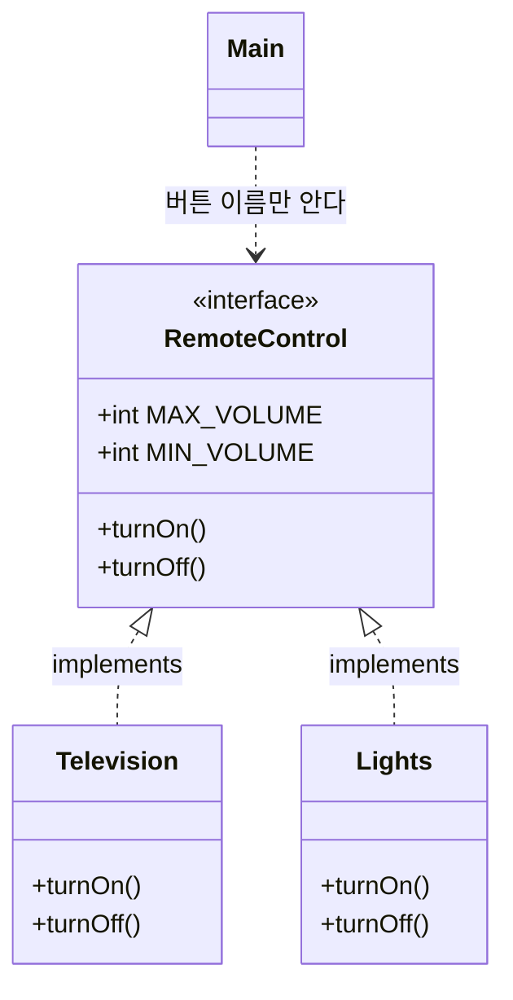


<div class="callout callout-summary" markdown="1">
<div class="callout-title callout-title--default" markdown="span">요약</div>

리모컨에 달린 버튼 목록 같은 것이다. 쓰는 사람은 버튼 이름만 알면 되고, 버튼을 눌렀을 때 실제로 무슨 일이 일어나는지는 그 리모컨에 연결된 기기가 정한다. 그래서 기기를 TV에서 조명으로 바꿔도 쓰는 쪽 코드는 한 글자도 고치지 않는다. 대신 기기는 목록에 적힌 버튼을 하나도 빠짐없이 만들어 두어야 하고, 목록에 없는 기능은 이 리모컨으로 부를 수 없다.

</div>


## 예시로 보기

`main`이 `Television` 클래스를 직접 쓰면, 켜는 대상을 조명으로 바꿀 때 `main` 안의 타입 이름을 전부 찾아 고쳐야 한다. 쓰는 쪽이 "켠다, 끈다"라는 버튼 이름만 알고 있으면 이 수고가 사라진다[^1].

버튼 목록을 먼저 적는다. 몸통 `{ }` 없이 이름만 있다.

```java
interface RemoteControl {
    void turnOn();
    void turnOff();
}
```

기기 둘이 이 목록의 버튼을 각자 채운다.

```java
class Television implements RemoteControl {
    @Override
    public void turnOn() { System.out.println("Turn on TV"); }
    @Override
    public void turnOff() { System.out.println("Turn off TV"); }
}

class Lights implements RemoteControl {
    @Override
    public void turnOn() { System.out.println("Turn on lights"); }
    @Override
    public void turnOff() { System.out.println("Turn off lights"); }
}
```

쓰는 쪽은 `RemoteControl` 타입 변수 하나만 둔다[^2].

```java
RemoteControl rc;
rc = new Television();
rc.turnOn();
rc = new Lights();
rc.turnOn();
```

```
Turn on TV
Turn on lights
```

| 줄 | `rc`에 들어 있는 객체 | 실제로 실행되는 메서드 | 출력 |
|---|---|---|---|
| `rc = new Television();` | Television 객체 | — | — |
| `rc.turnOn();` | Television 객체 | `Television`의 `turnOn` | Turn on TV |
| `rc = new Lights();` | Lights 객체 | — | — |
| `rc.turnOn();` | Lights 객체 | `Lights`의 `turnOn` | Turn on lights |

`rc.turnOn();`은 두 번 다 똑같이 썼는데 출력이 다르다. 변수에 무엇이 들어 있는지가 실행될 메서드를 정한다.

여기서 버튼 목록 `RemoteControl`을 인터페이스라고 부른다. 목록의 버튼을 채운 `Television`, `Lights`는 구현 클래스이고, 그 클래스로 만든 객체는 구현 객체다. 몸통 없이 이름만 적은 `turnOn()`은 추상 메서드다[^3].



`Main`에서 나가는 화살표는 `RemoteControl`에서 멈춘다. `Main`은 `Television`도 `Lights`도 모른다[^s1].

비유가 틀어지는 곳이 하나 있다. 진짜 리모컨은 손에 잡히는 물건이지만 인터페이스는 객체로 만들 수 없다. 인터페이스는 버튼 목록이 적힌 종이에 가깝다.

<div class="callout callout-check" markdown="1">
<div class="callout-title" markdown="span">검증: 위 출력, 상수 필드와 추상 메서드에 자동으로 붙는 키워드, null 변수 호출, 카드 C4의 출력 — [23_java-interface_impl.java](/Hongs_Blog/studies/java/code/23_java-interface_impl/)</div>

</div>


## 정의

인터페이스는 두 객체를 이어 주는 연결 고리다. 객체 A는 인터페이스에 적힌 메서드만 부르고, 그 호출을 실제로 처리하는 일은 인터페이스 뒤에 있는 객체 B가 한다. B를 C로 바꿔도 A는 신경 쓸 것이 없다[^1].

### 선언

`class` 자리에 `interface`를 쓴다. 접근 제한자는 클래스와 같다. `public`을 붙이면 어느 패키지에서나 쓰고, 아무것도 안 붙이면 같은 패키지 안에서만 쓴다[^4].

```java
interface RemoteControl { ... }          // 같은 패키지 안에서만
public interface RemoteControl { ... }   // 어디서나
```

중괄호 안에 둘 수 있는 것은 여섯 가지다[^4].

| 넣을 수 있는 것 | 다루는 문서 |
|---|---|
| public 상수 필드 | 이 문서 |
| public 추상 메서드 | 이 문서 |
| public 디폴트 메서드, public 정적 메서드, private 메서드, private 정적 메서드 | [디폴트·정적·private 메서드](/Hongs_Blog/studies/java/java-interface-methods/) |

객체마다 값이 다른 보통 필드와 생성자는 목록에 없다. 인터페이스는 객체로 만들지 않으므로 객체마다 다른 값을 담을 곳도, 객체를 처음 채울 생성자도 필요 없다[^s2].

### 상수 필드

인터페이스의 필드는 모두 바꿀 수 없는 값(상수)이다. `public`, `static`, `final` 세 키워드를 쓰지 않아도 컴파일할 때 자동으로 붙는다[^5].

```java
interface RemoteControl {
    int MAX_VOLUME = 10;   // public static final int MAX_VOLUME = 10; 과 같다
    int MIN_VOLUME = 0;
}
```

```java
System.out.println("Max:" + RemoteControl.MAX_VOLUME);   // Max:10
```

- `static`이 붙었으니 객체 없이 `인터페이스이름.상수이름`으로 읽는다.
- `final`이 붙었으니 값을 바꾸는 줄은 컴파일 오류다. `RemoteControl.MAX_VOLUME = 20;`은 `cannot assign a value to static final variable MAX_VOLUME`으로 막힌다[^s3].
- 선언하면서 바로 값을 넣어야 한다. `int MAX_VOLUME;`만 쓰면 `= expected` 오류가 난다[^s3].
- 이름은 대문자로 쓰고, 단어가 여럿이면 밑줄로 잇는 것이 관례다[^5].

### 추상 메서드

몸통 없이 선언만 있는 메서드다. `public abstract`를 쓰지 않아도 컴파일할 때 자동으로 붙는다[^3].

```java
interface RemoteControl {
    void turnOn();   // public abstract void turnOn(); 과 같다
}
```

<div class="callout callout-warning" markdown="1">
<div class="callout-title" markdown="span">원본 오류 의심</div>

원문: 11회 슬라이드 p.13의 코드 `public void turnOn; // public abstract` / 문제점: 메서드 선언에 괄호가 없다. 이대로 컴파일하면 `'(' expected` 오류가 난다. / 수정안: `public void turnOn();` / 근거: JDK 21에서 직접 컴파일해 확인했다. 12회 p.15의 `void run();`은 괄호가 있다.

</div>


### 구현 클래스

클래스 이름 뒤에 `implements 인터페이스이름`을 붙인다. 이 클래스가 인터페이스의 추상 메서드를 모두 다시 정의(오버라이딩)했다는 뜻이다[^6].

```java
public class Television implements RemoteControl {
    @Override
    public void turnOn() {
        System.out.println("Turn on TV");
    }
}
```

지켜야 할 것은 두 가지다.

1. 추상 메서드를 하나도 빠뜨리지 않는다. 선언(이름, 매개변수, 리턴 타입)도 똑같아야 한다[^7]. `turnOff()`를 빠뜨리면 `Television is not abstract and does not override abstract method turnOff() in RemoteControl` 오류가 난다[^s3].
2. 다시 정의할 때 `public`을 붙인다[^3]. 인터페이스 쪽이 `public`이기 때문이다. [메서드 오버라이딩](/Hongs_Blog/studies/java/java-overriding/)에서 접근 범위는 넓힐 수만 있고 좁힐 수 없다. `public`을 빼면 `attempting to assign weaker access privileges; was public` 오류가 난다[^s3].

<div class="callout callout-warning" markdown="1">
<div class="callout-title" markdown="span">원본 오류 의심</div>

원문: 11회 슬라이드 p.12~14의 `public class B implement RemoteControl { … }`, `public class Television implement RemoteControl { … }` / 문제점: 키워드는 `implements`다. `implement`로 쓰면 `'{' expected` 오류가 난다. / 수정안: `implements` / 근거: JDK 21에서 직접 컴파일해 확인했다. 같은 p.12의 본문과 12회 p.9, p.15의 코드는 `implements`로 적혀 있다.

</div>


### 변수 선언과 객체 대입

인터페이스도 타입이다. 변수의 타입으로 쓸 수 있고, 참조 타입이라 `null`도 넣을 수 있다. 인터페이스로 객체를 쓰려면 구현 객체를 인터페이스 변수에 넣는다[^2].

```java
RemoteControl rc;                      // 선언만
RemoteControl rc = null;               // 아직 가리키는 객체가 없다
RemoteControl rc = new Television();   // 구현 객체를 넣는다
rc.turnOn();                           // 들어 있는 객체의 turnOn이 실행된다
```

`null`이 든 변수로 `rc.turnOn()`을 부르면 실행 중에 `NullPointerException`이 난다([참조 비교와 null](/Hongs_Blog/studies/java/java-reference-equality/))[^s3].

### 인터페이스인 것과 아닌 것

자바 표준 라이브러리에서 고른 예다[^s4].

| | 이름 | 이유 |
|---|---|---|
| 인터페이스다 | `java.util.List` | "순서대로 담는다"는 메서드 목록만 정한다. 실제로 담는 일은 `ArrayList`, `LinkedList`가 한다 |
| 인터페이스다 | `java.lang.Comparable` | "크기를 비교할 수 있다"는 메서드 `compareTo` 하나를 정한다 |
| 인터페이스다 | `java.lang.Runnable` | "실행할 수 있다"는 메서드 `run` 하나를 정한다 |
| 아니다 | `java.util.ArrayList` | 클래스다. `new ArrayList<>()`로 객체를 만든다 |
| 아니다 | `java.lang.String` | 클래스다. 글자들을 담는 필드와 생성자가 있다 |

### 설계 이유

- **왜 전부 public인가.** 인터페이스는 바깥에서 부르라고 내놓는 목록이다. 밖에서 못 부르는 버튼을 목록에 적을 이유가 없다. 안에서만 쓰는 도우미가 필요해지자 나중에 private 메서드가 따로 추가되었다[^s2].
- **왜 필드는 상수뿐인가.** 인터페이스는 객체로 만들지 않는다. 객체가 없으니 객체마다 다른 값을 담을 자리가 없다. 남는 것은 모두가 함께 읽는 고정된 값뿐이다.
- **왜 몸통을 비워 두는가.** 몸통은 기기마다 다르다. 목록이 정하는 것은 "무엇을 부를 수 있는가"이고, "어떻게 하는가"는 구현 클래스의 몫이다.

### 스스로 설명해 보기

`예시로 보기`의 코드를 한 줄씩 본다.

<details class="callout callout-question" markdown="1">
<summary class="callout-title" markdown="span">1. `RemoteControl rc = new Television();`이 컴파일되는 이유</summary>

`Television`이 `implements RemoteControl`로 선언되어 있어서다. 컴파일러는 이 선언을 보고 Television 객체가 RemoteControl의 메서드를 모두 가졌다고 믿는다. `implements`가 없는 클래스의 객체를 넣으면 `incompatible types` 오류가 난다.

</details>


<details class="callout callout-question" markdown="1">
<summary class="callout-title" markdown="span">2. `rc.turnOn();`에서 컴파일러가 확인하는 것과 실행 때 일어나는 일</summary>

컴파일러는 변수의 타입인 `RemoteControl`에 `turnOn()` 선언이 있는지만 본다. 실행할 때는 `rc`에 들어 있는 객체의 클래스(Television)에서 `turnOn`을 찾아 실행한다.

</details>


<details class="callout callout-question" markdown="1">
<summary class="callout-title" markdown="span">3. `Television`의 `turnOn` 앞에 `public`이 꼭 있어야 하는 이유</summary>

인터페이스의 추상 메서드에는 `public`이 자동으로 붙는다. 다시 정의하는 메서드는 접근 범위를 좁힐 수 없다. `public`을 빼면 같은 패키지에서만 부를 수 있는 메서드가 되어 범위가 좁아진다.

</details>


<details class="callout callout-question" markdown="1">
<summary class="callout-title" markdown="span">이 구조의 핵심 아이디어는?</summary>

쓰는 쪽과 만드는 쪽 사이에 메서드 목록만 둔다. 쓰는 쪽은 목록만 보고 코드를 쓰고, 만드는 쪽은 목록만 채우면 된다. 두 쪽이 서로의 클래스 이름을 몰라도 된다.

</details>


<details class="callout callout-question" markdown="1">
<summary class="callout-title" markdown="span">이 방법을 쓸 수 있는 다른 상황은?</summary>

변수뿐 아니라 필드, 메서드의 매개변수, 배열의 원소 타입을 인터페이스로 두면 같은 효과가 난다. 타이어를 갈아 끼우는 자동차, 아무 탈것이나 모는 운전자가 그 예다([다형성](/Hongs_Blog/studies/java/java-polymorphism/)).

</details>


## 활용

- 구현: [23_java-interface_impl.java](/Hongs_Blog/studies/java/code/23_java-interface_impl/)
- 변수 타입을 `List`로 두고 `new ArrayList<>()`를 넣는 코드가 이 구조다. 나중에 `LinkedList`로 바꿔도 나머지 코드는 그대로다[^s4].
- 흔한 실수와 컴파일러가 하는 말[^s3]

| 실수 | 오류 메시지의 핵심 |
|---|---|
| `implements`를 `implement`로 씀 | `'{' expected` |
| 추상 메서드 하나를 빠뜨림 | `is not abstract and does not override abstract method` |
| 다시 정의하면서 `public`을 뺌 | `attempting to assign weaker access privileges; was public` |
| 상수에 값을 다시 넣음 | `cannot assign a value to static final variable` |
| `new RemoteControl()` | `RemoteControl is abstract; cannot be instantiated` |

## 연결

- 선수: [메서드 오버라이딩](/Hongs_Blog/studies/java/java-overriding/)(추상 메서드를 다시 정의한다), [final과 상수](/Hongs_Blog/studies/java/java-final/), [접근 제한자](/Hongs_Blog/studies/java/java-access-modifier/)
- 몸통이 있는 메서드를 인터페이스에 넣는 법: [디폴트·정적·private 메서드](/Hongs_Blog/studies/java/java-interface-methods/)
- 인터페이스 여러 개를 한 클래스가 맡기: [다중 구현과 인터페이스 상속](/Hongs_Blog/studies/java/java-interface-inheritance/)
- 비슷해 보이는 것: [추상 클래스](/Hongs_Blog/studies/java/java-abstract-class/), 가르는 법은 [추상 클래스와 인터페이스 비교](/Hongs_Blog/studies/java/abstract-class-vs-interface/)
- 같은 호출이 객체에 따라 다른 일을 하는 원리: [다형성](/Hongs_Blog/studies/java/java-polymorphism/). 원칙 수준의 소개는 [객체 지향의 세 원칙](/Hongs_Blog/studies/java/oop-principles/)

## 자주 하는 오해

<div class="callout callout-misconception" markdown="1">
<div class="callout-title" markdown="span">"`RemoteControl rc`라고 썼으니 RemoteControl 객체가 하나 생겼다"</div>

틀렸다. 인터페이스로는 객체를 만들 수 없다. `new RemoteControl()`은 `RemoteControl is abstract; cannot be instantiated`라는 컴파일 오류다. 그럴듯해 보이는 이유는 `Television tv = new Television();`처럼 변수 타입과 객체의 클래스가 늘 같았던 코드에 익숙해서다. 실제로 `RemoteControl rc = new Television();`에서 만들어진 것은 Television 객체 하나뿐이고, `rc`는 그 객체를 가리키는 변수다. 변수의 타입은 "이 변수로 무엇을 부를 수 있는가"만 정한다. 확인하는 법: `rc.getClass().getName()`을 찍으면 `Television`이 나온다.

</div>


## 확인 문제

<details class="callout callout-question" markdown="1">
<summary class="callout-title" markdown="span">**C1** 인터페이스의 필드와 추상 메서드에 컴파일러가 자동으로 붙이는 키워드를 각각 쓰라.</summary>

**답:** 필드에는 `public static final`, 추상 메서드에는 `public abstract`.<br>
**이유:** 그래서 필드는 객체 없이 `인터페이스이름.상수이름`으로 읽고 값을 바꿀 수 없다. 추상 메서드는 몸통이 없고 어디서나 부를 수 있다. 흔한 오답은 필드에서 `static`을 빠뜨리는 것이다.

</details>


<details class="callout callout-question" markdown="1">
<summary class="callout-title" markdown="span">**C2** 구현 클래스에서 추상 메서드를 다시 정의할 때 `public`을 빼면 왜 컴파일 오류인가?</summary>

**답:** 인터페이스의 추상 메서드는 `public`이다. 다시 정의하는 메서드는 접근 범위를 원래보다 좁힐 수 없다. `public`을 빼면 같은 패키지 안에서만 부를 수 있게 되어 범위가 좁아진다.<br>
**이유:** 좁혀도 된다면, 인터페이스 변수로는 어디서나 부를 수 있다고 약속한 메서드가 어떤 객체에서는 못 부르는 메서드가 된다. 약속이 깨진다.

</details>


<details class="callout callout-question" markdown="1">
<summary class="callout-title" markdown="span">**C3** (가)~(마) 가운데 컴파일 오류가 나는 줄을 모두 고르고 이유를 쓰라.</summary>

```java
interface RemoteControl {
    int MAX_VOLUME = 10;
    void turnOn();
}
class Television implements RemoteControl {
    void turnOn() { }                             // (가)
}
class Main {
    public static void main(String[] args) {
        RemoteControl rc = new Television();      // (나)
        RemoteControl.MAX_VOLUME = 20;            // (다)
        RemoteControl r2 = null;                  // (라)
        RemoteControl r3 = new RemoteControl();   // (마)
    }
}
```
**답:** (가), (다), (마).<br>
**이유:** (가) `public`이 없어 접근 범위를 좁혔다. (다) 인터페이스의 필드는 `final`이라 값을 바꿀 수 없다. (마) 인터페이스는 `new`로 객체를 만들 수 없다. (나)는 구현 객체를 넣는 보통 쓰임이고, (라)는 참조 타입이라 `null`을 넣을 수 있다. 흔한 오답은 (라)를 오류로 고르는 것이다[^s3].

</details>


<details class="callout callout-question" markdown="1">
<summary class="callout-title" markdown="span">**C4** `예시로 보기`의 `RemoteControl`, `Television`, `Lights`와 상수 `MAX_VOLUME = 10`, `MIN_VOLUME = 0`이 있을 때 이 코드의 출력은?</summary>

```java
RemoteControl[] rcs = { new Lights(), new Television(), new Lights() };
for (RemoteControl rc : rcs) rc.turnOn();
System.out.println(RemoteControl.MAX_VOLUME - RemoteControl.MIN_VOLUME);
```
**답:**
```
Turn on lights
Turn on TV
Turn on lights
10
```
**이유:** 배열의 원소 타입은 `RemoteControl`이지만 칸마다 든 객체가 다르다. `rc.turnOn()`은 그때그때 들어 있는 객체의 메서드를 실행한다. 상수는 객체 없이 인터페이스 이름으로 읽는다[^s3].

</details>


[^1]: 소프트웨어 프로젝트 11회 강의 자료 「Software Project 11. Interface (1)」, p.3~5 (리모컨 그림, 인터페이스의 역할, 객체 B를 C로 바꾸기)
[^2]: 같은 자료, p.15 (변수 선언과 객체 대입, `RemoteControl rc = new Television();`, `new Lights();`)
[^3]: 같은 자료, p.13~14 (추상 메서드, `public abstract` 생략, 구현 클래스는 `public`으로 다시 정의)
[^4]: 같은 자료, p.6~7 (인터페이스 선언, 접근 제한자, 넣을 수 있는 멤버 여섯 가지)
[^5]: 소프트웨어 프로젝트 12회 강의 자료 「Software Project 12. Interface (2)」, p.3 (상수 필드, `MAX_VOLUME`, `MIN_VOLUME`)
[^6]: 소프트웨어 프로젝트 11회 강의 자료 「Software Project 11. Interface (1)」, p.12 (`implements` 키워드의 뜻)
[^7]: 같은 자료, p.8 (구현 객체는 추상 메서드와 선언이 같은 메서드를 가져야 한다)
[^s1]: <span class="fn-tag" title="수업 자료에 없고 따로 보탠 내용">보충</span> 클래스 관계 그림과 실행 추적 표는 원본에 없다. 슬라이드 p.5, p.14의 그림(객체 A → 인터페이스 → 객체 B·C)을 클래스 그림으로 옮겼다. `Lights`의 몸통과 `turnOff`는 슬라이드 p.3의 "turnon, turnoff", p.15의 `new Lights()`를 근거로 채웠다.
[^s2]: <span class="fn-tag" title="수업 자료에 없고 따로 보탠 내용">보충</span> 인터페이스에 생성자와 인스턴스 필드를 둘 수 없다는 점과 설계 이유 세 가지는 원본에 없다. 생성자를 넣으면 `<identifier> expected`, 값 없는 필드를 넣으면 `= expected` 오류가 나는 것을 JDK 21에서 직접 컴파일해 확인했다. private 메서드는 Java 9에서 추가되었다(Java Language Specification §9.4).
[^s3]: <span class="fn-tag" title="수업 자료에 없고 따로 보탠 내용">보충</span> 오류 메시지, null 호출의 결과, 카드 C3·C4는 원본에 없다. JDK 21에서 직접 컴파일하고 실행해 확인했다.
[^s4]: <span class="fn-tag" title="수업 자료에 없고 따로 보탠 내용">보충</span> 표준 라이브러리의 예는 원본에 없다. Java SE 21 API 문서의 `java.util.List`, `java.lang.Comparable`, `java.lang.Runnable`(인터페이스), `java.util.ArrayList`, `java.lang.String`(클래스)을 근거로 했다.

