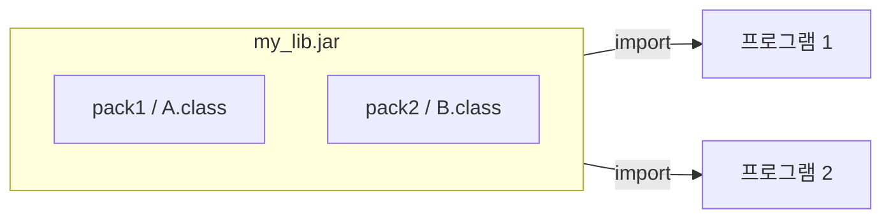


<div class="callout callout-summary" markdown="1">
<div class="callout-title callout-title--default" markdown="span">요약</div>

남이 이미 만들어 둔 부품 상자를 내 프로그램에 끼워 쓰는 방법이다. 자바에서는 번역이 끝난 파일들을 압축 파일 하나로 묶어 건네고, 받는 쪽은 그 파일이 어디 있는지만 알려 주면 된다. 같은 상자를 여러 프로그램이 함께 쓸 수 있어 편하다. 단, 번역할 때와 실행할 때 두 번 모두 위치를 알려 줘야 하고, 한쪽이라도 빠지면 부품을 못 찾아 멈춘다.

</div>


## 예시로 보기

클래스 `A`와 `B`를 잘 만들어 두었다고 하자. 다른 프로그램에서도 쓰고 싶다. 소스 파일을 프로그램마다 복사해 넣으면 고칠 때마다 복사본을 전부 다시 고쳐야 한다. 그래서 번역이 끝난 `.class` 파일만 한 묶음으로 만들어 두고, 프로그램들이 그 묶음을 가리키게 한다[^1].



묶음은 하나이고, 프로그램 둘이 같은 묶음에서 클래스를 가져다 쓴다[^s1].

직접 만들어 본다. 파일은 세 개다.

```java
// lib/pack1/A.java
package pack1;
public class A {
    public void method() { System.out.println("A.method()"); }
}
```

```java
// lib/pack2/B.java
package pack2;
public class B {
    public void method() { System.out.println("B.method()"); }
}
```

```java
// app/app/Main.java
package app;
import pack1.A;
import pack2.B;
public class Main {
    public static void main(String[] args) {
        A a = new A();
        a.method();
        B b = new B();
        b.method();
    }
}
```

먼저 `A`와 `B`를 번역해 묶는다. `jar tf`는 묶음 안에 든 파일 이름을 보여 준다.

```text
$ javac -d lib_out lib/pack1/A.java lib/pack2/B.java
$ jar cf my_lib.jar -C lib_out .
$ jar tf my_lib.jar
META-INF/
META-INF/MANIFEST.MF
pack1/
pack1/A.class
pack2/
pack2/B.class
```

묶음 안에서도 패키지 이름이 그대로 폴더가 된다. `META-INF/MANIFEST.MF`는 `jar` 명령이 넣어 주는 설명 파일이다.

이제 `Main`을 번역한다. 묶음이 어디 있는지 알려 주지 않으면 번역기가 `pack1`을 찾지 못한다.

```text
$ javac -d app_out app/app/Main.java
app/app/Main.java:2: error: package pack1 does not exist
import pack1.A;
            ^
```

`-cp`로 묶음의 위치를 알려 주면 번역된다. 그런데 실행할 때 또 알려 주지 않으면 이번에는 실행 중에 멈춘다.

```text
$ javac -cp my_lib.jar -d app_out app/app/Main.java
$ java -cp app_out app.Main
Exception in thread "main" java.lang.NoClassDefFoundError: pack1/A
$ java -cp my_lib.jar:app_out app.Main
A.method()
B.method()
```

`Main.class` 안에는 `A`의 코드가 들어 있지 않다. "`pack1.A`를 쓴다"는 이름만 적혀 있다. 그래서 실행할 때도 진짜 `A.class`가 있는 곳을 다시 알려 줘야 한다[^s2].

<div class="callout callout-check" markdown="1">
<div class="callout-title" markdown="span">검증: 위 명령 일곱 줄과 출력·오류 문구를 JDK 21(eclipse-temurin:21-jdk)에서 그대로 실행해 확인했다. 파일이 셋이라 한 파일짜리 코드로는 두지 않았다.</div>

</div>


## 정의

**라이브러리**는 프로그램을 만들 때 가져다 쓸 수 있는 클래스와 인터페이스의 모음이다. 보통 **JAR 파일**(`.jar`) 하나로 건넨다. JAR 파일은 클래스와 인터페이스를 번역한 바이트코드 파일(`.class`)들을 담은 압축 묶음이다[^1].

라이브러리 JAR를 쓰려면 그 파일을 **클래스패스**에 넣어야 한다. 클래스패스(ClassPath)는 자바가 클래스를 찾으러 다니는 길의 목록이다. 넣는 방법은 어디서 실행하느냐에 따라 다르다[^2].

| 실행하는 곳 | 클래스패스에 넣는 방법 |
|---|---|
| 명령 창(터미널) | 명령에 `-classpath`(줄여서 `-cp`)로 길을 적는다 |
| 명령 창(터미널) | `CLASSPATH`라는 환경 변수에 길을 적어 둔다 |
| 개발 도구(이클립스 등) | 프로젝트의 Build Path에 JAR를 추가한다 |

길을 여러 개 적을 때는 맥과 리눅스에서는 `:`로, 윈도우에서는 `;`로 나눈다[^s2].

## 활용

- 번역(`javac`)과 실행(`java`) 두 번 모두 클래스패스가 필요하다. 번역 때 빠지면 `package … does not exist`, 실행 때 빠지면 `NoClassDefFoundError`가 난다. 오류가 언제 났는지를 보면 어느 쪽에서 빠뜨렸는지 알 수 있다.
- 실행할 때는 라이브러리뿐 아니라 내 프로그램의 `.class`가 있는 폴더도 같이 적는다. 위 예에서 `my_lib.jar:app_out` 두 곳을 다 적은 이유다.
- 라이브러리 JAR 안의 `public` 클래스는 전부 꺼내 쓸 수 있다. 만든 사람이 "이 패키지는 안에서만 쓰려고 만든 것"이라고 막을 방법이 없다. 이것을 막는 장치가 [모듈](/Hongs_Blog/studies/java/java-module/)이다.

## 연결

- 선수: [패키지](/Hongs_Blog/studies/java/java-package/)(JAR 안의 폴더 구조가 곧 패키지 이름이다), [JVM과 바이트코드](/Hongs_Blog/studies/java/jvm-bytecode/)(JAR에 담기는 것은 소스가 아니라 바이트코드다)
- 다음: [모듈](/Hongs_Blog/studies/java/java-module/). 라이브러리에 "어느 패키지를 내보일지"와 "무엇이 필요한지"를 적어 넣은 것이다.
- 클래스 하나를 밖에서 쓸 수 있는지는 [접근 제한자](/Hongs_Blog/studies/java/java-access-modifier/)가 정한다. 라이브러리 JAR에서는 이것이 유일한 울타리다.

## 확인 문제

<details class="callout callout-question" markdown="1">
<summary class="callout-title" markdown="span">**C1** 라이브러리 JAR 파일 안에는 무엇이 들어 있는가? 그리고 그것을 쓰려면 어디에 넣어야 하는가?</summary>

**답:** 클래스와 인터페이스를 번역한 바이트코드 파일(`.class`)이 패키지 폴더 구조 그대로 들어 있다. 쓰려면 클래스패스에 넣는다. 명령 창에서는 `-classpath` 옵션이나 `CLASSPATH` 환경 변수로, 개발 도구에서는 프로젝트의 Build Path로 넣는다.<br>
**이유:** 소스 파일(`.java`)이 들어 있다고 답하면 틀린다. 받는 쪽은 번역을 다시 하지 않는다.

</details>


<details class="callout callout-question" markdown="1">
<summary class="callout-title" markdown="span">**C2** `javac -cp my_lib.jar -d app_out app/app/Main.java`는 잘 끝났다. 이어서 `java -cp app_out app.Main`을 실행하면 어떻게 되는가? ① 정상 출력 ② 번역 오류 `package pack1 does not exist` ③ 실행 중 `NoClassDefFoundError`</summary>

**답:** ③이다.<br>
**이유:** 번역은 이미 끝났으니 ②는 나올 수 없다. `Main.class`에는 `A`의 이름만 적혀 있고 코드는 없다. 실행할 때 클래스패스에 `my_lib.jar`가 없으면 `A.class`를 찾지 못해 실행 중에 멈춘다. `java -cp my_lib.jar:app_out app.Main`으로 고친다.

</details>


<details class="callout callout-question" markdown="1">
<summary class="callout-title" markdown="span">**C3** 클래스 `A`를 프로그램 두 개가 쓴다. `A.java`를 두 프로그램에 복사해 넣는 대신 JAR로 묶어 쓰면 무엇이 좋은가?</summary>

**답:** `A`를 고칠 때 묶음 하나만 다시 만들면 된다. 복사해 넣으면 복사본마다 따로 고쳐야 하고, 한쪽을 빠뜨리면 두 프로그램이 서로 다른 `A`를 쓰게 된다.<br>
**이유:** 라이브러리는 "한 곳에 두고 여럿이 가리킨다"는 점이 핵심이다.

</details>


[^1]: 소프트웨어 프로젝트 14회 강의 자료 「Software Project 14. Libraries and Modules」, p.4 (라이브러리의 뜻, JAR 파일, 프로그램 둘이 import하는 그림)
[^2]: 같은 자료, p.5 (클래스패스에 넣는 세 가지 방법)
[^s1]: <span class="fn-tag" title="수업 자료에 없고 따로 보탠 내용">보충</span> 다이어그램은 원본 p.4의 그림을 Mermaid로 다시 그린 것이다. 묶음 이름 `my_lib.jar`는 원본의 `~.jar` 자리에 붙인 예시 이름이다.
[^s2]: <span class="fn-tag" title="수업 자료에 없고 따로 보탠 내용">보충</span> 파일 세 개, 명령과 출력, 번역 때와 실행 때 두 번 필요하다는 설명, 길 구분 기호(`:`와 `;`), 카드 C2·C3는 원본에 없다. 원본 p.5는 방법 세 가지만 나열한다. 명령과 출력은 JDK 21에서 직접 실행해 확인했다.

