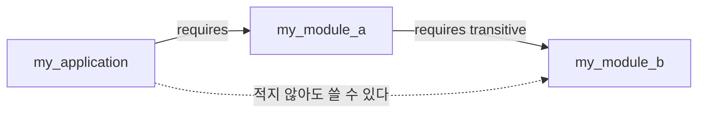


<div class="callout callout-summary" markdown="1">
<div class="callout-title callout-title--default" markdown="span">요약</div>

부품 상자에 안내문 한 장을 붙인 것이다. 안내문에는 "이 칸은 손님이 써도 된다"와 "이 상자를 쓰려면 저 상자도 있어야 한다"가 적혀 있다. 안내문에 적지 않은 칸은 밖에서 아예 보이지 않으므로, 만든 사람이 안쪽을 마음대로 고쳐도 쓰는 사람의 코드는 깨지지 않는다. 대신 필요한 상자를 빠짐없이 적어야 하고, 하나라도 빠지면 번역 단계에서 막힌다.

</div>


## 예시로 보기

[라이브러리 JAR](/Hongs_Blog/studies/java/java-library-jar/)에서는 `public` 클래스를 누구나 꺼내 쓸 수 있다. 만든 사람이 안에서만 쓰려고 둔 클래스까지 남이 쓰기 시작하면, 그 클래스를 고칠 때마다 남의 프로그램이 깨진다. 모듈은 패키지 단위로 "밖에 내보일 것"을 고른다[^1].

모듈 `my_module_a`에 패키지 `pack1`과 `pack2`가 있다. `pack1`의 `A`만 밖에서 쓰게 하고, `pack2`의 `B`는 `A`가 안에서만 쓴다. 폴더 맨 위에 `module-info.java`를 하나 둔다.

```text
src/
├── my_module_a/
│   ├── module-info.java
│   ├── pack1/A.java
│   └── pack2/B.java
└── my_application/
    ├── module-info.java
    └── app/Main.java
```

```java
// src/my_module_a/module-info.java
module my_module_a {
    exports pack1;
}
```

```java
// src/my_application/module-info.java
module my_application {
    requires my_module_a;
}
```

`Main`이 `pack1.A`를 쓰면 잘 돈다. `A.method()`는 안에서 `B.method()`를 부른다.

```text
$ javac -d out --module-source-path src $(find src -name '*.java')
$ java --module-path out -m my_application/app.Main
A.method()
B.method()
```

`Main`에 `import pack2.B;`를 넣으면 번역이 막힌다. `B`가 `public` 클래스인데도 그렇다.

```text
src/my_application/app/Main.java:3: error: package pack2 is not visible
import pack2.B;
       ^
  (package pack2 is declared in module my_module_a, which does not export it)
```

오류 문구가 이유를 그대로 말한다. `pack2`는 `my_module_a` 안에 있지만 그 모듈이 내보내지 않았다[^s1].

<div class="callout callout-check" markdown="1">
<div class="callout-title" markdown="span">검증: 이 문서의 모든 명령, 출력, 오류 문구를 JDK 21(eclipse-temurin:21-jdk)에서 직접 실행해 확인했다. 모듈은 폴더와 파일이 여럿 필요해 한 파일짜리 코드로는 두지 않았다.</div>

</div>


## 정의

**모듈**은 패키지를 관리하는 기능을 넣은 라이브러리다. 자바 9부터 쓸 수 있다. 모듈은 패키지 일부를 숨겨 밖에서 못 쓰게 할 수 있다[^1].

**모듈 기술자**(`module-info.java`)는 모듈에 붙이는 안내문이다. 모듈 소스 폴더의 맨 위에 둔다. 세 가지를 적는다[^2].

| 적는 것 | 쓰는 말 | 뜻 |
|---|---|---|
| 모듈 이름 | `module 이름 { … }` | 이 모듈을 이렇게 부른다 |
| 필요한 모듈 | `requires 모듈이름;` | 이 모듈을 쓰려면 저 모듈이 있어야 한다 |
| 내보내는 패키지 | `exports 패키지이름;` | 이 패키지는 다른 모듈이 써도 된다 |

`exports`에 적지 않은 패키지는 저절로 숨는다(패키지 은닉)[^3].

<div class="callout callout-warning" markdown="1">
<div class="callout-title" markdown="span">원본 오류 의심</div>

원문: 14회 p.9 "using the require keyword", 16회 p.7 "without 'require'" / 문제점: 자바의 실제 낱말은 끝에 s가 붙은 `requires`다. 같은 자료 p.12~16의 코드에도 `requires`로 적혀 있다. / 수정안: `requires` / 근거: `require`로 적으면 `module directive keyword or '}' expected` 오류로 번역되지 않는다(JDK 21). 이 문서의 모든 예는 `requires`로 번역·실행했다.<br>
원문: 14회 p.8 코드 창 제목 `Hello.java`, 안의 클래스는 `public class Main` / 문제점: `public` 클래스 이름과 파일 이름이 다르면 번역되지 않는다. / 수정안: 파일 이름 `Main.java` / 근거: `class Main is public, should be declared in a file named Main.java`(JDK 21).

</div>


### 왜 패키지를 숨기는가

슬라이드는 이유를 두 가지 든다[^4].

- **쓰는 길을 하나로 맞춘다.** `pack2`, `pack3`을 밖에서 못 쓰게 하면 모두가 `pack1`을 거쳐서만 모듈을 쓴다.
- **고치기 쉽다.** 성능을 올리려고 `pack2`, `pack3`을 뜯어고쳐도, 밖에서 쓰는 방법(`pack1`)이 그대로이므로 쓰는 쪽은 아무것도 바꿀 필요가 없다.

모듈끼리 누가 누구를 필요로 하는지가 `module-info.java`에 적혀 있으므로, 큰 프로그램을 기능별 모듈로 나눠 만들 때 관계를 한눈에 볼 수 있다. 나눠 둔 모듈은 다른 프로그램에서 다시 쓰기도 쉽다[^5].

### 건너서 필요한 모듈: transitive

`my_application`이 `my_module_a`를 필요로 하고, `my_module_a`가 `my_module_b`를 필요로 한다. 여기서 `A`의 메서드가 `my_module_b`의 `C` 객체를 돌려준다면 어떻게 될까[^6]?

```java
// my_module_a 의 pack1/A.java
public C getC() { return new C(); }      // C는 my_module_b의 pack3에 있다
```

```java
// my_application 의 Main.java
A a = new A();
C c = a.getC();
```

`my_application`의 안내문에는 `requires my_module_a;`만 있다. `my_module_b`를 적지 않았으므로 `C`를 쓸 수 없다.

```text
src/my_application/app/Main.java:3: error: package pack3 is not visible
import pack3.C;
       ^
  (package pack3 is declared in module my_module_b, but module my_application does not read it)
```

`my_application`에 `requires my_module_b;`를 한 줄 더 적어도 풀린다. 하지만 `my_module_a`를 쓰는 모든 프로그램이 그 줄을 적어야 한다. 그 대신 `my_module_a` 쪽에서 "나를 쓰는 모듈은 `my_module_b`도 같이 쓰게 해 준다"고 적는다. `requires` 뒤에 `transitive`를 붙인다(전이 의존)[^7].

```java
module my_module_a {
    exports pack1;
    requires transitive my_module_b;
}
```



실선은 안내문에 직접 적은 관계다. 점선은 `transitive` 덕분에 따라오는 관계다[^s2]. 이렇게 고치면 `my_application`의 안내문은 그대로인데 번역되고, 실행하면 `C.method()`가 찍힌다.

### 여러 모듈을 한 이름으로: 집합 모듈

자주 같이 쓰는 모듈들을 한데 묶은 모듈이다. 자기 패키지는 없고, 안내문에 `requires transitive`만 늘어놓는다. 쓰는 쪽은 모듈을 하나하나 적지 않고 집합 모듈 하나만 적는다[^8].

```java
module my_module {
    requires transitive my_module_a;
    requires transitive my_module_b;
}
```

`my_application`이 `requires my_module;` 한 줄만 적어도 `A`와 `C`를 모두 쓸 수 있다. JDK에도 이런 모듈이 있다. `java --describe-module java.se`를 실행하면 `requires java.sql transitive`, `requires java.desktop transitive` 같은 줄만 열아홉 개 나오고 `exports` 줄은 없다[^s3].

### 실행 중에 속을 들여다보게 허락하기: opens

프로그램이 실행 중에 클래스의 이름, 필드, 메서드를 조사하는 일을 리플렉션(reflection)이라 부른다. 숨긴 패키지는 다른 모듈이 리플렉션으로도 건드릴 수 없다. 허락하려면 안내문에 적는다[^9].

| 적는 법 | 허락 범위 |
|---|---|
| `open module 모듈이름 { … }` | 모듈 전체 |
| `opens 패키지이름;` | 그 패키지만 |
| `opens 패키지이름 to 모듈이름, …;` | 그 패키지를, 적어 준 모듈에게만 |

`my_application`이 리플렉션으로 `pack2.B` 객체를 만들고 `private` 필드 `secret`(값 `"hidden"`)을 읽어 본다[^s4].

| `my_module_a`의 안내문 | 실행 결과 |
|---|---|
| `opens` 없음 | `IllegalAccessException: … module my_module_a does not export pack2 to module my_application` |
| `opens pack2;` | `secret = hidden` |
| `opens pack2 to my_application;` | `secret = hidden` |
| `opens pack2 to my_module_b;` | `IllegalAccessException` (허락받은 모듈이 아니다) |
| `open module my_module_a { … }` | `secret = hidden` |

`opens`는 실행 중의 들여다보기만 허락한다. `opens pack2;`가 있어도 `Main`에 `import pack2.B;`를 쓰면 번역 단계에서 똑같이 `package pack2 is not visible`로 막힌다. 코드에서 이름으로 쓰려면 `exports`가 필요하다[^s4].

### 모듈을 JAR로 건네기

모듈을 다 만들면 바이트코드 파일을 JAR 하나로 묶어 다른 모듈이 쉽게 쓰게 한다[^10]. 슬라이드는 이클립스에서 모듈마다 `dist` 폴더에 `my_module_a.jar`, `my_module_b.jar`를 만든다. 명령 창에서는 이렇게 한다[^s5].

```text
$ jar --create --file dist/my_module_a.jar -C out/my_module_a .
$ jar --create --file dist/my_module_b.jar -C out/my_module_b .
$ jar --create --file dist/my_application.jar --main-class app.Main -C out/my_application .
$ jar --describe-module --file dist/my_module_a.jar
exports pack1
requires java.base mandated
requires my_module_b transitive
contains pack2
$ java --module-path dist -m my_application
C.method()
```

`--describe-module`은 JAR에 든 안내문을 읽어 준다. 내보내는 `pack1`은 `exports`로, 숨긴 `pack2`는 `contains`로 나온다. 적은 적 없는 `requires java.base`가 한 줄 끼어 있다.

### java.base와 API 문서

`java.base`는 모든 모듈이 기대는 기본 모듈이다. `requires`로 적지 않아도 쓸 수 있는 모듈은 이것 하나뿐이다[^11]. 위 출력의 `requires java.base mandated`가 그 흔적이다. `mandated`는 "적지 않아도 넣는다"는 표시다[^s5].

| `java.base`의 패키지 | 들어 있는 것 |
|---|---|
| `java.lang` | 자바 언어의 기본 클래스 |
| `java.util` | 자료 구조와 관련된 컬렉션 클래스 |
| `java.text` | 날짜와 숫자를 원하는 꼴의 문자열로 바꾸는 클래스 |
| `java.time` | 날짜와 시간을 다루고 계산하는 클래스 |
| `java.io` | 입출력 스트림 클래스 |
| `java.net` | 네트워크 통신 클래스 |
| `java.nio` | 데이터를 담아 두는 버퍼와 새 입출력 클래스 |

이 가운데 `java.lang`의 클래스와 인터페이스는 `import` 없이 쓴다[^12].

| `java.lang`의 클래스 | 쓰는 곳 |
|---|---|
| `Object` | 모든 자바 클래스의 맨 위 부모 |
| `System` | 키보드 입력, 화면 출력, 프로그램 끝내기, 걸린 시간 재기, 시스템 정보 읽기 |
| `String` | 문자열을 담고 다루기 |
| `Math` | 수학 계산 |

표준 모듈이 내놓는 클래스를 찾아 쓰는 법은 **API 문서**에 있다. JDK 버전마다 따로 있고, 주소는 `https://docs.oracle.com/en/java/javase/index.html`이다[^13]. 슬라이드 그림에서 프로그램 쪽 화살표는 `java.base` 안 클래스 `A`의 `public` 메서드와 `protected` 메서드에만 닿는다. 접근 제한자가 없는 메서드와 `private` 메서드에는 닿지 않는다[^14]. 다른 모듈의 다른 패키지에서는 앞의 두 종류만 쓸 수 있기 때문이다(`protected`는 상속받은 자식 클래스 안에서). 그래서 API 문서를 읽을 때도 이 두 종류만 보면 된다[^s6].

화면에 창과 버튼을 띄우는 클래스는 `java.base`에 없다. JDK는 창, 메뉴, 버튼, 목록 같은 화면 부품으로 프로그램을 만들도록 JFC(Java Foundation Classes)라는 클래스 모음을 준다. 그 안에 AWT(`java.awt` 패키지)와 Swing(`javax.swing` 패키지)이 있다. AWT는 운영체제가 가진 화면 부품을 빌려 쓰고, Swing은 부품을 자바로 직접 그린다[^15]. 이 두 패키지는 `java.desktop` 모듈에 있다. 그래서 `module-info.java`가 있는 프로그램에서 `import javax.swing.JFrame;`만 쓰면 `package javax.swing is declared in module java.desktop, but module my_application does not read it` 오류가 나고, `requires java.desktop;`을 적어야 번역된다[^s6].

## 활용

- 오류 문구의 괄호 안을 읽으면 무엇을 고칠지 바로 나온다. `which does not export it`이면 만든 쪽 모듈에 `exports`가 없는 것이고, `does not read it`이면 쓰는 쪽 모듈에 `requires`가 없는 것이다.
- `exports`와 `opens`를 섞지 않는다. `exports`는 코드에서 이름으로 쓰는 것을, `opens`는 실행 중에 속을 들여다보는 것을 허락한다.
- `module-info.java`가 없는 프로그램은 예전처럼 클래스패스로 돈다. 슬라이드의 화면 예제(`GUIexample`, 버튼을 누르면 알림 창이 뜬다)가 `requires` 없이 `javax.swing`을 쓰는 이유다[^16][^s6].

## 연결

- 선수: [라이브러리와 JAR](/Hongs_Blog/studies/java/java-library-jar/), [패키지](/Hongs_Blog/studies/java/java-package/)
- [접근 제한자](/Hongs_Blog/studies/java/java-access-modifier/)는 클래스와 멤버 하나하나에 울타리를 친다. 모듈은 그 바깥에 패키지 단위의 울타리를 한 겹 더 친다. `public` 클래스라도 패키지가 숨겨져 있으면 밖에서 못 쓴다.
- 안은 숨기고 쓰는 길만 내놓는다는 생각은 [객체 지향의 세 원칙](/Hongs_Blog/studies/java/oop-principles/)의 캡슐화와 같다. 크기만 객체에서 모듈로 커졌다.
- `java.lang`의 [String](/Hongs_Blog/studies/java/java-string/), 그리고 [예외 클래스](/Hongs_Blog/studies/java/java-exception/)들이 `java.base`에 들어 있다.

## 확인 문제

<details class="callout callout-question" markdown="1">
<summary class="callout-title" markdown="span">**C1** `module-info.java`에 적는 세 가지와, 각각에 쓰는 낱말을 쓰라. 적지 않은 패키지는 어떻게 되는가?</summary>

**답:** 모듈 이름(`module`), 필요한 모듈(`requires`), 내보내는 패키지(`exports`). `exports`에 적지 않은 패키지는 저절로 숨어 다른 모듈이 쓸 수 없다.<br>
**이유:** `require`가 아니라 `requires`다. 숨기려고 따로 적는 낱말은 없다. 안 적으면 숨는다.

</details>


<details class="callout callout-question" markdown="1">
<summary class="callout-title" markdown="span">**C2** `my_module_a`는 `exports pack1; requires my_module_b;`를, `my_module_b`는 `exports pack3;`를, `my_application`은 `requires my_module_a;`를 적었다. `my_application`의 `Main.java`에서 번역이 막히는 줄을 모두 고르라. ① `import pack1.A;` ② `import pack2.B;` ③ `import pack3.C;`</summary>

**답:** ②와 ③이다.<br>
**이유:** ②는 `my_module_a`가 `pack2`를 내보내지 않아서다(`which does not export it`). ③은 `pack3`이 내보내져 있지만 `my_application`이 `my_module_b`를 `requires`하지 않아서다(`does not read it`). ③은 `my_module_a`의 줄을 `requires transitive my_module_b;`로 바꾸면 풀린다. ②는 그래도 안 풀린다.

</details>


<details class="callout callout-question" markdown="1">
<summary class="callout-title" markdown="span">**C3** `A`의 메서드가 `my_module_b`의 `C`를 돌려줄 때, `my_application`에 `requires my_module_b;`를 적는 대신 `my_module_a`에 `transitive`를 붙이는 쪽이 나은 이유는?</summary>

**답:** `C`를 돌려주기로 한 것은 `my_module_a`다. 그 결정 때문에 생긴 필요를 `my_module_a`를 쓰는 모든 프로그램이 각자 알아내서 적게 하면, 하나라도 빠뜨린 프로그램은 번역이 막힌다. `my_module_a`가 한 번 `transitive`를 적어 두면 쓰는 쪽은 `requires my_module_a;` 한 줄로 끝난다.<br>
**이유:** 집합 모듈도 같은 장치를 쓴다. `requires transitive`만 모아 둔 모듈이다.

</details>


<details class="callout callout-question" markdown="1">
<summary class="callout-title" markdown="span">**C4** `my_module_a`에 `opens pack2;`만 있고 `exports pack2;`는 없다. `my_application`에서 ① `import pack2.B;`로 `new B()` 하기 ② 리플렉션으로 `pack2.B`의 `private` 필드 읽기 가운데 되는 것은?</summary>

**답:** ②만 된다.<br>
**이유:** `opens`는 실행 중에 속을 들여다보는 것만 허락한다. ①은 번역 단계에서 `package pack2 is not visible`로 막힌다. ①까지 되게 하려면 `exports pack2;`가 필요하다.

</details>


[^1]: 소프트웨어 프로젝트 14회 강의 자료 「Software Project 14. Libraries and Modules」, p.6 (모듈의 뜻, 패키지별 use/hide 그림)
[^2]: 같은 자료, p.9 (모듈 기술자와 세 가지 요소)
[^3]: 같은 자료, p.10 (exports와 자동 은닉, Pack1만 내보내는 그림)
[^4]: 같은 자료, p.11 (패키지를 숨기는 두 가지 이유)
[^5]: 같은 자료, p.7 (모듈 사이 의존 관계, 기능별 모듈화)
[^6]: 같은 자료, p.12~13 (전이 의존, "What if?"와 Compile error)
[^7]: 같은 자료, p.14~15 (requires transitive)
[^8]: 같은 자료, p.16 (집합 모듈)
[^9]: 같은 자료, p.17 (리플렉션과 open, opens, opens … to)
[^10]: 같은 자료, p.8 (모듈 배포용 JAR, 이클립스의 dist 폴더)
[^11]: 소프트웨어 프로젝트 16회 강의 자료 「Software Project 16. java.base Module」, p.7 (java.base와 패키지 표)
[^12]: 같은 자료, p.8 (java.lang과 클래스 표)
[^13]: 같은 자료, p.3 (API 문서와 주소)
[^14]: 같은 자료, p.4~6 (App에서 클래스 A의 public·protected 메서드로 가는 화살표 그림)
[^15]: 같은 자료, p.11 (JFC, AWT, Swing)
[^16]: 같은 자료, p.12 (GUI example: JFrame, JButton, ActionListener, JOptionPane)
[^s1]: <span class="fn-tag" title="수업 자료에 없고 따로 보탠 내용">보충</span> 폴더 구조, 명령, 출력, 오류 문구는 원본에 없다. 원본 p.8·p.10의 모듈과 패키지 이름을 써서 다시 만들고 JDK 21에서 직접 실행해 확인했다. `A`가 안에서 `B`를 부르게 한 것은 원본 p.10 그림의 Pack1 → Pack2 화살표를 따른 것이다.
[^s2]: <span class="fn-tag" title="수업 자료에 없고 따로 보탠 내용">보충</span> 다이어그램은 원본 p.15의 그림을 Mermaid로 다시 그린 것이다. 메서드 이름 `getC`는 원본의 `a.method()` 자리에 붙인 이름이다. 오류 문구와 `transitive`를 붙인 뒤의 실행 결과는 JDK 21에서 직접 실행해 확인했다.
[^s3]: <span class="fn-tag" title="수업 자료에 없고 따로 보탠 내용">보충</span> `java.se` 예는 원본에 없다. JDK 21에서 `java --describe-module java.se`를 직접 실행해 `requires … transitive` 줄이 19개이고 `exports` 줄이 없는 것을 확인했다. 집합 모듈로 `A`와 `C`를 쓰는 실행도 같이 확인했다.
[^s4]: <span class="fn-tag" title="수업 자료에 없고 따로 보탠 내용">보충</span> 표의 다섯 경우와 "`opens`만으로는 `import`할 수 없다"는 원본에 없다. `Class.forName("pack2.B")`으로 객체를 만들고 `setAccessible(true)`로 `private` 필드를 읽는 코드를 JDK 21에서 직접 실행해 확인했다.
[^s5]: <span class="fn-tag" title="수업 자료에 없고 따로 보탠 내용">보충</span> `jar` 명령과 `--describe-module` 출력, `mandated`의 뜻은 원본에 없다. JDK 21에서 직접 실행해 확인했다. 출력 첫 줄(JAR 파일 위치)은 뺐다.
[^s6]: <span class="fn-tag" title="수업 자료에 없고 따로 보탠 내용">보충</span> 그림의 화살표를 "다른 모듈에서 쓸 수 있는 것은 `public`과 `protected`뿐"으로 읽은 것은 해석이다. 원본에는 그림만 있고 설명 글이 없다. `javax.swing`이 `java.desktop` 모듈에 있다는 것과 오류 문구는 JDK 21에서 직접 실행해 확인했다(`JFrame.class.getModule().getName()`이 `java.desktop`, `String`은 `java.base`). `module-info.java`가 없는 프로그램이 클래스패스로 돈다는 설명도 원본에 없다.

